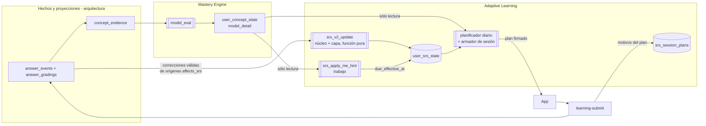
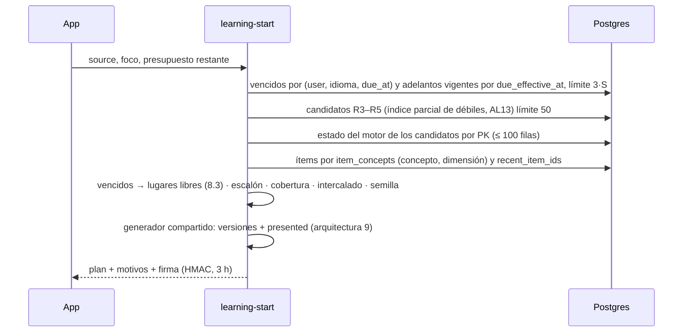
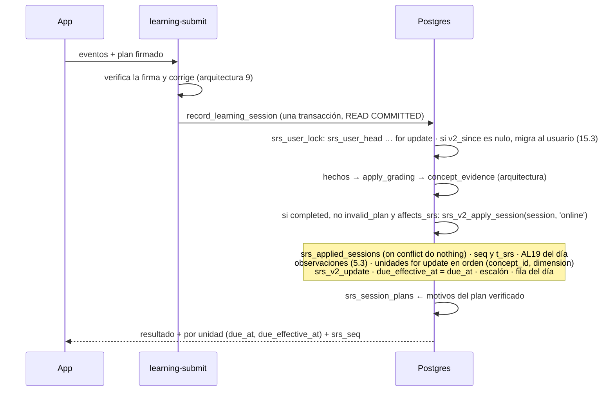
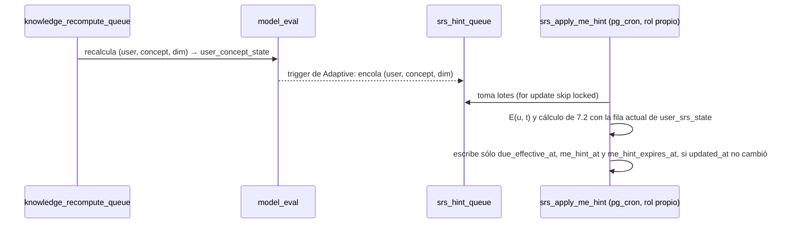

# Adaptive Learning: SRS v2 y planificación adaptativa

> **Fase 5-AL, etapa 2.** **Estado: APROBADO — DISEÑO CERRADO** (revisión 4.2, aprobada el
> 2026-11-07; ver 21). AL1–AL22 (19) están aprobadas tal como las define la revisión 4.2.
> Construye sobre la auditoría de la etapa 1 (sus nueve orientaciones están aprobadas), la
> arquitectura de datos (`docs/LEARNING_DATA_ARCHITECTURE.md`, rev. 8, aprobada) y el Mastery
> Engine (`docs/MASTERY_ENGINE_DESIGN.md`, rev. 2, aprobada). No modifica ninguno de los dos.
>
> Este documento no implementa nada: no hay código, SQL ni migraciones. Las simulaciones se
> corrieron con un simulador fuera del repositorio (apéndice A). **La aprobación cierra el diseño;
> no autoriza la implementación**, que requiere una confirmación aparte.

**Convención.** Cada sección indica el estado que tenía al proponerse; las etiquetas se conservan
como historial:

- **[Decidido]**: principios aprobados por el usuario o restricciones heredadas de los documentos
  aprobados.
- **[Propuesto]**: diseño de este documento, propuesto en las revisiones 1–4.2 y **aprobado el
  2026-11-07** con la sección 19. Los valores de 19.3 quedan aprobados como valores iniciales
  provisionales y las decisiones de 19.4 siguen dependiendo de datos reales.

---

## Cambios de la revisión 4.2

La revisión 4.2 hace tres precisiones sobre la 4.1. **No cambia el núcleo FSRS-4.5, sus fórmulas ni
sus pesos, no reabre AL1–AL22 y no recalcula ninguna simulación.** Las tablas de 9.6–9.8 siguen siendo
resultados de las simulaciones; ninguna evalúa la política de inicialización de C39.

| #   | Tema                                 | Revisión 4.1                                                                                                                                                                               | Revisión 4.2                                                                                                                                                                                                                                                                                                                                                                                                                                                       |
| --- | ------------------------------------ | ------------------------------------------------------------------------------------------------------------------------------------------------------------------------------------------ | ------------------------------------------------------------------------------------------------------------------------------------------------------------------------------------------------------------------------------------------------------------------------------------------------------------------------------------------------------------------------------------------------------------------------------------------------------------------- |
| C39 | Arranque de AL19 en la migración     | 15.3: al reconstruir las sesiones históricas se generaban filas de deuda con el `B` vigente en la migración, porque las metas pasadas no se registraron. AL19 las usaba para entrar y salir | **Las sesiones `replay` no evalúan AL19 ni escriben filas de deuda.** El historial del SRS se reconstruye igual. Las mediciones de AL19 se **inicializan en el corte**: estado inactivo, `I_max` 45, rachas en 0, `measured_since = v2_since` y `evaluated_on` = día local del corte. El primer día medido es el primer día de estudio posterior al del corte. **La entrada normal exige 15 días de estudio medidos.** Durante la inicialización rige `I_max` 45. **No se propone una protección excepcional** para quien migra con mucha deuda; si el inventario la justifica, se diseña aparte y nunca como entrada de AL19 (9.7) |
| C40 | Orden de las sesiones reconstruidas  | 15.3 ordenaba por (`completed_at`, `session_id`) sin decir qué garantiza                                                                                                                   | Se distinguen dos órdenes. **Sesiones nuevas:** el de aplicación y confirmación, impuesto por `srs_user_head`, con `seq` y `t_srs`. **Sesiones históricas:** un orden canónico determinista (`completed_at`, `session_id`). Como `completed_at` es el inicio de la transacción, **no garantiza reproducir el orden de commit original**. La verificación por unidad contra `user_word_progress` y la conversión de lo que no coincide se mantienen (13.3, 15.3)                                                                                      |
| C41 | Cota de `P`                          | 13.2: «`P` es un entero menor que 10⁸»                                                                                                                                                     | «**menor o igual que** 10⁸»: `s4` 10 000 y `a4` 10 000 dan exactamente 10⁸                                                                                                                                                                                                                                                                                                                                                                                         |

## Cambios de la revisión 4.1 (historial)

La revisión 4.1 es una revisión de coherencia. **No cambia el núcleo FSRS-4.5, los pesos ni ninguna
simulación general.** Las definiciones nuevas de AL8 y AL19 se contrastaron con el código del
simulador (`sim4.mjs`) para que describan exactamente lo que se simuló; por eso ninguna tabla de 9.6–9.8
se recalcula.

| #   | Tema                               | Revisión 4                                                                                                                                                          | Revisión 4.1                                                                                                                                                                                                                                                                                                                                                                                    |
| --- | ---------------------------------- | ------------------------------------------------------------------------------------------------------------------------------------------------------------------- | ----------------------------------------------------------------------------------------------------------------------------------------------------------------------------------------------------------------------------------------------------------------------------------------------------------------------------------------------------------------------------------------------- |
| C31 | Dos vías para aplicar sesiones     | 3.1 y 10.2: `srs_v2_update` dentro de `record_learning_session`. 11 y 15.3: toda sesión entra por `srs_v2_queue` y la procesa un trabajo en orden de `completed_at` | **Una sola vía:** la función `srs_v2_apply_session`, síncrona, dentro de la transacción del envío, serializada por usuario con un bloqueo sobre `srs_user_head`. El orden del SRS es el **orden de confirmación**, con un número de secuencia y una hora `t_srs` no decreciente por usuario. La migración llama a la misma función, usuario por usuario. `srs_v2_queue` desaparece (13.3, 15.3) |
| C32 | I3 de la sugerencia del motor      | `mín(due_at, máx(due_ME, piso))` con I3 sobre el timestamp: falla si `due_at` es anterior al inicio del día siguiente a `last_seen_at`                              | La fórmula se mantiene; se define cuándo **hay sugerencia** (`due_effective_at < due_at`). **I3a** (timestamp): toda sugerencia vigente es ≥ inicio del día siguiente a `last_seen_at`. **I3b** (elegibilidad): ninguna unidad es elegible el día local de `last_seen_at`, lo garantiza el planificador. Una exposición también anula la sugerencia. Vectores V1–V10 (7.2)                      |
| C33 | Persistencia de AL19               | «Un estado de deuda por usuario (fecha de entrada y contadores)», sin modelo                                                                                        | Tablas `srs_user_debt_state` y `srs_user_debt_days` (11). Evaluación una vez por día de estudio, en la primera aplicación del día, dentro de la misma transacción. Días sin estudio: no se evalúa nada (9.7)                                                                                                                                                                                    |
| C34 | `debt_items` y el 1,65             | `vencidos × 1,65`                                                                                                                                                   | 1,65 es la media del costo por unidad del simulador **antes** de descontar los ejercicios compartidos: sobreestima los ejercicios únicos. Queda como **supuesto provisional** y se reemplaza por `ipu`, ejercicios únicos por unidad atendida observados por usuario, con contracción hacia la media poblacional (9.7)                                                                          |
| C35 | Redondeo de `B` y de la reserva    | Sin definir (la tabla de 8.1 implicaba truncar)                                                                                                                     | `B = ⌊meta × ritmo⌋`; reserva = 20 % de `B` redondeado al entero más cercano (8.1–8.2)                                                                                                                                                                                                                                                                                                          |
| C36 | Ventana de AL8                     | «7 días de estudio» con espera máxima de 6 días                                                                                                                     | **7 días naturales**, que es lo que simuló `sim4.mjs`. Garantía en días naturales entre días de estudio; con ausencias, la plaza va en el primer día de estudio de la vuelta (8.3)                                                                                                                                                                                                              |
| C37 | «Sin lecciones mientras rige AL19» | Podía leerse como un bloqueo                                                                                                                                        | El planificador **no las recomienda** (reserva 0 %); el usuario puede hacerlas igual. Bloquear sigue pendiente (F7)                                                                                                                                                                                                                                                                             |
| C38 | Redondeo de `q`                    | «4 decimales» sin método. 13.2 decía «mitad al par» para lo guardado, que no es lo que hace `numeric` en PostgreSQL                                                 | Aritmética entera en diezmilésimos, **mitad hacia arriba**, idéntica en SQL y TS; nunca a partir de un `double`. Se separa la **continuidad** de las fórmulas (con `q` real) de la **discretización** de la entrada (T9 prueba la discretización). Pruebas Q1–Q12 (13.2). Lo guardado: mitad lejos de cero, como `numeric`                                                                      |

## Cambios de la revisión 4 (historial)

La revisión 4 cierra cinco cuestiones técnicas de la revisión 3 sin rehacer el diseño. **Se
corrigieron dos errores de la revisión 3**, uno de hecho y uno del simulador, y una definición de
AL19 que no hacía lo que decía:

- **De hecho:** FSRS-7 sí tiene una implementación oficial publicada (`ts-fsrs@6.0.0`).
- **Del simulador:** algunas sesiones superaban el presupuesto en hasta 2 ítems.
- **De AL19:** la condición de salida no se cumplía casi nunca, así que el tope de 90 días quedaba
  activado para siempre.

| #   | Tema                               | Revisión 3                                                                                              | Revisión 4                                                                                                                                                                                                                                                                                                                                                  |
| --- | ---------------------------------- | ------------------------------------------------------------------------------------------------------- | ----------------------------------------------------------------------------------------------------------------------------------------------------------------------------------------------------------------------------------------------------------------------------------------------------------------------------------------------------------- |
| C23 | Publicación de FSRS-7              | «No tiene versión publicada (sólo `main` de `fsrs-rs`)»                                                 | **Falso.** `ts-fsrs@6.0.0` (npm, 2026-10-28, etiqueta `v6.0.0` = commit `b69d6ca`) publica FSRS-7 y lo usa por defecto. Se verificó el paquete, se ejecutó su núcleo y se corrigieron todas las afirmaciones (4.8, 4.9, 16.2, apéndice C)                                                                                                                   |
| C24 | M1/M2 con FSRS-7                   | 115 violaciones con pesos ajustados, atribuidas a «la capa con FSRS-7»                                  | **Se reproducen exactamente** con el núcleo oficial (91 + 24, mismos casos). **El origen es el núcleo:** con esos pesos, una `D` más alta alarga el intervalo, y el núcleo solo, sin capa, programa más lejos después de _Again_ que después de _Good_ en hasta el 24 % de los estados. La capa puede evitarlo restringiendo dos pesos o el intervalo (4.9) |
| C25 | Comparación de núcleos             | FSRS-4.5 recomendado; FSRS-7 descartado por falta de versión y por M1/M2                                | Comparación rehecha (4.9) con el FSRS-7 oficial y con una variante restringida. **Se mantiene FSRS-4.5** por transferencia, simplicidad, migración y propiedades, no por falta de publicación                                                                                                                                                               |
| C26 | AL19: `I_max` dinámico             | Entra con deuda > 1·`B` 7 días; sale «al quedar al día» (en el simulador: ningún vencimiento en el día) | La salida de la revisión 3 casi nunca se cumple: en uso normal el tope de 90 quedaba encendido el 80–100 % del segundo año. **Nueva definición** con histéresis, entrada por tendencia, lecciones congeladas y salida por capacidad (9.7). D4 se vacía en GT-A y GT-C, **no en GT-B**: no hay garantía general                                              |
| C27 | AL8: plazas para débiles y sondeos | Un lugar mínimo diario                                                                                  | Comparación diaria / semanal / ninguna en cinco escenarios a 730 días (9.8). **Propuesta: una plaza mínima semanal**, siempre dentro de `B`                                                                                                                                                                                                                 |
| C28 | Auditoría del simulador            | Corrección C17 sin controles registrados                                                                | Ocho controles (9.9). Se encontró que **el 10–32 % de las sesiones superaba `B` en 1–2 ítems** (la última tanda se estimaba antes de jugarse). Corregido con presupuesto estricto: 0 sesiones por encima de `B`. Las ocho tablas de la revisión 3 se reproducen bit a bit con sus comandos                                                                  |
| C29 | Tablas de 4.8, 8 y 9               | Simulador con el exceso de C28                                                                          | **Recalculadas con presupuesto estricto.** Cambios: retención ±0,012, unidades ±2 %, deuda media ±2. Ninguna conclusión cambia; las diferencias menores que ~0,01 entre variantes quedan dentro del ruido del simulador y ya no se interpretan                                                                                                              |
| C30 | Sección 19                         | AL1–AL20 en una tabla                                                                                   | Cuatro grupos: principios aprobados, propuestas aprobables ahora, parámetros provisionales y decisiones que dependen de datos reales. Dos decisiones nuevas: **AL21** (presupuesto estricto) y **AL22** (ningún juego de pesos se activa sin pasar 5.10). Ninguna aprobada                                                                                  |

## Cambios de la revisión 3 (historial)

La revisión 3 responde a una revisión técnica de la revisión 2. No empieza de cero: corrige el
tratamiento de los resultados neutros, compara el núcleo con FSRS-6 y FSRS-7, estudia la deuda a
365 y 730 días, rehace el plan de migración y documenta fuentes y licencias. **Todas las cifras de
simulación de las secciones 4, 5, 8 y 9 se recalcularon**, porque además se encontró y corrigió un
error del simulador de sesiones (C17).

| #   | Tema                             | Revisión 2                                                                                                                                                     | Revisión 3                                                                                                                                                                                                                                                                                                    |
| --- | -------------------------------- | -------------------------------------------------------------------------------------------------------------------------------------------------------------- | ------------------------------------------------------------------------------------------------------------------------------------------------------------------------------------------------------------------------------------------------------------------------------------------------------------- |
| C12 | `q = 0,5`                        | Contaba como acierto de fuerza 0: en una unidad nueva daba `S = w2` (Good); en una existente podía bajar `D` y aplazaba `t_last` y `due_at`                    | **Neutro** (5.3): no es acierto ni error. Una sesión sin evidencia informativa es una **exposición**: se registra, pero no cambia `S`, `D`, `t_last`, `due_at`, escalón ni contadores. Una unidad nueva sólo expuesta queda sin `S` ni `D` y vence al día siguiente (5.5)                                     |
| C13 | Contradicción `c`                | Binaria: cualquier acierto de escalón igual o mayor reducía el error a la mitad                                                                                | **Continua** (5.3): `c = 1 − 0,5·C`, con `C` = fuerza del mejor acierto que contradice. Un neutro (`z` = 0) **no puede** atenuar un error; un acierto con ayudas (`z` 0,2) lo atenúa sólo un 10 %                                                                                                             |
| C14 | Aciertos y errores débiles       | Cualquier acierto, por débil que fuera, reiniciaba el reloj y aplazaba el repaso un intervalo completo. Un error débil podía **aplazar** un vencimiento futuro | Reloj y fechas proporcionales a la evidencia (5.4, 5.6). Nueva regla **E5**: un error nunca aplaza un vencimiento futuro. Comprobación sobre la rev. 2: «error débil + acierto» aplazaba 4,4 días un repaso que vencía (T8)                                                                                   |
| C15 | Dificultad                       | Reversión a la media por tramos, con saltos en el límite neutro                                                                                                | Una sola fórmula continua y monótona, válida para los tres núcleos (5.4)                                                                                                                                                                                                                                      |
| C16 | FSRS-4.5, FSRS-6 y FSRS-7        | Sólo FSRS-4.5                                                                                                                                                  | Comparación con el protocolo de 4.3 (4.8). **FSRS-7 predice mejor dentro de cada verdad, transfiere peor, no está publicado en una versión y no cumple dos propiedades de la capa. FSRS-6 iguala a FSRS-4.5.** Se recomienda **mantener FSRS-4.5** y dejar FSRS-6 como alternativa (AL1)                      |
| C17 | Simulador de sesiones            | Los ítems compartidos por dos unidades hacían «sobrar» presupuesto: con deuda seguían entrando lecciones                                                       | Corregido: la sesión toma vencidos en tandas hasta llenar el presupuesto real, y con deuda sin atender sólo entra la reserva. **Las tablas de 8 y 9 cambiaron**; las conclusiones cualitativas se mantienen, la deuda media bajó                                                                              |
| C18 | Deuda                            | «Acotada» en simulaciones de 150 días                                                                                                                          | 365 y 730 días, ocho escenarios (9.6). **La deuda sólo se mantiene acotada si se frena el contenido nuevo y el conjunto aprendido cabe en el presupuesto.** Si el usuario fuerza lecciones, crece sin límite (~240 unidades por mes). Con miles de pendientes tras bajar la meta, no llega a cero en 550 días |
| C19 | Puntos débiles y sondeos con 0 % | Sin medir la falta de lugar                                                                                                                                    | Con presupuesto saturado **no hay ningún lugar libre durante meses** (hasta 717 días en sobrecarga). Propuesta: un lugar mínimo por día (AL8)                                                                                                                                                                 |
| C20 | Migración                        | Reconstrucción vía `exercise_words` sin distinguir casos                                                                                                       | Tres categorías (reconstruible, convertible, irrecuperable), verificación de cada unidad rehaciendo v1, una sola cola y un registro de sesiones aplicadas para no contar dos veces, y un punto de corte verificable (15)                                                                                      |
| C21 | Licencias y «propio»             | «Verificar antes de implementar»                                                                                                                               | Fuentes con versión y commit exactos, licencias, diferencia entre fórmulas y código, y qué es de PolyGo (apéndice C)                                                                                                                                                                                          |
| C22 | Decisiones                       | AL1–AL18                                                                                                                                                       | Sección 19 actualizada; dos decisiones nuevas (AL19 y AL20). Ninguna aprobada                                                                                                                                                                                                                                 |

## Cambios de la revisión 2 (historial)

La revisión 2 responde a una revisión técnica de la revisión 1. Varias conclusiones de la revisión
1 **no resistieron** una evaluación más justa y se corrigieron.

| #   | Tema                      | Revisión 1                                                                                              | Revisión 2                                                                                                                                                                                                                                                                                                 |
| --- | ------------------------- | ------------------------------------------------------------------------------------------------------- | ---------------------------------------------------------------------------------------------------------------------------------------------------------------------------------------------------------------------------------------------------------------------------------------------------------- |
| C1  | Agregación por sesión     | Media ponderada: tres aciertos y un error daban un acierto neto (`h` 10 → 18,25) y el error desaparecía | **La evidencia negativa no se diluye** (5.3): cualquier error con masa `F ≥ 0,5` anula el crecimiento; los aciertos sólo atenúan el recorte, nunca lo anulan. Sesiones con error donde `S` sube: del 8–95 % al ≤ 5,4 % (sólo errores débiles)                                                              |
| C2  | Núcleo de memoria         | Modelo propio exponencial, presentado como «mejor calibrado» que FSRS                                   | **Ese resultado era un sesgo**: la calibración se medía en los repasos que el propio algoritmo programaba. Con ajuste comparable y validación con una verdad nueva, el núcleo exponencial predice peor y planifica peor. **Propuesta: núcleo FSRS-4.5 con pesos propios + capa de sesión de PolyGo** (AL1) |
| C3  | Práctica anticipada       | «Un acierto nunca empeora»; la reversión de la dificultad podía subirla                                 | Reglas E1–E4 precisas (5.7); un acierto anticipado no mueve la dificultad; un error anticipado sí cuenta y se explica por qué no contradice AL-P4                                                                                                                                                          |
| C4  | Límite del Mastery Engine | Descrito en texto                                                                                       | Especificación formal con elegibilidad, datos nulos, atrasados e insuficientes, e invariantes verificables (7.2)                                                                                                                                                                                           |
| C5  | Presupuesto               | 7,5 ejercicios/min presentado como estimación                                                           | Datos con tamaño de muestra y limitaciones (8.1): es un **supuesto de planificación**, no un parámetro calibrado                                                                                                                                                                                           |
| C6  | Reparto repaso/nuevo      | Reserva 20 % → 10 % con deuda > 2 sesiones                                                              | Con sesiones reales (varios ejercicios por unidad) **esa regla deja crecer la deuda sin límite** (hasta 520 pendientes). Propuesta: 20 % → 0 % cuando la deuda estimada en ítems supera una sesión                                                                                                         |
| C7  | Cupo de puntos débiles    | 15 % reservado, sin simular                                                                             | Simulado: reservar 15 % o 30 % **no mejora** la retención (ni de las unidades difíciles) y aumenta la deuda. Propuesta: 0 % reservado; puntos débiles y sondeos sólo con lugares libres; A/B                                                                                                               |
| C8  | Tope de intervalo `I_max` | 180 días, no identificable                                                                              | Con horizonte de 365 días es **el parámetro de mayor efecto**. Propuesta provisional: 45 días (AL9)                                                                                                                                                                                                        |
| C9  | v1                        | «Descartado: gasta 10–25 % más repasos»                                                                 | Falso en las simulaciones: a 365 días, v1 iguala o supera en retención por repaso a los planificadores adaptativos con topes largos. Se descarta **por los principios aprobados** (AL-P3, AL-P4, AL-P9), no por eficiencia                                                                                 |
| C10 | Validación matemática     | Propiedades enunciadas                                                                                  | 2,4 millones de comprobaciones automáticas (5.10); se encontraron y corrigieron dos errores de monotonía en la dificultad                                                                                                                                                                                  |
| C11 | Ejemplos                  | Trayectorias del núcleo exponencial                                                                     | Todos recalculados con el modelo propuesto (5.11). Los de la revisión 1 se eliminaron                                                                                                                                                                                                                      |

---

## 0. Resumen

- **Algoritmo [Propuesto, AL1].** `srs-2.0.0` es el algoritmo de PolyGo, con dos partes:
  - **Núcleo de memoria:** las fórmulas publicadas de FSRS-4.5 (dificultad `D`, estabilidad `S`,
    recuperabilidad `R` con curva potencia), con **pesos propios** que se ajustan con datos de
    PolyGo.
  - **Capa de sesión de PolyGo:** agregación de varias respuestas por unidad sin diluir errores,
    neutros y exposiciones, escalones con pesos `κ`, ayudas y resultados parciales, culpa repartida
    en ítems con varios conceptos, reglas de fechas E1–E5, reaprendizaje, tope de intervalo,
    dispersión determinista y elegibilidad por día local.
  - **Unidad programable:** `concept_id × dimension` (AL-P2).
  - El sistema integrado, la capa y el planificador son de PolyGo; las ecuaciones del núcleo son de
    FSRS, con atribución (apéndice C).
- **Por qué FSRS-4.5 y no FSRS-6 o FSRS-7 (4.8, 4.9).**
  - Con el mismo protocolo, **FSRS-6 no se distingue de FSRS-4.5**: predice algo mejor en una
    verdad y lo mismo en las otras dos, transfiere mejor en tres casos y peor en otros tres, y
    planifica igual (±0,01 de retención), con 4 pesos activos más. Se arranca con FSRS-4.5 y FSRS-6
    entra como candidato en el primer ajuste con datos reales (16.2).
  - **FSRS-7 está publicado** en `ts-fsrs@6.0.0` (2026-10-28), donde es el modelo por defecto. La
    revisión 3 decía lo contrario y estaba equivocada (C23). Se verificó contra ese paquete (4.9).
  - **FSRS-7 predice mejor dentro de cada verdad** (hasta −0,04 de pérdida en GT-C), pero es el
    **peor al transferir** entre verdades, necesita dos estabilidades e inversión numérica del
    intervalo, e infla `S` con repasos del mismo día.
  - **Con pesos ajustados, el propio núcleo FSRS-7 no es monótono:** una `D` más alta puede alargar
    el intervalo, y un _Again_ programar más lejos que un _Good_ (4.9). Eso causa las 115 violaciones
    de M1/M2. Restringir dos pesos lo evita; el costo en predicción está en 4.9.
  - Sus ventajas (intervalos de minutos y repasos del mismo día) **no se usan en PolyGo**: la capa
    agrega cada sesión y nunca programa dos repasos el mismo día local.
- **Por qué no el núcleo propio de la revisión 1.** Con el mismo protocolo, FSRS predice mejor en
  las tres verdades simuladas, incluida una verdad nueva congelada antes de ver resultados (GT-C).
  Ningún resultado demuestra superioridad en usuarios reales (sección 4).
- **Resultados neutros [Propuesto] (C12).** `q = 0,5` no es acierto ni error. Una sesión sin ninguna
  observación informativa se registra como **exposición** y no cambia el modelo: ni estabilidad, ni
  dificultad, ni fecha. Un neutro tampoco puede atenuar un error.
- **Errores [Propuesto].**
  - Nunca se resetea nada.
  - Un error aplica la estabilidad post-olvido del núcleo, en proporción a su fuerza, sube `D` y,
    si es pleno, deja un reaprendizaje al día siguiente.
  - Los aciertos de la misma sesión no lo borran, y un error nunca aplaza un vencimiento futuro (E5).
- **Práctica anticipada [Propuesto].** Un acierto anticipado nunca baja `S`, no mueve `D` hacia
  arriba y nunca adelanta el vencimiento. Un error anticipado es evidencia válida (5.7).
- **Mastery Engine [Propuesto, dentro de un principio decidido].**
  - El SRS es la única autoridad del vencimiento.
  - El motor sólo puede adelantar un repaso, como máximo a la mitad del intervalo, con datos
    frescos y suficientes, con el 20 % de la sesión como máximo y sólo con lugares libres.
  - El motor nunca toca `S` ni `D`, y nada del SRS entra al motor (7).
- **Sesiones [Propuesto].**
  - Presupuesto = meta diaria × ritmo. El ritmo es un **supuesto provisional** de 7,5 ejercicios
    por minuto; los datos reales muestran 11–12,5, con una muestra mínima (8.1).
  - **Ninguna sesión generada supera `B`** (AL21): la última unidad se corta en el ítem que llena el
    presupuesto.
  - Los vencidos van primero, por orden de vencimiento.
  - Se reserva un 20 % para lecciones, que pasa a 0 % mientras la deuda estimada supere una sesión.
  - Los puntos débiles y los sondeos usan lugares libres, más **una plaza mínima por semana**
    (7 días naturales), tomada de `B` y nunca por encima (AL8, 9.8).
  - Cada unidad tiene su escalera de escalones.
- **Deuda [Propuesto] (9.6, 9.7).** **No está acotada en general.**
  - Con la recomendación (frenar lecciones con deuda), se mantuvo en menos de una sesión durante
    730 días en las tres verdades.
  - Si el usuario fuerza lecciones por encima del presupuesto, crece sin límite, con o sin AL19.
  - Si aprendió más de lo que su presupuesto puede mantener (D4: miles de unidades y después bajó
    la meta), sin AL19 no se vacía en 550 días en GT-A ni en GT-B. Con la AL19 de la revisión 4
    (`I_max` 90 con histéresis, sin recomendar lecciones mientras rige y salida por capacidad), se
    vacía y no vuelve en GT-A (99–100 días) y en GT-C (159–164), pero **en GT-B sólo en una de tres
    semillas**. **AL19 no garantiza vaciar la deuda de todos los usuarios.**
- **Una sola vía de aplicación [Propuesto] (13.3).** Cada sesión se aplica una vez, de forma
  síncrona en la transacción del envío, en el orden en que se confirman las sesiones de cada
  usuario. La migración usa la misma función.
- **Plus [Decidido el principio, Propuesto el detalle].** Mismo motor; Plus suma foco, análisis y
  pronósticos.
- **Estados visibles [Propuesto].** «Dominada» sale sólo del Mastery Engine.

---

## 1. Principios y decisiones aprobadas [Decidido]

### 1.1 Principios de esta fase (aprobados por el usuario)

| #     | Principio                                                                                                                                     |
| ----- | --------------------------------------------------------------------------------------------------------------------------------------------- |
| AL-P1 | SRS v2 propio, determinista y versionado. Se comparan SM-2, FSRS y modelos de estabilidad/dificultad antes de elegir, con simulaciones        |
| AL-P2 | Unidad programable: `concept_id × dimension`, la misma del Mastery Engine. Los ejercicios son el medio para evaluar y practicar esas unidades |
| AL-P3 | Un error no borra el historial ni resetea el progreso: influye en la prioridad y en el próximo intervalo según la estabilidad                 |
| AL-P4 | Practicar antes del vencimiento nunca perjudica. Evaluaciones, repasos programados y práctica libre se diferencian con `affects_srs`          |
| AL-P5 | El Mastery Engine estima y Adaptive planifica. La información va sólo del Mastery Engine hacia Adaptive                                       |
| AL-P6 | Límites razonables, gestión de pendientes y combinación de contenido nuevo con repasos, justificados con simulaciones                         |
| AL-P7 | Plus: mismo motor de aprendizaje. Herramientas, análisis y planificación avanzada sí; ventajas artificiales en el aprendizaje o en Ranked, no |
| AL-P8 | Sin ambigüedad en «Dominada»: el SRS representa la planificación y el Mastery Engine el dominio demostrado                                    |
| AL-P9 | No se hacen arreglos puntuales sobre el SRS v1: los problemas detectados se rediseñan en el v2                                                |

**Cómo se lee AL-P1 con la propuesta AL1.**

- **Es de PolyGo:** el sistema integrado `srs-2.x` (capa de sesión, reglas de fechas, planificador,
  deuda, regla de autoridad frente al Mastery Engine), sus pesos ajustados con datos de PolyGo, su
  versionado, su implementación en SQL y TS, y sus pruebas.
- **No es de PolyGo:** las ecuaciones del núcleo de memoria, que son las publicadas de FSRS-4.5 y se
  citan con atribución.
- **Se reutilizan fórmulas, no código.** Las ecuaciones se reescriben; no se copia código de ninguna
  implementación. Las fuentes exactas, con versión, commit y licencia, están en el apéndice C. Una
  de ellas (`srs-benchmark`) no declara licencia y sólo se leyó como referencia.
- Si «propio» debe excluir también las ecuaciones, la alternativa es AL1-b (sección 19). **Lo
  decidís vos.** La revisión de licencias del apéndice C no es una opinión legal.

### 1.2 Restricciones heredadas

| Fuente                   | Restricción                                                                                                                                                                                       |
| ------------------------ | ------------------------------------------------------------------------------------------------------------------------------------------------------------------------------------------------- |
| Mastery Engine 3.2       | `model_eval` **no puede leer** `user_word_progress` ni ninguna tabla del SRS o de Adaptive, `item_stats`, `difficulty`, Ranked ni Plus                                                            |
| Mastery Engine 5.2       | Todos los orígenes entran al motor con las mismas reglas. El peso de una evidencia depende de sus hechos, nunca del motivo de selección                                                           |
| Mastery Engine 4.2 y 4.6 | Escalera R/G/L (P/F en `production`) y escalón objetivo `T`. La retención del motor es exponencial con una grilla de vidas medias                                                                 |
| Arquitectura 6.1         | `practice_sources` con `selection_mode`, `affects_srs`, `evidence_class`, `reward_kind`. **D3:** práctica libre y «Tus errores» no modifican el SRS. **G1:** toda evaluación la elige el servidor |
| Arquitectura 6.2 (P2)    | Las sesiones abandonadas o `invalid_plan` no modifican el SRS                                                                                                                                     |
| Arquitectura 7.4         | El SRS de la ruta vieja (`client_reported`) usa el veredicto del cliente                                                                                                                          |
| Arquitectura 9           | Plan firmado y sin estado (`learning-start` / `learning-submit`), `presented` copiado del plan, vencimiento de 3 h                                                                                |
| Arquitectura 14–15       | Ranked separado (D6). Plus no cambia lo que se registra                                                                                                                                           |
| Arquitectura 18          | Migraciones aditivas. Operaciones destructivas sólo con autorización (P7)                                                                                                                         |

---

## 2. Alcance y relación con los documentos aprobados

**Este documento define:** el modelo del SRS v2 (núcleo y capa), el planificador diario, el
armador de sesiones, la regla de autoridad frente al Mastery Engine, el modelo de datos de
Adaptive, los estados visibles, la migración, la calibración, las pruebas y el método de
evaluación de algoritmos.

**Lo que no duplica** (se referencia):

| Ya está en               | Qué                                                                                                 |
| ------------------------ | --------------------------------------------------------------------------------------------------- |
| Arquitectura 4–5         | Conceptos, ítems, versiones, `item_concepts`, modos de evaluación                                   |
| Arquitectura 6–9         | Sesiones, orígenes, integridad, eventos, correcciones, `concept_outcomes`, plan firmado             |
| Arquitectura 10–11       | `concept_evidence`, `user_concept_state`, cola de recálculo                                         |
| Mastery Engine 3–5       | Dominio, confianza, retención, vida media, velocidad y puntos débiles (`model_detail`, M10a)        |
| Mastery Engine 5.3 y 5.5 | Valor observado `s` y factores de ayuda `a`. El SRS **copia los valores** en sus propios parámetros |

**Fuera de alcance:** la regla de selección de evaluaciones (G1), el examen de nivel, la interfaz
detallada, el contenido de comprensión y los precios de Plus.

---

## 3. Arquitectura propuesta [Propuesto]

### 3.1 Componentes



**Regla de dirección (AL-P5):** nada de `AL` llega a `ME`. El motivo de selección vive en el plan
firmado y en `srs_session_plans`, **nunca** en `answer_events`, `answer_gradings` ni
`concept_evidence` (7.6).

| Componente             | Dónde corre                                                                                                                             | Qué hace                                                                                                                                                                      |
| ---------------------- | --------------------------------------------------------------------------------------------------------------------------------------- | ----------------------------------------------------------------------------------------------------------------------------------------------------------------------------- |
| `srs_v2_apply_session` | SQL, llamada dentro de la transacción de `record_learning_session` (y de la RPC vieja hasta P10); la migración llama a la misma función | **Única vía** que aplica una sesión al v2: bloqueo por usuario, registro de idempotencia, orden y hora `t_srs`, evaluación diaria de AL19 y `srs_v2_update` por unidad (13.3) |
| `srs_v2_update`        | SQL, invocada sólo por `srs_v2_apply_session`                                                                                           | Una actualización por unidad y sesión con las correcciones del servidor. Pura y determinista                                                                                  |
| `srs_apply_me_hint`    | Trabajo de `pg_cron` que consume una cola alimentada por el motor                                                                       | Calcula `due_effective_at` (7.2). Sólo puede escribir esa columna y sus metadatos                                                                                             |
| Planificador diario    | Edge Function                                                                                                                           | Presupuesto, recomendación de lección o repaso, deuda                                                                                                                         |
| Armador de sesión      | `learning-start`, con código compartido en `shared/`                                                                                    | Unidades, escalón, ítems, intercalado, motivos; firma el plan                                                                                                                 |
| Persistencia           | `learning-submit` → `srs_session_plans`                                                                                                 | Composición y motivos del plan verificado                                                                                                                                     |

### 3.2 Por qué el SRS tiene su propio modelo de memoria

El Mastery Engine estima la retención, pero no puede planificar:

1. **Es asíncrono**, y el SRS necesita la fecha en la transacción del envío.
2. **Exige suficiencia** (≥ 2 sondeos con `Δ ≥ 1 d`), y el SRS programa desde la primera
   exposición.
3. **Excluye** reconocimientos y respuestas con ayuda.
4. **Su vida media es estática.**

Los dos modelos **no comparten forma de curva**: el motor usa una grilla exponencial y el núcleo
propuesto, una potencia. Por eso la regla de autoridad (7.2) **compara fechas**, no parámetros:
cada modelo calcula su propia fecha con su propia curva. Para monitorear, el SRS publica una vida
media equivalente `h_eq = 3·S / (19/81) ≈ 12,79·S`, el tiempo en que `R` cae a 0,5 (16.3).

---

## 4. Comparación de algoritmos [Propuesto]

### 4.1 Candidatos

| Algoritmo                          | Estado                      | Olvido                                   | Errores                                                      | Repaso anticipado                                     | Parámetros                     |
| ---------------------------------- | --------------------------- | ---------------------------------------- | ------------------------------------------------------------ | ----------------------------------------------------- | ------------------------------ |
| v1 (PolyGo actual)                 | Etapa                       | No lo modela (1/3/7/21 d)                | Reset                                                        | Un acierto no cuenta; un error resetea                | 4 fijos                        |
| SM-2 (EF −0,2 por fallo)           | EF, repeticiones, intervalo | No lo modela                             | Reset de repeticiones                                        | **No lo distingue** (infla)                           | 3–4                            |
| FSRS-4.5                           | `D`, `S`, `R`               | Potencia `(1 + 19/81·t/S)^−0,5`          | Estabilidad post-olvido `f(D, S, R)`                         | Ganancia casi nula si `R ≈ 1`                         | 17 (13 activos con dos grados) |
| FSRS-6 (rev. 3)                    | `D`, `S`, `R`               | Potencia con decaimiento ajustable `w20` | Igual, con tope `S/e^(w17·w18)`; fórmula propia el mismo día | Mismo día (`Δ < 1 d`): `S·e^(w17·(G−3+w18))·S^(−w19)` | 21 (17 activos)                |
| FSRS-7 (rev. 3)                    | `D`, `S` larga, `S` corta   | Mezcla de dos curvas, 11 pesos           | Post-olvido sin `D`; error ponderado por la sorpresa en `D`  | Diseñado para intervalos fraccionarios                | 34 (28 activos)                |
| Núcleo propio exponencial (rev. 1) | `h`, `δ`                    | `2^(−Δ/h)`                               | Recorte `ℓ(p)·h^(γ−1)`                                       | Ganancia ∝ (1 − p)                                    | 9                              |
| Núcleo propio con curva potencia   | `h`, `δ`                    | `(1 + (2^(1/c) − 1)·Δ/h)^(−c)`           | Igual                                                        | Igual                                                 | 10                             |
| Half-Life Regression               | Rasgos                      | Exponencial                              | Rasgo                                                        | Vía rasgos                                            | Requiere entrenamiento         |

Half-Life Regression no se evaluó: sin datos no tiene parámetros. Queda como opción de
personalización (16.2).

### 4.2 El sesgo de la revisión 1

La revisión 1 presentaba al núcleo exponencial como «mejor calibrado» que FSRS. Esa conclusión
tenía tres sesgos:

1. **Calibración medida sobre datos autogenerados.** Cada algoritmo se evaluaba en los repasos que
   él mismo programaba, cerca de `p ≈ p*`, donde un modelo bien parametrizado queda calibrado por
   construcción. Eso no mide la capacidad predictiva en intervalos largos, que es la que importa
   para ordenar la deuda, decidir después de una ausencia y compararse con el motor.
2. **Ajuste desigual.** El núcleo propio se ajustó a mano mirando las dos verdades, `h0` incluido,
   anclado a GT-A; FSRS se usó con pesos ajenos (Anki). Ninguna verdad quedó independiente:
   `γ`, `κ` y la ponderación por información se eligieron mirando también GT-B.
3. **Horizonte de 150 días.** Ocultaba el efecto del tope de intervalo y el costo de mantenimiento a
   largo plazo.

### 4.3 Protocolo de evaluación justa

1. **Tres verdades.**
   - GT-A: activación de ACT-R.
   - GT-B: potencia de estabilidad/dificultad con parámetros propios.
   - **GT-C**: memoria de dos huellas, una rápida que se renueva y una lenta que crece con la
     dificultad deseable. **Se definió y congeló antes de ver resultados** y no se usó para ninguna
     decisión de diseño.
   - GT-C resultó más olvidadiza que el ancla buscada: `p(1 d)` = 0,23 después de la lección, contra
     0,6–0,75 buscado. **No se reajustó**, para no hacer un ajuste a posteriori.
2. **Datos neutros.** Ningún algoritmo elige sus datos de entrenamiento.
   - Planificador de intervalos al azar: log-uniforme entre 0,5 y 60 días, 8 repasos por unidad
     después de la lección.
   - 40 usuarios para entrenar (38 400 eventos) y 20 usuarios retenidos para evaluar (19 200
     eventos) por verdad, con habilidades que varían entre usuarios.
3. **Ajuste comparable.**
   - El mismo optimizador (Nelder–Mead), la misma función objetivo (pérdida logarítmica) y los
     mismos datos para cada modelo.
   - FSRS se ajusta con límites como los de su optimizador público (por ejemplo `w6 ≥ 0`); sin
     límites, el ajuste producía pesos negativos que hacían bajar `D` después de un error.
4. **Métricas predictivas:** pérdida logarítmica y error de calibración por deciles (ECE) en los
   usuarios retenidos, en la misma verdad y en las otras dos (transferencia).
5. **Métricas de planificación:** frontera retención/carga en GT-C con los modelos ajustados en GT-C,
   y horizonte de 365 días en las tres verdades.
6. **Sensibilidad:** tamaño del entrenamiento (2 a 40 usuarios) y parámetros del planificador.

### 4.4 Resultados predictivos (usuarios retenidos)

Cifras de la revisión 2 (núcleos propios contra FSRS-4.5). La comparación de la revisión 3 entre
versiones de FSRS, con un ajuste de dos reinicios, está en 4.8; allí FSRS-4.5 ajustado da
0,5080 / 0,4553 / 0,3680, dentro de 0,003 de estas cifras.

Pérdida logarítmica / ECE. Menor es mejor. «Constante» predice la tasa media de aciertos.

| Modelo                                   | GT-A               | GT-B               | GT-C (nueva)       |
| ---------------------------------------- | ------------------ | ------------------ | ------------------ |
| Constante                                | 0,5923             | 0,6929             | 0,5552             |
| FSRS-4.5, pesos públicos                 | 0,5424 / 0,080     | 0,7285 / 0,271     | 0,5096 / 0,102     |
| Núcleo exponencial, parámetros a mano    | 1,2121 / 0,216     | 0,6328 / 0,096     | 0,8570 / 0,162     |
| **FSRS-4.5 ajustado en la misma verdad** | **0,5090 / 0,060** | 0,4558 / 0,030     | **0,3701 / 0,029** |
| Núcleo exponencial ajustado              | 0,6207 / 0,120     | 0,5009 / 0,059     | 0,4126 / 0,053     |
| Núcleo propio con potencia ajustado      | 0,4938 / 0,065     | **0,4503 / 0,008** | 0,3787 / 0,022     |

**Transferencia** (ajustado en una verdad y evaluado en otra):

| Ajustado en → evaluado en | A → B  | A → C  | B → A  | B → C  | C → A  | C → B  |
| ------------------------- | ------ | ------ | ------ | ------ | ------ | ------ |
| FSRS-4.5                  | 0,6451 | 0,3856 | 0,5780 | 0,4552 | 0,5295 | 0,5956 |
| Núcleo exponencial        | 0,6385 | 0,4174 | 0,8290 | 0,5624 | 0,6336 | 0,6262 |
| Núcleo propio potencia    | 0,5423 | 0,4165 | 0,6115 | 0,4882 | 0,5297 | 0,5827 |

**Lectura:**

- Los parámetros a mano del núcleo exponencial predicen **peor que una constante** en GT-A y GT-C:
  el olvido exponencial subestima la recuperación en intervalos largos.
- Una vez ajustados, el núcleo potencia propio y FSRS quedan cerca. FSRS gana en GT-C, que es la
  verdad independiente; el núcleo potencia gana por poco en GT-A y GT-B.
- El ajuste del núcleo propio lleva los parámetros del error a sus límites (`ℓ₀` 0,9, `ℓ₁` 0,99,
  `γ` 1, `η_F` ≈ 0): con estos datos, su modelo de error está mal especificado o no se puede
  identificar. Es una debilidad estructural del núcleo propio.

### 4.5 Resultados de planificación

**GT-C sin tope** (150 días, 8 unidades nuevas por día durante 100 días; modelos ajustados con los
datos de entrenamiento de GT-C):

| Algoritmo                        | Carga | p95   | Máx.  | `ret` final | `ret` media |
| -------------------------------- | ----- | ----- | ----- | ----------- | ----------- |
| v1                               | 69,5  | 125,3 | 151,7 | 0,979       | 0,939       |
| SM-2                             | 61,5  | 78,3  | 85,7  | 0,854       | 0,890       |
| FSRS pesos públicos, r 0,9       | 47,5  | 65,3  | 72,7  | 0,872       | 0,866       |
| FSRS ajustado, r 0,85            | 46,1  | 58,0  | 63,7  | 0,857       | 0,896       |
| FSRS ajustado, r 0,9             | 58,1  | 74,0  | 82,7  | 0,921       | 0,933       |
| **FSRS-PG ajustado, r 0,85**     | 51,3  | 64,3  | 75,7  | 0,871       | 0,896       |
| **FSRS-PG ajustado, r 0,9**      | 62,8  | 78,0  | 88,0  | 0,927       | 0,934       |
| Núcleo exponencial a mano, 0,85  | 61,8  | 77,7  | 86,0  | 0,864       | 0,890       |
| Núcleo exponencial ajustado, 0,9 | 57,6  | 76,7  | 85,0  | 0,906       | 0,922       |
| Núcleo potencia ajustado, 0,9    | 56,0  | 68,7  | 76,0  | 0,894       | 0,908       |

FSRS-PG es la propuesta: núcleo FSRS + capa de PolyGo, con los mismos pesos.

**365 días** (100 días de incorporación y mantenimiento hasta el día 365, sin tope diario):

| Verdad | Algoritmo                   | Carga días 30–99 | Carga días 150–364 | Repasos totales | `ret` día 365 |
| ------ | --------------------------- | ---------------- | ------------------ | --------------- | ------------- |
| GT-A   | v1                          | 72,2             | 47,3               | 19 249          | 0,957         |
| GT-A   | FSRS-PG r 0,85, `I_max` 180 | 61,9             | 17,3               | 10 964          | 0,890         |
| GT-A   | FSRS-PG r 0,9, `I_max` 180  | 78,0             | 23,1               | 14 139          | 0,926         |
| GT-A   | FSRS-PG r 0,85, `I_max` 45  | 62,2             | 24,0               | 12 499          | 0,920         |
| GT-A   | FSRS-PG r 0,85, `I_max` 21  | 65,4             | 42,8               | 17 369          | 0,953         |
| GT-B   | v1                          | 82,9             | 58,2               | 23 374          | 0,960         |
| GT-B   | FSRS-PG r 0,85, `I_max` 180 | 103,8            | 41,9               | 21 736          | 0,920         |
| GT-B   | FSRS-PG r 0,85, `I_max` 45  | 103,8            | 46,3               | 22 693          | 0,947         |
| GT-B   | FSRS-PG r 0,85, `I_max` 21  | 104,6            | 62,4               | 26 573          | 0,968         |
| GT-C   | v1                          | 69,5             | 41,4               | 17 580          | 0,994         |
| GT-C   | FSRS-PG r 0,85, `I_max` 180 | 51,3             | 13,7               | 8 857           | 0,835         |
| GT-C   | FSRS-PG r 0,85, `I_max` 45  | 51,4             | 20,3               | 10 379          | 0,989         |
| GT-C   | FSRS-PG r 0,85, `I_max` 21  | 55,9             | 39,6               | 15 564          | 0,994         |

**Lectura:**

1. **v1 no está dominado en eficiencia.** Con intervalos cortos y fijos, v1 iguala o supera en
   retención por repaso a los planificadores adaptativos con tope de 180 días, a cambio de picos
   de carga de 2 veces la media y de un mantenimiento que crece sin fin.
   - Se descarta por los principios aprobados (resetea, AL-P3; castiga la práctica anticipada,
     AL-P4; AL-P9), **no** por las simulaciones.
   - Hay una lección de diseño: el tope de intervalo importa más que el algoritmo.
2. **`I_max` es el parámetro de mayor efecto.** Con tope de 45 días, FSRS-PG necesita entre un 3 y
   un 41 % menos de repasos que v1 para quedar a 0,005–0,037 de su retención. Con tope de 21 días
   lo iguala, y en GT-A y GT-C con un 10–11 % menos de repasos. Con 180 días pierde hasta 0,16 de
   retención al año (GT-C).
3. **FSRS-PG frente a FSRS solo:** con los mismos pesos quedan sobre la misma frontera (±0,01); la
   capa agrega garantías sin costo visible.
4. **Los modelos ajustados sobrestiman en su propio calendario** (pred / obs de FSRS ajustado en
   GT-C: 0,809 / 0,707 con r 0,85): los datos neutros no representan el sesgo de selección del
   planificador. Con datos reales, el ajuste debe hacerse sobre el **calendario real** (16.2).

### 4.6 Sensibilidad al tamaño del entrenamiento (GT-C, usuarios retenidos)

| Usuarios de entrenamiento | Eventos | Núcleo exponencial ajustado | FSRS ajustado  |
| ------------------------- | ------- | --------------------------- | -------------- |
| 2                         | 1 920   | 0,4122 / 0,051              | 0,3688 / 0,039 |
| 5                         | 4 800   | 0,4117 / 0,052              | 0,3700 / 0,030 |
| 10                        | 9 600   | 0,4124 / 0,054              | 0,3747 / 0,026 |
| 40                        | 38 400  | 0,4126 / 0,053              | 0,3701 / 0,029 |

Pesos públicos sin ajustar: 0,5096 / 0,102. En la simulación, unos 2 000 eventos ya bastan, pero
la población simulada es mucho más homogénea que la real: **no es un umbral para producción**
(16.2).

### 4.7 Qué se puede concluir y qué no

- **Se puede:**
  - Con ajuste comparable, el núcleo FSRS-4.5 no es peor que ninguna alternativa propia y es mejor
    en la verdad independiente.
  - Los parámetros a mano no deben usarse como si estuvieran calibrados.
  - El tope de intervalo y la retención objetivo pesan más que la elección de algoritmo.
- **No se puede:** afirmar superioridad en usuarios reales. Las tres verdades son supuestos; FSRS
  tiene ventaja de forma en GT-B (es su familia) y GT-C es una sola verdad. **La elección final de
  núcleo se valida con los primeros datos reales** (16.2), con el mismo protocolo: ajuste comparable
  y usuarios retenidos.

### 4.8 FSRS-4.5, FSRS-6 y FSRS-7 (revisión 3)

**Fuentes.** Ecuaciones, pesos por defecto y límites de `srs-benchmark` (commit `4ddb9fd`,
`models/fsrs_v4dot5.py`, `fsrs_v5.py`, `fsrs_v6.py`, `fsrs_v7.py`) y de la wiki de FSRS; estado de
las versiones en `fsrs-rs` y `py-fsrs`. Detalle, versiones y licencias en el apéndice C. Las
ecuaciones se reescribieron en el simulador; no se copió código.

**Protocolo (el de 4.3, sin cambios):**

- los mismos registros neutros: 40 usuarios de entrenamiento (38 400 eventos) y 20 retenidos
  (19 200) por verdad, en las tres verdades;
- el mismo criterio: pérdida logarítmica pura, sin la regularización L2 hacia los pesos por defecto
  que usan los optimizadores oficiales de FSRS-6 y FSRS-7 (sería un criterio distinto por versión);
- el mismo optimizador: Nelder–Mead con 70 iteraciones por peso libre y dos reinicios, partiendo de
  los pesos por defecto de cada versión y con los límites de su optimizador oficial;
- con dos grados (_Again_/_Good_) quedan libres 13 pesos en FSRS-4.5, 17 en FSRS-6 y 28 en FSRS-7.

**Predicción en usuarios retenidos** (pérdida logarítmica / ECE; menor es mejor):

| Modelo                      | GT-A               | GT-B               | GT-C (nueva)       |
| --------------------------- | ------------------ | ------------------ | ------------------ |
| Constante                   | 0,5923             | 0,6929             | 0,5552             |
| FSRS-4.5, pesos por defecto | 0,5404 / 0,079     | 0,7301 / 0,271     | 0,5095 / 0,102     |
| FSRS-6, pesos por defecto   | 0,5103 / 0,051     | 0,6979 / 0,255     | 0,5062 / 0,082     |
| FSRS-7, pesos por defecto   | 0,5018 / 0,051     | 0,7135 / 0,215     | 0,5791 / 0,086     |
| FSRS-4.5 ajustado           | 0,5080 / 0,058     | 0,4553 / 0,032     | 0,3680 / 0,038     |
| FSRS-6 ajustado             | 0,4736 / 0,032     | 0,4489 / 0,013     | 0,3689 / 0,034     |
| **FSRS-7 ajustado**         | **0,4570 / 0,019** | **0,4459 / 0,010** | **0,3257** / 0,049 |

**Transferencia** (ajustado en una verdad, evaluado en otra; pérdida logarítmica):

| Núcleo   | A → B      | A → C      | B → A      | B → C      | C → A      | C → B      |
| -------- | ---------- | ---------- | ---------- | ---------- | ---------- | ---------- |
| FSRS-4.5 | 0,6563     | **0,3921** | **0,5839** | **0,4538** | 0,5429     | 0,6013     |
| FSRS-6   | **0,6484** | 0,4211     | 0,6568     | 0,4698     | 0,5349     | **0,5959** |
| FSRS-7   | 0,7654     | 0,4088     | 0,7099     | 0,4780     | **0,5161** | 0,8143     |

**Tamaño del entrenamiento** (GT-C, usuarios retenidos):

| Usuarios | Eventos | FSRS-4.5       | FSRS-6         | FSRS-7         |
| -------- | ------- | -------------- | -------------- | -------------- |
| 2        | 1 920   | 0,3692 / 0,044 | 0,3701 / 0,041 | 0,3269 / 0,041 |
| 5        | 4 800   | 0,3683 / 0,041 | 0,3692 / 0,036 | 0,3249 / 0,048 |
| 10       | 9 600   | 0,3680 / 0,038 | 0,3692 / 0,035 | 0,3395 / 0,024 |
| 40       | 38 400  | 0,3680 / 0,038 | 0,3689 / 0,034 | 0,3257 / 0,049 |

**Intervalos cortos** (sensibilidad: registros de GT-C con intervalos de 0,02 a 2 días, donde FSRS-7
debería tener su mayor ventaja): FSRS-4.5 0,2502 / 0,018; FSRS-6 0,2486 / 0,011; FSRS-7
0,2384 / 0,022. La ventaja de FSRS-7 en pérdida se mantiene (−0,012), con peor calibración.

**Referencia externa** (README de `srs-benchmark` en el commit citado, datos reales de Anki,
~350 millones de repasos sin los del mismo día): pérdida logarítmica FSRS-4.5 0,3625, FSRS-6
0,3460, FSRS-7 0,3401; con los repasos del mismo día, 0,4286, 0,3842 y 0,3206. **En tarjetas de
Anki, cada versión mejora a la anterior**, sobre todo cuando hay repasos del mismo día. Esos datos no
son de PolyGo: otro tipo de ítem, grados de cuatro botones y repasos el mismo día que PolyGo no
programa.

**Planificación** (simulador de una observación por sesión, GT-C, 150 días, pesos ajustados en
GT-C):

| Algoritmo               | Carga | p95   | Máx.  | `ret` final | `ret` media | pred / obs    |
| ----------------------- | ----- | ----- | ----- | ----------- | ----------- | ------------- |
| v1                      | 69,5  | 125,3 | 151,7 | 0,979       | 0,939       | —             |
| FSRS-4.5 solo, r 0,85   | 50,2  | 71,7  | 83,0  | 0,932       | 0,930       | 0,814 / 0,743 |
| FSRS-6 solo, r 0,85     | 51,0  | 73,3  | 84,0  | 0,929       | 0,926       | 0,818 / 0,743 |
| FSRS-7 solo, r 0,85     | 50,7  | 65,0  | 70,7  | 0,933       | 0,927       | 0,805 / 0,763 |
| FSRS-4.5 + capa, r 0,85 | 55,2  | 71,7  | 78,0  | 0,937       | 0,930       | 0,834 / 0,770 |
| FSRS-6 + capa, r 0,85   | 57,0  | 76,0  | 84,3  | 0,929       | 0,926       | 0,825 / 0,773 |
| FSRS-7 + capa, r 0,85   | 58,3  | 76,7  | 85,0  | 0,934       | 0,928       | 0,829 / 0,793 |
| FSRS-4.5 + capa, r 0,9  | 71,0  | 89,3  | 98,3  | 0,962       | 0,956       | 0,872 / 0,834 |
| FSRS-6 + capa, r 0,9    | 71,6  | 100,3 | 122,3 | 0,960       | 0,953       | 0,862 / 0,831 |
| FSRS-7 + capa, r 0,9    | 77,4  | 99,3  | 109,7 | 0,964       | 0,953       | 0,870 / 0,853 |

(Con la capa, `I_max` 180 para que el tope no iguale a los tres.)

**365 días, con la capa, r 0,85**, en carga de los días 30–99 / carga de los días 150–364 / repasos
totales / `ret` al día 365:

| Verdad | v1                           | FSRS-4.5, `I_max` 45          | FSRS-6, `I_max` 45            | FSRS-7, `I_max` 45            | FSRS-7, `I_max` 180           |
| ------ | ---------------------------- | ----------------------------- | ----------------------------- | ----------------------------- | ----------------------------- |
| GT-A   | 72,2 / 47,3 / 19 249 / 0,957 | 63,0 / 26,0 / 13 098 / 0,928  | 67,3 / 25,5 / 13 441 / 0,927  | 60,4 / 28,8 / 13 566 / 0,926  | 58,0 / 19,3 / 11 091 / 0,857  |
| GT-B   | 82,9 / 58,2 / 23 374 / 0,960 | 110,3 / 48,4 / 23 727 / 0,949 | 104,9 / 46,7 / 22 721 / 0,943 | 106,7 / 47,8 / 23 355 / 0,947 | 106,7 / 44,2 / 22 593 / 0,922 |
| GT-C   | 69,5 / 41,4 / 17 580 / 0,994 | 55,3 / 20,9 / 11 020 / 0,988  | 57,0 / 20,7 / 11 152 / 0,989  | 58,4 / 25,2 / 12 488 / 0,986  | 58,3 / 23,2 / 12 014 / 0,967  |

**Sesiones combinadas** (simulador de 9.2 con presupuesto estricto, recalculado en la revisión 4,
C29; 365 días, `B` 75, capa completa; FSRS-7 con el núcleo reescrito, equivalente al oficial a
resolución de día, 4.9), en unidades / `ret` / deuda media / pérdida logarítmica en el propio
calendario:

| Escenario                  | Verdad | FSRS-4.5                   | FSRS-6                     | FSRS-7                     |
| -------------------------- | ------ | -------------------------- | -------------------------- | -------------------------- |
| Diario                     | GT-A   | 1199 / 0,911 / 2,1 / 0,450 | 1206 / 0,903 / 1,9 / 0,443 | 1243 / 0,888 / 2,1 / 0,457 |
|                            | GT-B   | 664 / 0,942 / 3,2 / 0,384  | 708 / 0,936 / 3,6 / 0,409  | 677 / 0,941 / 4,0 / 0,390  |
|                            | GT-C   | 1176 / 0,966 / 1,9 / 0,411 | 1185 / 0,966 / 1,8 / 0,431 | 1120 / 0,967 / 2,0 / 0,392 |
| 30 % difíciles, `θ` −0,3   | GT-A   | 494 / 0,719 / 4,4 / 0,881  | 376 / 0,743 / 4,4 / 0,898  | 233 / 0,763 / 3,9 / 0,671  |
|                            | GT-B   | 451 / 0,910 / 5,2 / 0,489  | 492 / 0,901 / 4,7 / 0,519  | 451 / 0,911 / 4,8 / 0,503  |
|                            | GT-C   | 1158 / 0,966 / 1,8 / 0,433 | 1178 / 0,965 / 2,0 / 0,435 | 1091 / 0,968 / 1,9 / 0,382 |
| Ayudas ×3 y 50 % parciales | GT-A   | 1136 / 0,915 / 1,9 / 0,398 | 1183 / 0,909 / 1,8 / 0,399 | 1224 / 0,897 / 1,8 / 0,412 |
|                            | GT-B   | 715 / 0,945 / 3,1 / 0,345  | 765 / 0,939 / 3,0 / 0,365  | 722 / 0,946 / 3,1 / 0,350  |
|                            | GT-C   | 1115 / 0,967 / 2,2 / 0,376 | 1136 / 0,965 / 2,1 / 0,380 | 1081 / 0,966 / 2,1 / 0,354 |

**Comportamiento con la capa** (estado tras la lección y tres repasos, `I_max` 45, pesos ajustados
en GT-C y pesos por defecto):

| Núcleo (pesos)         | `S` inicial  | Anticipado a los 30 min | 5 anticipados el mismo día | Anticipado a ¼ del intervalo | Error al vencer: `S′/S` | Parcial 0,67 | Ayuda 0,6 | Neutro 0,5 |
| ---------------------- | ------------ | ----------------------- | -------------------------- | ---------------------------- | ----------------------- | ------------ | --------- | ---------- |
| FSRS-4.5 (GT-C)        | 9,20         | 9,21                    | 9,24                       | 10,68                        | **1,000**               | 11,04        | 10,28     | 9,20       |
| FSRS-4.5 (por defecto) | 27,48 (tope) | 27,48                   | 27,48                      | 27,48                        | 0,168                   | 27,48        | 27,48     | 27,48      |
| FSRS-6 (GT-C)          | 10,53        | 10,53                   | 10,53                      | 12,43                        | **1,000**               | 12,71        | 11,81     | 10,53      |
| FSRS-6 (por defecto)   | 23,60 (tope) | 23,60                   | 23,60                      | 23,60                        | 0,102                   | 23,60        | 23,60     | 23,60      |
| FSRS-7 (GT-C)          | 33,40        | 37,42 (+12 %)           | **49,65 (+49 %)**          | 42,90                        | 0,369                   | 41,56        | 38,20     | 33,40      |
| FSRS-7 (por defecto)   | 84,98        | 85,31                   | 86,60                      | 104,09                       | 0,114                   | 100,91       | 94,35     | 84,98      |

**Compatibilidad con la capa** (validación de 5.10 con los pesos por defecto y los ajustados en las
tres verdades, 20 000 sesiones aleatorias por juego de pesos):

| Propiedad                                              | FSRS-4.5 | FSRS-6 | FSRS-7                                            |
| ------------------------------------------------------ | -------- | ------ | ------------------------------------------------- |
| Neutros, E1, E2, E5, continuidad, monotonía en `q`     | Pasa     | Pasa   | Pasa                                              |
| M1: agregar un error nunca aplaza el día de repaso     | Pasa     | Pasa   | **Falla** en 91 de 60 000 casos (pesos ajustados) |
| M2: agregar un acierto nunca adelanta el día de repaso | Pasa     | Pasa   | **Falla** en 24 de 60 000 casos (pesos ajustados) |

Con FSRS-7, el intervalo depende de dos estabilidades y de `D` a la vez (la escala temporal y el peso
de cada curva dependen de `D`). Con algunos pesos ajustados, un error que sube `D` y recorta las dos
estabilidades de forma distinta puede **alargar** el intervalo resultante. Con los pesos por
defecto no se observó. **La revisión 4 repitió esta tabla con el núcleo oficial de `ts-fsrs@6.0.0`
y obtuvo exactamente las mismas 115 violaciones. Además, mostró que el origen está en el núcleo,
no en la capa (4.9).**

**Estado y migración:**

| Aspecto                                      | FSRS-4.5                       | FSRS-6                                                                                   | FSRS-7                                                                                                                                                                                                 |
| -------------------------------------------- | ------------------------------ | ---------------------------------------------------------------------------------------- | ------------------------------------------------------------------------------------------------------------------------------------------------------------------------------------------------------ |
| Estado por unidad                            | `S`, `D`                       | `S`, `D`                                                                                 | `S` larga, `S` corta, `D` (una columna más)                                                                                                                                                            |
| Intervalo                                    | Forma cerrada                  | Forma cerrada (con `w20`)                                                                | **Sin forma cerrada:** bisección sobre la curva mixta en SQL y en TS, con más riesgo de diferencias SQL ≠ TS                                                                                           |
| `S_max` desde `I_max`                        | Cerrado                        | Cerrado                                                                                  | No hay un `S` equivalente; sólo se puede topar el intervalo                                                                                                                                            |
| Piso «recordó después de `Δ`»                | Cerrado                        | Cerrado                                                                                  | No se aplica (no hay `S` equivalente)                                                                                                                                                                  |
| Vida media equivalente (16.3)                | `12,79·S`                      | Depende de `w20`                                                                         | Depende de las dos `S` y de `D`                                                                                                                                                                        |
| Pesos con dos grados                         | 13                             | 17                                                                                       | 28 (con poca evidencia por usuario, más riesgo de sobreajuste)                                                                                                                                         |
| Disponibilidad (corregido en la rev. 4, C23) | Ecuaciones estables desde 2023 | Publicado en `fsrs-rs` v6.x, `py-fsrs` v6 y `ts-fsrs` (5.x y 6.0.0, `version: 'FSRS-6'`) | **Publicado en `ts-fsrs@6.0.0`** (MIT, 2026-10-28), modelo por defecto de su `DefaultScheduler`; también en `main` de `fsrs-rs` (BSD-3-Clause), todavía no en una versión de `fsrs-rs` ni de `py-fsrs` |
| Migración desde FSRS-4.5                     | —                              | `S` y `D` comparten semántica; los pesos se reajustan                                    | Hay que inventar la `S` corta inicial (la referencia usa 0,8·`S`) y reajustar todo                                                                                                                     |

**Lectura:**

1. **FSRS-7 es el mejor predictor dentro de cada verdad** y sigue siéndolo con 2 usuarios de
   entrenamiento. Pero es **el peor al transferir** en cuatro de seis casos (C → B: 0,814, peor que
   una constante): sus 28 pesos aprenden la forma de la verdad en la que se ajustan. Como las
   verdades son supuestos, eso es exactamente el riesgo con usuarios reales.
2. **FSRS-6 no se distingue de FSRS-4.5** en predicción, transferencia, planificación ni
   comportamiento. Sus agregados (decaimiento ajustable, fórmula del mismo día, amortiguación de `D`)
   no tienen efecto medible con estos datos.
3. **Ningún núcleo cambia la planificación** más que `I_max`: con tope 45, los tres quedan dentro de
   0,006 de retención en cada verdad.
4. **Las ventajas publicadas de FSRS-7 vienen de los repasos del mismo día y de intervalos
   fraccionarios**, que PolyGo no usa: la capa agrega cada sesión en una sola actualización y el
   planificador nunca programa dos repasos el mismo día local.
5. **FSRS-7 infla `S` con repasos del mismo día** (+49 % con cinco sesiones seguidas, pesos de GT-C),
   que es lo que la regla E3 quiere evitar, y **no cumple M1 y M2** con algunos pesos.
6. Un hallazgo que afecta a todos: **los pesos ajustados en GT-C hacen que un error al vencer no
   baje `S`** (`S′/S` = 1) en FSRS-4.5 y FSRS-6. Es una propiedad de esa verdad (su huella rápida
   se renueva con cada exposición), no de la capa; con datos reales hay que verificar que el ajuste
   no produzca pesos así sin revisarlos (16.2).

**Recomendación (AL1), actualizada en 4.9:** mantener **FSRS-4.5** como núcleo inicial.

- No por ser el más viejo, sino porque ninguna versión posterior mostró una ventaja que importe a
  PolyGo con el protocolo justo, y FSRS-4.5 es el más simple de validar, implementar en SQL y TS y
  migrar.
- **FSRS-6** queda como candidato en el primer ajuste con datos reales (16.2): se cambia si gana
  por más de 0,01 de pérdida logarítmica en usuarios retenidos y cumple todas las propiedades de 5.10.
- **FSRS-7:** la revisión 3 lo descartaba en parte por «no tener versión publicada». Esa razón era
  falsa (C23) y se retira. Los motivos que quedan, verificados con la versión oficial, están en 4.9.

**Alternativas (AL1-b, AL1-d, AL1-e):** el núcleo propio con curva potencia; FSRS-6 desde el
inicio; FSRS-7 restringido (4.9).

### 4.9 FSRS-7 oficial: verificación sobre `ts-fsrs@6.0.0` (revisión 4)

**Qué se verificó y cómo.**

| Elemento            | Valor verificado (2026-11-07)                                                                                                                                                                                             |
| ------------------- | ------------------------------------------------------------------------------------------------------------------------------------------------------------------------------------------------------------------------- |
| Paquete             | `ts-fsrs@6.0.0` en el registro de npm, etiqueta `latest`, publicado el **2026-10-28 14:11:50 UTC**                                                                                                                        |
| Tarball             | `ts-fsrs-6.0.0.tgz`, SHA-1 `900b2ff1b375cbebab098001b3c54dcaf9be4f5b`                                                                                                                                                     |
| Etiqueta y commit   | `v6.0.0` → `b69d6ca2dca55579198c913fd55a43d6bf703b34` (lanzamiento de GitHub del 2026-10-28 14:10:26 UTC); `packages/fsrs/src/models/fsrs-7/algorithm.ts` de ese commit coincide con el código distribuido                |
| Qué dice el paquete | CHANGELOG 6.0.0: «ts-fsrs v6 introduces FSRS-7, the default model for `DefaultScheduler`»; 34 pesos, campo `stabilityFast`, intervalos en días fraccionarios; el código declara ser un port de `model_v7.rs` de `fsrs-rs` |
| Archivo ejecutado   | `dist/models/fsrs-7.mjs` (`FSRS7Algorithm`: `next_state`, `curve`, `next_interval`; pesos por defecto `FSRS7_DEFAULT_WEIGHTS`; límites `FSRS7ParameterBounds`)                                                            |
| Dependencia         | `@open-spaced-repetition/srs-kit@1.0.0` (mismo repositorio, `packages/srs-kit`), BSD-3-Clause                                                                                                                             |
| Requisito declarado | Node ≥ 24 (las pruebas corrieron en Node 22.15 sin errores; sólo se usó el módulo del modelo)                                                                                                                             |

Se instaló aislado fuera del repositorio (`npm install --ignore-scripts`) y se llamó a su núcleo
desde el simulador mediante un adaptador que no reimplementa nada (apéndice A, `tsf7.mjs`).

**Control 1: equivalencia con el FSRS-7 reescrito de la revisión 3** (50 000 estados aleatorios por
juego de pesos; pesos por defecto y ajustados en GT-A, GT-B y GT-C):

| Magnitud                                                      | Diferencia máxima                                                                                                                                             |
| ------------------------------------------------------------- | ------------------------------------------------------------------------------------------------------------------------------------------------------------- |
| Curva `R(t)`                                                  | ≤ 4,4·10⁻¹⁶                                                                                                                                                   |
| `S`, `S` corta y `D` tras _Good_ y _Again_; estado inicial    | ≤ 7·10⁻⁶ relativa (el oficial redondea a 8 decimales). Excepción: `S` corta < 10⁻⁴, que el oficial lleva a su piso de 10⁻⁴                                    |
| Intervalo                                                     | ≤ 2,2 % relativa en los pesos por defecto; hasta 100 % sólo en intervalos de menos de un segundo (el oficial resuelve por Newton con tolerancia 0,001 en `R`) |
| **Día de vencimiento** (con `I_max` 45, cuatro fases del día) | **0 cambios en 200 000 estados**                                                                                                                              |

Las cifras de FSRS-7 de la revisión 3 valen, por lo tanto, para la versión publicada.

**Control 2: repetición de M1/M2** (validación de 5.10, 20 000 sesiones por juego de pesos, semilla
42, mismos juegos de pesos):

| Pesos FSRS-7   | M1, día de elegibilidad: rev. 3 / oficial | M2, día de elegibilidad: rev. 3 / oficial | Demás propiedades de 5.10 |
| -------------- | ----------------------------------------- | ----------------------------------------- | ------------------------- |
| Por defecto    | 0 / 0                                     | 0 / 0                                     | Pasan                     |
| Ajustados GT-A | 37 / **37**                               | 5 / **5**                                 | Pasan                     |
| Ajustados GT-B | 0 / 0                                     | 0 / 0                                     | Pasan                     |
| Ajustados GT-C | 54 / **54**                               | 19 / **19**                               | Pasan                     |
| **Total**      | **91 / 91**                               | **24 / 24**                               |                           |

**Las 115 violaciones se reproducen exactamente con la implementación oficial.** (Los avisos
informativos «vencimiento más tarde dentro del mismo día» cambian en GT-B, de 1375 a 1318, por la
tolerancia del Newton oficial; no son violaciones.)

**Control 3: núcleo o capa.** Se probaron propiedades del **núcleo oficial solo, sin la capa de
PolyGo**, en 40 000 estados aleatorios por juego de pesos (`r` 0,85, `I_max` 45, comparación en
días):

| Pesos FSRS-7                              | El intervalo crece al subir `D` (+0,5) | Baja al subir `S` o `S` corta | _Again_ programa más lejos que _Good_ | _Hard_ más lejos que _Good_ |
| ----------------------------------------- | -------------------------------------- | ----------------------------- | ------------------------------------- | --------------------------- |
| Por defecto                               | 0                                      | 0                             | 0                                     | 0                           |
| Ajustados GT-A                            | 19,0 %                                 | 0                             | **4,3 %**                             | 35,5 %                      |
| Ajustados GT-B                            | 2,3 %                                  | 0                             | 0                                     | 0                           |
| Ajustados GT-C                            | 43,6 %                                 | 0                             | **24,4 %**                            | 61,5 %                      |
| GT-A y GT-C con `w31 ≤ 0,5` y `w32 ≥ 0,3` | 0                                      | 0                             | 0                                     | 0                           |
| Control: FSRS-4.5 y FSRS-6 por defecto    | 0 (su intervalo no depende de `D`)     | —                             | —                                     | —                           |

(_Hard_ y _Easy_ no se ajustan con dos grados: esas columnas usan sus pesos por defecto y sólo
ilustran el efecto de `D`.)

- **Causa.** En FSRS-7, `D` entra en la curva lenta por dos lados: la escala temporal
  `exp((D − 5)·(w32 − 0,3))` y el peso de la curva lenta `exp((D − 5)·(w31 − 0,5))`. Con
  `w32 < 0,3`, una `D` más alta hace más lenta la curva lenta. Con `w31 > 0,5`, le da más peso. Los
  dos alargan el intervalo. Los pesos ajustados quedaron en `w32` = 0,000 / 0,323 / 0,000 y
  `w31` = 0,846 / 1,000 / 0,999. Los límites del optimizador oficial (`[0; 0,6]` y `[0; 1]`) lo
  permiten.
- **Ejemplo** (pesos de GT-C, estado tras la lección y tres repasos, `S` 33,4). Un acierto al vencer
  da un intervalo de 21,4 días. Un error al vencer recorta `S` a 0,369·`S` y sube `D` de 1,00 a
  8,49, pero el núcleo le asigna **≥ 45 días** (tope). La capa lo oculta la primera vez porque el
  reaprendizaje va al día siguiente; el estado que queda sigue alargando los intervalos siguientes.
- **Conclusión.** Las violaciones de M1/M2 **son propias del núcleo con esos pesos**. La capa no las
  crea: cuando el núcleo es monótono en `D` (pesos por defecto o restringidos), la capa cumple M1 y
  M2 sin cambios.

**Qué puede corregir la capa de PolyGo y a qué costo:**

| Corrección                                                                        | Dónde actúa                       | Resultado                                                                                                                                                                                                                                                                                                                                                                                      |
| --------------------------------------------------------------------------------- | --------------------------------- | ---------------------------------------------------------------------------------------------------------------------------------------------------------------------------------------------------------------------------------------------------------------------------------------------------------------------------------------------------------------------------------------------- |
| (a) Restringir el ajuste: `w31 ≤ 0,5` y `w32 ≥ 0,3`                               | Ajuste de pesos (16.2), no código | Elimina las violaciones del núcleo en todas las pruebas (tabla de arriba). Costo en predicción: abajo                                                                                                                                                                                                                                                                                          |
| (b) Intervalo monótono en la capa: `Ĩ(S, S_c, D) = mín_{u ∈ [1, D]} I(S, S_c, u)` | Cálculo de la fecha               | Con los pesos ajustados sin restricción: **0 violaciones de M1/M2** en 1 120 000 comprobaciones (las demás propiedades también pasan). Costo: unas 40 inversiones del intervalo por actualización, y fechas anteriores a las que el núcleo daría para `r` cuando `D` alarga (el efecto en la carga no se midió). Es una regla de PolyGo que contradice al núcleo, no una corrección del núcleo |
| (c) Rechazar pesos que no pasen 5.10                                              | Compuerta antes de activar (AL22) | No corrige, pero impide activar pesos así con cualquier núcleo                                                                                                                                                                                                                                                                                                                                 |

**FSRS-7 restringido** (protocolo de 4.3: mismos registros, semillas 11/99, Nelder–Mead; reajuste
completo con `w31 ∈ [0; 0,5]` y `w32 ∈ [0,3; 0,6]`), en pérdida logarítmica / ECE en usuarios
retenidos:

| Modelo                 | GT-A               | GT-B               | GT-C               |
| ---------------------- | ------------------ | ------------------ | ------------------ |
| FSRS-4.5 ajustado      | 0,5080 / 0,058     | 0,4553 / 0,032     | 0,3680 / 0,038     |
| FSRS-7 sin restricción | **0,4570** / 0,019 | 0,4459 / 0,010     | **0,3257** / 0,049 |
| FSRS-7 restringido     | 0,4653 / 0,013     | **0,4457** / 0,010 | 0,3688 / 0,035     |

Transferencia (ajustado en una verdad, evaluado en otra; pérdida logarítmica):

| Núcleo                 | A → B      | A → C      | B → A      | B → C      | C → A      | C → B      |
| ---------------------- | ---------- | ---------- | ---------- | ---------- | ---------- | ---------- |
| FSRS-4.5               | **0,6563** | **0,3921** | **0,5839** | **0,4538** | 0,5429     | 0,6013     |
| FSRS-7 sin restricción | 0,7654     | 0,4088     | 0,7099     | 0,4780     | **0,5161** | 0,8143     |
| FSRS-7 restringido     | 0,7210     | 0,4356     | 0,6668     | 0,4752     | 0,5313     | **0,6007** |

- La restricción quedó **activa en GT-A y GT-C** (`w31` = 0,500, `w32` = 0,300, en el límite). En
  GT-B no hizo falta (0,440 / 0,457).
- **Costo:** en GT-C, FSRS-7 pierde toda su ventaja y queda igual que FSRS-4.5 (0,3688 contra
  0,3680). En GT-A conserva el 84 % de su ventaja (−0,043 frente a FSRS-4.5). En GT-B, sin cambio.
- **Transferencia:** mejora mucho el peor caso (C → B, de 0,814 a 0,601), pero sigue peor que
  FSRS-4.5 en 4 de 6 casos.
- **Propiedades con la capa** (5.10, núcleo oficial, 20 000 sesiones por juego, semilla 42):
  - **M1 y M2: 0 violaciones** en las tres verdades. Las pruebas del núcleo solo dan 0 en todas
    las columnas, salvo _Good_ > _Easy_ en el 0,2 % (GT-A, por los pesos de _Easy_ sin ajustar).
  - **Falla nueva: continuidad de `S` en el límite neutro**, en 81 de 20 000 casos con los pesos
    de GT-C. No es un salto (el límite existe), sino una pendiente extrema: con esos pesos, un
    acierto tras 153 días con `R` 0,08 multiplica `S` por 523 (de 1,15 a 602). Además, un error
    al vencer no baja `S` (`S′/S` = 1,000) y `D` queda fija en 9,72. Es la misma degeneración de
    los pesos de GT-C que en FSRS-4.5 y FSRS-6 (4.8). **La compuerta AL22 rechazaría este juego.**

**Comportamiento con la capa, núcleo oficial** (como la tabla de 4.8):

| Núcleo (pesos)                     | `S` inicial | 5 anticipados el mismo día | Error al vencer: `S′/S` | `D` tras el error | Intervalo del núcleo tras acierto / tras error |
| ---------------------------------- | ----------- | -------------------------- | ----------------------- | ----------------- | ---------------------------------------------- |
| FSRS-7 reescrito (GT-C)            | 33,40       | 49,65 (+49 %)              | 0,369                   | 1,00 → 8,49       | 21,4 / ≥ 45                                    |
| FSRS-7 oficial (GT-C)              | 33,40       | 49,65 (+49 %)              | 0,369                   | 1,00 → 8,49       | 21,4 / ≥ 45                                    |
| FSRS-7 oficial (por defecto)       | 84,98       | 86,60 (+2 %)               | 0,114                   | 3,45 → 9,08       | ≥ 45 / 8,2                                     |
| FSRS-7 oficial, restringido (GT-C) | 83,48       | 85,93 (+3 %)               | **1,000**               | 9,72 → 9,72       | 21,6 / 12,8                                    |

**Comparación actualizada** (lo medido en 4.4–4.9; «=» = sin diferencia apreciable):

| Criterio                       | FSRS-4.5                       | FSRS-6                                  | FSRS-7 (oficial)                                                                                                                                                                                                                     |
| ------------------------------ | ------------------------------ | --------------------------------------- | ------------------------------------------------------------------------------------------------------------------------------------------------------------------------------------------------------------------------------------ |
| Publicación                    | Ecuaciones estables desde 2023 | `fsrs-rs` v6.x, `py-fsrs` v6, `ts-fsrs` | `ts-fsrs@6.0.0` (por defecto); `fsrs-rs` sólo en `main`                                                                                                                                                                              |
| Predicción dentro de la verdad | Base                           | =                                       | **Mejor** (−0,009 a −0,051 frente a FSRS-4.5 ajustado)                                                                                                                                                                               |
| Transferencia entre verdades   | Mejor en 3 de 6                | Mejor en 2 de 6                         | **Peor en 4 de 6** (C → B 0,814, peor que una constante)                                                                                                                                                                             |
| Planificación con `I_max` 45   | Base                           | = (±0,01)                               | = (±0,02)                                                                                                                                                                                                                            |
| M1/M2 con pesos ajustados      | Pasa                           | Pasa                                    | **Falla, por el núcleo**; pasa con pesos por defecto o restringidos                                                                                                                                                                  |
| Repasos el mismo día           | Sin efecto                     | Sin efecto                              | Infla `S` (+49 % con pesos de GT-C)                                                                                                                                                                                                  |
| Estado e intervalo             | `S`, `D`; forma cerrada        | `S`, `D`; forma cerrada                 | `S`, `S` corta, `D`; **sin forma cerrada** (Newton + bisección; SQL = TS más difícil)                                                                                                                                                |
| Pesos con dos grados           | 13                             | 17                                      | 28                                                                                                                                                                                                                                   |
| Migración desde v1             | Conversión directa             | Conversión directa                      | `ts-fsrs` indica rehacer la memoria con **historial completo** y **no inventar** `stabilityFast`; las unidades sin historial completo «deben quedar en FSRS-6». En PolyGo, las de categoría irrecuperable (15.2) no tienen historial |
| Licencia de la referencia      | MIT (implementaciones)         | MIT / BSD-3-Clause                      | MIT (`ts-fsrs`) + BSD-3-Clause (`srs-kit`, `fsrs-rs`)                                                                                                                                                                                |

**Recomendación (AL1, revisión 4):** mantener **FSRS-4.5** como núcleo preferido.

- La publicación de FSRS-7 elimina un motivo de la revisión 3, pero no los otros:
  - transfiere peor;
  - su ventaja publicada viene sobre todo de los repasos del mismo día (4.8), que PolyGo no
    programa; en las verdades simuladas, la que queda desaparece en GT-C al restringirlo;
  - necesita inversión numérica del intervalo;
  - con pesos ajustados sin restricción, su núcleo programa más lejos después de un error;
  - su propia biblioteca desaconseja inventar `stabilityFast` para unidades sin historial completo,
    que en PolyGo existen (15.2).
- Un FSRS-7 restringido es una alternativa real (AL1-e). Cumple M1 y M2 y las pruebas del núcleo, a
  cambio de:
  - perder su ventaja de predicción donde la restricción se activa (GT-C: igual que FSRS-4.5);
  - seguir transfiriendo peor que FSRS-4.5 en 4 de 6 casos.

  Con los pesos de GT-C tiene además la misma degeneración que FSRS-4.5 y FSRS-6, que AL22
  rechazaría.

- FSRS-6 sigue como candidato del primer ajuste real (16.2).
- **FSRS-7 entra en la comparación del primer ajuste real**, con la restricción (a) y la compuerta
  AL22.

---

## 5. Modelo matemático de `srs-2.0.0` [Propuesto]

### 5.1 Notación

- Unidad `u = (c, dim)`. `T(u)` = escalón objetivo del Mastery Engine (4.2) según `concepts.level`.
- Tiempo en días (segundos / 86 400), hora del servidor. `F = 19/81`, `DEC = −0,5`.
- `w0 … w16`: pesos del núcleo (sección 6). `clamp(x, a, b)` acota `x` a `[a, b]`.
- `D0(G) = clamp(w4 − (G − 3)·w5, 1, 10)`; `D0(3)` es la dificultad «media» de referencia.
- `D_núcleo(D, G)` = la actualización de dificultad de FSRS-4.5 con el grado `G`:
  `w7·D0(3) + (1 − w7)·(D − w6·(G − 3))`.
- `H(user, u)`: hash determinista en `[0, 1)` (13.2).

### 5.2 Estado de una unidad (`user_srs_state`)

| Variable                               | Dominio                     | Significado                                                                                              |
| -------------------------------------- | --------------------------- | -------------------------------------------------------------------------------------------------------- |
| `S`                                    | `[0,01, S_max]` días o nulo | Estabilidad: `R(Δ) = (1 + F·Δ/S)^DEC`; `R(S) = 0,9`. Nula mientras la unidad sólo fue **expuesta** (5.5) |
| `D`                                    | `[1, 10]` o nulo            | Dificultad. Nula en el mismo caso                                                                        |
| `n`, `λ`                               | enteros                     | Actualizaciones **informativas** y errores plenos acumulados (nunca se resetean)                         |
| `exposures`                            | entero                      | Sesiones con la unidad, informativas o no (**nuevo**, C12)                                               |
| `t_last`                               | timestamptz                 | Referencia del reloj de `R`. Avanza en proporción a la evidencia (5.4); una exposición no lo mueve       |
| `last_seen_at`                         | timestamptz                 | Última sesión con la unidad, informativa o no (**nuevo**). Se usa para no repetirla el mismo día         |
| `due_at`                               | timestamptz                 | Vencimiento del SRS (autoridad)                                                                          |
| `due_effective_at`                     | timestamptz                 | Con la sugerencia del motor (7.2). Nunca mayor que `due_at`                                              |
| `k`                                    | escalón                     | Escalón de presentación (5.9)                                                                            |
| `relearning`                           | booleano                    | Verdadero después de un error pleno, hasta la próxima actualización informativa sin error                |
| `algorithm_version`, `weights_version` | texto                       | `srs-2.0.0` y la versión de pesos (13.1)                                                                 |

`S_max = I_max / τ`, con `τ = (r^(1/DEC) − 1) / F`, el intervalo por unidad de `S` para una
retención objetivo `r`. Con `r` = 0,85, `τ` = 1,637; con `I_max` 45, `S_max` = 27,5.

### 5.3 Observaciones y agregación por sesión

Sólo entran sesiones `completed`, sin `invalid_plan`, de orígenes con `affects_srs = true`. Se
toma el **primer intento de cada ítem distinto**; los reintentos no cuentan.

Para cada observación `i` de la unidad:

| Símbolo | Definición                                                                                                                                        |
| ------- | ------------------------------------------------------------------------------------------------------------------------------------------------- |
| `s_i`   | Valor observado (Mastery 5.3: `correct` 1, `correct_minor` 0,9, `partial` el `score`, el resto 0). Si hay `concept_outcomes` para `c`, se usa ese |
| `a_i`   | Factor de ayudas (Mastery 5.5, copiado; piso 0,25)                                                                                                |
| `q_i`   | `s_i · a_i`, **discretizado a 4 decimales** con aritmética entera y mitad hacia arriba antes de clasificar (método único de 13.2)                 |
| `r_i`   | Escalón del ítem respecto de `T(u)`: −2, −1, 0 o +1                                                                                               |
| `κ_i`   | Peso de un acierto: `κ(−2)` 0,25, `κ(−1)` 0,5, `κ(≥0)` 1                                                                                          |
| `ψ_i`   | Peso de un error: 1 si `r_i ≤ 0`; 0,5 si `r_i = +1`                                                                                               |
| `χ_i`   | Parte de la culpa: `1/n_t` si el error no es atribuible y el ítem tiene `n_t` conceptos `target` en `dim`; si no, 1                               |

**Tres clases (corrección C12):**

| Clase       | Condición   | Efecto                                                                                   |
| ----------- | ----------- | ---------------------------------------------------------------------------------------- |
| **Acierto** | `q_i > 0,5` | Fuerza `z_i = (q_i − 0,5)/0,5 ∈ (0, 1]`                                                  |
| **Neutro**  | `q_i = 0,5` | **Ninguno.** No entra en ningún agregado: ni en `A`, ni en `ρ`, ni en `F_err`, ni en `c` |
| **Error**   | `q_i < 0,5` | Fuerza `φ_i = ψ_i · χ_i · (0,5 − q_i)/0,5`                                               |

**Agregados:**

```
A     = máx_aciertos  κ_i · z_i                       fuerza del mejor acierto (un máximo: repetir no infla)
ρ     = máx_aciertos  z_i                             calidad del mejor acierto, sin κ: cuánto renueva el reloj
Φ     = máx_{aciertos con r_i ≥ −1} κ_i · rampa(z_i)  para el piso; rampa(z) = clamp((z − 0,6)/0,4, 0, 1)
F_err = 1 − Π_errores (1 − φ_i)                       masa de error: se acumula y satura en 1; nunca se promedia
C     = mín_errores e  máx_{aciertos a con r_a ≥ r_e} z_a      (0 si algún error no tiene acierto que lo contradiga)
c     = 1 − (1 − c0)·C            c0 = 0,5           contradicción continua
z⁻    = c · F_err                                     fuerza del recorte
supp  = máx(0, 1 − 2·F_err)                           supresión del crecimiento: usa F_err sin descontar
```

Una sesión es **informativa** para la unidad si `A > 0` o `F_err > 0`, es decir, si tiene al menos
una observación con `q ≠ 0,5`. Una sesión que no es informativa es una **exposición**.

**Por qué así.**

- **Errores no compensables (C1, se mantiene).** Con `F_err ≥ 0,5` no hay crecimiento, haya los
  aciertos que haya. La contradicción sólo atenúa el **recorte**, a la mitad como mucho.
- **Neutro (C12).** En la revisión 2, `q = 0,5` se clasificaba como acierto de fuerza 0: no hacía
  crecer `S`, pero en una unidad nueva le daba `S0(Good)`, en una existente aplicaba la reversión de
  `D` hacia abajo, y movía `t_last` y `due_at` como si hubiera habido un repaso. Ahora no hace nada
  de eso.
- **Contradicción continua (C13).** En la revisión 2, cualquier acierto de escalón igual o mayor
  reducía el error a la mitad, incluso uno de fuerza casi nula. Ahora la atenuación es proporcional
  a la fuerza del acierto que contradice: con un acierto pleno, `c` = 0,5 como antes; con pinyin
  (`z` 0,2), `c` = 0,9; con un neutro, `c` = 1. **Un neutro no puede atenuar un error.**
- **Error débil.** Un error de culpa repartida entre 5 conceptos (`φ` = 0,2) sí permite algo de
  crecimiento: es el único caso en que `S` puede subir en una sesión con error (5.11, T8).

### 5.4 Actualización (núcleo + capa)

**Exposición** (sesión no informativa): sólo `exposures ← exposures + 1`, `last_seen_at ← t` y la
idempotencia (`last_session_id`). **`S`, `D`, `t_last`, `due_at`, `k`, `n`, `λ` y `relearning` no
cambian.** Como cambia `last_seen_at`, también anula una sugerencia vigente del motor
(`due_effective_at ← due_at`, `me_hint_at` y `me_hint_expires_at` nulos; I6 de 7.2). No es un campo
del modelo de memoria: P1 sigue valiendo.

En toda esta sección, `t` es `t_srs`, la hora de aplicación de la sesión (13.3).

**Actualización informativa** de una unidad con estado. Sean `Δ = t − t_last`,
`R = (1 + F·Δ/S)^DEC` e `info = mín(1, (1 − R)/0,1)`:

```
SInc = e^(w8) · (11 − D) · S^(−w9) · (e^(w10·(1 − R)) − 1)                       ≥ 0
S_s  = S · (1 + supp · A · SInc)                                                 crecimiento
S_f  = mín(S, w11 · D^(−w12) · ((S + 1)^(w13) − 1) · e^(w14·(1 − R)))            estabilidad post-olvido
S'   = S_s · (S_f / S)^(z⁻)                                                      interpolación geométrica
S'   = máx(S', Φ · supp · F·Δ/3)                                                 piso: recordó después de Δ → R(Δ) ≥ 0,5
S'   = clamp(S', 0,01, S_max)
```

**Dificultad (corrección C15):** una sola fórmula, continua y monótona.

```
D_E = D_núcleo(D, 1)      D_G = D_núcleo(D, 3)                    lo que haría el núcleo con Again y con Good
D'  = D + z⁻ · máx(0, D_E − D) − info · A · supp · máx(0, D − D_G)
D'' = clamp(D', 1, 10)
```

- Un error sólo puede subir `D`; un acierto sólo puede bajarla, en proporción a su fuerza `A`, a la
  información `info` y a la supresión `supp`. Con `A` → 0 o `z⁻` → 0, el término correspondiente
  tiende a 0: no hay saltos.
- Agregar un error sube `z⁻` y baja `supp`, así que nunca baja `D''` (M1). Agregar un acierto sube `A`
  o baja `z⁻` (vía `c`), así que nunca sube `D''` (M2).
- Es la misma fórmula para cualquier núcleo que defina `D_núcleo` (se usó también con FSRS-6 y
  FSRS-7 en 4.8).

**Reloj (corrección C14):**

```
g       = máx(ρ, F_err)                     fuerza informativa de la sesión, en [0, 1]
t_last' = t_last + g · (t − t_last)
```

Con un acierto pleno o un error pleno (`g` = 1), `t_last' = t`, como en FSRS. Con un acierto débil
(pinyin, `ρ` 0,2), el reloj avanza un 20 %: la sesión cuenta como un repaso parcial. Con `g` → 0 el
reloj no se mueve, igual que en una exposición.

**Contadores:** `λ' = λ + [z⁻ ≥ 0,5]`; `relearning = [z⁻ ≥ 0,5]`; `n' = n + 1`; `exposures' =
exposures + 1`; `last_seen_at = t`.

Con una sola observación sin ayuda (`q ∈ {0, 1}`, escalón objetivo, `χ = 1`), el núcleo coincide con
FSRS-4.5 en los grados _Again_ y _Good_, salvo en dos restricciones de la capa sobre `D`: la
reversión de un acierto se escala con `info`, y la de un error nunca baja `D` (5.10).

### 5.5 Estado inicial y unidades sólo expuestas

**Primera sesión informativa** con la unidad (normalmente la lección):

```
S = w0 · (w2 / w0)^(A · (1 − z⁻))         acierto pleno → S0(Good); error pleno → S0(Again); continuo
D = clamp(D0(3) + 2·w5·z⁻, 1, 10)
t_last = t;  n = 1;  due_at según 5.6 con due previo = t
```

- La revisión 2 usaba el exponente `1 − z⁻`: un acierto de fuerza casi nula daba `S0(Good)`. Ahora un
  acierto débil da una estabilidad inicial cercana a `S0(Again)`.
- **Unidad sólo expuesta** (su primera sesión no fue informativa, por ejemplo con un único parcial
  de 0,5): la fila se crea con `S` y `D` nulos, `n` = 0, `exposures` = 1, y
  `due_at` = **inicio del día local siguiente**. No hay estabilidad que calcular ni repaso que
  aplazar: se vuelve a presentar lo antes posible. La primera sesión informativa posterior la
  inicializa con la fórmula de arriba.

### 5.6 Vencimiento y elegibilidad

```
I    = mín(I_max, S'·τ·f)        f = 1 + 0,05·(2·H(user, u) − 1)     dispersión determinista ±5 %, constante por unidad
base = due + ρ · máx(0, t + I − due)                                  lo que permiten los aciertos
due' = base + F_err · mín(0, t + I − base)                            un error acerca el vencimiento en proporción a su masa
si error pleno (z⁻ ≥ 0,5):   due' = t + mín(I, 1 día)                 reaprendizaje
si hay error y due > t:      due' = mín(due', due)                    E5: un error nunca aplaza un vencimiento futuro
```

- **Sin error** (`F_err` = 0): `due' = base ≥ due`. Con un acierto pleno (`ρ` = 1) es
  `máx(due, t + I)`, la regla de la revisión 2. Con un acierto débil, el aplazamiento es
  proporcional: un acierto con pinyin sobre una unidad que vencía en 16,4 días la aplaza 0,8 días,
  no 3,8 (T6).
- **Error débil sin aciertos** sobre una unidad vencida: `base = due` (en el pasado), así que la
  unidad **sigue vencida** y vuelve al día siguiente. En la revisión 2 se reprogramaba a `t + I`, un
  intervalo completo, con casi nada de evidencia (T6c).
- **La dispersión es constante por unidad** (la revisión 2 la recalculaba con `n`). Sigue repartiendo
  las unidades aprendidas juntas, y hace exacta la continuidad en el límite neutro.
- **Elegibilidad por día local:** una unidad se puede repasar el día `D_loc` si
  `fecha_local(due_effective_at) ≤ D_loc`, y nunca el mismo día local de `last_seen_at` (una
  exposición también cuenta, para no presentar una y otra vez un ítem neutro). **Esta regla, no el
  timestamp, es la que garantiza que una unidad no se repita el mismo día** (I3b de 7.2): el propio
  SRS puede dejar `due_at` en el mismo día local de `last_seen_at` (un intervalo corto después de una
  lección a primera hora) o en el pasado (una unidad vencida que recibe una exposición).
- `fecha_local` usa la zona horaria vigente del usuario en el momento de planificar.
- `due_effective_at = due_at` después de cada sesión aplicada a la unidad, informativa o exposición;
  el trabajo del motor puede bajarla (7.2).

### 5.7 Práctica anticipada: reglas E1–E5 (correcciones C3 y C14)

Una sesión es **anticipada** para una unidad si ocurre antes de `fecha_local(due_effective_at)`.

| Regla  | Enunciado                                                                                                                                      | Por qué se cumple                                                           |
| ------ | ---------------------------------------------------------------------------------------------------------------------------------------------- | --------------------------------------------------------------------------- |
| **E1** | Una sesión anticipada **sin errores** nunca baja `S` (salvo por el tope `S_max`) ni sube `D`                                                   | `SInc ≥ 0`, `supp = 1`, `z⁻ = 0`; en `D'` sólo queda el término que baja    |
| **E2** | Nunca adelanta el vencimiento: `due_at' ≥ due_at`                                                                                              | `base ≥ due` (5.6)                                                          |
| **E3** | No infla: la ganancia tiende a 0 cuando `R → 1`, cuenta el mejor acierto (no la suma) y `D` sólo se mueve en proporción a `info`               | `e^(w10(1−R)) − 1 → 0`; `A` es un máximo                                    |
| **E4** | Un **error anticipado** cuenta como cualquier error: baja `S`, sube `D`, puede adelantar el vencimiento y dispara el reaprendizaje si es pleno | Es evidencia de olvido real, que existía antes de que el usuario practicara |
| **E5** | **Un error nunca aplaza un vencimiento futuro**, y una sesión neutra no hace nada                                                              | `mín(due', due)` de 5.6; exposición de 5.4                                  |

**Coherencia con AL-P4.** «Practicar antes nunca perjudica» se cumple así:

- Practicar antes no puede empeorar el estado si el usuario sabe (E1, E2).
- No da crédito falso por repetir (E3), ni por responder a medias (neutro).
- Si revela olvido (E4), el sistema lo usa para repasar antes, y nunca para repasar después (E5).
- Lo que **no** se garantiza es que el valor esperado de `log S` suba siempre. Cerca del tope
  (`S ≥ ~0,9·S_max`), un acierto ya no puede crecer y un error recorta. Eso describe la estabilidad
  estimada, no el saber real.
- En las simulaciones de la revisión 2, la práctica anticipada **subió** la retención en las dos
  verdades (S6, 9.4); la revisión 3 no cambia las reglas de aciertos plenos que esa prueba usa.

### 5.8 Recuperación, ítems con varios conceptos, parciales y ayudas

- **Después de un error:**
  - el reproductor reintenta en la misma sesión (sin efecto en el SRS);
  - `S` cae a la estabilidad post-olvido en proporción a `z⁻`;
  - `D` sube;
  - si el error es pleno, se repasa al día siguiente;
  - los aciertos siguientes vuelven a hacer crecer `S`. Ver T2.
- **Varios conceptos:**
  - un error no atribuible reparte la culpa (`χ = 1/n_t`): de cinco conceptos, se espera **un**
    culpable;
  - un acierto se acredita entero a cada concepto (los demostró todos);
  - si hay `concept_outcomes` (parejas, criterios), se usa el resultado de cada concepto y `χ = 1`.
- **Parciales:** `q` entre 0 y 1. Por encima de 0,5 crece en proporción, por debajo recorta en
  proporción, y **exactamente 0,5 es neutro**: no actualiza nada.
- **Ayudas:** `q = s·a`.
  - Un acierto con pinyin visible (`a` 0,6) vale `z` 0,2, aplaza el repaso en proporción y atenúa
    un error de la misma sesión un 10 %, no un 50 %.
  - Un acierto pleno con ayudas que llevan `a` a 0,5 es neutro: necesitó tanta ayuda que no informa.
  - Con ayudas que llevan `a` al piso de 0,25, un acierto cuenta como un error de fuerza 0,5. Es
    coherente con Mastery 5.5: necesitar la ayuda muestra que no lo recuperaba solo.
- **Poca evidencia:**
  - con `n ≤ 2`, el estado visible es «Aprendiendo»; una unidad sólo expuesta, «Nueva»;
  - el motor no fecha hasta ser suficiente;
  - el estado inicial es la previa `(w0, w2, D0)`, cuyo peso se diluye geométricamente con cada
    actualización;
  - los pesos poblacionales (16.2) son la forma de combinar el historial de todos con las primeras
    observaciones de un usuario.

### 5.9 Escalera de presentación

Una actualización informativa sin error y con algún acierto (`A > 0`) sube un escalón, hasta `T`.
Un error pleno baja uno. Un error débil o una exposición no cambian el escalón. La unidad empieza en
G después de la lección.

### 5.10 Validación matemática (correcciones C10 y C12–C15)

Comprobaciones automáticas de la revisión 3 sobre la capa, con **13 juegos de pesos**: FSRS-4.5 con
los pesos iniciales, FSRS-4.5, FSRS-6 y FSRS-7 con los pesos por defecto, y los tres núcleos ajustados
en cada verdad. Por cada juego, 20 000 sesiones aleatorias de 1 a 4 observaciones con `q` en
{0; 0,25; 0,4; **0,5**; 0,54; 0,6; 0,9; 1}, escalones de −2 a +1, culpa 1, 0,5 o 0,2, vencimientos
coherentes con el modelo o arbitrarios, y `Δ` de 0 a 400 días.

| Propiedad                                                                                 | Resultado (FSRS-4.5 y FSRS-6, 8 juegos) | FSRS-7 (5 juegos)                              |
| ----------------------------------------------------------------------------------------- | --------------------------------------- | ---------------------------------------------- |
| **P1** Una sesión sólo con neutros no cambia ningún campo del modelo                      | Sin fallas                              | Sin fallas                                     |
| **P2** Agregar un neutro a cualquier sesión no cambia el resultado                        | Sin fallas                              | Sin fallas                                     |
| **P3** Un neutro nunca cambia `c`                                                         | Sin fallas                              | Sin fallas                                     |
| **P4** Unidad nueva sólo con neutros: `S` y `D` nulos, vence al día siguiente             | Sin fallas                              | Sin fallas                                     |
| Continuidad en `q = 0,5 ± 10⁻⁷` de `S`, `D`, `t_last` y `due_at`                          | Sin fallas                              | Sin fallas                                     |
| Monotonía en `q` de `S`, y del vencimiento entre los aciertos                             | Sin fallas                              | Sin fallas                                     |
| E1/E2: sin errores → `S' ≥ S` (salvo tope), `D'' ≤ D`, `due' ≥ due`                       | Sin fallas                              | Sin fallas                                     |
| **E5**: con error y `due > t` → `due' ≤ due`                                              | Sin fallas                              | Sin fallas                                     |
| Error pleno → `S' ≤ S`                                                                    | Sin fallas                              | Sin fallas                                     |
| M1: agregar un error nunca sube `S'` ni baja `D''`                                        | Sin fallas                              | Sin fallas                                     |
| M2: agregar un acierto nunca baja `S'` ni sube `D''`                                      | Sin fallas                              | Sin fallas                                     |
| M1-fecha: agregar un error nunca aplaza **el día** en que la unidad vuelve a ser elegible | Sin fallas                              | **91 fallas** (pesos ajustados en GT-A y GT-C) |
| M2-fecha: agregar un acierto nunca adelanta ese día                                       | Sin fallas                              | **24 fallas** (ídem)                           |
| Finitud y límites (`S ∈ [0,01, S_max]`, `D ∈ [1, 10]`)                                    | Sin fallas                              | Sin fallas                                     |
| **Total**                                                                                 | 3 640 000 comprobaciones                |                                                |

- **M1-fecha y M2-fecha se comparan por día de elegibilidad**, no por la hora exacta. En el 3,5 % de
  los casos, un error cambia la hora de una unidad que de todos modos vuelve al día siguiente (por
  ejemplo, «vencida ayer» pasa a «mañana a esta hora»). Las dos fechas dan el mismo día elegible.
- **Fallas encontradas y corregidas durante esta revisión:**
  1. una primera versión de las reglas de fechas dejaba que un error débil adelantara el reloj y
     aplazara la fecha unos minutos, y que un acierto ínfimo sobre una unidad en reaprendizaje la
     reprogramara un intervalo completo. Se reemplazó por la interpolación de 5.6, que es continua y
     monótona por construcción;
  2. las fallas de FSRS-7 no se corrigieron: vienen de su intervalo, que depende de dos estabilidades y
     de `D` a la vez (4.8).
- **Reproducción de la revisión 2:** con las opciones de la revisión 2 (neutro como acierto,
  contradicción binaria, dispersión por `n`), la reimplementación reproduce exactamente sus tablas T6,
  T7 y T8. Las diferencias de 5.11 se deben sólo a las correcciones.
- **Validación de la revisión 2** (sigue vigente para lo que no cambió): 2,4 millones de
  comprobaciones y dos errores de monotonía en la dificultad, corregidos entonces.

### 5.11 Ejemplos numéricos (recalculados)

Pesos iniciales propuestos (sección 6), `r` 0,85, sin dispersión, `I_max` 180 para que se vea el
crecimiento (con 45, los intervalos se cortan en 45). Son los **vectores de prueba** de 13.2 y 17.

**T1 — siempre acierta y repasa al vencer** (sin cambios):

| Repaso    | Lección              | 1    | 2     | 3     | 4          | 5      |
| --------- | -------------------- | ---- | ----- | ----- | ---------- | ------ |
| `S`       | 0,60                 | 3,96 | 22,00 | 97,97 | 109,93     | 109,93 |
| Intervalo | 0,98 → día siguiente | 6,5  | 36,0  | 160,4 | 180 (tope) | 180    |

**T2 — error en el quinto repaso:** `S` 109,93 → ✗ 8,48 (`D` 5,16 → 6,90, reaprende en 1 d) → 10,40
(17,0 d) → 39,07 (64,0 d) → 109,93 (180 d). Nada se resetea: `n` y `λ` siguen sumando. (En la
revisión 2, `D` subía a 6,96: cambia sólo la fórmula de la dificultad.)

**T3 — cinco aciertos anticipados en días seguidos** con `S` en el tope: `S` y `D` no cambian (E1),
y el vencimiento pasa de 386 a 391: un día más por cada verificación, nunca antes (E2).
**T3b — un error anticipado** al día siguiente del cuarto repaso: `S` 109,93 → 6,69, `D` 5,16 →
6,90, reaprende en 1 d (E4).

**T4 — cinco sesiones el mismo día** (cada 29 min, todas acertadas): `S` 0,60 → 0,68 → 0,76 → 0,83 →
0,91 → 0,99. Casi no crece (E3).

**T5 — con 60 días de atraso:** si acierta, `S` 97,97 → 109,93 (tope); si falla, 97,97 → 8,63, `D`
6,90, y reaprende al día siguiente.

**T6 — una observación** (`S` 10, `D` 5, a los 2 días; vencía el día 16,37), con la fecha absoluta
del próximo repaso:

| Resultado                      | `S'`      | `D''`    | `t_last'` | Vence (rev. 3) | Vence (rev. 2) | Qué cambió                     |
| ------------------------------ | --------- | -------- | --------- | -------------- | -------------- | ------------------------------ |
| Acierto L                      | 15,46     | 5,00     | 2,00      | 27,31          | 27,31          | —                              |
| Tipeo tolerado (0,9)           | 14,37     | 5,00     | 1,60      | 23,69          | 25,52          | Aplaza en proporción a `ρ` 0,8 |
| Acierto G                      | 12,73     | 5,00     | 2,00      | 22,84          | 22,84          | —                              |
| Acierto R                      | 11,36     | 5,00     | 2,00      | 20,61          | 20,61          | —                              |
| Con pinyin (0,6)               | 11,09     | 5,00     | 0,40      | 17,13          | 20,16          | Aplaza 0,8 d, no 3,8 d         |
| Tipeo con pinyin (0,54)        | 10,44     | 5,00     | 0,16      | 16,59          | 19,09          | Aplaza 0,2 d                   |
| **Parcial 0,5 o ayudas a 0,5** | **10,00** | **5,00** | **0,00**  | **16,37**      | 18,37          | **Exposición: nada cambia**    |
| Parcial 0,25                   | 4,76      | 5,87     | 1,00      | 3,00           | 3,00           | `D` por la fórmula nueva       |
| Error L                        | 2,26      | 6,74     | 2,00      | 3,00           | 3,00           | Ídem                           |

**T6b — dificultad por encima de la media** (`D` 8, el resto igual):

| Resultado      | `D''` (rev. 3) | `D''` (rev. 2)                |
| -------------- | -------------- | ----------------------------- |
| Acierto L      | 7,9801         | 7,9801                        |
| 0,54           | 7,9984         | 7,9801                        |
| **Neutro 0,5** | **8,0000**     | 7,9801 (bajaba sin evidencia) |

**T6c — unidad vencida** (`S` 10, `D` 8, sesión el día 20, vencía el 16,37):

| Resultado                      | `S'`  | `D''`  | `t_last'` | Vence (rev. 3)            | Vence (rev. 2) |
| ------------------------------ | ----- | ------ | --------- | ------------------------- | -------------- |
| Acierto L                      | 32,84 | 7,9120 | 20,00     | 73,78                     | 73,78          |
| 0,54                           | 11,83 | 7,9930 | 1,60      | 18,21 (vuelve mañana)     | 39,37          |
| **Neutro 0,5**                 | 10,00 | 8,0000 | 0,00      | **16,37 (sigue vencida)** | **36,37**      |
| Error de culpa 1/20 (`φ` 0,05) | 9,38  | 8,0826 | 1,00      | 16,37 (sigue vencida)     | 35,36          |
| Error de culpa 1/5 (`φ` 0,2)   | 7,74  | 8,3303 | 4,00      | 16,37 (sigue vencida)     | 32,67          |
| Error L                        | 2,78  | 9,6514 | 20,00     | 21,00                     | 21,00          |

En la revisión 2, una respuesta neutra sobre una unidad vencida la **aplazaba 20 días**.

**T7 — error y acierto según el momento** (`S` 10, `D` 5; sin cambios):

| `Δ` (d) | `R`   | Error → `S'` | Acierto → `S'` |
| ------- | ----- | ------------ | -------------- |
| 0,01    | 1,000 | 2,19         | 10,03          |
| 1       | 0,988 | 2,22         | 12,76          |
| 3       | 0,967 | 2,30         | 18,10          |
| 10      | 0,900 | 2,56         | 35,08          |
| 30      | 0,766 | 3,17         | 73,05          |
| 90      | 0,567 | 4,34         | 109,93 (tope)  |

**T8 — sesiones mixtas** (`S` 10, `D` 5, a los 2 días, vencía el 16,37):

| Sesión                                        | `A`  | `F_err` | `c`       | `z⁻`  | `S'`  | `D''` | `λ` +1 | Reaprende | Vence (rev. 3) | Vence (rev. 2)  |
| --------------------------------------------- | ---- | ------- | --------- | ----- | ----- | ----- | ------ | --------- | -------------- | --------------- |
| 3 aciertos L                                  | 1,00 | 0       | —         | 0     | 15,46 | 5,00  | no     | no        | 27,31          | 27,31           |
| **3 aciertos L + 1 error L**                  | 1,00 | 1,000   | 0,500     | 0,500 | 4,76  | 5,87  | sí     | sí        | 3,00           | 3,00            |
| 1 error L                                     | 0    | 1,000   | 1,000     | 1,000 | 2,26  | 6,74  | sí     | sí        | 3,00           | 3,00            |
| 2 aciertos R + 1 error L                      | 0,25 | 1,000   | 1,000     | 1,000 | 2,26  | 6,74  | sí     | sí        | 3,00           | 3,00            |
| Acierto L + error R (desliz)                  | 1,00 | 1,000   | 0,500     | 0,500 | 4,76  | 5,87  | sí     | sí        | 3,00           | 3,00            |
| 2 errores L                                   | 0    | 1,000   | 1,000     | 1,000 | 2,26  | 6,74  | sí     | sí        | 3,00           | 3,00            |
| `order_words` fallado, 5 conceptos (`χ` 0,2)  | 0    | 0,200   | 1,000     | 0,200 | 7,43  | 5,35  | no     | no        | 15,93          | 14,17           |
| Ídem + acierto L                              | 1,00 | 0,200   | 0,500     | 0,100 | 11,44 | 5,17  | no     | no        | **16,37**      | **20,74**       |
| Ítem compartido fallado (`χ` 0,5) + acierto L | 1,00 | 0,500   | 0,500     | 0,250 | 6,90  | 5,44  | no     | no        | 14,83          | 13,30           |
| Acierto L con pinyin + acierto R              | 0,25 | 0       | —         | 0     | 11,36 | 5,00  | no     | no        | 20,61          | 20,61           |
| Parcial 0,67 L + acierto R                    | 0,34 | 0       | —         | 0     | 11,86 | 5,00  | no     | no        | 21,41          | 21,41           |
| Parcial 0,33 L                                | 0    | 0,340   | 1,000     | 0,340 | 6,04  | 5,59  | no     | no        | 14,85          | 11,88           |
| **Error L + neutro 0,5 L**                    | 0    | 1,000   | **1,000** | 1,000 | 2,26  | 6,74  | sí     | sí        | 3,00           | 3,00            |
| Error L + pinyin 0,6 L                        | 0,20 | 1,000   | 0,900     | 0,900 | 2,63  | 6,57  | sí     | sí        | 3,00           | (`c` 0,5: 4,76) |
| Error L + 0,54 L                              | 0,08 | 1,000   | 0,960     | 0,960 | 2,40  | 6,67  | sí     | sí        | 3,00           | (`c` 0,5)       |
| Neutro + neutro                               | 0    | 0       | —         | 0     | 10,00 | 5,00  | no     | no        | 16,37          | 18,37           |
| Neutro + acierto L                            | 1,00 | 0       | —         | 0     | 15,46 | 5,00  | no     | no        | 27,31          | 27,31           |
| Neutro + error de culpa 1/5                   | 0    | 0,200   | 1,000     | 0,200 | 7,43  | 5,35  | no     | no        | 15,93          | 14,17           |

- «Ídem + acierto L»: en la revisión 2, un error débil con un acierto **aplazaba 4,4 días** un
  repaso que vencía. Ahora queda en su fecha (E5).
- Un error débil sin acierto (`order_words`, parcial 0,33) adelanta menos que en la revisión 2: el
  adelanto es proporcional a su masa de error y el reloj avanza en la misma proporción.
- **«Error + neutro»** demuestra que un neutro no atenúa: `c` = 1. En la revisión 2 tampoco lo hacía
  (el neutro no contaba como contradicción), pero la regla no estaba escrita; ahora es una propiedad
  probada (P3). En cambio, «error + pinyin» se atenuaba a la mitad en la revisión 2 y ahora un 10 %.

**Estado inicial** (lección a las 0,75 d):

| Primera sesión                  | `S`  | `D`  | Vence                | Estado               |
| ------------------------------- | ---- | ---- | -------------------- | -------------------- |
| R ✓ L ✓                         | 0,60 | 5,16 | 1,73                 | Aprendiendo          |
| L ✗ (o R ✓ L ✗)                 | 0,20 | 7,62 | 1,08                 | Reaprendiendo        |
| L 0,6 (pinyin)                  | 0,25 | 5,16 | 1,16                 | Aprendiendo          |
| L 0,54                          | 0,22 | 5,16 | 1,11                 | Aprendiendo          |
| Sólo error de culpa 1/5         | 0,20 | 5,65 | 1,08                 | Aprendiendo          |
| **Sólo neutros (L 0,5, R 0,5)** | nulo | nulo | 1,00 (día siguiente) | **Nueva (expuesta)** |

Una unidad expuesta que recibe después otro neutro sigue igual; con un acierto pleno el día 2,75 se
inicializa con `S` 0,60 y `D` 5,16, como si fuera su lección.

**T9 — vectores de continuidad** (unidad tras la lección y dos repasos, sesión 3 días después del
vencimiento): con `q` = 0,5, 0,4999999 y 0,5000001, `S` = 21,9951, `D` = 5,1618, `t_last` = 8,0000
y vence el 44,0149 en los tres casos (igual que antes de la sesión).

**Qué prueba T9 (aclaración de la revisión 4.1).** Por la vía de producción, 0,4999999 y 0,5000001
se discretizan a 0,5000 (13.2): los tres casos son neutros y T9 prueba **la discretización**, no la
continuidad. La **continuidad** de las fórmulas es una propiedad de `srs_v2_update` con `q` real, sin
discretizar, y se prueba llamando al núcleo con `q` = 0,5 ± 10⁻⁷ sin redondeo (5.10 y Q12 de 13.2):
los resultados difieren del neutro en menos de `1e−4`.

---

## 6. Parámetros [Propuesto]

**Tipos:**

- **E** = estructural (sale de una propiedad o una definición).
- **S** = elegido con simulación y robusto.
- **C** = sensible: requiere calibración con datos reales.
- **P** = supuesto provisional, sin datos.

### 6.1 Núcleo

| Parámetro                | Valor inicial                                | Tipo  | Justificación                                                                                                                                                                                 |
| ------------------------ | -------------------------------------------- | ----- | --------------------------------------------------------------------------------------------------------------------------------------------------------------------------------------------- |
| `w0`, `w2`               | 0,2 / 0,6 (los públicos son 0,4872 / 3,7145) | P → C | Primer repaso al día siguiente de la lección (`0,6·τ` = 0,98 d), la misma convención de v1. Los públicos suponen pasos de aprendizaje de Anki: con ellos el primer repaso caería a los 6 días |
| `w1`, `w3`, `w15`, `w16` | Públicos                                     | E     | Sin efecto: sólo hay dos grados (_Again_/_Good_)                                                                                                                                              |
| `w4 … w14`               | Públicos de FSRS-4.5                         | P → C | Mejores que los parámetros a mano del núcleo propio en GT-A y GT-C (4.4); peores que los ajustados en las tres verdades. Se reemplazan con el ajuste de 16.2                                  |

### 6.2 Capa de sesión

| Parámetro                | Valor                                            | Tipo            | Justificación                                                                                                                                                                                                                             |
| ------------------------ | ------------------------------------------------ | --------------- | ----------------------------------------------------------------------------------------------------------------------------------------------------------------------------------------------------------------------------------------- |
| `r` (retención objetivo) | 0,85                                             | C (de producto) | Con `I_max` 45, la diferencia entre 0,85 y 0,9 es menor que la de cambiar `I_max` (4.5). Ver AL2                                                                                                                                          |
| `I_max`                  | 45 días                                          | C (de producto) | 4.5: entre 21 (máxima retención, carga de v1) y 180 (mínima carga, pierde hasta 0,16). Ver AL9                                                                                                                                            |
| `κ` (R/G/L)              | 0,25 / 0,5 / 1                                   | S               | En la revisión 1 mejoró la calibración en S7 frente a 0,5/0,75. Coincide con `τ` del motor, pero es un parámetro propio                                                                                                                   |
| `ψ(+1)`                  | 0,5                                              | E               | Fallar algo más difícil que el objetivo prueba la mitad (Mastery 5.6)                                                                                                                                                                     |
| `χ`                      | `1/n_t`                                          | E               | Con `n_t` conceptos y un error no atribuible, el número esperado de culpables es uno                                                                                                                                                      |
| `c0` (contradicción)     | 0,5, continua: `c = 1 − 0,5·C`                   | S               | 9.3 (rev. 3): con `c0` 0,25 la retención cambia entre −0,009 y 0; con la regla binaria de la revisión 2, entre −0,004 y +0,004. La forma continua se elige por coherencia (un neutro o un acierto casi nulo no atenúan), no por retención |
| Clase neutra             | `q4 = 5000` (q discretizado a 4 decimales, 13.2) | E               | Ni acierto ni error: la sesión sólo neutra es una exposición (5.3–5.5)                                                                                                                                                                    |
| Reloj proporcional       | `g = máx(ρ, F_err)`                              | E               | Continuidad en el límite neutro. 9.3: quitarlo cambia la retención entre −0,004 y +0,003                                                                                                                                                  |
| Umbral de error pleno    | `z⁻ ≥ 0,5`                                       | E               | Un error único sin contradicción (`z⁻` = 1) o contradicho (0,5) es pleno; un error de culpa repartida no                                                                                                                                  |
| Rampa del piso           | 0,6 → 1,0                                        | E               | Hace continuo el piso (en la revisión 1 saltaba en `z = 0,8`)                                                                                                                                                                             |
| Reaprendizaje            | 1 día                                            | S               | Sensibilidad baja (revisión 1: ±0,01)                                                                                                                                                                                                     |
| Dispersión               | ±5 %, constante por unidad                       | E               | Reparte vencimientos aprendidos juntos; constante para que el límite neutro sea exacto (5.6)                                                                                                                                              |
| Ayudas y `s`             | Copia de Mastery 5.3 y 5.5                       | E               | Mismas definiciones, versión independiente                                                                                                                                                                                                |

### 6.3 Planificador

| Parámetro                           | Valor                                                                                                                                                                                                                                               | Tipo  | Justificación                                                                                                                                                                                                                            |
| ----------------------------------- | --------------------------------------------------------------------------------------------------------------------------------------------------------------------------------------------------------------------------------------------------- | ----- | ---------------------------------------------------------------------------------------------------------------------------------------------------------------------------------------------------------------------------------------- |
| Ritmo (ejercicios por minuto)       | 7,5                                                                                                                                                                                                                                                 | **P** | 8.1: los datos (n = 47 respuestas de 1 usuario) muestran 11–12,5. 7,5 es un margen prudente, no una medición. En las simulaciones cambia cuánto contenido nuevo se recomienda, no la retención                                           |
| Redondeo del presupuesto            | `B = ⌊meta × ritmo⌋` (entero de ejercicios, hacia abajo); reserva = `⌊(B + 2) / 5⌋`, el 20 % redondeado al entero más cercano                                                                                                                       | E     | 8.1: reproduce la tabla de 8.1 (37,5 → 37; 112,5 → 112) y el simulador (`Math.round(0,2·B)`). Con `B` entero, el 20 % nunca cae en un empate                                                                                             |
| Reserva para contenido nuevo        | 20 %; 0 % mientras la deuda estimada supere 1·`B`                                                                                                                                                                                                   | S     | 8.2: única regla probada con deuda pequeña y retención alta. **Sólo acota la deuda si el usuario sigue la recomendación** (9.6)                                                                                                          |
| Presupuesto estricto                | Ninguna sesión supera `B`: la última unidad se corta en el ítem que llena el presupuesto                                                                                                                                                            | E     | 9.9 (C28): sin esta regla, el 10–32 % de las sesiones superaba `B` en 1–2 ítems. Una unidad cortada antes de su primer ítem sigue pendiente (AL21)                                                                                       |
| Plaza mínima para débiles y sondeos | 0 % reservado + **1 plaza por semana**: en un día de estudio, si pasaron **7 días naturales o más** desde el último día con un débil o un sondeo atendido; alternando débil y sondeo, **dentro de `B`**                                             | S / P | 9.8: la plaza diaria sube la deuda hasta un 11 % con miles de vencidos (43 % en el año 2 de GT-C) sin una mejora de retención consistente; la semanal limita la espera a 6 días con ±3 % de deuda. Sin plaza, hasta 719 días sin ninguno |
| `I_max` con deuda persistente       | 90 días; entra con deuda > 1·`B` durante 14 días de estudio sin bajar un 25 %; sale con deuda 0 durante 7 días **y** carga proyectada con 45 ≤ 0,8·`B`; sin recomendar lecciones mientras rige; vencimientos conservados (definición exacta en 9.7) | S / P | 9.7, AL19: D4 se vacía y no vuelve en GT-A (99–100 d) y GT-C (159–164 d); en GT-B, 1 de 3 semillas (486 d). En uso normal entra ≤ 1,7 veces en 730 días. No acota la deuda si se fuerzan lecciones                                       |
| Adelantos del motor                 | ≤ 20 % de la sesión, sólo con lugares libres, `β` 0,5                                                                                                                                                                                               | E / S | 7.2: límite formal; efecto despreciable con el presupuesto saturado                                                                                                                                                                      |
| Tamaño de sesión `S`                | 15 ítems                                                                                                                                                                                                                                            | P     | Hoy son 10–15                                                                                                                                                                                                                            |
| Orden de la deuda                   | `due_effective_at` ascendente                                                                                                                                                                                                                       | S     | Revisión 1, S8: el mejor orden en las dos verdades. «Salvar lo salvable» fue el peor                                                                                                                                                     |

---

## 7. Integración con el Mastery Engine [Propuesto, con condiciones decididas]

### 7.1 Qué se consume

De `user_concept_state` y de su `model_detail` (M10a), por (concepto, dimensión):

- estado, `mastery`, `confidence`, cota `L`, `retention_estimate`;
- vida media `ĥ_ME`, `recall_speed` (`v_T`), marca de punto débil;
- `model_version`, `computed_at`, `dirty_since`;
- la última exposición `t_exp` del concepto en esa dimensión.

### 7.2 R1: límite máximo de adelanto (corrección C4)

**Elegibilidad.** La sugerencia del motor para la unidad `u` en el instante `t` es **elegible**
sólo si se cumplen todas estas condiciones:

```
E(u, t) =  fila del motor existe
         ∧ model_version ∈ versiones habilitadas para Adaptive
         ∧ retención suficiente (≥ 2 sondeos con Δ ≥ 1 d, Mastery 5.11)
         ∧ ĥ_ME no nulo, finito y > 0
         ∧ t_exp no nulo y t_exp ≤ t
         ∧ (dirty_since es nulo  ∨  t − dirty_since ≤ 72 h)
         ∧ t − computed_at ≤ 7 d
         ∧ la unidad tiene estado SRS con S no nulo e I_srs = due_at − t_last > 0
```

Cualquier valor nulo, no finito, negativo o fuera de versión hace que `E` sea falso. Un motor
**insuficiente, nulo o atrasado nunca adelanta nada**.

**Cálculo:**

```
due_ME            = t_exp + ĥ_ME · log2(1/r)                          (curva exponencial del motor)
D1                = inicio del día local siguiente a last_seen_at     (zona horaria vigente del usuario)
piso              = máx( t_last + β · I_srs ,  D1 )                                   β = 0,5
cand              = máx( due_ME , piso )
hay sugerencia    ⇔  E(u, t)  ∧  cand < due_at
due_effective_at  = hay sugerencia ? cand : due_at                    (= mín(due_at, cand) si E)
```

**Corrección de la revisión 4.1 (C32).** La fórmula es la misma de la revisión 4: si `E` es
verdadero, `mín(due_at, cand)` vale `cand` cuando `cand < due_at` y `due_at` en el resto de los
casos. Lo que estaba mal era el enunciado de I3. Cuando `due_at < D1`, el mínimo devuelve `due_at`,
que es anterior a `D1`: I3, escrito sobre el timestamp, fallaba. Pero en ese caso **no hay
sugerencia**: el motor no adelanta nada y el timestamp es el del SRS. Y el SRS puede, legítimamente,
dejar `due_at` antes de `D1` (5.6). Exigir lo contrario obligaría a atrasar `due_at`, y eso rompería
I1. Por eso I3 se divide en dos garantías distintas:

- **I3a (sobre el timestamp, la garantiza esta fórmula):** el motor nunca hace vencer una unidad
  antes de `D1`. Si hay sugerencia, `due_effective_at = cand ≥ piso ≥ D1`.
- **I3b (sobre la elegibilidad, la garantiza el planificador):** ninguna unidad es elegible el día
  local de `last_seen_at`, sea cual sea su `due_effective_at` o su `due_at` (5.6). Es la única
  garantía de «no repetir el mismo día» que vale siempre, con o sin motor.

El trabajo escribe `me_hint_at` y `me_hint_expires_at` sólo si hay sugerencia. Si no la hay, deja
`due_effective_at = due_at` y esas dos columnas nulas. Así, «sugerencia vigente» equivale a
`due_effective_at < due_at` con `me_hint_expires_at > now()`, y el índice parcial de 11 sólo contiene
unidades adelantadas.

**Invariantes**, cada una con su prueba (17):

| #   | Invariante                                                                                                                                                                                                                                                                                                                                                                                          |
| --- | --------------------------------------------------------------------------------------------------------------------------------------------------------------------------------------------------------------------------------------------------------------------------------------------------------------------------------------------------------------------------------------------------- |
| I1  | `due_effective_at ≤ due_at`: el motor nunca atrasa                                                                                                                                                                                                                                                                                                                                                  |
| I2  | `due_at − due_effective_at ≤ (1 − β)·I_srs`: el adelanto máximo es la mitad del intervalo                                                                                                                                                                                                                                                                                                           |
| I3a | **Si hay sugerencia** (`due_effective_at < due_at`), `due_effective_at ≥ D1`, el inicio del día local siguiente a `last_seen_at` con la zona horaria usada al calcularla. Es un invariante del estado: `last_seen_at` no puede cambiar sin anular la sugerencia (I6), y el trabajo sólo escribe si `updated_at` no cambió. Sin sugerencia no se exige nada al timestamp, que es el `due_at` del SRS |
| I3b | Ninguna unidad es **elegible** el día local de `last_seen_at` (regla del planificador, 5.6), con la zona horaria vigente al planificar. Cubre los casos en que `due_at` cae el mismo día o antes, y el cambio de zona horaria después de calcular la sugerencia                                                                                                                                     |
| I4  | El trabajo sólo escribe `due_effective_at`, `me_hint_at` y `me_hint_expires_at`. `S`, `D`, `n`, `λ`, `exposures`, `k`, `relearning`, `due_at`, `t_last`, `last_seen_at` y la versión **no cambian**. Se garantiza con permisos por columna para el rol del trabajo y con un trigger que rechaza cambios de otras columnas cuando la escritura viene de ese rol                                      |
| I5  | `me_hint_expires_at = mín(t_hint + 72 h, computed_at + 7 d)`. El planificador usa `due_effective_at` sólo si `me_hint_expires_at > now()`; si no, usa `due_at`                                                                                                                                                                                                                                      |
| I6  | Cada sesión aplicada a la unidad, **informativa o exposición**, restablece `due_effective_at = due_at` y anula la sugerencia (`me_hint_at`, `me_hint_expires_at` nulos). La revisión 4 lo decía sólo de las actualizaciones informativas. Con eso, una exposición podía mover `last_seen_at` por encima de una sugerencia vigente y romper I3a (V8)                                                 |
| I7  | En una sesión, las unidades elegibles **sólo por el adelanto** ocupan como máximo `⌈0,2·S⌉` lugares, y sólo cuando los vencidos del SRS no la llenan. Además, como máximo el 20 % de los repasos del día                                                                                                                                                                                            |

**Por qué se siguen cumpliendo I1, I2 e I4.** I1: hay sugerencia sólo si `cand < due_at`; si no,
`due_effective_at = due_at`. I2: con sugerencia, `due_at − due_effective_at ≤ due_at − (t_last +
β·I_srs) = (1 − β)·I_srs`, porque `I_srs = due_at − t_last`. Sin sugerencia, el adelanto es 0. I4: la
corrección no agrega columnas que escriba el trabajo. La anulación de I6 la hace
`srs_v2_apply_session`, con el rol del SRS, no el trabajo.

**Vectores de I3** (β 0,5, sin dispersión; horas locales en `America/Argentina/Buenos_Aires`, UTC−3
sin horario de verano, salvo V9; `dN hh:mm` = día `N` a esa hora; `E` verdadero salvo en V10):

| #   | Caso                                                     | `t_last` / `last_seen_at`                               | `due_at`  | `D1`             | `t_last + β·I_srs` | `due_ME`  | Hay sugerencia                                   | `due_effective_at`                      | Elegible desde                                                                                                                                                                 |
| --- | -------------------------------------------------------- | ------------------------------------------------------- | --------- | ---------------- | ------------------ | --------- | ------------------------------------------------ | --------------------------------------- | ------------------------------------------------------------------------------------------------------------------------------------------------------------------------------ |
| V1  | Adelanto máximo                                          | d0 10:00 / d0 10:00                                     | d20 10:00 | d1 00:00         | d10 10:00          | d6 10:00  | Sí                                               | d10 10:00                               | d10 (adelanto 10 d = `(1 − β)·I`)                                                                                                                                              |
| V2  | Adelanto parcial                                         | ídem                                                    | d20 10:00 | d1 00:00         | d10 10:00          | d14 10:00 | Sí                                               | d14 10:00                               | d14                                                                                                                                                                            |
| V3  | El motor fecha más tarde                                 | ídem                                                    | d20 10:00 | d1 00:00         | d10 10:00          | d25 10:00 | No (`cand ≥ due_at`)                             | d20 10:00                               | d20 (I1: nunca atrasa)                                                                                                                                                         |
| V4  | **Vence el mismo día local** (lección a primera hora)    | d0 00:10 / d0 00:10                                     | d0 23:44  | d1 00:00         | d0 11:57           | d0 05:00  | No (`cand = D1 > due_at`)                        | d0 23:44                                | **d1** (I3b; d0 no, aunque vence d0)                                                                                                                                           |
| V5  | **Vencida antes de `D1`** y expuesta                     | d0 10:00 / d5 15:00                                     | d3 10:00  | d6 00:00         | d1 22:00           | d2 10:00  | No (`cand = D1 > due_at`)                        | d3 10:00                                | **d6** (I3b; d5 no)                                                                                                                                                            |
| V6  | `due_at` = `D1` exacto                                   | d0 20:00 / d0 20:00                                     | d1 00:00  | d1 00:00         | d0 22:00           | d0 21:00  | No (`cand = due_at`, no menor)                   | d1 00:00                                | d1                                                                                                                                                                             |
| V7  | `D1` es el piso que manda                                | d0 20:00 / d0 20:00                                     | d1 03:51  | d1 00:00         | d0 23:56           | d0 21:00  | Sí                                               | d1 00:00                                | d1 (adelanto 3 h 51 ≤ 3 h 56)                                                                                                                                                  |
| V8  | Sugerencia vigente y después una exposición el mismo día | V1 y exposición en d10 08:00 → `last_seen_at` d10 08:00 | d20 10:00 | d11 00:00        | d10 10:00          | d6 10:00  | Se anula (I6); al recalcular, `cand` = d11 00:00 | d20 10:00; tras el recálculo, d11 00:00 | d11. **Rev. 4:** quedaba d10 10:00 < `D1` (rompía I3a)                                                                                                                         |
| V9  | Cambio de zona horaria después de la sugerencia (UTC)    | d0 23:00 / d0 23:00 UTC                                 | d1 07:00  | d1 03:00 (UTC−3) | d1 03:00           | d0 23:30  | Sí, calculada en UTC−3                           | d1 03:00 UTC                            | Usuario pasa a UTC+1: `last_seen_at` = d1 00:00 local y la sugerencia, d1 04:00 local, el mismo día. **I3a vale con la zona del cálculo; I3b lo deja elegible desde d2 local** |
| V10 | Motor atrasado (`computed_at` hace 8 d): `E` falso       | como V1                                                 | d20 10:00 | d1 00:00         | d10 10:00          | d6 10:00  | No                                               | d20 10:00                               | d20                                                                                                                                                                            |

V4: `S` 0,6 después de la lección da `I` = 0,6·τ = 0,982 d (23 h 34 min). V7: error pleno con `S'` 0,2,
`I` = 0,327 d (7 h 51 min), reaprendizaje `t + mín(I, 1 d)`. En V4 y V5 el `due_at` del SRS queda en
el mismo día local de `last_seen_at` o antes, y sólo I3b impide presentar la unidad ese día.

**Verificación en simulación** (sesiones combinadas, núcleo propuesto, GT-A y GT-B, 3 escenarios):

- La razón máxima de adelanto observada fue **0,500** (nunca mayor).
- Con el motor atrasado 5 días (más que el límite de 72 h) hubo 0 adelantos.
- Con una vida media absurda (`ĥ` = 0,25 d), la razón máxima siguió en 0,500.
- Sin motor (usuario nuevo), el planificador funcionó igual.
- Con el presupuesto saturado se usaron 0–3 adelantos por día, y la retención cambió entre −0,002 y
  +0,007 (9.3). **El efecto del adelanto no se pudo demostrar en estas condiciones.** En la revisión
  1, con presupuesto libre, había sumado hasta +0,03.

**Nunca se modifica `S` ni `D` por una sugerencia del motor** (I4). El reanclaje es una alternativa
explícita (AL4-b), no la propuesta.

**Una sola retención visible:** la del motor. La `R` del SRS nunca se muestra.

### 7.3 R2–R5

| Regla | Salida                    | Uso                                                                                                                                      | Sin datos del motor                                                                  |
| ----- | ------------------------- | ---------------------------------------------------------------------------------------------------------------------------------------- | ------------------------------------------------------------------------------------ |
| R2    | `mastery`, estado         | `mastered` → escalón objetivo con ítems nuevos (transferencia). **Nunca cambia `S`, `D` ni la fecha**                                    | Sin efecto                                                                           |
| R3    | `confidence`, suficiencia | `insufficient` o `confidence < 0,35` con `n ≥ 3` → candidata a **sondeo**: escalón objetivo, sin ayudas a la vista, ítem nuevo si existe | Sin sondeos                                                                          |
| R4    | `recall_speed`            | `v_T ≥ 1,5 ×` la mediana del propio usuario y `m ≥ 0,7` → candidata de **fluidez** en el escalón objetivo                                | Sin efecto                                                                           |
| R5    | Puntos débiles            | Lista del motor: `core` débiles, menor `m`, exposición más vieja; máximo 2 por objetivo por sesión                                       | Respaldo del SRS: `D ≥ 6,85` (equivale a `δ ≥ 0,65`) o ≥ 2 errores plenos en 30 días |

R3–R5 producen **candidatos**, que entran sólo en los lugares libres de la sesión (8.3).

### 7.4 Prohibiciones y verificación

| Condición                                                | Mecanismo                                                                                                                                                                                                                                                    |
| -------------------------------------------------------- | ------------------------------------------------------------------------------------------------------------------------------------------------------------------------------------------------------------------------------------------------------------ |
| El SRS nunca es entrada del motor                        | Test por `prosrc`: `model_eval` y todo lo que llama no mencionan `user_srs_state`, `srs_session_plans`, `srs_algorithm_versions`, `srs_weights` ni `user_word_progress`                                                                                      |
| El motivo de selección no cambia el peso de la evidencia | Los motivos sólo viven en el plan y en `srs_session_plans`; `presented` sigue siendo permutación y distractores; los orígenes nuevos tienen `evidence_class = 'retrieval'`; un test compara `model_eval` sobre la misma evidencia con dos `source` distintos |
| Funciona sin el motor                                    | `E` falso en todos los casos de 7.2; pruebas con `user_concept_state` vacía, nula y atrasada                                                                                                                                                                 |
| Sin competencia entre modelos de retención               | R1 (sólo adelanta, con límite) y una sola retención visible                                                                                                                                                                                                  |
| `concept_evidence.srs_stage_before` / `was_due`          | No son entradas del motor. Propuesta (AL15): `was_due` = elegible según `due_effective_at`; `srs_stage_before` nulo en la ruta v2                                                                                                                            |

**Riesgo residual:** el planificador decide qué evidencia existe (sesgo de selección), no su peso
(R-6).

---

## 8. Sistema adaptativo [Propuesto]

### 8.1 Presupuesto diario y datos disponibles (corrección C5)

`B = ⌊meta (minutos) × ritmo⌋`: un número entero de ejercicios, **redondeado hacia abajo**. El
producto se calcula en decimal exacto (`numeric` en SQL; en TS, con el ritmo en centésimas como
entero: `⌊meta · ritmo_100 / 100⌋`), con el ritmo redondeado a 2 decimales. Así 5 × 7,5 = 37,5 da 37
y 15 × 7,5 = 112,5 da 112, como en la tabla de abajo. Redondear hacia abajo mantiene AL21: una
sesión nunca supera la meta en minutos por redondeo. **El ritmo de 7,5 ejercicios por minuto es un
supuesto de planificación, no un parámetro calibrado.**

**Datos de producción disponibles** (consulta de sólo lectura de la etapa 1, 2026-11-07; en esta
revisión no se volvió a consultar producción):

| Tipo      | Sesiones | Respuestas (con reintentos) | Segundos por respuesta (media de sesiones) | Mediana de `response_ms` |
| --------- | -------- | --------------------------- | ------------------------------------------ | ------------------------ |
| Lección   | 4        | 36                          | 5,5                                        | 2,5 s                    |
| Repaso    | 2        | 11                          | 4,8                                        | 3,5 s                    |
| **Total** | **6**    | **47**                      | ≈ 5,3 ponderado                            | —                        |

- **Ritmo observado:** 60 / 5,5 a 60 / 4,8 = **10,9 a 12,5 respuestas por minuto**, con la
  devolución incluida, porque `duration_seconds` va del inicio al fin de la sesión.
- **Tamaño de muestra:** 1 usuario (un tester del equipo), 6 sesiones, 47 respuestas.
- **Distribución:** no hay más que los agregados por tipo. La distribución por sesión y por tipo de
  ejercicio no se consultó (habría que leer producción, fuera del alcance de esta revisión). Con 6
  sesiones, cualquier percentil sería ruido.
- **Sesgos conocidos:**
  - el tester conoce la app;
  - la muestra son ejercicios de A1;
  - no hay ejercicios de escritura larga ni de producción;
  - el dispositivo y la red son únicos;
  - `duration_seconds` incluye la introducción de la lección.
- **Por qué 7,5:** es un margen de ~1,5× sobre lo observado para usuarios nuevos, escritura,
  escucha y distracciones. **No hay datos que lo justifiquen como valor**; sólo como cota prudente.
- **Efecto en las simulaciones** (meta de 10 minutos, núcleo propuesto, simulador con presupuesto
  estricto de la revisión 4, 150 días), en unidades aprendidas / `ret` / deuda media:

| Ritmo supuesto   | `B` | GT-A              | GT-B              | GT-C              |
| ---------------- | --- | ----------------- | ----------------- | ----------------- |
| 6,0              | 60  | 538 / 0,884 / 0,7 | 322 / 0,933 / 1,9 | 507 / 0,935 / 1,0 |
| **7,5**          | 75  | 676 / 0,885 / 1,2 | 390 / 0,933 / 2,1 | 638 / 0,935 / 1,2 |
| 10,9 (observado) | 109 | 978 / 0,886 / 1,5 | 572 / 0,934 / 3,5 | 933 / 0,933 / 1,5 |

El ritmo **no cambia la retención** (±0,002): cambia cuánto contenido nuevo se recomienda, en
proporción. Equivocarse por lo bajo es más lento, pero no daña.

- **Plan de calibración (propuesta):**
  - ritmo por usuario = mediana de respuestas por minuto en sus últimas 10 sesiones, contraído
    hacia la media poblacional: `(n·r_usuario + 5·r_pob)/(n + 5)`;
  - `r_pob` arranca en 7,5 y se reemplaza por la mediana poblacional con ≥ 200 usuarios y ≥ 2000
    sesiones, por tipo de ejercicio.

| Meta (min)  | 5   | 10  | 15  | 20  |
| ----------- | --- | --- | --- | --- |
| `B` con 7,5 | 37  | 75  | 112 | 150 |

### 8.2 Reparto entre repasos y contenido nuevo (corrección C6)

**Regla propuesta:**

- Los repasos vencidos van primero.
- La reserva para lecciones es del **20 %** de `B`, redondeado al entero más cercano
  (`⌊(B + 2) / 5⌋`: 15 con `B` 75, 7 con 37), y pasa a **0 %** mientras la deuda estimada en
  ítems supere `1·B` o mientras rija AL19.
- La deuda estimada en ítems es `debt_items = pend × ipu`: vencidos al empezar el día por ejercicios
  únicos por unidad observados (definición y origen del 1,65 en 9.7). Se evalúa una vez por día de
  estudio, con el mismo valor que usa AL19.
- **La recomendación nunca bloquea:** reserva 0 % significa que el planificador no recomienda
  lecciones, no que las impida. El usuario puede hacerlas igual, y la energía ya las limita en las
  cuentas gratuitas. Bloquearlas o limitarlas es la decisión pendiente F7.

Sesiones combinadas (simulador con presupuesto estricto, C28–C29), núcleo propuesto, `B` 75, 150
días, en unidades / `ret` / retenidas / deuda media / deuda al final:

| Escenario | Verdad | Regla de la revisión 1 (20 → 10 %, deuda > 2·B unidades) | **Propuesta** (20 → 0 %, deuda > 1·B ítems) | Sin reserva                  |
| --------- | ------ | -------------------------------------------------------- | ------------------------------------------- | ---------------------------- |
| Diario    | GT-A   | 772 / 0,855 / 660 / 36,0 / 107                           | **676 / 0,885 / 599 / 1,2 / 3**             | 275 / 0,915 / 251 / 0 / 0    |
|           | GT-B   | 532 / 0,905 / 481 / 88,1 / 123                           | **390 / 0,933 / 364 / 2,1 / 5**             | 199 / 0,944 / 188 / 0 / 0    |
|           | GT-C   | 744 / 0,912 / 679 / 45,9 / 112                           | **638 / 0,935 / 597 / 1,2 / 3**             | 255 / 0,944 / 240 / 0 / 0    |
| Difíciles | GT-A   | 492 / 0,600 / 295 / 98,4 / 153                           | **325 / 0,670 / 218 / 2,8 / 6**             | 183 / 0,746 / 136 / 0 / 0    |
|           | GT-B   | 476 / 0,831 / 396 / 106,2 / 162                          | **311 / 0,901 / 280 / 3,2 / 4**             | 166 / 0,917 / 152 / 0 / 0    |
|           | GT-C   | 730 / 0,914 / 667 / 49,8 / 108                           | **635 / 0,934 / 593 / 1,0 / 4**             | 252 / 0,942 / 237 / 0 / 0    |
| Abandono  | GT-A   | 615 / 0,853 / 525 / 69,3 / 78                            | **553 / 0,877 / 485 / 54,8 / 3**            | 234 / 0,911 / 213 / 17,2 / 0 |
|           | GT-B   | 467 / 0,902 / 421 / 124,4 / 113                          | **348 / 0,934 / 325 / 42,4 / 2**            | 170 / 0,949 / 162 / 16,9 / 0 |
|           | GT-C   | 600 / 0,934 / 560 / 77,5 / 70                            | **525 / 0,953 / 500 / 56,9 / 0**            | 214 / 0,960 / 205 / 16,7 / 0 |

- **La regla de la revisión 1 deja una deuda de 70 a 162 unidades al final** en todos los casos.
- La propuesta mantiene la deuda en menos de una sesión cuando se estudia todos los días, con una
  retención 0,007–0,076 menor que sin reserva, a cambio de aprender entre 1,8 y 2,5 veces más
  contenido.
- **Respecto de la revisión 3** (presupuesto estricto, C29): unidades −2 a +5 %, retención ±0,005,
  deuda media ±0,3 (±2 en abandono); las conclusiones no cambian. **Respecto de la revisión 2**, la deuda media de la
  propuesta bajó de 4–37 a 1–3 unidades, porque antes se colaban lecciones con deuda (C17).
- **Estas cifras son de 150 días.** A 365 y 730 días la conclusión necesita condiciones (9.6).
- La elección entre más cobertura y más retención es de producto (AL7). Las cifras de arriba son
  el costo de cada opción.

### 8.3 Composición de una sesión

Tamaño `S` = 15 ítems.

0. **Plaza mínima (AL8):** en un día de estudio, si hay candidatos y pasaron **7 días naturales o
   más** desde el último día en que se atendió un punto débil o un sondeo, una unidad candidata
   (alternando débil y sondeo). Se pone en la primera sesión del día y ocupa lugar dentro de `B`:
   reemplaza al último vencido de la cola, nunca se suma. Cuenta como atendido cualquier débil o
   sondeo servido ese día, por la plaza o por un lugar libre.

   **Por qué días naturales (C36).** Es lo que simuló `sim4.mjs` (`día − último día con plaza ≥ 7`,
   con el día de calendario). En los escenarios de 9.8 se estudia todos los días, así que las dos
   medidas coinciden y las tablas no cambian. **Garantía:** si el usuario estudia todos los días y hay
   candidatos, entre dos días con un débil o un sondeo atendido hay como mucho **6 días naturales**
   sin ninguno (la racha de 6 de 9.8). Si estudia con huecos, ningún día de estudio que esté a 7 días
   naturales o más del último atendido se queda sin la plaza. Si no estudia, la espera se alarga lo que dure la ausencia, y la plaza va en el primer día de
   estudio de la vuelta. Contar días de estudio habría alargado la espera de quien estudia tres días
   por semana a unos 14 días naturales.

1. **Vencidos** (`fecha_local(due_effective_at) ≤ hoy`, sólo los que vencen por el SRS) por
   `due_at` ascendente, hasta llenar la sesión.
   **Presupuesto estricto (AL21):** cada ejercicio entra sólo si cabe en `B`; una unidad que no llegó
   a su primer ítem sigue vencida para el día siguiente.
2. **Lugares libres**, en este orden:
   - candidatos de R5 (puntos débiles), R3 (sondeos) y R4 (fluidez);
   - adelantos del motor (I7);
   - unidades recién aprendidas (`n ≤ 2`);
   - «por vencer» (≤ 2 días, `R` ascendente), que no tienen costo por E1–E3.
3. **Sin nada pendiente:** «Estás al día».

**Cupo de puntos débiles (correcciones C7, C19 y C27).** Simulado con el núcleo propuesto y el
simulador con presupuesto estricto (revisión 4), 150 días, en `ret` / `ret` de las difíciles /
retenidas / deuda media / débiles por día («sobrecarga» = 30 % difíciles con `θ` −0,3):

| Cupo           | GT-A, 30 % difíciles              | GT-A, sobrecarga                  | GT-B, 30 % difíciles              | GT-B, sobrecarga                  | GT-C, 30 % difíciles              | GT-C, sobrecarga                  |
| -------------- | --------------------------------- | --------------------------------- | --------------------------------- | --------------------------------- | --------------------------------- | --------------------------------- |
| 0 %            | 0,763 / 0,483 / 317 / 2,1 / 2,1   | 0,670 / 0,320 / 218 / 2,8 / 1,7   | 0,914 / 0,863 / 294 / 2,9 / 1,5   | 0,901 / 0,837 / 280 / 3,2 / 1,5   | 0,936 / 0,936 / 589 / 1,2 / 4,9   | 0,934 / 0,933 / 593 / 1,0 / 4,6   |
| 1 lugar diario | 0,768 / 0,475 / 324 / 2,6 / 2,5   | 0,669 / 0,318 / 212 / 3,9 / 2,1   | 0,908 / 0,854 / 284 / 3,8 / 2,2   | 0,902 / 0,835 / 267 / 3,2 / 2,0   | 0,937 / 0,932 / 592 / 1,4 / 5,1   | 0,936 / 0,938 / 594 / 1,4 / 4,7   |
| 15 %           | 0,774 / 0,501 / 292 / 11,6 / 10,5 | 0,697 / 0,378 / 204 / 12,9 / 10,7 | 0,913 / 0,857 / 258 / 12,0 / 10,7 | 0,903 / 0,841 / 228 / 12,9 / 10,8 | 0,935 / 0,934 / 528 / 7,7 / 10,7  | 0,937 / 0,934 / 530 / 7,4 / 11,0  |
| 30 %           | 0,800 / 0,573 / 251 / 22,6 / 20,5 | 0,712 / 0,428 / 171 / 24,1 / 20,8 | 0,910 / 0,847 / 208 / 22,7 / 21,0 | 0,890 / 0,802 / 196 / 22,9 / 21,1 | 0,933 / 0,937 / 431 / 18,0 / 19,8 | 0,934 / 0,938 / 426 / 18,3 / 19,9 |

- **Reservar 15–30 %:** en GT-A **sube** la retención total (+0,011 a +0,042) y la de las difíciles
  (+0,018 a +0,108). En GT-B y GT-C la cambia entre −0,011 y +0,003. En las tres verdades cuesta
  entre un 6 y un 30 % de unidades retenidas y de 4 a 18 veces más deuda.
- **Con 0 % puro, los débiles pueden quedarse sin lugar indefinidamente:** a 730 días con el
  presupuesto saturado, hasta 719 días seguidos sin ninguno teniendo candidatos (9.8).
- **Un lugar diario**, con presupuesto estricto, cambia la retención total en ±0,006 y la de las
  difíciles entre −0,009 y +0,005. Cuesta de 0 a 1,1 unidades de deuda media. **La mejora para las
  difíciles que informaba la revisión 3 (+0,006 a +0,014) no se sostiene**: queda dentro del ruido.
- La comparación diaria / semanal / ninguna a 730 días, con presupuesto saturado, miles de vencidos,
  unidades muy difíciles y sondeos, está en **9.8**. **La propuesta pasa a ser una plaza mínima
  semanal (AL8).**
- **Límite de la prueba:** los puntos débiles simulados son los de respaldo del SRS (dificultad y
  errores), no los del motor, cuyo valor (objetivos `core`, dimensiones, información de los
  sondeos) la verdad simulada no modela. El A/B de 0 / 1 lugar / 5 / 15 % sigue en pie cuando el
  motor exista (16.4).

### 8.4 Escalón, ítem e intercalado

1. **Escalón:** el `k` de la unidad (5.9); `mastered` o sondeo → escalón objetivo.
2. **Candidatos:** ítems publicados con `item_concepts` (`c`, `dim`, `target`) en ese escalón y del
   idioma de la sesión.
3. **Preferencias, en orden:**
   - no visto en 7 días;
   - ítem nuevo si `n ≥ 3` y falta transferencia;
   - que cubra otras unidades elegidas (hasta 3);
   - alternar el canal;
   - desempate por hash de la semilla.
4. **Intercalado:**
   - al menos 3 ítems entre dos que comparten concepto;
   - como máximo 2 seguidos del mismo tipo;
   - mezcla de dimensiones;
   - primero y último de `R` alta.
5. Los distractores y el orden de las opciones los fija el generador compartido (arquitectura 9).

### 8.5 Deuda: cientos de unidades pendientes

- Nunca se borra ni se resetea una unidad vencida.
- Tope diario: `B`. Mientras haya deuda, la reserva para contenido nuevo es 0 %.
- Orden: `due_at` ascendente.
- Comunicación: «Tenés N repasos pendientes; a tu ritmo, quedás al día en X días».

Simulado (sesiones combinadas, presupuesto estricto, abandono de los días 60–89, 150 días), en
`ret` / deuda máxima / deuda final:

| Presupuesto | GT-A            | GT-B            | GT-C            |
| ----------- | --------------- | --------------- | --------------- |
| 37          | 0,876 / 138 / 1 | 0,933 / 107 / 1 | 0,953 / 140 / 0 |
| 75          | 0,877 / 315 / 3 | 0,934 / 221 / 2 | 0,953 / 313 / 0 |

Con el motor y el tope del 20 % el resultado de la revisión 2 era el mismo (±0,005). **Los casos de
miles de pendientes, ausencias largas y sobrecarga persistente están en 9.6 y 9.7**: allí la deuda no
siempre se vacía.

### 8.6 Diferencias entre orígenes

| Origen                                       | Selección         | `affects_srs` | Qué elige el planificador                                        |
| -------------------------------------------- | ----------------- | ------------- | ---------------------------------------------------------------- |
| `lesson`, `consolidation`                    | `fixed`           | sí            | Nada (contenido fijo); repetir una lección no perjudica (E1–E5)  |
| `adaptive_review` (**nuevo**)                | `server`          | sí            | Todo (8.3–8.4)                                                   |
| `focus_review` (**nuevo**, Plus)             | `server`          | sí            | Igual, restringido al foco                                       |
| `free_practice`                              | `client_proposed` | **no** (D3)   | Orden y variedad dentro del alcance elegido                      |
| `mistakes_practice`                          | `client_proposed` | **no** (D3)   | Errores plenos de los últimos 30 días + puntos débiles del motor |
| `srs_review`, `smart_review`, `topic_review` | `client_proposed` | sí            | — (app vieja, hasta P10)                                         |
| `assessment`, `level_exam`, `placement`      | `server` (G1)     | no            | La regla de evaluaciones (fuera de alcance)                      |

Los orígenes nuevos se agregan como filas nuevas porque `learning_sessions` tiene una FK compuesta
(`source`, `selection_mode`): cambiar el `selection_mode` de `srs_review` invalidaría las sesiones
ya registradas.

### 8.7 Plus

| Plus **sí** (propuesta)                                                            | Plus **no** (AL-P7)                                      |
| ---------------------------------------------------------------------------------- | -------------------------------------------------------- |
| Foco por unidad, objetivo o dimensión (`focus_review`)                             | Otra `r`, otro `I_max`, más crecimiento ni menos recorte |
| Análisis: puntos débiles por objetivo, retención por dimensión, perfil por escalón | Prioridad en el orden de los vencidos                    |
| Pronósticos de carga y de la fecha para quedar al día                              | Ninguna relación con Ranked                              |
| Plan semanal configurable sobre las mismas reglas                                  | Cambios en lo que se registra                            |

---

## 9. Simulaciones [Propuesto]

### 9.1 Verdades y uso de cada una

| Verdad | Modelo                                                                                                                                | Ancla                                                              | Se usó para                                                             |
| ------ | ------------------------------------------------------------------------------------------------------------------------------------- | ------------------------------------------------------------------ | ----------------------------------------------------------------------- |
| GT-A   | Activación de ACT-R con decaimiento dependiente de la activación (Pavlik y Anderson, 2005). `c` 0,125, `α` 0,12, `τ` −1,05, `s` 0,275 | `p(1 d)` 0,70, `p(7 d)` 0,44, `p(60 d)` 0,78 con 4 repasos         | **Diseño** de la revisión 1 y entrenamiento/evaluación en la revisión 2 |
| GT-B   | Potencia de estabilidad/dificultad con parámetros propios                                                                             | —                                                                  | **Diseño** de la revisión 1 y entrenamiento/evaluación en la revisión 2 |
| GT-C   | Dos huellas: rápida (`τ` 0,5 d, se renueva) y lenta (crece con `0,5·w·(1 − p)`, `τ_s = 10·(1 + 4·a_s)` d)                             | Resultó `p(1 d)` 0,23, `p(7 d)` 0,08, `p(60 d)` 0,52 con 4 repasos | **Sólo evaluación** (congelada antes de ver resultados)                 |

En las tres verdades, el reconocimiento tiene un umbral más bajo y un 25 % de azar, y la huella pesa
0,4 en R, 0,7 en G y 1 en L. La población varía: dificultad por unidad (desvío 0,35) y habilidad
por usuario (`θ`).

### 9.2 Simuladores

1. **Una observación por sesión** (de la revisión 1): sirve para comparar algoritmos (4.5, 4.8) y
   para S6 y S7.
2. **Sesiones combinadas** (de la revisión 2, corregido en la revisión 3):
   - **varios ejercicios por unidad** (1, 2 o 3, con probabilidades 0,5 / 0,35 / 0,15) en rondas
     separadas por minutos: escalón `k`, después R, después L;
   - **ítems de construcción con dos unidades** (20 % de los primeros ejercicios), con error no
     atribuible (`χ` 0,5);
   - **resultados parciales** (15 % de los ítems L, puntaje de 0, 1/3, 2/3 o 1; 1/3 y 2/3 no son
     neutros, así que los neutros aparecen sólo por combinación con ayudas);
   - **ayudas** según la dificultad: probabilidad `0,05 + 0,3·(1 − p)`, la ayuda sube el acierto en
     un 40 % de lo que falta y `a` = 0,6;
   - presupuesto con reserva, puntos débiles, adelantos del motor con su límite, y deuda;
   - **corrección C17:** la revisión 2 elegía las unidades con un costo estimado en ítems, y los ítems
     compartidos por dos unidades hacían que el presupuesto real «sobrara»: con deuda seguían
     entrando lecciones. Ahora la sesión toma vencidos en tandas hasta llenar el presupuesto real, y
     mientras queden vencidos sin atender sólo entra la reserva;
   - horizontes de 150, 365 y 730 días, con series diarias de deuda y de lugares libres (9.6);
   - **corrección C28 (revisión 4): presupuesto estricto.** La última tanda de la sesión se estimaba
     antes de jugarse y podía pasarse de `B` en 1–2 ítems. Ahora cada ejercicio se juega sólo si
     cabe; una unidad que no llegó a su primer ítem sigue pendiente. Controles en 9.9.
3. **Evaluación justa** (4.3, 4.8): registros neutros, ajuste comparable, usuarios retenidos,
   tres verdades.

Todas las cifras son la media de 3 semillas. Cada verdad usa, en el núcleo propuesto, los pesos
ajustados con los registros neutros de esa misma verdad (revisión 3, 4.8). Las sesiones combinadas
se corrieron también en GT-C (en la revisión 2 sólo en GT-A y GT-B). **Desde la revisión 4, todas
las tablas de sesiones combinadas (4.8, 8 y 9) usan presupuesto estricto.**

**Ruido del simulador.** Cambiar sólo la contabilidad del presupuesto (que altera el recorrido
aleatorio) movió la retención hasta 0,012 y las unidades hasta un 5 %. **Las diferencias menores que
~0,01 de retención entre dos variantes no se interpretan como efecto**, aunque aparezcan en las
tablas.

### 9.3 Sesiones combinadas: resultados (recalculados en la revisión 4)

**Agregación** (núcleo propuesto, 150 días), en `ret` / deuda media / pred / obs / fracción de
sesiones con error en que `S` sube:

| Variante                                      | GT-A diario                         | GT-B diario                         | GT-C diario                         |
| --------------------------------------------- | ----------------------------------- | ----------------------------------- | ----------------------------------- |
| Revisión 2 (neutro como acierto, `c` binario) | 0,882 / 0,9 / 0,864 / 0,810 / 0,038 | 0,937 / 2,8 / 0,838 / 0,873 / 0,003 | 0,939 / 1,0 / 0,867 / 0,850 / 0,015 |
| **Revisión 3**                                | 0,885 / 1,2 / 0,861 / 0,812 / 0,028 | 0,933 / 2,1 / 0,837 / 0,874 / 0,001 | 0,935 / 1,2 / 0,866 / 0,852 / 0,013 |
| Revisión 3 con `c` binario                    | 0,886 / 0,9 / 0,862 / 0,825 / 0,028 | 0,933 / 2,2 / 0,836 / 0,880 / 0,001 | 0,935 / 1,0 / 0,866 / 0,850 / 0,014 |
| Revisión 3 con `c0` 0,25                      | 0,882 / 0,8 / 0,862 / 0,818 / 0,025 | 0,930 / 2,4 / 0,836 / 0,873 / 0,004 | 0,936 / 1,0 / 0,866 / 0,859 / 0,016 |
| Revisión 3 sin reloj proporcional             | 0,877 / 1,1 / 0,858 / 0,810 / 0,030 | 0,931 / 2,3 / 0,833 / 0,866 / 0,001 | 0,939 / 0,9 / 0,862 / 0,845 / 0,017 |
| Sólo la primera observación                   | 0,878 / 0,8 / 0,860 / 0,822 / 0,043 | 0,934 / 2,6 / 0,827 / 0,883 / 0     | 0,936 / 1,0 / 0,861 / 0,854 / 0     |
| Cualquier error es pleno                      | 0,890 / 1,1 / 0,858 / 0,824 / 0     | 0,938 / 3,0 / 0,832 / 0,887 / 0     | 0,940 / 1,2 / 0,865 / 0,848 / 0     |

Con 30 % de unidades difíciles y `θ` −0,3:

| Variante                          | GT-A                                | GT-B                                | GT-C                                |
| --------------------------------- | ----------------------------------- | ----------------------------------- | ----------------------------------- |
| Revisión 2                        | 0,670 / 2,6 / 0,847 / 0,571 / 0,017 | 0,908 / 3,4 / 0,834 / 0,820 / 0,002 | 0,938 / 1,1 / 0,862 / 0,837 / 0,015 |
| **Revisión 3**                    | 0,670 / 2,8 / 0,845 / 0,572 / 0,016 | 0,901 / 3,2 / 0,830 / 0,823 / 0,002 | 0,934 / 1,0 / 0,864 / 0,836 / 0,015 |
| Revisión 3 con `c` binario        | 0,682 / 2,8 / 0,845 / 0,587 / 0,018 | 0,906 / 3,2 / 0,830 / 0,814 / 0,003 | 0,932 / 1,1 / 0,864 / 0,838 / 0,014 |
| Revisión 3 con `c0` 0,25          | 0,681 / 2,9 / 0,844 / 0,577 / 0,015 | 0,904 / 3,0 / 0,831 / 0,798 / 0,005 | 0,933 / 0,9 / 0,864 / 0,844 / 0,015 |
| Revisión 3 sin reloj proporcional | 0,678 / 2,8 / 0,836 / 0,579 / 0,021 | 0,900 / 3,1 / 0,827 / 0,805 / 0,003 | 0,933 / 1,0 / 0,861 / 0,839 / 0,014 |
| Sólo la primera observación       | 0,665 / 3,2 / 0,844 / 0,549 / 0,087 | 0,906 / 3,1 / 0,822 / 0,825 / 0     | 0,936 / 1,1 / 0,862 / 0,854 / 0,001 |
| Cualquier error es pleno          | 0,688 / 2,9 / 0,844 / 0,602 / 0     | 0,911 / 3,7 / 0,826 / 0,827 / 0     | 0,936 / 1,3 / 0,861 / 0,831 / 0     |

**Casos exigentes** (30 % de unidades difíciles), revisión 2 contra revisión 3, en `ret` / pred /
obs / sesiones con error en que `S` sube:

| Caso                            | GT-A rev. 2                   | GT-A rev. 3                   | GT-B rev. 2                   | GT-B rev. 3                   | GT-C rev. 2                   | GT-C rev. 3                   |
| ------------------------------- | ----------------------------- | ----------------------------- | ----------------------------- | ----------------------------- | ----------------------------- | ----------------------------- |
| Muchas ayudas (×3)              | 0,760 / 0,848 / 0,733 / 0,031 | 0,780 / 0,848 / 0,746 / 0,028 | 0,924 / 0,833 / 0,859 / 0,004 | 0,920 / 0,826 / 0,851 / 0,005 | 0,942 / 0,863 / 0,866 / 0,021 | 0,935 / 0,861 / 0,865 / 0,024 |
| Muchos parciales (50 %)         | 0,757 / 0,848 / 0,644 / 0,074 | 0,760 / 0,847 / 0,628 / 0,067 | 0,921 / 0,835 / 0,831 / 0,008 | 0,912 / 0,833 / 0,835 / 0,010 | 0,940 / 0,862 / 0,849 / 0,058 | 0,936 / 0,864 / 0,846 / 0,048 |
| Muchos ítems compartidos (50 %) | 0,766 / 0,859 / 0,648 / 0,014 | 0,761 / 0,857 / 0,633 / 0,012 | 0,930 / 0,849 / 0,858 / 0,001 | 0,913 / 0,847 / 0,859 / 0,002 | 0,938 / 0,874 / 0,866 / 0,008 | 0,937 / 0,872 / 0,851 / 0,007 |
| Siempre 3 ejercicios por unidad | 0,776 / 0,831 / 0,692 / 0,056 | 0,787 / 0,831 / 0,711 / 0,053 | 0,873 / 0,811 / 0,728 / 0,013 | 0,869 / 0,811 / 0,718 / 0,012 | 0,919 / 0,841 / 0,756 / 0,036 | 0,918 / 0,840 / 0,765 / 0,034 |

**Lectura:**

- **El tratamiento del neutro y de la contradicción no cambia la retención** (rev. 2 contra rev. 3:
  entre −0,017 y +0,020, del orden del ruido del simulador). Las correcciones C12–C15 se justifican por **coherencia** (no inventar
  estabilidad ni aplazar sin evidencia), no por simulación.
- Las sesiones con error en que `S` sube siguen en ≤ 7 %, sólo con errores débiles. (La revisión 1
  las dejaba en el 8–95 %; esas cifras, con el simulador viejo, siguen en el historial de cambios.)
- **Comparación honesta con la revisión 2:** el simulador corregido cambió las cifras absolutas. En
  GT-A difíciles la revisión 2 informaba 0,628 de retención; con el simulador corregido y el
  presupuesto estricto, la misma configuración da 0,670.
- «Sólo la primera observación» ignora los errores posteriores de la sesión y deja subir `S` en
  hasta el 9 % de las sesiones con error: se descarta.
- «Cualquier error es pleno» retiene igual o algo más (hasta +0,018), pero castiga a cinco conceptos
  por el error de uno: se descarta por la culpa repartida (AL6), no por retención.

**Otros escenarios** (núcleo propuesto, 150 días):

| Escenario                     | Verdad | Unidades | `ret` | Deuda media | pred / obs    |
| ----------------------------- | ------ | -------- | ----- | ----------- | ------------- |
| Aprende todos los días        | GT-A   | 676      | 0,885 | 1,2         | 0,861 / 0,812 |
|                               | GT-B   | 390      | 0,933 | 2,1         | 0,837 / 0,874 |
|                               | GT-C   | 638      | 0,935 | 1,2         | 0,866 / 0,852 |
| Tres veces por semana         | GT-A   | 306      | 0,879 | 13,7        | 0,851 / 0,807 |
|                               | GT-B   | 206      | 0,937 | 19,8        | 0,809 / 0,866 |
|                               | GT-C   | 300      | 0,936 | 15,0        | 0,856 / 0,849 |
| Muy fácil (`θ` +0,8)          | GT-A   | 841      | 0,983 | 0,1         | 0,887 / 0,972 |
|                               | GT-B   | 446      | 0,952 | 2,0         | 0,840 / 0,907 |
|                               | GT-C   | 649      | 0,938 | 0,9         | 0,868 / 0,861 |
| Errores repetidos (difíciles) | GT-A   | 325      | 0,670 | 2,8         | 0,845 / 0,572 |
|                               | GT-B   | 311      | 0,901 | 3,2         | 0,830 / 0,823 |
|                               | GT-C   | 635      | 0,934 | 1,0         | 0,864 / 0,836 |
| Abandona 30 días              | GT-A   | 553      | 0,877 | 54,8        | 0,855 / 0,812 |
|                               | GT-B   | 348      | 0,934 | 42,4        | 0,822 / 0,863 |
|                               | GT-C   | 525      | 0,953 | 56,9        | 0,862 / 0,839 |

La deuda media de «tres veces por semana» y «abandona» cuenta **todos los días**, también los que no
se estudia (la revisión 2 sólo contaba los días de estudio). En «errores repetidos» de GT-A, el
núcleo sigue sobrestimando mucho (0,845 contra 0,572): razón para ajustar con el calendario real
(16.2).

### 9.4 Práctica anticipada y escalones (una observación por sesión, núcleo propuesto)

Cifras de la revisión 2. Con una observación por sesión y `q ∈ {0, 1}` no hay neutros ni aciertos
débiles, así que las correcciones C12–C14 no las afectan; C15 (dificultad) cambia `D` en ±0,06 por
error (T2) y no se volvió a correr.

**S6, práctica anticipada** (+20 unidades no vencidas por día, que cuentan para el SRS):

| Verdad | Sin anticipar: `ret` final / media | Con anticipación: `ret` final / media |
| ------ | ---------------------------------- | ------------------------------------- |
| GT-A   | 0,879 / 0,862                      | 0,908 / 0,894                         |
| GT-B   | 0,813 / 0,808                      | 0,889 / 0,863                         |

La práctica anticipada nunca empeoró la retención.

**S7, buen reconocimiento y mala producción** (penalización de producción `pp` 1,5 o 0), en `ret`
en L / fracción de práctica en L:

| Política         | GT-A `pp` 1,5 | GT-B `pp` 1,5 | GT-A `pp` 0  | GT-B `pp` 0      | Peor caso |
| ---------------- | ------------- | ------------- | ------------ | ---------------- | --------- |
| Rotación (2/3 R) | 0,299 / 0,36  | 0,659 / 0,36  | 0,810 / 0,36 | 0,897 / 0,36     | 0,299     |
| Siempre L        | 0,807 / 0,92  | 0,380 / 0,92  | 0,879 / 0,91 | 0,813 / 0,92     | 0,380     |
| **Escalera**     | 0,473 / 0,41  | 0,606 / 0,37  | 0,869 / 0,65 | **0,900** / 0,56 | **0,473** |

- La escalera tiene el mejor peor caso.
- Con un usuario normal es la mejor opción en GT-B y queda a 0,010 de la mejor en GT-A.
- Las verdades discrepan sobre cómo se aprende a producir: lo decide el dato real (16.4).

### 9.5 Límites de las simulaciones

1. **Las verdades son supuestos.** Sólo GT-C es independiente del diseño, y GT-C es una sola.
2. **Los pesos ajustados vienen de registros neutros**, no del calendario real, y sobrestiman en el
   propio calendario (4.5). En GT-C, además, producen errores que no bajan `S` (4.8).
3. **No se modelaron:** los puntos débiles del motor por objetivo, la transferencia, la
   motivación, el abandono por carga, el contenido gramatical ni la comprensión.
4. **El valor de los sondeos** (información para el motor) no se mide en retención.
5. **Población homogénea:** las sensibilidades al tamaño de los datos son optimistas.
6. **Horizontes de hasta 730 días:** no muestran efectos de varios años ni cambios de contenido.
7. **El usuario simulado no reacciona a la deuda** (no abandona, no cambia su meta): la deuda que
   crece en 9.6 es la que habría si siguiera igual.
8. **Ruido:** cambiar sólo el recorrido aleatorio movió la retención hasta 0,012 (9.2). Con 3
   semillas, las diferencias menores que ~0,01 no son evidencia.
9. **Evidencia del motor:** los «sondeos» de 9.8 son un sustituto (sin observación en L en 60
   días); el motor real pide evidencia por objetivo y dimensión, que la verdad no modela.
10. **La carga proyectada de AL19** usa 1,65 ítems por unidad, el promedio simulado; en producción
    sería el observado por usuario.

### 9.6 Deuda y saturación a 365 y 730 días (recalculada en la revisión 4)

**Escenarios** (núcleo propuesto, `r` 0,85, `I_max` 45, `B` 75 salvo indicación, presupuesto
estricto, 3 semillas, las tres verdades; «deuda» = vencidos que la sesión del día no pudo atender):

| #   | Escenario                                                                                                                                                                                   |
| --- | ------------------------------------------------------------------------------------------------------------------------------------------------------------------------------------------- |
| D1  | Sigue la recomendación todos los días, 730 días (D1b: con `B` 37)                                                                                                                           |
| D2  | **Demanda persistente mayor que el presupuesto:** fuerza 8 lecciones por día durante 730 días ignorando la recomendación (D2c: 4 por día con `B` 37); D2b: las fuerza sólo hasta el día 180 |
| D3  | Unidades difíciles que fallan una y otra vez: 30 % difíciles con `θ` −0,3; D3b: 60 % muy difíciles (+2,0) con `θ` −0,5                                                                      |
| D4  | **Miles de vencimientos:** `B` 300 los días 0–179 (aprende ~2 000 unidades) y después `B` 75; D4b: además, ausencia de los días 180–359                                                     |
| D5  | Ausencias prolongadas: días 180–269 (90 d), 180–359 (180 d) y 120–484 (365 d)                                                                                                               |
| D6  | Tres días por semana, 730 días                                                                                                                                                              |

**Resultados sin AL19** (media de las 3 semillas; deuda media por trimestre en los 730 días;
«pendiente» en unidades cada 30 días sobre los últimos 365 / 180 días; «días hasta 0» desde que
vuelve o baja la meta; «+» = no llegó a 0 en alguna semilla):

| Escenario                     | Verdad | Unidades | `ret` final | Deuda media por trimestre (8 ventanas)              | Deuda máx. | Pendiente 365 / 180 d | Tendencia                              | Días sin lecciones | Días hasta 0 |
| ----------------------------- | ------ | -------- | ----------- | --------------------------------------------------- | ---------- | --------------------- | -------------------------------------- | ------------------ | ------------ |
| D1 recomendado                | GT-A   | 1638     | 0,936       | 1 / 2 / 2 / 4 / 4 / 5 / 7 / 7                       | 36         | 0,4 / 0,3             | Estable, sube lento                    | 56 %               | —            |
|                               | GT-B   | 939      | 0,954       | 2 / 3 / 3 / 5 / 6 / 6 / 8 / 9                       | 44         | 0,4 / 0,1             | Estable, sube lento                    | 75 %               | —            |
|                               | GT-C   | 1673     | 0,985       | 1 / 2 / 2 / 3 / 4 / 5 / 6 / 5                       | 37         | 0,1 / −0,1            | Estable                                | 55 %               | —            |
| D1b recomendado, `B` 37       | GT-A   | 792      | 0,936       | 0 / 1 / 1 / 2 / 2 / 3 / 3 / 5                       | 24         | 0,3 / 0,5             | Estable                                | 49 %               | —            |
|                               | GT-B   | 453      | 0,953       | 1 / 2 / 2 / 3 / 4 / 5 / 5 / 6                       | 24         | 0,2 / 0,1             | Estable                                | 70 %               | —            |
|                               | GT-C   | 803      | 0,984       | 0 / 1 / 1 / 2 / 2 / 3 / 3 / 4                       | 23         | 0,3 / 0,6             | Estable                                | 47 %               | —            |
| **D2 fuerza 8 lecciones/día** | GT-A   | 5840     | **0,656**   | 43 / 355 / 867 / 1509 / 2177 / 2844 / 3559 / 4301   | 4685       | **234 / 234**         | **Crece sin límite**                   | 0 %                | —            |
|                               | GT-B   | 5840     | **0,372**   | 177 / 737 / 1388 / 2101 / 2815 / 3500 / 4228 / 4991 | 5394       | **240 / 241**         | **Crece sin límite**                   | 0 %                | —            |
|                               | GT-C   | 5840     | **0,626**   | 62 / 449 / 1031 / 1725 / 2453 / 3161 / 3911 / 4711  | 5101       | **249 / 251**         | **Crece sin límite**                   | 0 %                | —            |
| D2b fuerza 8/día hasta el 180 | GT-A   | 1440     | 0,950       | 43 / 355 / 349 / 13 / 1 / 1 / 1 / 1                 | 582        | 0,0 / 0,1             | Se vacía (~día 300)                    | 75 %               | —            |
|                               | GT-B   | 1440     | 0,948       | 177 / 737 / 974 / 748 / 569 / 444 / 324 / 243       | 1074       | −36 / −26             | **Disminuye; no se vacía en 730 días** | 75 %               | —            |
|                               | GT-C   | 1440     | 0,995       | 62 / 449 / 439 / 1 / 1 / 1 / 0 / 0                  | 724        | 0,0 / 0,0             | Se vacía (~día 300)                    | 75 %               | —            |
| D2c fuerza 4/día, `B` 37      | GT-A   | 2920     | 0,648       | 21 / 186 / 451 / 766 / 1097 / 1435 / 1782 / 2165    | 2355       | 118 / 120             | **Crece sin límite**                   | 0 %                | —            |
|                               | GT-B   | 2920     | 0,369       | 94 / 372 / 701 / 1058 / 1409 / 1755 / 2123 / 2502   | 2709       | 121 / 120             | **Crece sin límite**                   | 0 %                | —            |
|                               | GT-C   | 2920     | 0,624       | 34 / 225 / 523 / 874 / 1236 / 1586 / 1961 / 2362    | 2560       | 124 / 125             | **Crece sin límite**                   | 0 %                | —            |
| D3 30 % difíciles             | GT-A   | 646      | 0,751       | 2 / 4 / 5 / 6 / 6 / 9 / 9 / 12                      | 43         | 0,6 / 1,1             | Estable, sube lento                    | 83 %               | —            |
|                               | GT-B   | 541      | 0,923       | 3 / 4 / 6 / 7 / 10 / 10 / 9 / 14                    | 39         | 0,4 / 1,1             | Estable, sube lento                    | 86 %               | —            |
|                               | GT-C   | 1659     | 0,986       | 1 / 2 / 2 / 3 / 3 / 5 / 7 / 7                       | 44         | 0,4 / 0,2             | Estable                                | 55 %               | —            |
| D3b 60 % muy difíciles        | GT-A   | 205      | 0,394       | 3 / 6 / 6 / 9 / 12 / 13 / 11 / 15                   | 38         | 0,4 / 1,3             | Estable, sube lento                    | **95 %**           | —            |
|                               | GT-B   | 197      | 0,827       | 3 / 8 / 8 / 13 / 11 / 16 / 12 / 15                  | 38         | 0,3 / 1,2             | Estable, sube lento                    | **95 %**           | —            |
|                               | GT-C   | 1655     | 0,986       | 1 / 2 / 2 / 3 / 5 / 4 / 5 / 8                       | 37         | 0,4 / 0,8             | Estable                                | 55 %               | —            |
| **D4 miles de vencimientos**  | GT-A   | 2160     | 0,943       | 0 / 0 / 632 / 442 / 330 / 293 / 248 / 225           | 852        | −12 / −8              | **Disminuye; no se vacía en 550 días** | 75 %               | 550+         |
|                               | GT-B   | 1612     | 0,942       | 2 / 6 / 677 / 630 / 553 / 490 / 411 / 350           | 807        | −23 / −19             | **Disminuye; no se vacía en 550 días** | 81 %               | 550+         |
|                               | GT-C   | 2169     | 0,996       | 0 / 0 / 914 / 526 / 99 / 48 / 40 / 47               | 1153       | −6 / +2               | Se vacía tarde y vuelve a subir        | 75 %               | 328          |
| D4b ídem + ausencia 180 d     | GT-A   | 2160     | 0,929       | 0 / 0 / 1786 / 2154 / 913 / 523 / 376 / 303         | 2160       | −68 / −23             | Disminuye; no se vacía                 | 67 %               | 370+         |
|                               | GT-B   | 1612     | 0,916       | 2 / 6 / 1397 / 1608 / 1017 / 784 / 632 / 515        | 1612       | −55 / −38             | Disminuye; no se vacía                 | 74 %               | 370+         |
|                               | GT-C   | 2161     | 0,995       | 0 / 0 / 1791 / 2153 / 1488 / 279 / 68 / 34          | 2156       | −146 / −8             | Disminuye; se vacía al final           | 67 %               | 349          |
| D5 ausencia 90 d              | GT-A–C | 876–1589 | 0,930–0,982 | pico 380–626 → 4–10                                 | 439–766    | ≈ 0                   | Se vacía                               | 52–73 %            | **17–27**    |
| D5b ausencia 180 d            | GT-A–C | 811–1480 | 0,926–0,979 | pico 435–760 → 6–10                                 | 439–766    | ≈ 0                   | Se vacía                               | 48–71 %            | **19–29**    |
| D5c ausencia 365 d            | GT-A–C | 655–1163 | 0,912–0,967 | pico 342–571 → 3–5                                  | 342–571    | ≈ 0                   | Se vacía                               | 38–65 %            | **15–20**    |
| D6 tres días por semana       | GT-A   | 728      | 0,930       | 13 / 16 / 19 / 21 / 22 / 24 / 28 / 29               | 72         | 0,9 / 0,5             | **Crece lento**                        | 56 %               | —            |
|                               | GT-B   | 470      | 0,946       | 19 / 21 / 22 / 24 / 24 / 28 / 28 / 26               | 72         | 0,2 / −0,4            | Estable                                | 71 %               | —            |
|                               | GT-C   | 757      | 0,982       | 14 / 17 / 19 / 22 / 23 / 26 / 29 / 31               | 78         | 1,0 / 1,4             | Estable, sube lento                    | 54 %               | —            |

**Cambios frente a la revisión 3** (presupuesto estricto, C29): las cifras se mueven dentro de
±4 % en unidades y ±0,005 en retención final, salvo D3b en GT-A (−0,014). El único cambio cualitativo es **D4 en GT-C**: la
revisión 3 informaba que la deuda se estancaba en ~34 sin vaciarse; ahora se vacía a los ~328 días de
bajar la meta y en el último semestre vuelve a subir lentamente (+2 por mes). En GT-A y GT-B sigue sin vaciarse en
550 días.

**Lectura:**

1. **La deuda no está acotada en general.** Hay tres regímenes:
   - **Estable** (D1, D1b, D3, D3b, D5): si el usuario sigue la recomendación, la deuda queda en menos
     de una sesión durante 730 días en las tres verdades. Pero **no por el SRS solo**: se mantiene
     porque las lecciones se frenan. En los 730 días, entre el 47 y el 95 % de los días de estudio
     no hubo lecciones: el mantenimiento ocupa casi todo el presupuesto. Las ventanas trimestrales suben
     despacio (de 0–3 a 4–15 unidades), con pendientes de 0–1,3 unidades por mes: **no se demostró
     que se detenga**, sólo que crece mucho más despacio que el horizonte.
   - **Crece sin límite** (D2, D2c): si el usuario hace lecciones por encima de su presupuesto, la
     deuda crece en línea recta (~234–251 unidades por mes con 8 lecciones diarias y `B` 75; la mitad
     con 4 y `B` 37), y la retención cae a 0,37–0,66. Ninguna regla del SRS lo evita: el ingreso
     supera a la capacidad. AL19 tampoco (9.7).
   - **Disminuye, pero no se vacía** (D2b en GT-B, D4 en GT-A y GT-B, D4b en GT-A y GT-B): cuando el
     conjunto aprendido supera lo que el presupuesto puede mantener, la deuda baja 8–68 unidades por
     mes y no llega a cero en 12–18 meses.
2. **La capacidad de mantenimiento tiene un techo.** Con `I_max` 45, cada unidad madura necesita al
   menos un repaso cada 45 días, de ~1,65 ítems: con `B` 75 caben, como mucho, ~2 000 unidades
   maduras (75 × 45 / 1,65), y menos con errores. D4 aprende 1 600–2 200 y queda justo en el
   límite. **Por eso la deuda acotada depende de `B` y de `I_max`, no sólo de la regla de reserva.**
3. **Ausencias:** después de 90, 180 o 365 días sin estudiar, la deuda llega a 340–770 unidades y se
   vacía en **15–29 días**, porque mientras haya deuda no entran lecciones. Las ausencias no son el
   problema; lo es aprender más de lo que se puede mantener.
4. **Nuevas detenidas mientras exista deuda:** funciona como se diseñó y es la razón de la
   estabilidad de D1, pero tiene un costo de producto: en D4 no hubo ninguna lección durante 550 días
   seguidos. Ver AL7 y AL19.
5. **No hay forma de acotar la deuda si el usuario fuerza lecciones.** La única protección posible
   es de producto: comunicar la deuda, recomendar no hacer lecciones nuevas y, si se decide, limitar
   las lecciones con la energía o con un aviso fuerte (AL7). La simulación no puede decir si eso
   cambia el comportamiento.

Las mitigaciones con `I_max` dinámico (AL19) están en **9.7**, y los lugares para puntos débiles y
sondeos con el presupuesto saturado (AL8), en **9.8**. Las tablas de mitigación de la revisión 3 se
reemplazaron porque usaban la condición de salida defectuosa (C26).

### 9.7 AL19: `I_max` dinámico durante la deuda (revisión 4)

**Qué estaba mal en la revisión 3.** La regla decía «vuelve a 45 al quedar al día», pero el
simulador lo implementaba como «ningún vencimiento en el día». Un usuario activo casi siempre tiene
algún vencimiento, así que, una vez activado, el tope de 90 **no se apagaba nunca**:

- en uso normal (D1) quedaba activado el 80–100 % de los días del segundo año;
- bajaba la retención a 730 días de 0,936–0,985 a 0,916–0,952;
- las cifras de la revisión 3 para «D1 + `I_max` 90 condicional» medían, en la práctica, un
  `I_max` 90 casi permanente.

**Definición propuesta (revisión 4).** `debt_items` = vencidos × ítems por unidad (1,65 en la
simulación; en el sistema real, `ipu`). Todos los contadores cuentan días de estudio. La tabla
resume la regla; la definición exacta, la persistencia y los días sin estudio están más abajo
(revisión 4.1).

| Elemento                           | Regla                                                                                                                                                                                                                                                                                                                                 |
| ---------------------------------- | ------------------------------------------------------------------------------------------------------------------------------------------------------------------------------------------------------------------------------------------------------------------------------------------------------------------------------------- |
| **Entrada** (estado «deuda»)       | En cada uno de los últimos **14** días de estudio, `debt_items > 1·B`, **y** hoy `debt_items ≥ 0,75 ×` el valor de 14 días de estudio antes (la deuda no está bajando a un ritmo que la vacíe en ~2 meses)                                                                                                                            |
| **Salida**                         | **7** días de estudio seguidos con deuda 0 (todos los vencidos del día atendidos) **y** carga de mantenimiento proyectada con `I_max` 45, `Σ 1,65 / mín(45, I(S))`, **≤ 0,8·B**                                                                                                                                                       |
| **Histéresis**                     | Entrar exige 14 días por encima de una sesión; salir, 7 días en cero y un 20 % de margen de capacidad. Sin histéresis (entrar y salir con un día), el estado cambió 35–167 veces en 730 días                                                                                                                                          |
| **Vencimientos existentes**        | **No se mueven** al entrar ni al salir. Al entrar, los ya programados con 45 siguen igual. Al salir, los programados con 90 se conservan; adelantarlos a `último + 45` crea una ola: deuda de 7–187 al final en uso normal y de 511 en D4 GT-C                                                                                        |
| **Nuevos intervalos**              | Mientras rige, cada actualización informativa usa `I_max` 90 y `S_max = 90/τ` = 55,0. Reaprendizaje (1 día), E1–E5, dispersión y adelantos del motor (7.2) no cambian                                                                                                                                                                 |
| **Estabilidad**                    | `S` puede crecer hasta 55 mientras rige. Al salir, una `S` > 27,5 se lleva al tope en la próxima actualización informativa: es un tope, no un olvido (no cambia `D` ni cuenta como error). Alternativa: no topar `S`, sólo el intervalo (abajo)                                                                                       |
| **Contenido nuevo**                | **Mientras rige, la reserva para lecciones es 0 %**, aunque la deuda baje de 1·`B`: el planificador **no recomienda** lecciones. **No las bloquea**: mientras F7 siga pendiente, el usuario puede abrirlas igual. Sin esta regla, la recomendación vuelve a llenar la capacidad que liberó el tope de 90, y al salir la deuda regresa |
| **Si el usuario fuerza lecciones** | AL19 no lo impide ni acota la deuda (abajo). Se comunica y queda para AL7                                                                                                                                                                                                                                                             |

**Definición exacta (revisión 4.1).** Es la que implementa `sim4.mjs` (`imaxBoost` con
`enterDays` 14, `enterRatio` 0,75, salida `debt0` de 7 días, `exitLoad` 0,8, `freezeNew`, vencimientos
conservados). Por eso las tablas de esta sección no se recalculan. Todo es por usuario e idioma,
`(user_id, language_code)`.

- **Día de estudio:** un día local con al menos una sesión aplicada al v2 en ese idioma (13.3). Un
  día con sólo práctica libre (`affects_srs = false`) o con sesiones abandonadas no lo es. Para AL19
  sólo cuentan los **días de estudio medidos**: los posteriores al día local del corte de migración,
  con sesiones `online` o `repair` (arranque, abajo). Las sesiones `replay` nunca forman un día medido. El día de
  una sesión es la fecha local de `t_srs`, nunca anterior al último día evaluado (si el usuario
  cambia de zona horaria hacia el oeste, no se «vuelve» a un día ya evaluado).
- **Evaluación:** una sola vez por día de estudio `d`, en la **primera** aplicación de una sesión de
  ese día, **antes** de aplicarla y en la misma transacción (13.3). Su resultado rige para todas las
  sesiones del día. `learning-start` calcula la misma función en modo lectura para decidir la
  reserva, sin escribir nada.
- **Medidas del día** (con el estado anterior a la primera sesión del día):
  - `pend_d` = unidades con `fecha_local(due_at) ≤ d`. Son los vencidos del SRS al empezar el día;
    los adelantos del motor no cuentan.
  - `debt_items_d = pend_d × ipu_d`.
  - `debt_prev_d` = **deuda del día natural anterior** `d − 1`: unidades con `fecha_local(due_at) ≤
d − 1` y `fecha_local(last_seen_at) ≠ d − 1`. Se calcula con el estado actual. Es exacto porque
    entre la última sesión de `d − 1` y la primera de `d` no se aplica ninguna sesión, y el trabajo
    del motor no toca `due_at` ni `last_seen_at`. Si `d − 1` no fue día de estudio, son todos los
    vencidos hasta ese día.
  - `load45_d = Σ ipu_d / máx(1, mín(45, S·τ))` sobre las unidades con `S` no nulo (sin
    dispersión, como el simulador). Sólo se calcula si AL19 está activa.
  - `B_d` = presupuesto del día (8.1).
- **Entrada** (si está inactiva): la racha de entrada (días de estudio seguidos con `debt_items_d >
1·B_d`, incluido `d`) llega a **14**, **y** `debt_items_d ≥ 0,75 × debt_items` del día de estudio
  que está 14 posiciones antes de `d` (ese día puede ser anterior a una salida; con menos de 15 días
  de estudio **medidos** desde el corte no se entra, porque no existe ese día de comparación). La racha de entrada vuelve a 0 en un día de estudio
  sin deuda por encima de `B` y en el día de una salida. Al entrar se fija `entered_on = d`,
  `imax_effective = 90` y la racha de salida en 0. El día de entrada no se evalúa la salida.
- **Salida** (si está activa): la racha de salida suma 1 en cada día de estudio con `debt_prev_d = 0`
  **y** `load45_d ≤ 0,8·B_d`, y vuelve a 0 en cualquier otro día de estudio. Al llegar a **7**, sale
  ese mismo día: `imax_effective = 45` y la racha de entrada vuelve a 0. Las sesiones de ese día ya
  usan 45.
- **Días sin estudio:** no se evalúa ni se escribe nada. Los contadores cuentan días de estudio, así
  que una ausencia no avanza ni reinicia la ventana de entrada. El estado queda como estaba: si
  regía el tope de 90, sigue rigiendo, y como no hay sesiones no se calcula ningún intervalo. En el
  primer día de estudio después de la ausencia, `debt_prev_d` incluye los vencidos de la víspera sin
  atender: si había alguno, la racha de salida vuelve a 0. Es lo que hace el simulador (F3, ausencia
  de 180 días).

**Arranque en la migración (revisión 4.2, C39).**

- **El problema.** La revisión 4.1 generaba, al reconstruir las sesiones históricas (15.3), una fila
  de deuda por día histórico con el `B` vigente en la migración. Las metas diarias pasadas no se
  registraron, así que esos `B` son **presupuestos retrospectivos inventados**. Con ellos AL19 podía
  entrar el mismo día de la migración con «14 días de deuda» que nunca se midieron, o dejar rachas
  de salida a medio contar.
- **El SRS se reconstruye igual.** Las sesiones `replay` actualizan `user_srs_state` como cualquier
  otra (15.3), con `I_max` 45 y `S_max` 27,5: el tope de deuda nunca rigió en v1.
- **Las sesiones `replay` no tocan AL19.** No evalúan, no escriben filas en `srs_user_debt_days` y no
  cambian `srs_user_debt_state` (13.3, paso 5). Ninguna fila de deuda describe un día anterior al
  corte.
- **Inicialización en el corte.** Al fijar `v2_since` (15.3, paso 3.4), por cada idioma del usuario
  se escribe el estado inicial: `al19_active = false`, `imax_effective = 45`, `enter_streak = 0`,
  `exit_streak = 0`, `entries = 0`, `measured_days = 0`, `measured_since = v2_since`, `init_source =
  'migration'` y `evaluated_on` = día local de `v2_since`. Un idioma sin estado (o un usuario nuevo)
  recibe el mismo estado en su primera evaluación, con `init_source = 'new'`.
- **El día del corte no se mide.** Como `evaluated_on` ya es ese día, una sesión `online` del mismo
  día no lo evalúa (13.3, paso 5) y usa `I_max` 45. Así ningún día medido mezcla sesiones `replay` y
  `online`. El primer día medido es el primer día de estudio posterior al del corte.
- **Período de inicialización.** Desde el corte hasta la primera entrada normal, rige **`I_max` 45**
  (el de AL9, con `S_max` 27,5) para todas las sesiones, y la reserva para lecciones es la normal de
  8.2 (20 %, 0 % con deuda > 1·`B`). Cada día medido escribe su fila con su `B_d` real, el de ese día.
  `ipu_d` arranca en `ipu_pob`, porque las sesiones históricas no son `adaptive_review` (`n` = 0).
- **Entrada normal.** Es la regla de arriba, sin excepciones: hacen falta **15 días de estudio
  medidos**, porque la racha de 14 incluye el día `d` y la tendencia compara con el día 14 posiciones
  antes. La entrada más temprana posible es el 15.º día medido. Los días sin estudio no cuentan.
- **Protección excepcional: no se propone.** Un usuario que migra con una deuda enorme espera esos 15
  días medidos con `I_max` 45. Se acepta por tres motivos: los vencimientos ya programados no cambian
  al entrar (la espera sólo afecta a los intervalos nuevos de esos días); en las simulaciones, D4
  tarda 99–164 días en vaciarse con AL19 en GT-A y GT-C (en GT-B, 486 días en una de tres semillas),
  mucho más que la espera; y hoy hay un solo usuario con 18 filas. Si el inventario de 15.3 (paso 1) encuentra usuarios con `pend × ipu_pob` de muchas sesiones
  en el corte, una protección se diseña **aparte**, con su propio indicador y su propia salida, sin
  sumar a `entries`, sin escribir rachas y **sin presentarse como evidencia de 14 días**: sería una
  decisión tomada con una sola medida, la del corte.
- **Lo que no prueban las simulaciones.** En las simulaciones no hay migración: AL19 mide desde el
  primer día simulado. Las tablas de esta sección no evalúan esta política de inicialización ni
  miden el costo de la espera de 15 días para quien migra con mucha deuda (20, limitación 9).

**`ipu`: ejercicios únicos por unidad (corrección C34).**

- **El 1,65 es provisional.** Es la media del costo por unidad del simulador (1, 2 o 3 ejercicios,
  con probabilidad 0,5 / 0,35 / 0,15), medida **antes** de descontar los ejercicios compartidos.
  Como un ejercicio con dos unidades se cuenta una vez y atiende a las dos, `vencidos × 1,65`
  **sobreestima** los ejercicios únicos que hacen falta. La suma de unidades vencidas no es la
  cantidad de ejercicios pendientes. El sesgo hace que AL19 entre algo antes y salga algo después,
  nunca al revés.
- **Estimación observada:** `ipu_usuario` = ejercicios distintos servidos ÷ unidades atendidas (con
  al menos una observación), sobre las últimas 10 sesiones `adaptive_review` del idioma. Un
  ejercicio compartido cuenta una vez en el numerador, y cada unidad que cubre, una vez en el
  denominador.
- **Contracción:** `ipu_d = clamp((n·ipu_usuario + 5·ipu_pob) / (n + 5), 0,5, 3)`, con `n` = número de
  esas sesiones (≤ 10). `ipu_pob` arranca en 1,65 y se reemplaza por la mediana poblacional con ≥ 200
  usuarios y ≥ 2 000 sesiones `adaptive_review`, igual que el ritmo (8.1, F6). El valor del día se
  guarda en `srs_user_debt_days`.
- `debt_items` es una estimación para decidir, no un conteo exacto. El armador sí cuenta los
  ejercicios reales al llenar `B` (AL21).

**Persistencia** (11): `srs_user_debt_state` guarda el estado vigente y `srs_user_debt_days` una fila
por día de estudio con las medidas de arriba. La evaluación es una función pura `al19_eval(estado
anterior, filas anteriores, medidas de d)`. El estado y las rachas se pueden reconstruir partiendo
del estado inicial del corte y recorriendo las filas en orden, y una prueba compara lo reconstruido
con lo guardado (17).

**AL19 no garantiza vaciar la deuda de todos los usuarios.** En las simulaciones, D4 se vacía en
GT-A y GT-C, pero en GT-B sólo en una de tres semillas. Si el usuario fuerza lecciones (X1–X3), la
deuda crece igual. Lo único que se garantiza es la regla: cuándo entra, cuándo sale, qué intervalos
usa y que no mueve vencimientos.

**Resultados** (730 días con instantánea al día 365, presupuesto estricto, 3 semillas), en unidades
a 730 días / `ret` a 365 / `ret` a 730 / deuda media año 1 / deuda media año 2:

| Escenario                     | Variante        | GT-A                              | GT-B                               | GT-C                              |
| ----------------------------- | --------------- | --------------------------------- | ---------------------------------- | --------------------------------- |
| F1 sigue la recomendación     | Sin AL19        | 1638 / 0,911 / 0,936 / 2 / 6      | 939 / 0,942 / 0,954 / 3 / 7        | 1673 / 0,966 / 0,985 / 2 / 5      |
|                               | AL19 rev. 3     | 1917 / 0,911 / 0,916 / 2 / 3      | 1016 / 0,935 / 0,937 / 3 / 6       | 1855 / 0,966 / 0,952 / 2 / 4      |
|                               | **AL19 rev. 4** | 1568 / 0,911 / 0,938 / 2 / 4      | 923 / 0,942 / 0,952 / 3 / 6        | 1673 / 0,966 / 0,985 / 2 / 5      |
|                               | `I_max` 90 fijo | 1993 / 0,894 / 0,912 / 2 / 3      | 1004 / 0,931 / 0,937 / 3 / 6       | 1951 / 0,935 / 0,960 / 2 / 3      |
| F2 miles de vencimientos (D4) | Sin AL19        | 2160 / 0,907 / 0,943 / 271 / 272  | 1612 / 0,884 / 0,942 / 333 / 447   | 2169 / 0,986 / 0,996 / 362 / 58   |
|                               | AL19 rev. 3     | 2579 / 0,900 / 0,921 / 135 / 8    | 1615 / 0,891 / 0,943 / 296 / 182   | 2638 / 0,964 / 0,973 / 295 / 5    |
|                               | **AL19 rev. 4** | 2160 / 0,903 / 0,930 / 144 / 0    | 1612 / 0,889 / 0,941 / 294 / 190   | 2156 / 0,967 / 0,981 / 301 / 0    |
|                               | `I_max` 90 fijo | 2582 / 0,898 / 0,919 / 115 / 6    | 1608 / 0,887 / 0,942 / 292 / 192   | 2634 / 0,966 / 0,974 / 291 / 6    |
| F3 ausencia 180 d (D5b)       | Sin AL19        | 1444 / 0,805 / 0,926 / 353 / 22   | 811 / 0,728 / 0,949 / 208 / 14     | 1480 / 0,363 / 0,979 / 337 / 32   |
|                               | AL19 rev. 3     | 1672 / 0,805 / 0,906 / 353 / 15   | 847 / 0,731 / 0,934 / 206 / 10     | 1623 / 0,363 / 0,951 / 337 / 29   |
|                               | **AL19 rev. 4** | 1400 / 0,805 / 0,927 / 353 / 20   | 783 / 0,728 / 0,947 / 208 / 10     | 1455 / 0,363 / 0,979 / 337 / 32   |
|                               | `I_max` 90 fijo | 1669 / 0,800 / 0,905 / 343 / 16   | 857 / 0,734 / 0,937 / 207 / 10     | 1625 / 0,363 / 0,952 / 335 / 30   |
| X1 fuerza 8/día               | Sin AL19        | 5840 / 0,720 / 0,656 / 705 / 3264 | 5840 / 0,503 / 0,372 / 1114 / 3928 | 5840 / 0,744 / 0,626 / 829 / 3606 |
|                               | AL19 rev. 3     | 5840 / 0,730 / 0,669 / 622 / 2846 | 5840 / 0,502 / 0,370 / 1100 / 3833 | 5840 / 0,735 / 0,627 / 800 / 3409 |
|                               | **AL19 rev. 4** | 5840 / 0,727 / 0,668 / 630 / 2856 | 5840 / 0,502 / 0,370 / 1100 / 3833 | 5840 / 0,735 / 0,627 / 800 / 3409 |
|                               | `I_max` 90 fijo | 5840 / 0,730 / 0,669 / 624 / 2846 | 5840 / 0,502 / 0,370 / 1100 / 3833 | 5840 / 0,735 / 0,627 / 800 / 3409 |
| X2 fuerza 8/día hasta el 180  | Sin AL19        | 1440 / 0,911 / 0,950 / 188 / 1    | 1440 / 0,844 / 0,948 / 660 / 389   | 1440 / 0,978 / 0,995 / 234 / 1    |
|                               | AL19 rev. 3     | 1440 / 0,896 / 0,929 / 158 / 0    | 1440 / 0,847 / 0,940 / 645 / 214   | 1440 / 0,951 / 0,981 / 226 / 0    |
|                               | **AL19 rev. 4** | 1440 / 0,897 / 0,948 / 161 / 1    | 1440 / 0,847 / 0,939 / 645 / 213   | 1440 / 0,978 / 0,996 / 226 / 1    |
|                               | `I_max` 90 fijo | 1440 / 0,896 / 0,929 / 161 / 0    | 1440 / 0,847 / 0,940 / 645 / 214   | 1440 / 0,951 / 0,981 / 226 / 0    |
| X3 fuerza 4/día               | Sin AL19        | 2920 / 0,873 / 0,822 / 50 / 857   | 2920 / 0,776 / 0,625 / 308 / 1515  | 2920 / 0,929 / 0,876 / 60 / 942   |
|                               | AL19 rev. 3     | 2920 / 0,881 / 0,846 / 20 / 464   | 2920 / 0,770 / 0,643 / 295 / 1391  | 2920 / 0,920 / 0,883 / 41 / 639   |
|                               | **AL19 rev. 4** | 2920 / 0,878 / 0,844 / 24 / 483   | 2920 / 0,770 / 0,643 / 295 / 1391  | 2920 / 0,914 / 0,880 / 43 / 649   |
|                               | `I_max` 90 fijo | 2920 / 0,878 / 0,844 / 17 / 477   | 2920 / 0,770 / 0,643 / 295 / 1391  | 2920 / 0,920 / 0,882 / 42 / 643   |

Cuánto tiempo rige el tope de 90 y cuándo se vacía la deuda, en días de estudio con 90 en el año 1 /
en el año 2 / entradas en 730 días / días hasta deuda 0 por semilla («no» = no llegó en 550 días):

| Escenario                     | Variante        | GT-A                          | GT-B                             | GT-C                           |
| ----------------------------- | --------------- | ----------------------------- | -------------------------------- | ------------------------------ |
| F1 sigue la recomendación     | AL19 rev. 3     | 0 % / 90 % / 1 / —            | 40 % / 100 % / 1 / —             | 0 % / 80 % / 1 / —             |
|                               | **AL19 rev. 4** | 0 % / 25 % / 1,3 / —          | 0 % / 22 % / 1,7 / —             | 0 % / 0 % / 0 / —              |
| F2 miles de vencimientos (D4) | Sin AL19        | — / — / — / no/no/no          | — / — / — / no/no/no             | — / — / — / 327/384/273        |
|                               | AL19 rev. 3     | 49 % / 100 % / 1 / 93/133/129 | 49 % / 100 % / 1 / no/525/527    | 49 % / 100 % / 1 / 164/162/155 |
|                               | **AL19 rev. 4** | 47 % / 100 % / 1 / 99/100/100 | 47 % / 100 % / 1 / **no/486/no** | 47 % / 100 % / 1 / 159/162/164 |
| F3 ausencia 180 d (D5b)       | Sin AL19        | — / — / — / 19/18/19          | — / — / — / 21/29/37             | — / — / — / 27/29/27           |
|                               | **AL19 rev. 4** | 0 % / 19 % / 6,0 / 19/18/19   | 0 % / 26 % / 2,3 / 21/23/28      | 0 % / 8 % / 1,7 / 27/28/27     |
| X2 fuerza 8/día hasta el 180  | Sin AL19        | — / — / — / 97/123/111        | — / — / — / no/no/no             | — / — / — / 90/86/87           |
|                               | **AL19 rev. 4** | 86 % / 7 % / 1 / 69/77/77     | 94 % / 100 % / 1 / 543/532/505   | 70 % / 0 % / 1 / 83/79/83      |
| X1 y X3 (fuerzan siempre)     | **AL19 rev. 4** | 42–87 % / 100 % / 1 / —       | 84–94 % / 100 % / 1 / —          | 45–90 % / 100 % / 1 / —        |

**Variantes descartadas** (F1 y F2), en unidades a 730 días / `ret` a 730 / deuda media año 2 /
deuda el día 730 / entradas:

| Escenario | Variante                                                    | GT-A                           | GT-B                          | GT-C                           |
| --------- | ----------------------------------------------------------- | ------------------------------ | ----------------------------- | ------------------------------ |
| F1        | Entrada 7 d, salida «deuda 0 × 7 d», sin congelar lecciones | 1858 / 0,920 / 18 / 17 / 3,0   | 1011 / 0,938 / 6 / 10 / 1,3   | 1792 / 0,955 / 28 / 141 / 4,3  |
|           | Sin histéresis (1 d / 1 d)                                  | 1889 / 0,917 / 7 / 2 / 135     | 994 / 0,940 / 6 / 5 / 167     | 1841 / 0,966 / 8 / 27 / 144    |
|           | Al salir, adelantar a `último + 45`                         | 1819 / 0,923 / 61 / 123 / 4,0  | 1006 / 0,939 / 8 / 7 / 1,7    | 1715 / 0,979 / 57 / 187 / 5,7  |
|           | Rev. 4 sin salida por capacidad                             | 1672 / 0,934 / 15 / 112 / 2,0  | 948 / 0,945 / 9 / 4 / 3,0     | 1673 / 0,985 / 5 / 6 / 0       |
|           | Rev. 4 sin congelar lecciones ni salida por capacidad       | 1693 / 0,932 / 7 / 16 / 1,3    | 979 / 0,938 / 7 / 23 / 1,0    | 1673 / 0,985 / 5 / 6 / 0       |
|           | Rev. 4 con `S` sin tope                                     | 1610 / 0,931 / 5 / 1 / 1,0     | 911 / 0,944 / 6 / 2 / 2,0     | 1683 / 0,974 / 9 / 67 / 0,7    |
| F2        | Entrada 7 d, salida «deuda 0 × 7 d», sin congelar lecciones | 2578 / 0,920 / 20 / 39 / 3,0   | 1615 / 0,943 / 182 / 13 / 1,0 | 2615 / 0,973 / 41 / 16 / 2,3   |
|           | Sin histéresis (1 d / 1 d)                                  | 2539 / 0,924 / 39 / 59 / 46    | 1607 / 0,942 / 164 / 31 / 35  | 2552 / 0,975 / 45 / 53 / 49    |
|           | Al salir, adelantar a `último + 45`                         | 2503 / 0,924 / 258 / 283 / 3,7 | 1615 / 0,943 / 182 / 13 / 1,0 | 2539 / 0,979 / 227 / 511 / 3,7 |
|           | Rev. 4 sin salida por capacidad                             | 2437 / 0,927 / 171 / 348 / 5,7 | 1612 / 0,941 / 190 / 39 / 1,0 | 2440 / 0,984 / 182 / 325 / 5,0 |
|           | Rev. 4 sin congelar lecciones ni salida por capacidad       | 2547 / 0,923 / 62 / 145 / 2,0  | 1612 / 0,941 / 190 / 39 / 1,0 | 2575 / 0,982 / 102 / 2 / 3,7   |
|           | Rev. 4 con `S` sin tope                                     | 2160 / 0,928 / 0 / 0 / 1,0     | 1604 / 0,942 / 152 / 13 / 1,0 | 2160 / 0,981 / 0 / 0 / 1,0     |

**Lectura:**

1. **Uso normal (F1).** La AL19 de la revisión 4 no entra en GT-C y entra 1–2 veces en GT-A y GT-B
   durante el segundo año (22–25 % de los días). La retención a 730 días queda dentro de ±0,002 de
   «sin AL19», con un 2–4 % menos de unidades, porque mientras rige no hay lecciones. La de la
   revisión 3 bajaba la retención hasta 0,033 y admitía un 8–17 % más de contenido.
2. **Miles de vencimientos (F2 = D4).** Las tres verdades no dicen lo mismo:
   - **GT-A:** se vacía en 99–100 días y no vuelve (deuda media del año 2: 0). Sin AL19 no se vacía
     en 550 días.
   - **GT-C:** se vacía en 159–164 días y no vuelve. Sin AL19 se vacía en 273–384 días y vuelve a
     subir.
   - **GT-B:** se vacía **en una sola de tres semillas** (486 días). Con `S` sin tope se vacía en
     las tres (439–516 días), pero esa variante empeora el uso normal en GT-C (deuda de 67 el día
     730 y −0,011 de retención).
   - **Conclusión:** **no hay garantía general de vaciado.** El «119–161 días» de la revisión 3
     valía para dos de tres verdades, y con una salida que nunca se cumplía.
3. **Por qué hacen falta la congelación de lecciones y la salida por capacidad.** El usuario de D4
   aprendió más de lo que `B` 75 mantiene con 45 días (~2 000 unidades maduras). Si el tope vuelve a
   45 apenas la deuda llega a 0, la deuda regresa: 171–182 de media en el año 2 de GT-A y GT-C,
   con 5–6 entradas. Con la salida por capacidad, ese usuario **queda en 90 mientras su conjunto no
   quepa con 45**. Es correcto, pero equivale a un `I_max` 90 permanente para él, sin lecciones
   nuevas hasta que suba `B` (decisión de producto, AL7).
4. **Ausencias (F3).** Se vacían en 18–37 días con o sin AL19. La entrada por tendencia evita que
   el tope se active por la vuelta de una ausencia (la deuda baja rápido). Entra después, en el
   segundo año, igual que en F1.
5. **Costo en retención mientras rige.** En F2, la retención a 730 días queda 0,013–0,015 por
   debajo de «sin AL19» en GT-A y GT-C, e igual en GT-B. En X2 (fuerza lecciones hasta el día 180 y
   después sigue la recomendación), se vacía un 29–37 % antes en GT-A (69–77 días contra 97–123),
   un 7 % antes en GT-C, y en GT-B pasa de no vaciarse a vaciarse en 505–543 días.
6. **Si el usuario sigue forzando lecciones (X1, X3), la deuda crece sin límite con cualquier
   variante.**
   - X1 (8 por día): la pendiente del segundo año baja de 234–249 a 210–236 unidades por mes
     (1–10 %).
   - X3 (4 por día): baja de 104–117 a 67–104 unidades por mes (11–36 %).
   - La retención a 730 días queda en 0,37–0,88, entre −0,002 y +0,022 respecto de «sin AL19».
   - **AL19 no protege a quien fuerza lecciones:** sólo hace más lenta la caída.

### 9.8 AL8: plazas para puntos débiles y sondeos (revisión 4)

**Políticas comparadas** (todas con presupuesto estricto: la plaza sale de `B`, **nunca se suma**):

| Política    | Regla                                                                                                                                                                           |
| ----------- | ------------------------------------------------------------------------------------------------------------------------------------------------------------------------------- |
| Ninguna     | Puntos débiles y sondeos sólo con lugares libres (0 % reservado)                                                                                                                |
| **Semanal** | Si pasaron 7 días naturales o más desde el último día con un débil o un sondeo atendido, se reserva una unidad (1–3 ítems) dentro de `B`; si no, sólo lugares libres (8.3, C36) |
| Diaria      | Una unidad reservada todos los días con candidatos (la propuesta de la revisión 3)                                                                                              |

En la semanal y en la diaria, la plaza alterna entre un punto débil y un sondeo cuando hay
candidatos de los dos tipos.

**Candidatos simulados.** Los débiles son los de respaldo del SRS (`D ≥ 6,85` o dos reaprendizajes en
30 días). Los sondeos son **unidades sin observación informativa en el escalón objetivo (L) en los
últimos 60 días**, que no estén vencidas: es lo más parecido a «falta de evidencia del Mastery
Engine» que el simulador puede representar.

**Resultados** (730 días, 3 semillas), en `ret` final (en D3b, entre paréntesis, la de las
difíciles) / deuda media / deuda media del año 2 / débiles y sondeos atendidos por día / racha más
larga sin atender ninguno teniendo candidatos (días):

| Escenario                                                    | Política    | GT-A                                   | GT-B                                     | GT-C                                  |
| ------------------------------------------------------------ | ----------- | -------------------------------------- | ---------------------------------------- | ------------------------------------- |
| Sigue la recomendación (D1)                                  | Ninguna     | 0,936 / 4,3 / 6,4 / 2,31 / 28          | 0,954 / 5,3 / 7,3 / 1,20 / 27            | 0,985 / 3,4 / 5,0 / 2,25 / 18         |
|                                                              | **Semanal** | 0,936 / 4,2 / 6,6 / 2,33 / 6           | 0,953 / 5,6 / 7,9 / 1,29 / 6             | 0,985 / 3,6 / 5,6 / 2,25 / 6          |
|                                                              | Diaria      | 0,937 / 4,8 / 7,3 / 2,89 / 0           | 0,953 / 6,8 / 9,1 / 1,88 / 0             | 0,985 / 4,7 / 6,9 / 2,75 / 0          |
| Saturado: fuerza 8/día (D2)                                  | Ninguna     | 0,656 / 1984 / 3264 / 0,28 / **689**   | 0,372 / 2522 / 3929 / 0,04 / **719**     | 0,626 / 2217 / 3606 / 0,21 / **700**  |
|                                                              | **Semanal** | 0,656 / 1981 / 3261 / 0,41 / 6         | 0,369 / 2528 / 3936 / 0,19 / 6           | 0,627 / 2217 / 3600 / 0,37 / 6        |
|                                                              | Diaria      | 0,652 / 1999 / 3286 / 1,19 / 0         | 0,360 / 2538 / 3950 / 1,05 / 0           | 0,620 / 2233 / 3627 / 1,17 / 0        |
| Miles de vencidos (D4)                                       | Ninguna     | 0,943 / 269 / 269 / 13,5 / **550**     | 0,942 / 390 / 447 / 3,6 / **552**        | 0,996 / 210 / 58 / 12,2 / **329**     |
|                                                              | **Semanal** | 0,943 / 273 / 271 / 13,7 / 6           | 0,942 / 376 / 423 / 3,8 / 6              | 0,996 / 206 / 54 / 12,4 / 6           |
|                                                              | Diaria      | 0,943 / 281 / 285 / 14,3 / 0           | 0,943 / 379 / 428 / 4,4 / 0              | 0,996 / 233 / 82 / 13,0 / 0           |
| 60 % muy difíciles (D3b)                                     | Ninguna     | 0,394 (0,064) / 9,3 / 12,8 / 0,58 / 62 | 0,827 (0,749) / 11,1 / 13,9 / 0,42 / 107 | 0,986 (0,986) / 3,7 / 5,5 / 2,15 / 21 |
|                                                              | **Semanal** | 0,406 (0,066) / 8,5 / 11,7 / 0,72 / 6  | 0,840 (0,763) / 11,0 / 14,6 / 0,51 / 6   | 0,985 (0,985) / 3,4 / 4,9 / 2,13 / 6  |
|                                                              | Diaria      | 0,376 (0,071) / 10,1 / 13,0 / 1,34 / 0 | 0,846 (0,770) / 13,2 / 18,3 / 1,25 / 0   | 0,985 (0,985) / 4,1 / 5,9 / 2,67 / 0  |
| Poca evidencia en L (1 ejercicio por unidad, 30 % difíciles) | Ninguna     | 0,756 / 0 / 0 / 21,6 / 1               | 0,929 / 0 / 0,1 / 20,2 / 1               | 0,984 / 0 / 0 / 28,2 / 0              |
|                                                              | **Semanal** | 0,756 / 0 / 0 / 22,0 / 1               | 0,929 / 0 / 0 / 20,4 / 2                 | 0,985 / 0 / 0 / 27,9 / 0              |
|                                                              | Diaria      | 0,745 / 0 / 0 / 21,7 / 0               | 0,926 / 0 / 0 / 20,4 / 0                 | 0,985 / 0 / 0 / 28,1 / 0              |

**Evidencia nueva para el motor** (unidades que reciben una observación informativa en L después
de más de 60 días sin ella, por cada 30 días / cobertura: fracción de unidades con evidencia en L en
los últimos 90 días al final):

| Escenario     | Ninguna: GT-A / GT-B / GT-C      | Semanal                          | Diaria                           |
| ------------- | -------------------------------- | -------------------------------- | -------------------------------- |
| D1            | 109 / 46 / 106 — 95 / 97 / 94 %  | 111 / 46 / 105 — 95 / 96 / 94 %  | 112 / 44 / 105 — 96 / 97 / 94 %  |
| D2 (saturado) | 430 / 289 / 330 — 49 / 35 / 37 % | 434 / 287 / 330 — 50 / 35 / 37 % | 439 / 286 / 326 — 50 / 34 / 37 % |
| D4 (miles)    | 201 / 143 / 242 — 90 / 93 / 93 % | 204 / 138 / 241 — 91 / 92 / 93 % | 205 / 138 / 244 — 91 / 91 / 93 % |

**Lectura:**

1. **Ninguna plaza:** con el presupuesto saturado o miles de vencidos, los débiles y los sondeos
   esperan **329–719 días** seguidos sin lugar. Se descarta, como en la revisión 3.
2. **Plaza diaria:** garantiza uno por día, pero con miles de vencidos cambia la deuda media entre −3 y
   +11 % (GT-C: +43 % en el año 2) y, con el presupuesto saturado, baja la retención entre 0,004 y 0,012.
   Con unidades muy difíciles, cambia la retención total entre −0,018 y +0,019 y la de las difíciles
   entre −0,001 y +0,021: no hay una mejora consistente.
3. **Plaza semanal:** limita la espera a **6 días** (naturales; en estos escenarios se estudia
   todos los días) en todos los escenarios. Cambia la deuda media
   entre −9 y +6 % (en D1, ±0,3 unidades) y la retención entre −0,003 y +0,013, dentro del ruido salvo en D3b (+0,012 y
   +0,013 en GT-A y GT-B). **Es la propuesta (AL8).**
4. **Evidencia nueva:** ninguna política cambia la evidencia nueva en L en más de un 4 %, ni la
   cobertura en más de dos puntos. Con el presupuesto saturado, las unidades sin evidencia reciente son
   **las vencidas**, que la cola del SRS atiende por orden de vencimiento. Los sondeos, que eligen
   unidades no vencidas, casi no tienen candidatos (0–0,8 por día, sólo en GT-A). **Una reserva fija
   no resuelve la falta de evidencia cuando falta presupuesto:** la resuelve vaciar la deuda (9.7).
5. **Ninguna política hizo superar la meta diaria:** en las 207 corridas, 0 sesiones con repasos y
   plazas por encima de `B`. La plaza siempre reemplaza un vencido de la cola, nunca se agrega.
6. **Límite:** el valor real de un sondeo para el Mastery Engine (objetivos `core`, dimensiones,
   información esperada) no está en la verdad simulada. La frecuencia (semanal frente a diaria) y el
   tamaño (1 unidad frente a un 5 %) siguen para el A/B de 16.4 cuando el motor exista.

### 9.9 Auditoría del simulador (revisión 4)

La revisión 3 encontró un error de contabilidad (C17). La revisión 4 agregó controles automáticos
al simulador de sesiones (`sim4.mjs`, apéndice A). **Los controles no consumen números aleatorios**:
con las opciones nuevas apagadas, `sim4.mjs` reproduce `sim3.mjs` bit a bit.

| #   | Control                                                               | Cómo                                                                                                                                                                       | Resultado                                                                                                                                                                                                                                                                                                                      |
| --- | --------------------------------------------------------------------- | -------------------------------------------------------------------------------------------------------------------------------------------------------------------------- | ------------------------------------------------------------------------------------------------------------------------------------------------------------------------------------------------------------------------------------------------------------------------------------------------------------------------------ |
| A1  | Cada ejercicio compartido consume presupuesto una sola vez            | Por sesión: observaciones registradas = ítems + ítems compartidos                                                                                                          | **0 diferencias** en 18 corridas de control (970–9 401 ítems compartidos por corrida), con el simulador de la revisión 3 y con presupuesto estricto                                                                                                                                                                            |
| A2  | Las dos unidades de un ítem compartido reciben su observación         | Después de cada ítem compartido, las dos listas tienen la observación                                                                                                      | **0 faltantes**                                                                                                                                                                                                                                                                                                                |
| A3  | No sobra presupuesto por deduplicación                                | Sesiones con vencidos sin atender **y** ítems < presupuesto de repaso                                                                                                      | **0**                                                                                                                                                                                                                                                                                                                          |
| A4  | **Las sesiones nunca superan el presupuesto**                         | Ítems de repaso + plazas + lecciones recomendadas ≤ `B` (las lecciones que el usuario fuerza se cuentan aparte)                                                            | **Falló en la revisión 3:** 10–32 % de las sesiones superaban `B` en 1–2 ítems (máx. +2, ≤ 2,7 % de `B`). **Con presupuesto estricto: 0** en todas las corridas de la revisión 4 (18 de control, 630 de AL19, 207 de AL8). En las 207 de AL8 se midió además repasos + plazas por encima de `B`, incluso forzando lecciones: 0 |
| A5  | Ninguna unidad se elige dos veces en una sesión                       | Conjunto de unidades servidas                                                                                                                                              | **0**                                                                                                                                                                                                                                                                                                                          |
| A6  | Ninguna unidad cuenta como servida sin observación                    | Con presupuesto estricto, una unidad que no llegó a su primer ítem se descarta y sigue vencida                                                                             | **0** servidas sin observación                                                                                                                                                                                                                                                                                                 |
| A7  | Las tablas de la revisión 3 se reproducen con sus comandos y semillas | Se volvieron a correr los 8 comandos de 9.3–9.6 de la revisión 3 y se compararon byte a byte con sus salidas guardadas; se cotejaron cifras del documento con esas salidas | **8 de 8 idénticas** (SHA-256 en el apéndice A); las cifras del documento coinciden                                                                                                                                                                                                                                            |
| A8  | Las tablas de la revisión 4 se reproducen                             | Se repitió una muestra de corridas hechas con versiones intermedias de `sim4.mjs` con la versión final                                                                     | **Idénticas** (5 de 5); hashes de todas las salidas en el apéndice A                                                                                                                                                                                                                                                           |
| A9  | El núcleo FSRS-7 del simulador es el publicado                        | Control 1 de 4.9                                                                                                                                                           | 0 cambios de día de vencimiento en 200 000 estados                                                                                                                                                                                                                                                                             |

**Origen del exceso (A4).** Las tandas de vencidos se armaban con un costo estimado por unidad (1–3
ítems), y la última se jugaba completa aunque llenara el presupuesto a mitad de camino. **Ahora cada
ejercicio se juega sólo si cabe.** Una unidad que se quedó sin su primer ítem sigue pendiente. Una
que se quedó sin el segundo o el tercero recibe la actualización con las observaciones que tuvo.
Esa es la regla AL21 que se propone para el planificador real.

**Efecto del cambio:** retención ±0,012, unidades −2 a +5 %, deuda media ±2 unidades. Ninguna
conclusión de la revisión 3 se invierte (C29). Las cifras cambiadas están en 4.8, 8.1–8.5, 9.3 y 9.6.

---

## 10. Flujos [Propuesto]

### 10.1 Selección (inicio de sesión)



### 10.2 Actualización (envío)



La sesión se aplica **en la misma transacción** que registra sus hechos, y por la única vía de
13.3. No hay cola de sesiones: si la aplicación falla, falla el envío entero y la app lo reintenta
con el mismo `session_id` (idempotente). La respuesta lleva el estado confirmado de cada unidad de
la sesión y el número `srs_seq` (13.3).

### 10.3 Sugerencia del motor (asíncrona)



El trabajo de sugerencias **no aplica sesiones** ni toma el bloqueo de `srs_user_head`: escribe una
fila por vez con `update … where updated_at = <leído>`. Si una sesión cambió la unidad en el medio,
no escribe nada (13.3).

---

## 11. Modelo de datos conceptual [Propuesto]

Todo es aditivo. Ninguna tabla nueva duplica hechos.

**`srs_algorithm_versions`** (`version` PK, `params` jsonb con la capa y el planificador, `status`,
fechas).

**`srs_weights`** (`weights_version` PK, `algorithm_version`, `w` real[17], `fitted_on` jsonb con
el período, los usuarios, los eventos y las métricas de validación, `status`). Una sola fila
`active` por algoritmo.

**`user_srs_state`** (16 particiones por hash de `user_id`):

| Campo                                                                                      | Notas                                                                                               |
| ------------------------------------------------------------------------------------------ | --------------------------------------------------------------------------------------------------- |
| `user_id`, `concept_id`, `dimension` (PK)                                                  | FK compuesta válida contra `item_concepts` y `ref_polygo_dimensions`                                |
| `language_code`                                                                            | Copia inmutable con FK compuesta a `concepts (id, language_code)`                                   |
| `algorithm_version`, `weights_version`                                                     | FK                                                                                                  |
| `stability`, `difficulty`, `n`, `lapses`, `last_a`, `last_z_minus`                         | `numeric`, 4 decimales. `stability` y `difficulty` nulos ⇔ unidad sólo expuesta (CHECK con `n = 0`) |
| `t_last`, `last_seen_at`, `due_at`, `due_effective_at`, `me_hint_at`, `me_hint_expires_at` | `t_last`: referencia del reloj (5.4); `last_seen_at`: última sesión, aunque sea una exposición      |
| `exposures`                                                                                | Sesiones con la unidad, informativas o no                                                           |
| `migration_source`                                                                         | `replay`, `converted` o nulo, con el motivo (15.3)                                                  |
| `rung`, `relearning`                                                                       |                                                                                                     |
| `recent_item_ids` text[] (≤ 4)                                                             | Caché reconstruible                                                                                 |
| `last_session_id`                                                                          | Idempotencia por unidad                                                                             |
| `created_at`, `updated_at`                                                                 |                                                                                                     |

Índices:

- PK;
- (`user_id`, `language_code`, `due_at`);
- parcial (`user_id`, `language_code`, `due_effective_at`) donde `due_effective_at < due_at`;
- parcial (`user_id`, `language_code`, `difficulty` desc) donde `difficulty ≥ 6,85`.

Permisos por columna para el rol del trabajo de sugerencias (I4).

**`srs_session_plans`**: `session_id` PK y FK, `user_id`, `planner_version`, `algorithm_version`,
`weights_version`, `budget`, `items` jsonb compacto (`[{i, c, dim, rung, reason, prio, p, due}]`,
con `reason` ∈ `due`, `weak`, `probe`, `fluency`, `me_advanced`, `recent`, `due_soon`, `focus`) y
`created_at`. Vence a los 90 días.

**`srs_hint_queue`**: (`user_id`, `concept_id`, `dimension`, `enqueued_at`). Es la cola de
**sugerencias** del motor, no de sesiones.

**Aplicación de sesiones (revisión 4.1, 13.3).** No hay cola de sesiones: `srs_v2_queue` de la
revisión 4 se elimina del diseño.

- **`srs_user_head`** (`user_id` PK, `last_seq` bigint, `last_t_srs` timestamptz, `v2_since`
  timestamptz nulo, `updated_at`): una fila por usuario. Su bloqueo (`for update`) serializa todas
  las aplicaciones del usuario, en todos los idiomas y por todas las vías. `v2_since` nulo = usuario
  todavía no migrado (15.3).
- **`srs_applied_sessions`** (`session_id` PK y FK, `user_id`, `seq`, `t_srs`, `origin` ∈ `online`,
  `replay`, `repair`, `applied_at`, `algorithm_version`, `weights_version`, `planner_version`;
  `unique (user_id, seq)`): el registro de sesiones aplicadas y **el orden canónico** del SRS.
  Insertarla es el primer paso de cada aplicación, con `on conflict do nothing`; si la fila ya
  existía, la sesión no se vuelve a aplicar. Recalcular el estado (13.1, pruebas) recorre esta tabla
  por `(user_id, seq)` con el `t_srs` guardado.
- **`srs_migration_queue`** (`user_id` PK, `status`, `attempts`, `last_error`): usuarios pendientes de
  migrar. Es una cola de **usuarios**: no transporta sesiones, sólo indica a quién migrar (15.3).
- **`srs_migration_cutoff`** (una fila por usuario migrado): `user_id`, `cutoff_at` (= `v2_since`),
  cantidad de sesiones reconstruidas, máximo `exercise_attempts.id`, hash de los ids ordenados y el
  resultado de la verificación.

**Estado de deuda y AL19 (revisión 4.1, 9.7).** Por `(user_id, language_code)`:

| Tabla                 | Campos                                                                                                                                                                                                                                                                                                                                                             | Qué guarda                                                                                                          |
| --------------------- | ------------------------------------------------------------------------------------------------------------------------------------------------------------------------------------------------------------------------------------------------------------------------------------------------------------------------------------------------------------------ | ------------------------------------------------------------------------------------------------------------------- |
| `srs_user_debt_state` | PK (`user_id`, `language_code`); `al19_active` boolean; `entered_on` date y `entered_at` timestamptz (nulos si nunca entró); `entries` int; `imax_effective` smallint (45 o 90); `enter_streak`, `exit_streak` smallint; `last_trend_ratio` numeric; `last_load45` numeric; `last_ipu` numeric; `evaluated_on` date; `evaluated_at` timestamptz; `planner_version`; **rev. 4.2:** `measured_since` timestamptz (= `v2_since`), `init_source` ∈ `migration`, `new`, `measured_days` int (días de estudio medidos desde el corte) | El estado vigente: lo que usa `srs_v2_update` (`I_max` y `S_max`) y el planificador (reserva). Las rachas y `measured_days` son caché |
| `srs_user_debt_days`  | PK (`user_id`, `language_code`, `study_date`); `B` int; `ipu` numeric; `pend_units` int; `debt_items` numeric; `debt_prev_units` int; `load45` numeric (nulo si AL19 inactiva); `trend_ratio` numeric (nulo con < 15 días medidos); `al19_active` y `imax_effective` después de evaluar; `debt_units_end` int (se actualiza en cada sesión del día); CHECK `study_date` > día local de `measured_since` | Una fila por **día de estudio medido** (posterior al corte): las medidas de 9.7 con las que se evaluó. Con ellas se reconstruye el estado       |

- **Escritura:** sólo `srs_v2_apply_session`, con el bloqueo de `srs_user_head` tomado. En la
  primera sesión del día se evalúa AL19, se inserta la fila del día y se actualiza el estado. En las
  siguientes, sólo `debt_units_end` (vencidos de hoy todavía sin atender, para comunicar la deuda).
  Todo en la transacción del envío: si el envío falla, no queda ni la fila ni el cambio de estado.
- **Días sin estudio:** no generan filas. La primera fila después de una ausencia lleva en
  `debt_prev_units` los vencidos de la víspera (9.7).
- **Arranque (rev. 4.2, C39):** las sesiones `replay` no escriben ninguna de las dos tablas. El paso
  3.4 de 15.3 escribe el estado inicial de cada idioma (inactivo, 45, rachas en 0, `measured_days` 0,
  `evaluated_on` = día local del corte). Ninguna fila describe un día histórico ni el día del corte.
- **Reconstrucción:** `al19_eval` parte del estado inicial del corte, recorre las filas en orden de
  `study_date` desde la primera y tiene que dar el estado guardado. Las filas se conservan al menos 60 días de estudio; la
  evaluación sólo necesita las últimas 15.
- **Costo:** `pend_units` y `debt_prev_units` son dos conteos por el índice (`user_id`,
  `language_code`, `due_at`), una vez por día de estudio. `load45` recorre las unidades del usuario
  en ese idioma (≤ ~10⁴) sólo mientras AL19 está activa.

**Catálogo:**

| `practice_sources.id` | `selection_mode` | `affects_srs` | `evidence_class` | `reward_kind` | `consumes_energy` | `counts_for_streak` | `plus_feature` |
| --------------------- | ---------------- | ------------- | ---------------- | ------------- | ----------------- | ------------------- | -------------- |
| `adaptive_review`     | `server`         | sí            | `retrieval`      | `review`      | no                | sí                  | —              |
| `focus_review`        | `server`         | sí            | `retrieval`      | `review`      | no                | sí                  | `focus_review` |

**Estructuras actuales:**

| Estructura                                                 | Destino                                                                                                 |
| ---------------------------------------------------------- | ------------------------------------------------------------------------------------------------------- |
| `user_word_progress`, `apply_word_result`, `srs_config`    | Sólo la RPC vieja hasta P10; después quedan congeladas. Borrarlas es destructivo (P7)                   |
| `shared/srs.ts`                                            | Réplica TS de `srs-2.0.0`                                                                               |
| `get_learning_summary`                                     | `words_due` → vencidos de `user_srs_state` **por idioma**; `words_mastered` → `mastered` del motor (14) |
| `smartReview.ts`, `topicReview.ts`, `buildReviewExercises` | Los reemplaza el armador del servidor                                                                   |

---

## 12. Escalabilidad y rendimiento [Propuesto]

Con el supuesto de la arquitectura (10 000 usuarios activos por día, 60 respuestas diarias, 5
sesiones):

| Operación           | Volumen                                   | Costo por operación                                                                    | Total                         |
| ------------------- | ----------------------------------------- | -------------------------------------------------------------------------------------- | ----------------------------- |
| `learning-start`    | 50 000 / día, pico ≈ 10 / s               | 4 consultas por índice, ≤ ~500 filas                                                   | Objetivo p95 < 100 ms de base |
| `srs_v2_update`     | ~20 unidades por sesión → 1 M filas / día | `on conflict` + `for update` + `update` por PK; las potencias y exponenciales son O(1) | ~12 / s media, ~100 / s pico  |
| `srs_apply_me_hint` | ~300 000 / día                            | Lotes de 500 cada 5 min, por PK                                                        | < 4 / s                       |
| `user_srs_state`    | Usuario intenso ~3000 unidades por año    | ~190 B por fila con índices                                                            | 30 M filas ≈ 6 GB             |
| `srs_session_plans` | 50 000 filas / día, ~600 B                | —                                                                                      | ~2,7 GB estables con 90 días  |

El crecimiento del catálogo no afecta al armador, porque las consultas son por usuario y acotadas.
La compactación por nivel no borra `user_srs_state`.

---

## 13. Versionado, determinismo, idempotencia y concurrencia [Propuesto]

### 13.1 Versionado

- Hay tres versiones independientes, registradas en cada fila y en cada plan:
  - `algorithm_version`: fórmulas del núcleo y de la capa;
  - `weights_version`: pesos;
  - `planner_version`: reglas del armador.
- **Pesos nuevos** (mismo algoritmo):
  - se ajustan fuera de línea (16.2) y se validan con usuarios retenidos;
  - se activan sólo si mejoran la pérdida logarítmica en el calendario real sin empeorar la
    calibración por deciles;
  - las filas adoptan los pesos nuevos en su próxima actualización; `S` y `D` se conservan, porque
    tienen la misma semántica.
- **Algoritmo nuevo:**
  - modo sombra: se calculan las predicciones de la versión nueva junto a las de la vigente, sin
    usarlas;
  - migración: las unidades de niveles activos se reconstruyen desde sus eventos, recorriendo
    `srs_applied_sessions` en orden de `seq` con el `t_srs` guardado (13.3), y las de niveles
    compactados con una conversión documentada.

### 13.2 Determinismo

- La autoridad es SQL; la réplica TS se verifica con vectores (los T1–T9 de 5.11, incluidos los
  neutros, las exposiciones y los límites `q = 0,5 ± 10⁻⁷`).
- `double precision` para calcular `S`, `D`, intervalos y fechas; se guarda con 4 decimales con el
  redondeo de `numeric` de PostgreSQL (**mitad lejos de cero**), y la réplica TS usa la misma regla;
  tolerancia `1e−4`. La revisión 4 decía «mitad al par», que no es lo que hace `numeric` (C38).
- Las potencias y exponenciales de PostgreSQL y de JavaScript pueden diferir en el último bit. La
  tolerancia lo cubre, y el valor guardado por SQL manda.
- Hashes definidos sobre texto, iguales en SQL y en TS; ningún generador aleatorio.

**Discretización de `q` (método único, C38).** `q` se discretiza **antes** de clasificarlo. La
clasificación es un umbral exacto (acierto, neutro, error), así que SQL y TS tienen que dar
exactamente el mismo entero, no algo parecido dentro de una tolerancia. Por eso no se calcula con
`double`:

1. **Entradas en diezmilésimos, como enteros.**
   - `s4`: 10 000 (`correct`), 9 000 (`correct_minor`), `round(score, 4) · 10⁴` para `partial`.
     `score` es `numeric` y se discretiza una sola vez, en SQL. La réplica TS recibe `s4` como entero.
   - `a4`: se parte de 10 000 y se aplica cada factor de Mastery 5.5 en un orden fijo (el de
     `ref_assists.id`; una repetición de audio es un factor más), como entero en diezmilésimos:
     `a4 ← (a4 · f4 + 5 000) div 10 000`. Después, `a4 ← máx(a4, 2 500)` (piso 0,25).
     Los factores son 8 500, 7 000, 8 000, 6 000 y 4 000.
2. **Producto exacto:** `P = s4 · a4`, entero menor o igual que 10⁸ (`s4` 10 000 y `a4` 10 000
   dan exactamente 10⁸; `bigint` en SQL, `Number` en TS, que
   lo representa sin error hasta 2⁵³).
3. **Redondeo a 4 decimales, mitad hacia arriba:** `q4 = (P + 5 000) div 10 000`, con división entera
   sobre un número no negativo (en SQL, `/` entre `bigint`; en TS, `(N − N % 10 000) / 10 000` con
   `N = P + 5 000`). Como `P ≥ 0`, mitad hacia arriba y mitad lejos de cero coinciden.
4. **Clasificación sobre el entero:** acierto si `q4 > 5 000`, neutro si `q4 = 5 000`, error si
   `q4 < 5 000`. Luego `z = (q4 − 5 000) / 5 000` y `(0,5 − q)/0,5 = (5 000 − q4) / 5 000` en `double`.
5. **Umbrales posteriores** (`z⁻ ≥ 0,5`, la rampa de `Φ`, `C`): `c`, `F_err` y `z⁻` sólo usan suma,
   resta, producto, división y máximo/mínimo de IEEE-754, que dan el mismo bit en PostgreSQL y en
   JavaScript. Las funciones trascendentes (`pow`, `exp`) sólo entran en `S`, `D`, `I` y fechas, que
   se comparan con tolerancia.

**Por qué no basta con «redondear a 4 decimales».** Con `double`, los dos métodos habituales de
JavaScript no coinciden entre sí ni con SQL. Con `s` 0,73 y `a` 0,685, el producto exacto es
0,50005. En `double` vale 0,500049999…: `toFixed(4)` da 0,5000 (neutro) y `Math.round(x·10⁴)/10⁴` da
0,5001 (acierto). El método entero da 0,5001 en los dos lenguajes.

**Continuidad frente a discretización.**

- **Continuidad** es una propiedad de las **fórmulas** con `q` real: `S`, `D`, `t_last` y `due_at`
  tienden al resultado neutro cuando `q → 0,5` por los dos lados (5.10). Se prueba llamando a
  `srs_v2_update` con `q` sin discretizar (Q12).
- **Discretización** es una propiedad de la **entrada**: todo `q` real cae en una grilla de 10⁻⁴, y
  la banda `[0,49995; 0,50005)` se vuelve neutra. La continuidad garantiza que esa banda cambie el
  resultado en menos de lo que cambia la entrada (un error de fuerza 10⁻⁴ casi no mueve nada). Que
  un valor de la banda sea neutro es una decisión de la discretización, no una consecuencia de las
  fórmulas.

**Pruebas de cuantización** (las mismas en SQL y TS; `s4`, `a4` → `q4` → clase):

| #   | Entrada                                                | Exacto     | `q4`  | Clase                            | Qué prueba                                                        |
| --- | ------------------------------------------------------ | ---------- | ----- | -------------------------------- | ----------------------------------------------------------------- |
| Q1  | `s4` 10 000, `a4` 5 000                                | 0,5        | 5 000 | Neutro                           | Neutro exacto                                                     |
| Q2  | `s4` 9 999, `a4` 5 000                                 | 0,49995    | 5 000 | **Neutro**                       | Empate por debajo: sube a 0,5000                                  |
| Q3  | `s4` 7 300, `a4` 6 850                                 | 0,50005    | 5 001 | **Acierto** (`z` 0,0002)         | Empate por encima: 0,5001. Con `toFixed(4)` daría neutro          |
| Q4  | `s4` 8 334, `a4` 7 500                                 | 0,62505    | 6 251 | Acierto                          | Empate lejos del límite; `toFixed(4)` daría 0,6250                |
| Q5  | `s4` 6 667, `a4` 7 500                                 | 0,500025   | 5 000 | Neutro                           | Un parcial de 0,6667 con ayudas cae en la banda neutra            |
| Q6  | `P` = 49 994 999                                       | 0,49994999 | 4 999 | Error (`φ` 0,0002·`ψ`·`χ`)       | Justo debajo del empate                                           |
| Q7  | `P` = 50 004 999                                       | 0,50004999 | 5 000 | Neutro                           | Justo debajo del empate superior                                  |
| Q8  | `s4` 5 001, `a4` 10 000                                | 0,5001     | 5 001 | Acierto                          | Primer acierto de la grilla                                       |
| Q9  | `s4` 4 999, `a4` 10 000                                | 0,4999     | 4 999 | Error                            | Primer error de la grilla                                         |
| Q10 | `s4` 9 000, pinyin (`f4` 6 000)                        | 0,54       | 5 400 | Acierto (`z` 0,08)               | En `double`, 0,9·0,6 = 0,5399999…; el entero da 5 400 exacto      |
| Q11 | `s4` 10 000, tres audios extra (`f4` 8 500 tres veces) | 0,614125   | 6 141 | Acierto                          | Redondeo paso a paso de `a4`: 8 500 → 7 225 → 6 141               |
| Q12 | `q` real 0,5 ± 10⁻⁷ **sin discretizar**, estado de T9  | —          | —     | Error / acierto de fuerza 2·10⁻⁷ | Continuidad: `S`, `D`, `t_last`, `due_at` a menos de `1e−4` de T9 |

Además: 10⁵ pares (`s4`, `a4`) aleatorios con la misma clase y el mismo `q4` en SQL y TS, y todas
las combinaciones de ayudas de hasta cuatro factores con el mismo `a4`.

### 13.3 Idempotencia, orden y concurrencia: una sola vía (revisión 4.1)

**El problema de la revisión 4 (C31).** El documento describía dos arquitecturas a la vez: una
actualización síncrona dentro de `record_learning_session` (3.1, 10.2) y una cola `srs_v2_queue`
consumida por un trabajo en orden de `completed_at` (11, 15.3). Con las dos, había dos fuentes de
verdad, y la fecha que recibía la app al enviar no tenía por qué coincidir con la que calculaba la
cola después. Además, ordenar por `completed_at` no alcanza: `completed_at` es `now()`, la hora de
**inicio** de la transacción, y dos sesiones del mismo usuario pueden confirmarse en el orden inverso
al de esa hora.

**Arquitectura única.** Una sola función, `srs_v2_apply_session(session_id, origin)`, es la única que
escribe `user_srs_state` y el estado de deuda a partir de sesiones. Tiene tres invocadores, que
comparten bloqueo, registro y código:

| Invocador                                                  | `origin` | Cuándo                                                                                           |
| ---------------------------------------------------------- | -------- | ------------------------------------------------------------------------------------------------ |
| `record_learning_session` (y la RPC vieja hasta P10, AL14) | `online` | Al final de su transacción, si la sesión es `completed`, sin `invalid_plan` y `affects_srs`      |
| Migración por usuario (15.3)                               | `replay` | Una vez por usuario, para las sesiones anteriores a su corte                                     |
| Barrido de reparación (15.3, paso 6)                       | `repair` | Sólo si una verificación encuentra una sesión elegible sin aplicar. Debe dar cero; si no, alerta |

**Pasos**, todos en la transacción del invocador (READ COMMITTED; la función es `VOLATILE`, así que
cada sentencia ve lo confirmado por otras transacciones hasta ese momento):

Los pasos 1 y 2 son `srs_user_lock(user_id)`, que `record_learning_session` (y la RPC vieja) llama
**al empezar**, antes de registrar los hechos de la sesión, cuando la sesión puede afectar al v2. Los
pasos 3 a 8 son `srs_v2_apply_session`, que se llama al final con el bloqueo ya tomado.

1. **Bloqueo por usuario.** `insert into srs_user_head (user_id) … on conflict do nothing` y
   `select … from srs_user_head where user_id = $u for update`, antes que cualquier otro bloqueo por
   usuario de la transacción. Así el orden de bloqueo es siempre `srs_user_head` → filas de la
   sesión → unidades en orden (`concept_id`, `dimension`), y no hay ciclos. El bloqueo dura hasta el
   commit.
2. **Usuario no migrado** (`v2_since` nulo): se migra **ahí mismo**, en la misma transacción y
   antes de registrar los hechos de esta sesión (15.3, paso 3). Para un usuario nuevo es trivial:
   no tiene sesiones anteriores y sólo se fija `v2_since`. Para uno con historial, el trabajo de
   migración ya lo habrá hecho casi siempre; esto es el respaldo que impide que una sesión quede
   sin aplicar.
3. **Idempotencia.** `insert into srs_applied_sessions … on conflict (session_id) do nothing
returning`. Si no devuelve fila, la sesión ya estaba aplicada: se devuelve el estado actual de sus
   unidades, sin cambiar nada. **Ninguna sesión se aplica dos veces**, llegue por la vía que llegue.
4. **Orden y hora.** `seq = last_seq + 1`. La hora de aplicación es
   `t_srs = máx(clock_timestamp(), last_t_srs)` para `online` y `repair`, y
   `t_srs = máx(completed_at, last_t_srs)` para `replay`. Se guardan en `srs_applied_sessions` y en
   `srs_user_head`. **`t` de las fórmulas (5.4–5.6) es `t_srs`.** Para `online` y `repair`, `seq`
   sigue el orden de obtención del bloqueo, que es el de confirmación. Para `replay`, sigue el orden
   canónico histórico (`completed_at`, `session_id`) en que la migración las presenta (abajo, «Dos
   órdenes»).
5. **AL19 del día.** Sólo para `online` y `repair`: si el día de estudio de `t_srs` es posterior a
   `evaluated_on`, se evalúa AL19 con el estado anterior a esta sesión (9.7) y se escribe la fila del
   día. **Las sesiones `replay` se saltan este paso y el 7** (C39): usan `I_max` 45 y no escriben
   estado de deuda. Como el corte fija `evaluated_on` en su propio día local, tampoco se evalúa el
   día del corte.
6. **Unidades.** Observaciones (5.3); `select … for update` de las unidades en orden (`concept_id`,
   `dimension`); `srs_v2_update` con el `I_max` vigente; `due_effective_at = due_at` y sugerencia
   anulada (I6); `last_session_id`; `updated_at`.
7. **Deuda del día:** se actualiza `debt_units_end`.
8. **Respuesta:** por unidad, `due_at` y `due_effective_at` después de la sesión, y `srs_seq = seq`.

**Qué garantiza.**

- **Un solo orden por usuario.** Como el bloqueo dura hasta el commit, dos aplicaciones del mismo
  usuario nunca se solapan: la segunda espera a que la primera confirme y, al obtener el bloqueo, ya
  ve sus cambios. **El orden de aplicación es el orden de confirmación**, y coincide con el orden de
  `seq` y con el de `t_srs`, que nunca baja.
- **Sesiones que se confirman en distinto orden.** Si A empieza antes que B (`completed_at` menor)
  pero B obtiene el bloqueo primero, el SRS aplica B y después A, y `t_srs(A) ≥ t_srs(B)`. **No se
  reordena por `completed_at`.** Hacerlo exigiría deshacer B al llegar A, o esperar con una cola, y
  entonces la app no podría recibir la fecha en la respuesta. La diferencia entre `completed_at` y
  `t_srs` es la duración de la transacción (milisegundos); para intervalos de días es irrelevante, y
  queda registrada.
- **Dos órdenes (revisión 4.2, C40).** `seq` es un único orden por usuario, pero se origina de dos
  maneras distintas, y no garantizan lo mismo:
  - **Sesiones nuevas** (`online`, `repair`, posteriores al corte): el orden de aplicación es el de
    confirmación, impuesto por el bloqueo de `srs_user_head`. `seq` y `t_srs` lo registran. Es el
    orden real en que el SRS vio las sesiones.
  - **Sesiones históricas** (`replay`, anteriores al corte): no hubo bloqueo cuando se confirmaron,
    así que el orden real no se puede recuperar. Se usa un **orden canónico determinista**,
    (`completed_at`, `session_id`), con `t_srs = máx(completed_at, last_t_srs)`. `completed_at` es
    `now()`, la hora de **inicio** de la transacción, no la de confirmación: dos sesiones históricas
    solapadas pueden haberse confirmado en el orden inverso, y v1 pudo aplicarlas en ese otro orden.
    **El orden histórico no garantiza reproducir el orden de commit original**; sólo garantiza que
    toda reconstrucción da el mismo resultado. Lo que protege contra una diferencia de orden es la
    verificación por unidad contra `user_word_progress` (15.3, paso 5): si rehacer v1 en el orden
    canónico no da la fila de v1, la unidad se convierte (15.2 B).
  - El mecanismo de bloqueo de las sesiones nuevas no cambia por esto.
- **Determinismo.** El estado de un usuario es la composición de `srs_v2_update` sobre sus sesiones
  en orden de `seq`, con el `t_srs` guardado. Recalcularlo (13.1, pruebas) da el mismo resultado sin
  depender del orden en que se confirmaron las transacciones originales.
- **Fecha coherente para la app.** La respuesta del envío lleva el estado **confirmado** de cada
  unidad: lo que ve cualquier lectura posterior hasta la próxima sesión que la toque. Si a la app
  llegan dos respuestas fuera de orden, se queda, por unidad, con la de `srs_seq` mayor.
  `learning-start` siempre lee el estado del servidor. Después del envío, la fecha sólo puede
  **adelantarse** sin otra sesión, por una sugerencia del motor (7.2); el `due_at` recibido es una
  cota superior del día en que la unidad vuelve hasta la próxima sesión con ella.
- **Fallas.** Si cualquier paso falla, falla la transacción del envío entero: no queda ni la fila de
  `srs_applied_sessions`, ni `seq` consumido, ni cambios de estado. La app reintenta con el mismo
  `session_id`. No hay una cola de respaldo, porque sería una segunda vía.

**Trabajo de sugerencias.** No toma el bloqueo del usuario ni aplica sesiones. Lee una unidad,
calcula 7.2 y escribe con `update … where updated_at = <leído>`. Si una sesión la está modificando,
el `update` espera al commit de esa sesión, reevalúa la condición sobre la fila nueva (READ
COMMITTED), ve otro `updated_at` y no escribe. Usa `skip locked` para tomar lotes de la cola y permisos
por columna (I4).

**Planes viejos:** se juegan igual; la actualización usa el estado del momento de la aplicación.

**Pruebas de concurrencia** (PostgreSQL 17 local; `pg_sleep` dentro de la transacción para forzar
cada intercalado):

| #   | Escenario                                                                                                                                                                                                                                   | Resultado esperado                                                                                                                                                                                                                                                                            |
| --- | ------------------------------------------------------------------------------------------------------------------------------------------------------------------------------------------------------------------------------------------- | --------------------------------------------------------------------------------------------------------------------------------------------------------------------------------------------------------------------------------------------------------------------------------------------- |
| K1  | Dos sesiones A y B del mismo usuario, **simultáneas**, con unidades distintas                                                                                                                                                               | Las dos aplicadas; `seq` 1 y 2 en orden de confirmación; `t_srs` no decreciente; una fila por sesión en `srs_applied_sessions`                                                                                                                                                                |
| K2  | **La segunda se confirma antes que la primera.** A empieza a las 10:00:00,000 y B a las 10:00:00,050 (`completed_at` A < B), con una unidad `u` en común. A se demora antes del bloqueo; B lo obtiene, aplica y confirma a las 10:00:00,200 | Orden del SRS: B (`seq` 1), A (`seq` 2); `t_srs(A) ≥ t_srs(B)`. A ve el `u` que dejó B (`t_last`, `S`, `D` de B) y lo actualiza desde ahí. Respuesta de B = estado de `u` tras B; respuesta de A = estado final. La app, con las dos respuestas en cualquier orden, muestra el de `srs_seq` 2 |
| K3  | K2 y después recálculo desde `srs_applied_sessions` por `seq` con el `t_srs` guardado                                                                                                                                                       | Estado final idéntico a 4 decimales. Recalcular ordenando por `completed_at` (A, B) puede dar otro estado: la prueba documenta que el orden canónico es `seq`                                                                                                                                 |
| K4  | Dos envíos simultáneos con el **mismo** `session_id` (reintento de la app)                                                                                                                                                                  | Uno aplica; el otro espera el bloqueo, encuentra la fila en `srs_applied_sessions` y devuelve el mismo estado sin cambios. `exposures`, `n` y `seq` suben una sola vez                                                                                                                        |
| K5  | B aplica y después falla en un paso posterior de su transacción (rollback); A espera el bloqueo                                                                                                                                             | Sin rastro de B: ni fila aplicada, ni `seq`, ni cambios en `user_srs_state` ni en la deuda. A recibe `seq` 1. Al reintentar, B recibe `seq` 2                                                                                                                                                 |
| K6  | K2 con el trabajo de sugerencias escribiendo `u` entre las dos aplicaciones                                                                                                                                                                 | La escritura del trabajo se descarta si `updated_at` cambió. Tras el commit de A: `due_effective_at = due_at` y la sugerencia anulada (I6)                                                                                                                                                    |
| K7  | A y B en distinto día local: A empieza a las 23:59:59,900 y B confirma primero, a las 00:00:00,100 del día siguiente                                                                                                                        | A se aplica después con `t_srs ≥ t_srs(B)`: su día de estudio es el día siguiente. AL19 se evalúa **una sola vez** para ese día, en B                                                                                                                                                         |
| K8  | Reloj del servidor que retrocede (inyectado) entre dos sesiones                                                                                                                                                                             | `t_srs` no baja: se usa `last_t_srs`                                                                                                                                                                                                                                                          |
| K9  | 100 envíos simultáneos del mismo usuario con conjuntos de unidades que se solapan, más el trabajo de sugerencias                                                                                                                            | Sin interbloqueos; `seq` 1…100 sin huecos; estado final = recálculo por `seq`                                                                                                                                                                                                                 |
| K10 | Migración del usuario concurrente con una sesión en línea, en tres intercalados: la sesión confirma antes de que la migración tome el bloqueo, espera durante la migración, o empieza después                                               | Cada sesión aplicada exactamente una vez: las confirmadas antes, como `replay` en el orden canónico histórico con `t_srs = máx(completed_at, last_t_srs)`; las demás, como `online` con `t_srs ≥ v2_since`. El barrido de reparación da cero                                                                                                  |
| K11 | Primera sesión de un usuario **sin migrar** (nuevo, o con historial que el trabajo todavía no procesó), en paralelo con el trabajo de migración de ese usuario                                                                              | Quien toma primero el bloqueo migra; el otro encuentra `v2_since` fijado y no repite nada. Las sesiones anteriores quedan como `replay`; la actual, como `online`. La verificación contra `user_word_progress` no incluye la sesión actual, porque se migra antes de registrar sus hechos     |

---

## 14. Estados visibles [Propuesto]

| Lo que se muestra       | Fuente               | Valores                                                                                                                                                                |
| ----------------------- | -------------------- | ---------------------------------------------------------------------------------------------------------------------------------------------------------------------- |
| Estado de planificación | `user_srs_state`     | «Nueva» (sin fila, o sólo expuesta: `n` = 0) · «Aprendiendo» (`n ≤ 2`) · «Reaprendiendo» (`relearning`) · «En repaso» · «Próximo repaso: {fecha}» · «Para repasar hoy» |
| Dominio                 | `user_concept_state` | «Sin evidencia suficiente» · «En progreso» · **«Dominada»** (sólo `mastered`) · «Punto débil»                                                                          |
| Retención               | motor                | «Retención estimada» sólo si es suficiente                                                                                                                             |
| Contadores del resumen  | ambos                | «Para repasar» (SRS, por idioma) · «Dominadas» (motor, por idioma)                                                                                                     |

«Dominada» desaparece del SRS. Mientras no exista el motor, «Dominadas» no se muestra (AL12).

---

## 15. Migración desde v1 [Propuesto] (corrección C20)

### 15.1 Qué registra hoy el sistema (verificado en el código del repositorio)

Revisado en `supabase/migrations/20261029021909_curriculum.sql` (esquema) y
`20261102004033_energy_plus.sql` (versión vigente de `submit_learning_session`), y en
`src/app/review.tsx` y `src/features/learning/player.ts` (qué envía la app). **No se consultó
producción en esta revisión.**

| Hecho                                                                                                                                                                                                 | Consecuencia para la migración                                                                                                            |
| ----------------------------------------------------------------------------------------------------------------------------------------------------------------------------------------------------- | ----------------------------------------------------------------------------------------------------------------------------------------- |
| `exercise_attempts.exercise_id` es nulable, con `on delete set null`; `word_id` también                                                                                                               | Un intento puede quedar sin ejercicio y sin palabra                                                                                       |
| **Lecciones:** la app envía `exercise_id` (el id real) y no envía `word_id`                                                                                                                           | La palabra sólo se deduce por `exercise_words` **de hoy**                                                                                 |
| **Repasos:** los ejercicios se generan en el cliente con id `review-<word_id>`; la app envía `word_id` y el `exercise_id` sintético no existe, así que queda nulo                                     | La palabra está registrada; el tipo de ejercicio (elegir, escuchar, escribir) **no**: la rotación `index % 3` no se guarda                |
| `exercise_attempts.skill` = `coalesce(exercises.skill, 'vocabulary')` al insertar                                                                                                                     | En lecciones, la habilidad es histórica; en repasos siempre dice `vocabulary` (hallazgo 6 de la arquitectura)                             |
| `exercise_words` no tiene fecha; los contenidos se cargan con `on conflict do nothing` (sólo agrega)                                                                                                  | El vínculo ejercicio → palabra de hoy puede incluir palabras que **no** estaban vinculadas cuando se respondió                            |
| `exercises` se actualiza con `on conflict do update` (tipo, consigna, respuesta) y tiene `updated_at`                                                                                                 | Si `updated_at` es posterior al intento, el ejercicio de hoy puede no ser el que se respondió                                             |
| El SRS v1 hace **un resultado por palabra y sesión** (`bool_and` de los primeros intentos) y `apply_word_result` suma `seen_count`, `correct_count` o `incorrect_count` una vez por (palabra, sesión) | Los contadores de `user_word_progress` permiten **verificar** una reconstrucción: rehacer v1 sobre lo reconstruido tiene que dar lo mismo |
| `learning_sessions.completed_at` lo pone el servidor (`default now()`)                                                                                                                                | Un corte por `completed_at` no depende del reloj del cliente                                                                              |
| Etapa 1 (consulta de sólo lectura, 2026-11-07): 1 usuario con 18 filas en `user_word_progress`, 6 sesiones (4 lecciones, 2 repasos), 47 intentos                                                      | Cuántos intentos tienen `exercise_id` nulo, `word_id` nulo o ejercicio modificado **no se midió**: es el primer paso del plan (15.3)      |

### 15.2 Tres categorías de información

**A. Reconstruible desde `exercise_attempts` (con verificación).**

- Intento de **repaso** con `word_id` no nulo: palabra conocida. Unidad = (concepto léxico de esa
  palabra, `vocabulary`). La correspondencia palabra → concepto léxico y su dimensión `vocabulary`
  la define la arquitectura (`concepts.word_id`, `ref_concept_kinds.knowledge_dimension`); no es una
  relación nueva.
- Intento de **lección** con `exercise_id` no nulo: palabras por `exercise_words`, **sólo** las que
  cumplen las dos condiciones siguientes. Las demás quedan fuera:
  1. `exercises.updated_at ≤ created_at` del intento (el ejercicio no cambió después), y
  2. la palabra tiene fila en `user_word_progress` con `created_at ≤ completed_at` de la sesión. Si
     la fila se creó después, v1 no la vinculó en esa sesión.
- Observación de cada intento: `q` = 1 o 0 (veredicto del cliente, arquitectura 7.4), primer intento
  únicamente, sin ayudas ni parciales (no existían).
- **Escalón:** en lecciones, el del `exercises.type` vigente si cumple la condición 1. En repasos
  no se registró. Regla conservadora para todo escalón desconocido: un acierto pesa como `R`
  (`κ` 0,25) y un error como escalón objetivo (`ψ` 1). Así un dato incompleto nunca da más
  estabilidad que la que podría haber dado.

**B. A convertir desde `user_word_progress`.**

Sólo para las unidades cuya reconstrucción **no** pasa la verificación de 15.3, nunca además de
ella:

- etapa 0 → `S` = `w0`; 1 → `S` tras un repaso; 2 → tras dos; ≥ 3 → `S_max` (valores de T1, 5.11);
- `D` = `D0(Good)`; `t_last = last_reviewed_at`;
- `due_at = mín(next_review_at, t_last + I(S))`: la conversión nunca aplaza lo que v1 ya tenía
  programado;
- `n` = `seen_count`, `λ` = `incorrect_count` (cuentan sesiones, no intentos; se documenta).

**C. Irrecuperable** (no se inventa; queda nulo o se usa la regla conservadora):

- intentos con `exercise_id` **y** `word_id` nulos (ejercicio borrado de una lección): no hay a
  qué unidad atribuirlos;
- el tipo de ejercicio de los repasos y, por lo tanto, su escalón;
- el contenido exacto de un ejercicio modificado después del intento y el `exercise_words` de ese
  momento;
- ayudas, parciales, tiempos por ítem más allá de `response_ms`, y cualquier dimensión distinta de
  `vocabulary`;
- el historial de `user_word_progress` anterior a su estado actual (sólo existe la última fila).

### 15.3 Procedimiento con punto de corte verificable

1. **Inventario de sólo lectura** (antes de AL-1): intentos por categoría (repaso con palabra,
   lección vigente, lección modificada, sin ejercicio ni palabra), por usuario. Si la categoría C
   supera el 5 % de los intentos de un usuario, ese usuario se migra por conversión (B). También
   cuenta, por usuario e idioma, las sesiones con `completed_at` solapado (para estimar cuántas
   unidades puede afectar el orden canónico) y los vencidos que tendría al corte, para decidir si
   hace falta diseñar aparte una protección de arranque (9.7).
2. **Una sola vía (revisión 4.1, 13.3).** Toda sesión que afecte al v2, reconstruida o nueva, se
   aplica con `srs_v2_apply_session`, con el bloqueo de `srs_user_head` del usuario y el registro
   `srs_applied_sessions`. **No hay cola de sesiones.** La migración llama a la misma función con
   `origin = replay`. Insertar en `srs_applied_sessions` es lo primero de cada aplicación, con
   `on conflict do nothing`: si ya estaba, no se aplica. **Así ninguna sesión se cuenta dos veces**,
   aunque llegue por los dos caminos.
3. **Corte por usuario.** Desde AL-1, `record_learning_session` y la RPC vieja toman el bloqueo del
   usuario al empezar (13.3). Todos los usuarios con sesiones entran en `srs_migration_queue`, y un
   trabajo los migra **de a uno por transacción**. La misma migración se ejecuta en línea, al tomar
   el bloqueo, si llega una sesión de un usuario que el trabajo todavía no migró (13.3, paso 2). En
   los dos casos:
   1. se toma el bloqueo de `srs_user_head` del usuario **antes** de leer sus sesiones;
   2. lee las sesiones confirmadas que afectan al SRS y no están en `srs_applied_sessions`, en el
      **orden canónico histórico** (`completed_at`, `session_id`), y las aplica con `origin = replay`
      y `t_srs = máx(completed_at, last_t_srs)`. Ese orden es determinista, pero **no garantiza
      reproducir el orden de commit original**: `completed_at` es la hora de inicio de cada
      transacción, no la de confirmación (13.3, «Dos órdenes»). Las sesiones posteriores al corte no
      usan este orden: las ordena el bloqueo de `srs_user_head`. **Las sesiones `replay` no generan
      filas de deuda ni evalúan AL19** (C39): la meta de cada día pasado no se registró, y un `B`
      retrospectivo sería inventado. El historial del SRS se reconstruye completo, con `I_max` 45;
   3. verifica por unidad (paso 5) y convierte las que no pasan. La verificación también cubre las
      diferencias de orden: si el orden canónico no reproduce la fila de v1, la unidad se convierte;
   4. fija `v2_since = clock_timestamp()`, **inicializa AL19** en cada idioma del usuario (estado
      inactivo, `I_max` 45, rachas y `measured_days` en 0, `measured_since = v2_since`,
      `evaluated_on` = día local del corte; 9.7, «Arranque») y guarda `srs_migration_cutoff` del
      usuario: cantidad de sesiones, máximo `exercise_attempts.id`, hash de los ids ordenados y
      resultado. Desde ahí, la entrada normal de AL19 necesita 15 días de estudio medidos;
   5. confirma.
4. **Por qué no se pierde ninguna sesión.** Toda sesión del usuario que pueda afectar al v2 toma el
   mismo bloqueo al empezar. Si confirmó antes de que la migración lo tomara, la migración la lee y
   la aplica como `replay`. Si estaba en curso, espera el bloqueo y, al obtenerlo, ve `v2_since` y se
   aplica como `online`, con `t_srs ≥ v2_since`, después de todas las `replay`. Si el usuario no
   estaba migrado, la propia sesión lo migra antes de registrarse. Un barrido final idempotente
   («toda sesión que afecta al SRS de un usuario migrado y no está en `srs_applied_sessions`») tiene
   que dar cero; si encuentra alguna, la aplica como `repair` y alerta (K10 de 13.3).
5. **Verificación por unidad.** Se rehace el v1 (`apply_word_result`) sobre las observaciones
   reconstruidas de la unidad y se compara con su fila de `user_word_progress`: `stage`,
   `seen_count`, `correct_count`, `incorrect_count`, `last_reviewed_at` y `next_review_at`.
   - Si coinciden, la reconstrucción queda **verificada** y se usa.
   - Si no, se descarta la reconstrucción de esa unidad y se usa la conversión (B). La unidad queda
     marcada con `migration_source = 'converted'` y el motivo.
6. **Verificación del corte**, por usuario: las sesiones `replay` en `srs_applied_sessions`
   coinciden en cantidad y hash con `srs_migration_cutoff`; ninguna sesión con `t_srs > v2_since`
   figura como `replay`; ninguna sesión elegible queda fuera del registro (barrido del paso 4);
   ninguna fila de `srs_user_debt_days` tiene `study_date` ≤ día local del corte, y el estado de
   deuda de cada idioma es el inicial o resulta de filas posteriores al corte.
7. **Convivencia hasta P10 (AL14).** La RPC vieja sigue escribiendo `user_word_progress` (v1) y, en
   la misma transacción, llama a `srs_v2_apply_session` con las reglas de A para sus sesiones
   `client_reported` (escalón conservador, palabras por `word_id` o `exercise_words`). **El v1 no lee el v2 ni el v2 lee el v1** después del
   corte: la conversión B se usa una sola vez, en la migración. Las recompensas siguen leyendo
   `learning_sessions` (arquitectura 6.2), así que el v2 no cambia ninguna.
8. **Después de P10:** `user_word_progress` queda congelada (borrarla es destructivo, P7).

Con los datos de la etapa 1 (18 filas, 47 intentos), el procedimiento es pequeño, pero se diseña para
el volumen futuro y se prueba con datos sintéticos que incluyan las tres categorías (17).

### 15.4 Fases

| Fase de Adaptive              | Requiere                             | Entrega                                                       |
| ----------------------------- | ------------------------------------ | ------------------------------------------------------------- |
| AL-1 Estado y actualización   | Fases 1–2 de la arquitectura         | `user_srs_state`, `srs_v2_update`, pesos iniciales, migración |
| AL-2 Armador en el servidor   | Fase 3                               | Orígenes nuevos, plan con motivos, estados visibles           |
| AL-3 Integración con el motor | Fase 4 + Mastery Engine implementado | R1–R5, trabajo de sugerencias                                 |
| AL-4 Calibración              | Datos reales (16.2)                  | Pesos propios, A/B                                            |

---

## 16. Validación con datos reales y calibración [Propuesto]

### 16.1 Métricas

- Calibración por deciles, pérdida logarítmica y AUC.
- Sobre primeros intentos sin ayuda del escalón objetivo con `Δ ≥ 1 d`.
- Por dimensión, modo y escalón.
- Carga, deuda y días hasta quedar al día.
- Retención demostrada y dominio del motor.

### 16.2 Ajuste de pesos con datos reales

**Protocolo** (el mismo de 4.3, pero con datos reales):

1. Registro: eventos `valid` del **calendario real**. A diferencia de los registros neutros de las
   simulaciones, incluyen el sesgo de selección del planificador, que es el que hay que corregir.
2. Partición **por usuario**: entrenamiento y validación con usuarios distintos, y validación
   temporal (las últimas 4 semanas fuera del ajuste).
3. Mismo optimizador y mismos límites para todos los modelos candidatos: FSRS-4.5, **FSRS-6**, el
   núcleo propio con potencia (AL1-b) y **FSRS-7 restringido** (`w31 ≤ 0,5`, `w32 ≥ 0,3`; 4.9). La
   referencia de FSRS-7 es `ts-fsrs@6.0.0` o la versión que la reemplace, fijada por versión y
   commit (AL1). Se elige el que gane en validación **y** cumpla todas las propiedades de 5.10 con los
   pesos ajustados. Si ninguno mejora en más de 0,01 la pérdida logarítmica, se queda el vigente.
   Se mide también la **transferencia** (ajustado en un idioma o nivel y evaluado en otro), porque en
   4.8 fue lo que separó a FSRS-7 de los demás.
4. **Revisión de los pesos ajustados** antes de activarlos (**AL22**): un error al vencer tiene que
   bajar `S` (`S′/S < 1` en el estado típico), `D` no puede quedar fija y **el juego de pesos tiene
   que pasar toda la validación de 5.10, M1/M2 incluidas, y las pruebas del núcleo solo de 4.9**
   (intervalo no creciente en `D`; _Again_ nunca más lejos que _Good_). En 4.8 y 4.9, los pesos
   ajustados en GT-C violaban esas propiedades sin empeorar la pérdida.
5. **Umbral orientativo** para el primer ajuste: ≥ 20 000 repasos válidos con `Δ ≥ 1 d`, de ≥ 200
   usuarios. En la simulación bastaban ~2 000 eventos, pero la población real es más heterogénea
   (4.6).
6. **Personalización (2.1):** pesos por usuario con contracción hacia los poblacionales. Half-Life
   Regression o los pesos de FSRS por usuario son las opciones.

### 16.3 Monitoreo de los dos modelos de retención

Distribución de `log(ĥ_ME / h_eq)`, con `h_eq = 12,79·S`, por usuario y dimensión. Si la mediana
queda fuera de `[−log 2, +log 2]` en más de un 20 % de los usuarios, se revisan los pesos; si la
discrepancia es sistemática, se evalúa AL4-b.

### 16.4 Experimentos A/B (mismas reglas para todos los grupos)

Plaza para puntos débiles y sondeos (semanal / diaria / 5 %), reserva (20 % frente a 30 %), umbrales de la
escalera, `r` (0,85 frente a 0,9), `I_max` (30 / 45 / 90) y la ampliación de `I_max` con deuda (AL19:
sí / no, y sus umbrales de 9.7). Métrica principal: retención demostrada y dominio a
30 y 90 días. Métrica de control: continuidad de uso.

---

## 17. Pruebas [Propuesto]

| Prueba                      | Qué verifica                                                                                                                                                                                                                                                                                                                                                                                                                                                                                                |
| --------------------------- | ----------------------------------------------------------------------------------------------------------------------------------------------------------------------------------------------------------------------------------------------------------------------------------------------------------------------------------------------------------------------------------------------------------------------------------------------------------------------------------------------------------- |
| Vectores                    | T1–T9 (5.11) exactos a 4 decimales, por `algorithm_version` y `weights_version`, incluidos neutros, exposiciones y `q = 0,5 ± 10⁻⁷`                                                                                                                                                                                                                                                                                                                                                                         |
| Propiedades (10⁵–10⁶ casos) | Las de 5.10: P1–P4 (neutros), continuidad, monotonía, E1–E5, M1/M2 (también por día de elegibilidad), límites, finitud                                                                                                                                                                                                                                                                                                                                                                                      |
| SQL = TS                    | Vectores y 10⁴ casos aleatorios, con la misma clasificación de `q` (4 decimales)                                                                                                                                                                                                                                                                                                                                                                                                                            |
| Cuantización de `q` (4.1)   | Q1–Q12 de 13.2 (empates por encima y por debajo de 0,5, límites de la grilla, `a4` paso a paso, continuidad con `q` real); 10⁵ pares `(s4, a4)` con el mismo `q4` en SQL y TS; ningún `double` antes de clasificar                                                                                                                                                                                                                                                                                          |
| Límite del motor            | I1–I7 con datos nulos, no finitos, insuficientes, atrasados, de otra versión y con `ĥ` extremos; unidades sólo expuestas (`S` nulo). **Vectores V1–V10 de 7.2** (I3a sobre el timestamp, I3b sobre la elegibilidad, vencimientos el mismo día local y antes de `D1`, exposición con sugerencia vigente, cambio de zona horaria). Propiedad: con sugerencia vigente, `due_effective_at ≥ D1` en 10⁵ estados aleatorios                                                                                       |
| Independencia del motor     | Por `prosrc` y con distinto `source`                                                                                                                                                                                                                                                                                                                                                                                                                                                                        |
| Orígenes                    | `affects_srs = false`, `abandoned` e `invalid_plan` no tocan `user_srs_state`                                                                                                                                                                                                                                                                                                                                                                                                                               |
| Exposiciones                | Una sesión sólo con neutros cambia únicamente `exposures`, `last_seen_at`, `last_session_id` y, si había una sugerencia vigente, la anula (`due_effective_at = due_at`, I6); reenviarla no cambia nada                                                                                                                                                                                                                                                                                                      |
| Migración (15.3)            | Datos sintéticos con las tres categorías; la verificación por unidad rehace v1 y coincide; una sesión que llega por `replay` y `online` se aplica una vez; el corte por usuario verifica cantidad y hash; la migración en línea de un usuario sin migrar; el barrido final da cero                                                                                                                                                                                                                          |
| Concurrencia (13.3)         | K1–K11: sesiones simultáneas del mismo usuario, **la segunda confirmada antes que la primera**, reintentos con el mismo `session_id`, rollback, trabajo de sugerencias, cambio de día, reloj que retrocede, 100 envíos simultáneos y migración concurrente (PostgreSQL 17 local)                                                                                                                                                                                                                            |
| Orden canónico              | Para cada usuario de las pruebas, recalcular desde `srs_applied_sessions` por `seq` con `t_srs` da el estado guardado a 4 decimales                                                                                                                                                                                                                                                                                                                                                                         |
| Rendimiento                 | Usuario con 10 000 unidades: `learning-start` p95 < 100 ms                                                                                                                                                                                                                                                                                                                                                                                                                                                  |
| Simulación de regresión     | Con AL18 (aprobada; rige cuando se incorpore el simulador): los resultados de las secciones 4, 8 y 9 no cambian más que la tolerancia sin una versión nueva; los controles A1–A6 de 9.9 en cada corrida                                                                                                                                                                                                                                                                                                                                             |
| Presupuesto (AL21)          | Ninguna sesión generada supera `B`, con ítems compartidos, plazas mínimas y deuda; una unidad cortada antes de su primer ítem sigue vencida                                                                                                                                                                                                                                                                                                                                                                 |
| AL19                        | Entrada, salida e histéresis de 9.7 con series sintéticas (ausencia, miles de vencidos, sobrecarga); los vencimientos existentes no se mueven al cambiar de estado                                                                                                                                                                                                                                                                                                                                          |
| AL19: persistencia (4.1)    | Una evaluación por día de estudio, en la primera sesión, en la misma transacción (con rollback no queda fila ni cambio de estado); dos sesiones simultáneas del primer día evalúan una vez; días sin estudio no generan filas y la primera vuelta lleva los vencidos de la víspera en `debt_prev_units`; reconstruir el estado recorriendo `srs_user_debt_days` da lo guardado; **equivalencia con `sim4.mjs`**: las mismas series diarias de `pend`, deuda y carga dan los mismos días de entrada y salida |
| AL19: arranque (4.2)        | Usuario sintético con 200 días históricos de deuda alta: tras la migración, `srs_user_debt_days` no tiene filas con `study_date` ≤ día del corte y el estado es el inicial (inactivo, 45, rachas 0); una sesión `online` el mismo día del corte no evalúa y usa `I_max` 45; con deuda > 1·`B` todos los días, la entrada ocurre exactamente el 15.º día de estudio medido y no antes; los días sin estudio no adelantan la entrada; reconstruir desde el estado inicial y las filas da lo guardado; migrar en línea (13.3, paso 2) y por el trabajo da el mismo estado de deuda |
| Orden histórico (4.2)       | Dos sesiones históricas con el mismo `completed_at` se aplican por `session_id`, en cualquier orden de lectura; dos sesiones históricas solapadas que v1 aplicó en el orden inverso al de `completed_at`: si rehacer v1 en el orden canónico no da la fila de `user_word_progress`, la unidad queda `converted` con el motivo, y si da lo mismo, `replay`; repetir la migración sobre los mismos datos da el mismo `seq`, `t_srs` y estado |
| `ipu` (4.1)                 | Un ejercicio compartido por dos unidades cuenta una vez; contracción hacia `ipu_pob` con `n` sesiones; límites 0,5–3; con `ipu_pob` 1,65 y sin sesiones, `ipu` = 1,65                                                                                                                                                                                                                                                                                                                                       |
| AL8 (4.1)                   | La plaza aparece en el primer día de estudio a 7 días naturales o más del último débil o sondeo atendido, y no antes; con estudio diario, rachas ≤ 6 días; con ausencia, plaza en el primer día de la vuelta                                                                                                                                                                                                                                                                                                |
| Redondeo de `B` (4.1)       | `B = ⌊meta × ritmo⌋` en decimal exacto: 5 × 7,5 → 37; 15 × 7,5 → 112; 10 × 7,5 → 75; reserva `⌊(B + 2)/5⌋`: 37 → 7, 38 → 8, 75 → 15, 112 → 22                                                                                                                                                                                                                                                                                                                                                               |

---

## 18. Riesgos y limitaciones

| #    | Riesgo                                                                                                               | Mitigación                                                                                                                                                                                                             |
| ---- | -------------------------------------------------------------------------------------------------------------------- | ---------------------------------------------------------------------------------------------------------------------------------------------------------------------------------------------------------------------- |
| R-1  | Pesos iniciales (públicos con `S0` ajustado) mal calibrados para PolyGo                                              | Monitoreo desde el primer día; primer ajuste con el umbral de 16.2                                                                                                                                                     |
| R-2  | Las verdades simuladas no representan a los usuarios reales                                                          | Sólo se adoptan conclusiones robustas a las tres verdades; validación con datos                                                                                                                                        |
| R-3  | Carga percibida y abandono                                                                                           | Presupuesto por meta, comunicación de la deuda, AL19                                                                                                                                                                   |
| R-4  | Optimizar reconocimiento y no producción                                                                             | Escalón objetivo, `κ`, escalera, sondeos                                                                                                                                                                               |
| R-5  | Discrepancia sostenida entre SRS y motor                                                                             | R1, una sola retención visible, monitoreo                                                                                                                                                                              |
| R-6  | Sesgo de selección                                                                                                   | Pesos del motor sólo por hechos; ítems nuevos y sondeos                                                                                                                                                                |
| R-7  | **El `I_max` elegido domina el resultado** y no se puede calibrar con datos rápido (hacen falta meses)               | Valor provisional de 45 d; A/B; revisión a los 6 meses                                                                                                                                                                 |
| R-8  | Pocas unidades de producción y de comprensión                                                                        | Modelo por dimensión; fase C de contenido                                                                                                                                                                              |
| R-9  | Apps viejas hasta P10                                                                                                | Convivencia con una sola vía de aplicación y registro de sesiones aplicadas (13.3, 15.3)                                                                                                                               |
| R-10 | Ritmo de 7,5 sin base empírica                                                                                       | Calibración por usuario (8.1); el error sólo cambia cuánto contenido se recomienda                                                                                                                                     |
| R-11 | Licencia de las fórmulas o implementaciones de FSRS                                                                  | Apéndice C: reescribir ecuaciones, no copiar código; confirmación legal antes de implementar (AL1)                                                                                                                     |
| R-12 | Que un error anticipado se perciba como castigo                                                                      | Comunicarlo como «lo repasamos mañana»                                                                                                                                                                                 |
| R-13 | **Deuda sin límite** si el usuario hace más lecciones de las que su presupuesto puede mantener (9.6)                 | Recomendación, comunicación; si se decide, límite de producto (AL7). Ni el SRS ni AL19 pueden evitarlo (9.7)                                                                                                           |
| R-14 | Meses sin lecciones recomendadas cuando el conjunto aprendido llena el presupuesto (9.6, D4)                         | AL19 vacía la deuda en GT-A y GT-C, no en GT-B; mostrar el motivo («primero ponete al día»); AL7                                                                                                                       |
| R-15 | Pesos ajustados degenerados (errores que no bajan `S`, `D` fija), como en GT-C (4.8)                                 | Revisión de pesos de 16.2 antes de activarlos                                                                                                                                                                          |
| R-16 | Migración con atribuciones falsas por `exercise_words` o ejercicios modificados                                      | Filtros de 15.2 y verificación por unidad rehaciendo v1 (15.3); si falla, conversión                                                                                                                                   |
| R-17 | Que la versión de FSRS elegida quede atrás de las bibliotecas mantenidas (`ts-fsrs@6.0.0` ya usa FSRS-7 por defecto) | Las ecuaciones de FSRS-4.5 son estables y propias en la implementación; FSRS-6 y FSRS-7 restringido se evalúan en el primer ajuste                                                                                     |
| R-18 | Pesos ajustados que vuelven no monótono al núcleo (FSRS-7: _Again_ más lejos que _Good_, 4.9)                        | Restricción de pesos (4.9) y compuerta AL22                                                                                                                                                                            |
| R-19 | Un usuario de D4 queda con `I_max` 90 indefinidamente y sin lecciones (9.7)                                          | Mostrar el motivo y la alternativa (subir la meta); decisión de producto en AL7                                                                                                                                        |
| R-20 | Conclusiones basadas en diferencias menores que el ruido del simulador (±0,01)                                       | 9.2: no se interpretan; A/B con datos reales (16.4)                                                                                                                                                                    |
| R-21 | El bloqueo por usuario serializa los envíos del mismo usuario (13.3)                                                 | Un usuario rara vez envía dos sesiones a la vez; la espera es la duración de una transacción. La migración en línea de un usuario con mucho historial alarga su primer envío: el trabajo de migración lo procesa antes |
| R-22 | `ipu` de 1,65 sin medir; sobreestima los ejercicios únicos (9.7)                                                     | Estimación observada por usuario con contracción; el sesgo sólo adelanta la entrada y retrasa la salida de AL19                                                                                                        |

---

## 19. Decisiones (aprobadas el 2026-11-07)

**AL1–AL22 están aprobadas (2026-11-07), exactamente como las define la revisión 4.2**, con sus
dependencias y condiciones. La aprobación no cambia el grupo de cada una: los valores de 19.3 siguen
siendo provisionales y se calibran como dice su fila, y las decisiones de 19.4 siguen abiertas hasta
tener los datos que indica su criterio. Se separan en cuatro grupos:

- **19.1 Principios aprobados:** no se votan.
- **19.2 Propuestas aprobadas:** decisiones de diseño. Sus valores numéricos van aparte.
- **19.3 Parámetros provisionales:** valores iniciales aprobados para arrancar, que se calibran.
- **19.4 Decisiones que dependen de datos reales futuros:** quedan abiertas a propósito, con su
  criterio de decisión fijado de antemano.

Al final, un índice de AL1–AL22 indica en qué grupo está cada una.

### 19.1 Principios aprobados (no se votan)

- **AL-P1 a AL-P9** (1.1) y las **restricciones heredadas** (1.2): arquitectura rev. 8 y Mastery
  Engine rev. 2.
- **D3:** la práctica libre no modifica el SRS. No se reabre.
- Las nueve orientaciones de la auditoría de la etapa 1.

### 19.2 Propuestas aprobadas

| #        | Propuesta (revisión 4)                                                                                                                                                                                                                                                                                                                                                                                                                            | Cambio frente a la revisión 3                                                                                                                                                                                                                 | Alternativas                                                                                                                                                                                                                       | Dependencias                                                   | Evidencia y consecuencias                                                                                                                                                                                                                                                                              |
| -------- | ------------------------------------------------------------------------------------------------------------------------------------------------------------------------------------------------------------------------------------------------------------------------------------------------------------------------------------------------------------------------------------------------------------------------------------------------- | --------------------------------------------------------------------------------------------------------------------------------------------------------------------------------------------------------------------------------------------- | ---------------------------------------------------------------------------------------------------------------------------------------------------------------------------------------------------------------------------------- | -------------------------------------------------------------- | ------------------------------------------------------------------------------------------------------------------------------------------------------------------------------------------------------------------------------------------------------------------------------------------------------ |
| **AL1**  | `srs-2.0.0` = núcleo **FSRS-4.5** (ecuaciones publicadas, pesos propios) + capa de sesión de PolyGo (5). En el primer ajuste real compiten FSRS-6 y **FSRS-7 restringido** (19.4, F1)                                                                                                                                                                                                                                                             | Se retira el argumento «FSRS-7 no está publicado» (C23). FSRS-7 restringido pasa a ser alternativa (C24–C25)                                                                                                                                  | **b:** núcleo propio con curva potencia. **c:** exponencial (descartado). **d:** FSRS-6 desde el inicio. **e:** FSRS-7 restringido (`w31 ≤ 0,5`, `w32 ≥ 0,3`). **f:** FSRS-7 sin restricción (descartado: núcleo no monótono, 4.9) | Confirmación legal de licencias (apéndice C); AL22             | 4.8–4.9: FSRS-7 predice mejor y transfiere peor; sin restricción, su núcleo programa más lejos tras un error. Con FSRS-7 cambian el estado (dos `S`), el intervalo (numérico) y la migración (sin `S` corta para unidades sin historial)                                                               |
| **AL4**  | Límite del motor de 7.2: elegibilidad `E`, invariantes I1–I7 (I3 como I3a sobre el timestamp e I3b sobre la elegibilidad), sin tocar `S` ni `D`                                                                                                                                                                                                                                                                                                   | Rev. 4.1 (C32): misma fórmula; I3 dividido en dos garantías; una exposición también anula la sugerencia (I6)                                                                                                                                  | **b:** reanclar `S` hacia `ĥ_ME` con discrepancia sistemática                                                                                                                                                                      | Mastery Engine implementado                                    | Protege contra datos malos; efecto no demostrable con el presupuesto saturado. `β` en 19.3                                                                                                                                                                                                             |
| **AL5**  | Escalera por unidad (5.9)                                                                                                                                                                                                                                                                                                                                                                                                                         | Sin cambios                                                                                                                                                                                                                                   | Siempre en el escalón objetivo; rotación                                                                                                                                                                                           | Ítems por escalón en el contenido                              | Mejor peor caso entre las verdades (9.4); umbrales con A/B (F4)                                                                                                                                                                                                                                        |
| **AL6**  | Agregación de 5.3: acierto / **neutro** / error, masa de error no compensable, contradicción continua, culpa `χ = 1/n_t`, reloj y fechas proporcionales, E1–E5                                                                                                                                                                                                                                                                                    | Sin cambios                                                                                                                                                                                                                                   | Contradicción binaria; `c0` 0,25; «cualquier error es pleno»; sólo la primera observación (descartada)                                                                                                                             | `concept_outcomes` (arquitectura 7.3)                          | Validada con los tres núcleos. Con presupuesto estricto, las variantes quedan dentro de ±0,02 de retención (9.3): se elige por coherencia, no por retención                                                                                                                                            |
| **AL7**  | `B` = meta × ritmo con calibración por usuario; reserva para lecciones 20 % → 0 % con deuda > 1·`B` en ítems; **la recomendación no bloquea**; comunicar la deuda                                                                                                                                                                                                                                                                                 | La cifra del ritmo pasa a 19.3; se agrega que, con AL19 activa, la reserva es 0 %                                                                                                                                                             | Reserva 20 → 10 % (deuda de 70–162 al final); sin reserva; **bloquear o limitar lecciones mientras la deuda supere 1·`B`** (decisión de producto pendiente, F7)                                                                    | Telemetría de ritmo (8.1); decisión de producto sobre bloquear | Con la recomendación, deuda < 1 sesión durante 730 días. Ignorándola, crece 234–251 unidades por mes y la retención cae a 0,37–0,66 (9.6)                                                                                                                                                              |
| **AL8**  | 0 % reservado para débiles y sondeos **más una plaza mínima semanal**: en un día de estudio a 7 días naturales o más del último débil o sondeo atendido, una unidad dentro de `B`, alternando débil y sondeo                                                                                                                                                                                                                                      | **Cambia** (C27): de diaria a semanal. Rev. 4.1 (C36): la semana son 7 días naturales, como en la simulación                                                                                                                                  | Diaria (rev. 3); ninguna (rev. 2); 15 % reservado                                                                                                                                                                                  | Mastery Engine (R3–R5); AL21                                   | 9.8: la semanal limita la espera a 6 días con ±0,013 de retención y −9 a +6 % de deuda; la diaria cuesta hasta +11 % de deuda (+43 % en el año 2 de GT-C); sin plaza, hasta 719 días sin ninguno. Nunca supera `B`                                                                                     |
| **AL10** | Orígenes nuevos `adaptive_review` y `focus_review`; los viejos sólo para la app vieja                                                                                                                                                                                                                                                                                                                                                             | Sin cambios                                                                                                                                                                                                                                   | —                                                                                                                                                                                                                                  | Arquitectura fase 3                                            | Filas de catálogo nuevas, sin tocar las existentes                                                                                                                                                                                                                                                     |
| **AL11** | El repaso inteligente pasa a ser de todos; Plus = foco, análisis, pronósticos y plan semanal                                                                                                                                                                                                                                                                                                                                                      | Sin cambios                                                                                                                                                                                                                                   | Mantener un modo de repaso exclusivo de Plus que cumpla AL-P7                                                                                                                                                                      | `docs/PLUS.md` (decisión de producto)                          | Cambio de oferta de Plus                                                                                                                                                                                                                                                                               |
| **AL12** | «Dominada» sólo desde el motor; estados de planificación de 14; sin «Dominadas» hasta que exista el motor                                                                                                                                                                                                                                                                                                                                         | Sin cambios                                                                                                                                                                                                                                   | Contador provisorio «En repaso»                                                                                                                                                                                                    | Mastery Engine                                                 | Desaparece una métrica visible por un tiempo                                                                                                                                                                                                                                                           |
| **AL13** | Modelo de datos de 11, con `exposures`, `last_seen_at`, `S` y `D` nulos, **una sola vía de aplicación** (`srs_user_head`, `srs_applied_sessions` con `seq` y `t_srs`, 13.3), las tablas de migración por usuario y el **estado de deuda** (`srs_user_debt_state`, `srs_user_debt_days`)                                                                                                                                                           | Rev. 4.1 (C31, C33): se elimina `srs_v2_queue`; se agregan el bloqueo por usuario, el orden canónico y la persistencia de AL19                                                                                                                | Leer los débiles sin índice; una cola de sesiones asíncrona (descartada: dos fuentes de verdad y la app no recibe la fecha al enviar)                                                                                              | Arquitectura fases 1–4; AL1                                    | ~6 GB con 10 000 usuarios intensivos. Con FSRS-7, una columna de estabilidad más. La deuda agrega una fila por usuario e idioma y una por día de estudio                                                                                                                                               |
| **AL14** | El v2 consume las sesiones `client_reported` de la app vieja: la RPC vieja llama a `srs_v2_apply_session` en su transacción, con escalón conservador y atribución de 15.2                                                                                                                                                                                                                                                                         | Rev. 4.1: por la vía única, no por una cola                                                                                                                                                                                                   | Sólo correcciones del servidor (el v2 no ve la app vieja hasta P10)                                                                                                                                                                | P10; arquitectura fase 2                                       | Continuidad del calendario durante la convivencia                                                                                                                                                                                                                                                      |
| **AL15** | `was_due` = elegible según `due_effective_at`; `srs_stage_before` nulo en la ruta v2                                                                                                                                                                                                                                                                                                                                                              | Sin cambios                                                                                                                                                                                                                                   | Agregar `srs_stability_before` (requiere revisar la arquitectura)                                                                                                                                                                  | —                                                              | Sin cambios en la arquitectura                                                                                                                                                                                                                                                                         |
| **AL16** | Migración en tres categorías (15.2), con corte verificable, verificación por unidad y conversión sólo donde la reconstrucción no se verifica (15.3)                                                                                                                                                                                                                                                                                               | Se agrega: con FSRS-7, las unidades sin historial completo no pueden recibir un estado inventado (lo indica `ts-fsrs`)                                                                                                                        | Empezar de cero (18 filas); sólo conversión desde `user_word_progress`                                                                                                                                                             | AL1; inventario de sólo lectura (15.3, paso 1)                 | No se inventan relaciones ni estados                                                                                                                                                                                                                                                                   |
| **AL17** | Unidades persistentes: ofrecer volver a la explicación de la lección                                                                                                                                                                                                                                                                                                                                                                              | Los umbrales pasan a 19.3                                                                                                                                                                                                                     | Sin tratamiento especial                                                                                                                                                                                                           | Interfaz; AL1 (el umbral de `D` depende del núcleo)            | —                                                                                                                                                                                                                                                                                                      |
| **AL18** | Incorporar el simulador al repositorio (`scripts/srs-sim/`) como prueba de regresión, con semillas fijas y los controles A1–A6 de 9.9. **No se hizo en esta revisión**                                                                                                                                                                                                                                                                            | Se agregan los controles de auditoría                                                                                                                                                                                                         | Dejarlo fuera del repositorio                                                                                                                                                                                                      | Aprobación; revisión del código del simulador                  | Reproducibilidad de 4, 8 y 9 en CI. La revisión 4 mostró que el error de C28 sólo se detectó con controles                                                                                                                                                                                             |
| **AL19** | **`I_max` dinámico durante la deuda**, con la definición exacta de 9.7: entrada por deuda persistente que no baja, salida por deuda 0 **y** capacidad, histéresis, vencimientos conservados, `S_max` del tope activo, **sin recomendar lecciones mientras rige** (no las bloquea; F7). Persistencia por usuario e idioma, evaluada una vez por día de estudio en la transacción del envío. **No garantiza vaciar la deuda de todos los usuarios** | **Cambia** (C26): la salida de la rev. 3 casi nunca se cumplía; nueva entrada, salida, histéresis y congelación. Rev. 4.1 (C33, C34, C37): definición exacta, persistencia, `ipu` en lugar de 1,65 fijo y «sin lecciones» = sin recomendarlas | No hacer nada (D4 no se vacía en 550 días en GT-A y GT-B); `I_max` 90 fijo (−0,017 a −0,025 de retención a 730 días en uso normal); la de la rev. 3; `S` sin tope (vacía GT-B en 3 de 3 semillas, empeora GT-C normal)             | AL7 (comunicación y bloqueo); A/B (16.4)                       | D4: se vacía y no vuelve en GT-A y GT-C; **en GT-B, 1 de 3 semillas**. Uso normal: ±0,002 de retención, −2 a −4 % de contenido. **No acota la deuda de quien fuerza lecciones.** Umbrales en 19.3                                                                                                      |
| **AL20** | Registrar exposiciones (`exposures`, `last_seen_at`) separadas de las actualizaciones informativas, y mostrar «Nueva» para las unidades sólo expuestas                                                                                                                                                                                                                                                                                            | Sin cambios                                                                                                                                                                                                                                   | No registrar las sesiones neutras                                                                                                                                                                                                  | AL13                                                           | Permite saber cuántas veces se vio una unidad sin evidencia                                                                                                                                                                                                                                            |
| **AL21** | **Nueva. Presupuesto estricto:** ninguna sesión generada supera `B`. El planificador corta la última unidad en el ítem que llena el presupuesto; si no llegó a su primer ítem, sigue vencida; si recibió alguno, se actualiza con lo que tuvo                                                                                                                                                                                                     | Nueva (C28)                                                                                                                                                                                                                                   | Permitir un exceso de hasta una unidad (1–3 ítems); reservar un margen fijo                                                                                                                                                        | AL8, AL19                                                      | Sin la regla, el 10–32 % de las sesiones superaba `B` en 1–2 ítems. Con ella, retención ±0,012 y unidades ±5 % (dentro del ruido)                                                                                                                                                                      |
| **AL22** | **Nueva. Compuerta de pesos:** ningún juego de pesos (inicial, ajustado o de otro núcleo) se activa sin pasar toda la validación de 5.10 (M1/M2 incluidas), las pruebas del núcleo solo de 4.9 y la revisión de 16.2                                                                                                                                                                                                                              | Nueva (C24): los pesos ajustados de FSRS-7 rompían la monotonía sin empeorar la pérdida                                                                                                                                                       | Revisión manual sin batería automática                                                                                                                                                                                             | AL1, AL3; pruebas de 17                                        | Aplica a cualquier núcleo. Con los juegos de esta revisión rechazaría FSRS-7 ajustado sin restricción en las tres verdades (en GT-B, porque el intervalo crece con `D` en el 2,3 % de los estados), FSRS-7 restringido de GT-C, y FSRS-4.5 y FSRS-6 ajustados en GT-C (un error al vencer no baja `S`) |

### 19.3 Parámetros provisionales

| Parámetro                            | Valor inicial                                                                         | AL        | Por qué es provisional                                                        | Cómo se calibra                                                                                              |
| ------------------------------------ | ------------------------------------------------------------------------------------- | --------- | ----------------------------------------------------------------------------- | ------------------------------------------------------------------------------------------------------------ |
| Retención objetivo `r`               | 0,85                                                                                  | **AL2**   | Decisión de producto; con `I_max` 45 pesa menos que `I_max`                   | A/B 0,85 frente a 0,9 (16.4)                                                                                 |
| Pesos iniciales                      | Por defecto de FSRS-4.5 con `w0` 0,2 y `w2` 0,6; capa con los valores de 6.2          | **AL3**   | Sin datos de PolyGo; con otro núcleo cambian todos                            | Primer ajuste real (16.2), pasando AL22                                                                      |
| `I_max`                              | 45 días                                                                               | **AL9**   | Es el parámetro de mayor efecto y no se calibra rápido (hacen falta meses)    | A/B 30 / 45 / 90 y revisión a los 6 meses                                                                    |
| Ritmo                                | 7,5 ejercicios por minuto                                                             | AL7       | 1 usuario, 47 respuestas (8.1)                                                | Por usuario, con contracción hacia la media poblacional (8.1)                                                |
| Reserva para lecciones               | 20 % → 0 % con deuda > 1·`B`                                                          | AL7       | Elegida con simulación                                                        | A/B 20 % frente a 30 %                                                                                       |
| Plaza mínima                         | 1 unidad si pasaron 7 días naturales o más desde el último débil o sondeo atendido    | AL8       | 9.8 no distingue entre 7 y, por ejemplo, 5 o 10 días                          | A/B semanal / diaria / 5 % con el motor                                                                      |
| Edad para sondeo                     | 60 días sin observación informativa en el escalón objetivo                            | AL8       | Sustituto de la necesidad de evidencia del motor                              | La define el motor cuando exista                                                                             |
| AL19: entrada                        | `debt_items > 1·B` en 14 días de estudio seguidos y sin bajar un 25 % en esos 14 días | AL19      | Elegidos con tres verdades simuladas                                          | A/B; telemetría de deuda y entradas por usuario                                                              |
| AL19: salida                         | 7 días de estudio con deuda 0 y carga proyectada con 45 ≤ 0,8·`B`                     | AL19      | Ídem                                                                          | A/B; telemetría de deuda y salidas por usuario                                                               |
| Ejercicios únicos por unidad `ipu`   | 1,65 (media de costo del simulador, sin descontar compartidos: sobreestima)           | AL7, AL19 | No medido; el valor real depende de cuántos ejercicios cubren varias unidades | `ipu` observado por usuario con contracción; `ipu_pob` = mediana con ≥ 200 usuarios y ≥ 2 000 sesiones (9.7) |
| AL19: tope durante la deuda          | 90 días (`S_max` 55,0)                                                                | AL19      | 180 vacía igual y pierde más retención (rev. 3)                               | A/B                                                                                                          |
| Límite del motor `β`                 | 0,5                                                                                   | AL4       | Sin efecto medible con el presupuesto saturado                                | Cuando exista el motor                                                                                       |
| Unidades persistentes                | `λ ≥ 4` en 30 días y `D ≥ 8,2`                                                        | AL17      | Depende del núcleo y de sus pesos                                             | Con los pesos del primer ajuste                                                                              |
| Tamaño de sesión                     | 15 ítems                                                                              | —         | Hoy son 10–15                                                                 | Telemetría de abandono de sesión                                                                             |
| Restricción de FSRS-7 (si se evalúa) | `w31 ∈ [0; 0,5]`, `w32 ∈ [0,3; 0,6]`                                                  | AL1-e     | Suficiente en todas las pruebas de 4.9, no demostrada en general              | Pruebas del núcleo de 4.9 con cada ajuste (AL22)                                                             |

### 19.4 Decisiones que dependen de datos reales futuros

| #   | Decisión                                                        | Revisa    | Criterio (fijado de antemano)                                                                                                        | Datos necesarios                                                          |
| --- | --------------------------------------------------------------- | --------- | ------------------------------------------------------------------------------------------------------------------------------------ | ------------------------------------------------------------------------- |
| F1  | Cambiar de núcleo (FSRS-6 o FSRS-7 restringido)                 | AL1       | Gana por más de 0,01 de pérdida logarítmica en usuarios retenidos **y** en transferencia entre idiomas o niveles, y pasa AL22 (16.2) | ≥ 20 000 repasos válidos con `Δ ≥ 1 d` de ≥ 200 usuarios, calendario real |
| F2  | Pesos ajustados de PolyGo                                       | AL3       | 16.2 y AL22                                                                                                                          | Ídem                                                                      |
| F3  | `r` e `I_max`                                                   | AL2, AL9  | Retención demostrada y dominio a 30 y 90 días; continuidad de uso como control (16.4)                                                | A/B de al menos 6 meses                                                   |
| F4  | Frecuencia y tamaño de la plaza mínima; umbrales de la escalera | AL8, AL5  | Dominio del motor y retención de las unidades difíciles, sin más de +5 % de deuda                                                    | A/B con el Mastery Engine activo                                          |
| F5  | Si AL19 se mantiene, y sus umbrales                             | AL19      | Vaciado de la deuda y continuidad de uso frente a no aplicarla; que no entre en más del 10 % de los usuarios sin sobrecarga          | A/B; series de deuda por usuario                                          |
| F6  | Ritmo por tipo de ejercicio y población                         | AL7       | Mediana poblacional con ≥ 200 usuarios y ≥ 2 000 sesiones (8.1)                                                                      | Telemetría de sesiones                                                    |
| F7  | Bloquear o limitar lecciones mientras la deuda supere 1·`B`     | AL7, AL19 | Si los usuarios que fuerzan lecciones con deuda abandonan más o retienen menos que los demás                                         | Telemetría de deuda y abandono; es además una decisión de producto        |
| F8  | Reanclar `S` hacia el motor (AL4-b)                             | AL4       | Discrepancia sistemática de 16.3 (mediana fuera de `[−log 2, +log 2]` en > 20 % de los usuarios)                                     | Motor activo con datos de varios meses                                    |
| F9  | Umbrales de unidades persistentes                               | AL17      | Con los pesos de F2                                                                                                                  | Ídem F2                                                                   |
| F10 | Confirmación de licencias                                       | AL1       | Revisión legal de las fuentes del apéndice C (no depende de datos, sí de un tercero)                                                 | —                                                                         |

### Índice AL1–AL22

| #    | Tema                              | Grupo                         | ¿Depende del núcleo (4.8–4.9)?                 | Estado                 |
| ---- | --------------------------------- | ----------------------------- | ---------------------------------------------- | ---------------------- |
| AL1  | Núcleo y capa                     | 19.2 (revisión en F1, F10)    | **Sí**                                         | Aprobada (2026-11-07) |
| AL2  | Retención objetivo                | 19.3 (revisión en F3)         | No                                             | Aprobada (2026-11-07) |
| AL3  | Pesos iniciales                   | 19.3 (revisión en F2)         | **Sí** (cambian los pesos)                     | Aprobada (2026-11-07) |
| AL4  | Límite del motor                  | 19.2 (`β` en 19.3; F8)        | No                                             | Aprobada (2026-11-07) |
| AL5  | Escalera                          | 19.2 (F4)                     | No                                             | Aprobada (2026-11-07) |
| AL6  | Agregación por sesión             | 19.2                          | No (validada con los tres)                     | Aprobada (2026-11-07) |
| AL7  | Presupuesto y reserva             | 19.2 (cifras en 19.3; F6, F7) | No                                             | Aprobada (2026-11-07) |
| AL8  | Plaza para débiles y sondeos      | 19.2 (cifras en 19.3; F4)     | No                                             | Aprobada (2026-11-07) |
| AL9  | `I_max`                           | 19.3 (revisión en F3)         | No                                             | Aprobada (2026-11-07) |
| AL10 | Orígenes nuevos                   | 19.2                          | No                                             | Aprobada (2026-11-07) |
| AL11 | Plus                              | 19.2                          | No                                             | Aprobada (2026-11-07) |
| AL12 | «Dominada» y estados visibles     | 19.2                          | No                                             | Aprobada (2026-11-07) |
| AL13 | Modelo de datos                   | 19.2                          | **Sí** (columnas de estado)                    | Aprobada (2026-11-07) |
| AL14 | Convivencia con la app vieja      | 19.2                          | No                                             | Aprobada (2026-11-07) |
| AL15 | `was_due`                         | 19.2                          | No                                             | Aprobada (2026-11-07) |
| AL16 | Migración                         | 19.2                          | **Sí** (conversión; con FSRS-7, sin `S` corta) | Aprobada (2026-11-07) |
| AL17 | Unidades persistentes             | 19.2 (umbrales en 19.3; F9)   | **Sí** (umbral de `D`)                         | Aprobada (2026-11-07) |
| AL18 | Simulador en el repositorio       | 19.2                          | No                                             | Aprobada (2026-11-07) |
| AL19 | `I_max` dinámico durante la deuda | 19.2 (umbrales en 19.3; F5)   | No (planificación igual con los tres, ±0,02)   | Aprobada (2026-11-07) |
| AL20 | Exposiciones                      | 19.2                          | No                                             | Aprobada (2026-11-07) |
| AL21 | Presupuesto estricto              | 19.2                          | No                                             | Aprobada (2026-11-07) |
| AL22 | Compuerta de pesos                | 19.2                          | No (se aplica a cualquiera)                    | Aprobada (2026-11-07) |

---

## 20. Estado

**Revisión 4.2: APROBADO — DISEÑO CERRADO (2026-11-07).** AL1–AL22 aprobadas (21).

- La revisión 4.2 hace tres precisiones (C39–C41): el arranque de AL19 en la migración (las sesiones
  históricas no generan filas de deuda; las mediciones se inicializan en el corte y la entrada normal
  espera 15 días de estudio medidos, con `I_max` 45 mientras tanto), la distinción entre el orden de
  las sesiones nuevas (bloqueo, `seq`, `t_srs`) y el orden canónico de las históricas
  (`completed_at`, `session_id`), y la cota `P ≤ 10⁸`. No cambia FSRS-4.5, sus fórmulas ni sus
  pesos, no reabre AL1–AL22 ni recalcula simulaciones.
- La revisión 4.1 resolvió cuatro cuestiones de coherencia (C31–C38): una sola vía de aplicación
  de sesiones, I3 del motor, la persistencia de AL19 con `ipu`, y los redondeos de `B`, de la reserva
  y de `q`, más la ventana de AL8. No cambia el núcleo, los pesos ni ninguna simulación: las
  definiciones de AL8 y AL19 se contrastaron con el código de `sim4.mjs`.
- Nada implementado: sin código, SQL ni migraciones, y sin cambios en producción.
- En esta revisión no se consultó producción. Los datos de producción citados son de la consulta de
  sólo lectura de la etapa 1. Lo que dice 15.1 sobre el esquema y la app sale del código del
  repositorio.
- Los documentos aprobados de arquitectura y del Mastery Engine no se modificaron.
- El simulador sigue fuera del repositorio (AL18). `ts-fsrs@6.0.0` se instaló fuera del repositorio,
  sólo para la verificación de 4.9.
- Las decisiones AL1–AL22 quedaron aprobadas el 2026-11-07 (21). Los parámetros de 19.3 siguen
  siendo provisionales y las decisiones F1–F10 de 19.4 siguen abiertas.

**Limitaciones que siguen abiertas** (la aprobación no las resuelve):

1. **Todo lo cuantitativo sale de tres verdades simuladas.** GT-B no confirma el vaciado de D4 con
   AL19, y las verdades discrepan en cómo se aprende a producir (9.4).
2. **FSRS-7 restringido se probó con un solo ajuste por verdad.** No hay datos de que la
   restricción baste con datos reales; por eso pasa por AL22.
3. **AL19 deja a un usuario de D4 en `I_max` 90 y sin lecciones recomendadas mientras su conjunto
   no quepa con 45 días**, y no garantiza vaciar la deuda de todos los usuarios. Qué ofrecerle (subir
   la meta, limitar lecciones) es una decisión de producto (AL7, F7).
4. **`ipu` arranca en 1,65 sin medir** (9.7): hasta tener sesiones reales, la deuda en ejercicios es
   una sobreestimación.
5. **AL8 no se puede evaluar en serio sin el Mastery Engine.** El simulador sólo representa la falta
   de evidencia como «sin observación en L en 60 días».
6. **Ruido:** las diferencias menores que ~0,01 de retención no son evidencia (9.2).
7. **Licencias:** la lectura de licencias del apéndice C no es una opinión legal (F10).
8. **El efecto en la carga de la corrección (b) de 4.9** (intervalo monótono en la capa) no se
   midió, porque no se propone.
9. **El arranque de AL19 no se simuló** (C39). Las simulaciones no tienen migración: AL19 mide desde
   el primer día simulado, así que las tablas de 9.7 no son resultados de esta política. Un usuario
   que migra con mucha deuda espera al menos 15 días de estudio medidos con `I_max` 45 antes de que
   AL19 pueda entrar; ese costo no se midió, y no hay protección excepcional propuesta (9.7).
10. **El orden histórico no reproduce necesariamente el orden de commit original** (C40):
    `completed_at` es la hora de inicio de la transacción. La verificación por unidad contra
    `user_word_progress` detecta y convierte lo que no coincide, pero no recupera el orden real; las
    unidades convertidas pierden su historial reconstruido.

---

## 21. Aprobación y cierre del diseño

**Estado: APROBADO — DISEÑO CERRADO** (revisión 4.2, 2026-11-07). Queda cerrada la fase de diseño
de Adaptive Learning / SRS v2. AL1–AL22 (19) quedan aprobadas **exactamente como las define la
revisión 4.2**, con sus dependencias y condiciones. Un cambio posterior exige una revisión nueva de
este documento, no una decisión en la implementación. El historial de cambios (C1–C41, al principio
del documento) se conserva.

**Documentos de diseño cerrados:**

| Documento                              | Revisión | Estado   | Fecha      |
| -------------------------------------- | -------- | -------- | ---------- |
| `docs/LEARNING_DATA_ARCHITECTURE.md`   | 8        | Aprobada | 2026-11-06 |
| `docs/MASTERY_ENGINE_DESIGN.md`        | 2        | Aprobada | 2026-11-06 |
| `docs/ADAPTIVE_LEARNING_DESIGN.md`     | 4.2      | Aprobada | 2026-11-07 |

**Qué significa la aprobación:**

- **19.2:** las decisiones de diseño quedan fijadas, entre ellas el núcleo FSRS-4.5 con sus
  fórmulas (5) y la compuerta de pesos (AL22).
- **19.3:** los valores quedan aprobados **como valores iniciales provisionales**, con el método de
  calibración de cada fila.
- **19.4:** F1–F10 **siguen abiertas**, con el criterio y los datos fijados de antemano. La
  aprobación no las decide.
- **Limitaciones de 20:** siguen vigentes; la aprobación no las resuelve.

**La aprobación no autoriza la implementación.** Antes de implementar hacen falta una confirmación
explícita del usuario y, además:

1. **Confirmación legal de licencias** de las fuentes de FSRS (apéndice C, F10; dependencia de AL1).
2. **Inventario de sólo lectura** de 15.3, paso 1: categorías de intentos, sesiones solapadas y
   vencidos al corte por usuario. Decide quién se migra por conversión y si hace falta diseñar aparte
   una protección de arranque de AL19 (9.7).
3. **Fases de la arquitectura** que requiere cada fase de Adaptive (15.4): 1–2 para AL-1, 3 para
   AL-2, 4 y el Mastery Engine implementado para AL-3, datos reales para AL-4.
4. **Incorporar el simulador al repositorio** (AL18, `scripts/srs-sim/`), con semillas fijas y los
   controles A1–A6 de 9.9, cuando se autorice.
5. **Decisiones de producto** de las que dependen AL7 (comunicación de la deuda; bloquear o limitar
   lecciones, F7) y AL11 (`docs/PLUS.md`).
6. **Entorno de pruebas** con PostgreSQL 17 local para K1–K11 y las pruebas de 17.

---

## Apéndice A. Simulador: cómo reproducir

**Ubicación:** fuera del repositorio, en el directorio temporal de la sesión. La revisión 4 trabajó
sobre una copia del simulador de la revisión 3 (`…/scratchpad/al-sim4/`), y los archivos de la
revisión 3 están sin cambios. Node 22, sin dependencias salvo para la verificación de 4.9 (`ts-fsrs`).
No se incorporó al repositorio (AL18).

| Archivo                                                                            | Contenido                                                                                                                                                                                                 |
| ---------------------------------------------------------------------------------- | --------------------------------------------------------------------------------------------------------------------------------------------------------------------------------------------------------- |
| `util.mjs`                                                                         | Generador determinista (mulberry32) y normal                                                                                                                                                              |
| `tune.mjs`                                                                         | Calibración de GT-A a sus anclas (búsqueda en grilla)                                                                                                                                                     |
| `sim.mjs`                                                                          | GT-A, GT-B, v1, SM-2, FSRS-4.5, núcleo exponencial de la revisión 1; simulador de una observación por sesión                                                                                              |
| `al2.mjs`, `fsrspg.mjs`, `sim2.mjs`                                                | Capa, modelo y sesiones de la revisión 2 (se conservan para comparar)                                                                                                                                     |
| `fair.mjs`                                                                         | Evaluación justa de la revisión 2 (núcleos propios contra FSRS-4.5)                                                                                                                                       |
| `cores.mjs`                                                                        | Rev. 3: núcleos FSRS-4.5, FSRS-6 y FSRS-7 reescritos desde las ecuaciones (apéndice C), con sus límites y pesos libres                                                                                    |
| `pglayer.mjs`                                                                      | Rev. 3: capa de sesión sobre cualquier núcleo (5.3–5.6), con opciones para reproducir la revisión 2                                                                                                       |
| `fair3.mjs`                                                                        | Rev. 3: GT-C, registros neutros, Nelder–Mead, comparación 4.8, tamaño e intervalos cortos                                                                                                                 |
| `sim3.mjs`                                                                         | Rev. 3: sesiones combinadas (C17), horizontes largos, series de deuda y de lugares libres. **Sin cambios: reproduce la rev. 3**                                                                           |
| `validate3.mjs`, `examples3.mjs`, `ex3b.mjs`, `plan3.mjs`, `run3.mjs`, `debt3.mjs` | Rev. 3 (sin cambios)                                                                                                                                                                                      |
| `weights.json`, `weights3.json`                                                    | Pesos ajustados de la revisión 2 (FSRS-4.5) y de la revisión 3 (FSRS-4.5, 6 y 7 por verdad)                                                                                                               |
| **`tsf7.mjs`**                                                                     | **Rev. 4:** adaptador al núcleo oficial de `ts-fsrs@6.0.0` (`FSRS7Algorithm`); opciones `mono` (corrección b de 4.9)                                                                                      |
| **`equiv.mjs`, `equiv2.mjs`**                                                      | **Rev. 4:** control 1 de 4.9 (equivalencia del FSRS-7 reescrito con el oficial)                                                                                                                           |
| **`validate4.mjs`, `validate4c.mjs`**                                              | **Rev. 4:** 5.10 con el núcleo elegido por `CORE7` = `sim`, `ts` o `ts-mono`; `4c` con los pesos restringidos                                                                                             |
| **`diag7.mjs`, `diag7c.mjs`**                                                      | **Rev. 4:** control 3 de 4.9 (propiedades del núcleo solo)                                                                                                                                                |
| **`fit7c.mjs`**                                                                    | **Rev. 4:** reajuste de FSRS-7 con `w31 ≤ 0,5`, `w32 ≥ 0,3` → `weights4c.json` (≈ 2,6 h)                                                                                                                  |
| **`behave4.mjs`**                                                                  | **Rev. 4:** comportamiento con la capa y núcleo oficial (4.9)                                                                                                                                             |
| **`sim4.mjs`**                                                                     | **Rev. 4:** `sim3` + auditoría (9.9) + presupuesto estricto (`strict`) + AL19 con histéresis (`imaxBoost`) + plazas y sondeos (`slotPolicy`, `probes`, `slotAlt`). Sin opciones, igual a `sim3` bit a bit |
| **`repro.mjs`**                                                                    | **Rev. 4:** controles A1–A6 y A9 de 9.9 (`sim3` contra `sim4`, con y sin presupuesto estricto)                                                                                                            |
| **`run4.mjs`, `debt4.mjs`, `plan4.mjs`**                                           | **Rev. 4:** copias de `run3`, `debt3` y `plan3` con presupuesto estricto (tablas de 4.8, 8 y 9.3–9.6)                                                                                                     |
| **`al19.mjs`, `tab19.mjs`**                                                        | **Rev. 4:** AL19 (9.7): escenarios F1–F3 y X1–X3, variantes V0–V12; tablas                                                                                                                                |
| **`al8.mjs`, `tab8.mjs`**                                                          | **Rev. 4:** AL8 (9.8): escenarios W1–W5, políticas; tablas                                                                                                                                                |
| `repro/`, `strict/`, `recheck/`                                                    | **Rev. 4:** salidas de los controles A7, de las tablas recalculadas y de A8                                                                                                                               |

**Instalación de la referencia** (directorio aparte, fuera del repositorio):
`npm install --ignore-scripts ts-fsrs@6.0.0` (instala también `@open-spaced-repetition/srs-kit@1.0.0`).
`tsf7.mjs` toma la ruta del módulo de la variable `TSF7`.

**Comandos de la revisión 4**, en `al-sim4/`:

```
node equiv.mjs 50000; node equiv2.mjs                  # 4.9, control 1
ONLY7=1 CORE7=sim node validate4.mjs 20000             # 4.9, control 2 (rev. 3: 91 + 24)
ONLY7=1 CORE7=ts node validate4.mjs 20000              # 4.9, control 2 (oficial: 91 + 24)
ONLY7=1 CORE7=ts-mono node validate4.mjs 20000         # 4.9, corrección (b): 0
node diag7.mjs 40000                                   # 4.9, control 3
node fit7c.mjs                                         # 4.9, FSRS-7 restringido → weights4c.json
ONLY7=1 CORE7=ts node validate4c.mjs 20000; node diag7c.mjs 40000; node behave4.mjs   # 4.9, restringido
node repro.mjs                                         # 9.9, A1–A6
bash repro/run.sh                                      # 9.9, A7: los 8 comandos de la rev. 3 → repro/
node run4.mjs pace|policy|weak|debt|agg|heavy|other    # 8.1–8.5 y 9.3 → strict/
node debt4.mjs 4.5                                     # 9.6 → strict/debt.md
node plan4.mjs sessions                                # 4.8, sesiones combinadas → strict/sessions.md
cat al19.jobs al19b.jobs al19c.jobs | xargs -P 6 -L 1 sh -c 'node al19.mjs $0 $1 $2' > al19all.jsonl; node tab19.mjs   # 9.7
cat al8.jobs al8b.jobs | xargs -P 5 -L 1 sh -c 'node al8.mjs $0 $1 $2' > al8all.jsonl; node tab8.mjs                 # 9.8
```

Cada línea de `al19.jobs` / `al8.jobs` es `escenario variante verdad`. Con `xargs -P`, el orden de
las líneas JSON depende de cuál termina primero; el contenido no.

**Semillas:** 1, 2 y 3 para las simulaciones; 11 (entrenamiento) y 99 (prueba) para los registros
neutros; 42 para la validación; 5 y 7 para los controles del núcleo de 4.9.

**Huellas (SHA-256, 12 primeros caracteres)** de las salidas usadas en el documento:

| Salida                                  | Huella         | Salida                   | Huella         |
| --------------------------------------- | -------------- | ------------------------ | -------------- |
| `repro/run-pace.md` (= rev. 3)          | `78fedf8d6f89` | `strict/run-pace.md`     | `9fde92d3b198` |
| `repro/run-debt.md` (= rev. 3)          | `e4023a5de502` | `strict/run-debt.md`     | `f8933665cb39` |
| `repro/run-policy.md` (= rev. 3)        | `bff8aa936ee8` | `strict/run-policy.md`   | `b62e02a5f2f3` |
| `repro/run-weak.md` (= rev. 3)          | `49f745ee01d7` | `strict/run-weak.md`     | `3667fe970e1a` |
| `repro/run-agg.md` (= rev. 3)           | `6d433a5d9c8c` | `strict/run-agg.md`      | `bf5582723a52` |
| `repro/run-heavy.md` (= rev. 3)         | `ef2626e826a8` | `strict/run-heavy.md`    | `e371f7d13022` |
| `repro/debt.md` (= rev. 3)              | `e69f7a86710d` | `strict/run-other.md`    | `67655aa46971` |
| `repro/debt-mit.md` (= rev. 3)          | `69f9da7221f4` | `strict/debt.md`         | `90a3a9cee403` |
| `al19all.jsonl` (210 líneas, ordenadas) | `695e57b0a7ee` | `strict/sessions.md`     | `352ee8465db8` |
| `al8all.jsonl` (69 líneas, ordenadas)   | `e181c845259e` | `out4-equiv.txt`         | `e21e7e097e57` |
| `out4-diag7.md`                         | `453c07e9cfd3` | `out4-validate-mono.txt` | `d1754ced1121` |

**Qué se ajustó y qué se validó de forma independiente:**

| Elemento                                     | Cómo se fijó                                                                                                                          | Validación independiente                         |
| -------------------------------------------- | ------------------------------------------------------------------------------------------------------------------------------------- | ------------------------------------------------ |
| GT-A (`c`, `α`, `τ`, `s`)                    | Grilla contra tres anclas                                                                                                             | No aplica (es una verdad)                        |
| GT-B, GT-C                                   | A mano; GT-C congelada antes de ver resultados                                                                                        | No aplica                                        |
| Pesos FSRS-4.5/6/7 ajustados                 | Nelder–Mead con límites, sobre registros neutros de cada verdad                                                                       | Usuarios retenidos y transferencia; GT-C         |
| FSRS-7 restringido (rev. 4)                  | Ídem, con `w31 ≤ 0,5` y `w32 ≥ 0,3`                                                                                                   | Ídem; 5.10 y pruebas del núcleo con el oficial   |
| Núcleo FSRS-7                                | Reescrito en la rev. 3                                                                                                                | **Rev. 4: contra `ts-fsrs@6.0.0`** (4.9)         |
| Núcleos propios ajustados (rev. 2)           | Ídem                                                                                                                                  | Ídem                                             |
| Capa (`κ`, `c0`, `χ`, rampa, reaprendizaje)  | Elegidos en las revisiones 1 y 2 mirando GT-A y GT-B; las correcciones de la revisión 3 son estructurales (propiedades), no ajustadas | Parcial: la revisión 3 la corrió también en GT-C |
| Planificador (reserva, plazas, `I_max`, `β`) | Elegidos mirando GT-A y GT-B; `I_max`, AL8 y AL19 también GT-C                                                                        | Parcial                                          |
| Umbrales de AL19 (rev. 4)                    | Elegidos mirando las tres verdades a la vez (no hay verdad reservada)                                                                 | **No**                                           |
| `w0`, `w2` iniciales                         | Convención pedagógica (primer repaso al día siguiente)                                                                                | No                                               |
| Ritmo de 7,5                                 | Supuesto                                                                                                                              | No                                               |

**Limitaciones del simulador:** las de 9.5. La revisión 3 encontró un error de contabilidad del
simulador de la revisión 2 (C17). La revisión 4 encontró que las sesiones podían superar `B` en 1–2
ítems (C28). Las tablas que dependían de ellos se recalcularon, y los controles quedaron en
`sim4.mjs`.

## Apéndice B. Datos de producción usados

Consulta de sólo lectura de la etapa 1 (2026-11-07, transacción `read only` con `rollback`):

- 18 filas en `user_word_progress` (1 usuario);
- 6 sesiones (4 lecciones y 2 repasos);
- 47 intentos;
- segundos por respuesta por tipo (8.1);
- mediana de `response_ms` por tipo.

No hay otros datos reales en este documento.

## Apéndice C. Fuentes de FSRS, versiones y licencias

Consultadas el 2026-11-07 (revisión 3) y verificadas de nuevo el mismo día (revisión 4): las
versiones de `fsrs-rs`, `py-fsrs` y `srs-benchmark` no cambiaron. Las licencias se leyeron con la API
de GitHub (`spdx_id` del repositorio) y, para los paquetes, con su `package.json` y su `LICENSE`.
**No es una opinión legal** y debe confirmarla quien corresponda antes de implementar
(AL1).

| Fuente                                                                                                    | Versión exacta consultada                                                                                                                                                                                                                                                       | Qué se tomó                                                                                                                                                                                                                                                                                                                                                                                               | Licencia                                                                                                                                |
| --------------------------------------------------------------------------------------------------------- | ------------------------------------------------------------------------------------------------------------------------------------------------------------------------------------------------------------------------------------------------------------------------------- | --------------------------------------------------------------------------------------------------------------------------------------------------------------------------------------------------------------------------------------------------------------------------------------------------------------------------------------------------------------------------------------------------------- | --------------------------------------------------------------------------------------------------------------------------------------- |
| `open-spaced-repetition/srs-benchmark`, `models/fsrs_v4dot5.py`, `fsrs_v5.py`, `fsrs_v6.py`, `fsrs_v7.py` | Rama `main`, commit `4ddb9fd9d6d7888ea52fc721d5ab0e6dd7a5e877`; `fsrs_v7.py` modificado por última vez en el commit `b4b0254…` (2026-08-29)                                                                                                                                     | Ecuaciones, pesos por defecto y límites de los cuatro núcleos; tabla de resultados del README (sección 4.8)                                                                                                                                                                                                                                                                                               | **Sin licencia declarada** (`license: null`). Sin licencia no hay permiso de copia: se leyó como referencia, no se copió código         |
| `open-spaced-repetition/fsrs-rs`                                                                          | `main`, commit `65224f1de57c538385ecb5e4df0f2564ee6f0fb8`; última versión publicada `v6.6.2` (2026-08-28)                                                                                                                                                                       | Que `main` usa FSRS-7 por defecto (34 pesos; 17, 19 o 21 seleccionan FSRS-6) y que **`v6.6.2` no incluye FSRS-7** (`src/inference_v7.rs` no existe en esa etiqueta). **Esto es cierto sólo para `fsrs-rs`; no implica que FSRS-7 no esté publicado** (fila de `ts-fsrs`)                                                                                                                                  | BSD-3-Clause                                                                                                                            |
| `open-spaced-repetition/py-fsrs`                                                                          | `main`, commit `9446cb0…`; versión `v6.3.2` (2026-08-09)                                                                                                                                                                                                                        | Que su `DEFAULT_PARAMETERS` son los 21 pesos de FSRS-6                                                                                                                                                                                                                                                                                                                                                    | MIT                                                                                                                                     |
| `open-spaced-repetition/ts-fsrs` y paquete npm `ts-fsrs` (**revisión 4**)                                 | **`ts-fsrs@6.0.0`**, publicado en npm el 2026-10-28 14:11:50 UTC (`latest`); etiqueta `v6.0.0` = commit `b69d6ca2dca55579198c913fd55a43d6bf703b34`; tarball SHA-1 `900b2ff1b375cbebab098001b3c54dcaf9be4f5b`; `main` en `edc4ceb79f08dcd41917c35c7eb14c8b09526100` (2026-11-06) | **FSRS-7 publicado y por defecto** en `DefaultScheduler` (CHANGELOG 6.0.0); `dist/models/fsrs-7.mjs` (34 pesos, `stabilityFast`, Newton + bisección), que declara ser un port de `model_v7.rs` de `fsrs-rs`. Se **ejecutó** para 4.9 (equivalencia, 5.10, pruebas del núcleo). También ofrece FSRS-3 a FSRS-6. Guía de migración: no inventar `stabilityFast`; unidades sin historial completo, en FSRS-6 | MIT (`ts-fsrs`). Su dependencia **`@open-spaced-repetition/srs-kit@1.0.0`** (mismo repositorio, `packages/srs-kit`) es **BSD-3-Clause** |
| `open-spaced-repetition/fsrs4anki`                                                                        | `main`, commit `ff7c85c…`                                                                                                                                                                                                                                                       | Referencia histórica de FSRS-4.5 (la wiki se mudó)                                                                                                                                                                                                                                                                                                                                                        | MIT                                                                                                                                     |
| Wiki de `open-spaced-repetition/awesome-fsrs`, página «The Algorithm»                                     | Revisión del 2026-07-28 (48 revisiones)                                                                                                                                                                                                                                         | Curva y constantes de FSRS-4.5, fórmulas de FSRS-5 y FSRS-6, pesos por defecto. **No cubre FSRS-7**                                                                                                                                                                                                                                                                                                       | El repositorio declara CC0-1.0, pero la licencia de un repositorio **no se aplica automáticamente a su wiki**: no se da por cubierta    |

**Reutilizar fórmulas no es copiar código.**

- Lo que el simulador hace (y lo que haría la implementación) es **reescribir las ecuaciones** en
  SQL y en TS. No se copió ninguna línea de código de esas fuentes. En la revisión 4, el simulador
  **llama** al paquete `ts-fsrs@6.0.0` instalado aparte, sin copiar su código, sólo para verificar.
- Las ecuaciones de FSRS-4.5 y FSRS-6 están descritas en la wiki y en implementaciones MIT. Las de
  FSRS-7 están en código: **una versión publicada, `ts-fsrs@6.0.0` (MIT)**, `fsrs-rs` `main`
  (BSD-3-Clause, sin versión) y `srs-benchmark` (sin licencia). La revisión 3 decía que no había
  versión publicada: era falso (C23).
- Si se eligiera FSRS-7, la referencia normativa sería `ts-fsrs@6.0.0` (o la versión que se fije),
  identificada por versión y commit. Si se copiara cualquier fragmento, hay que conservar su aviso
  MIT y, si viniera de `srs-kit` o de `fsrs-rs`, el aviso BSD-3-Clause.
- Usar `ts-fsrs` como dependencia en la implementación no se propone: el núcleo va en SQL y TS
  propios (AL1), y el paquete exige Node ≥ 24. Sí puede servir para generar vectores de prueba,
  conservando su licencia.
- Si se copiara código de una implementación MIT o BSD (por ejemplo, para los vectores de prueba),
  hay que conservar su aviso de licencia.
- No se buscaron patentes.

**Qué es de PolyGo y qué no** (AL-P1):

| De PolyGo                                                                                                                                                                                                                                                                                                                                                               | No es de PolyGo                                                                                                   |
| ----------------------------------------------------------------------------------------------------------------------------------------------------------------------------------------------------------------------------------------------------------------------------------------------------------------------------------------------------------------------- | ----------------------------------------------------------------------------------------------------------------- |
| El sistema integrado `srs-2.x`: la capa de sesión (agregación sin dilución, neutros y exposiciones, contradicción continua, reloj proporcional, reglas de fechas E1–E5, culpa repartida, escalones), el planificador, la deuda, la regla de autoridad frente al Mastery Engine, los pesos ajustados con datos de PolyGo, la implementación, las pruebas y el versionado | Las ecuaciones del núcleo de memoria, que son las publicadas de FSRS (de la versión que se elija), con atribución |
