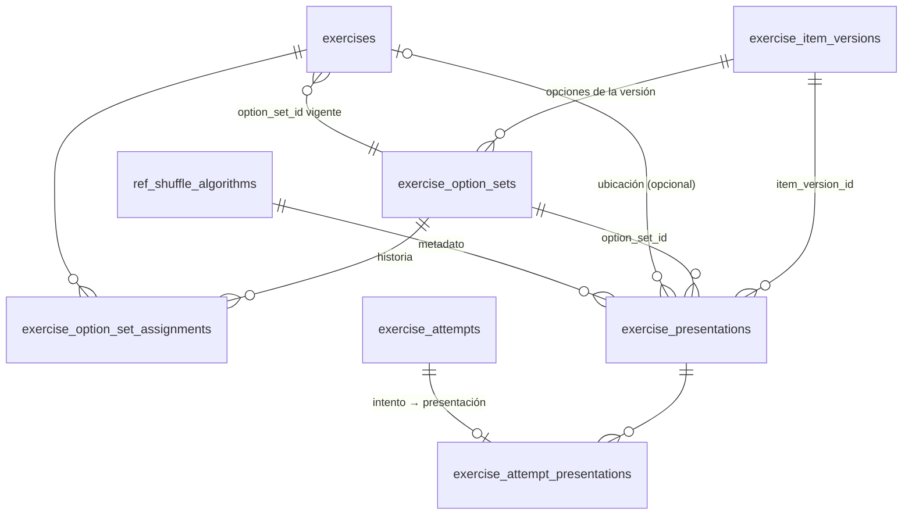

# `exercise_item_versions`: decisiones, implementación y lo que queda

Estado al 2026-11-08 (arquitectura de datos rev. 8, §5, §7.1, §8, §9, §17 y §18). Decisiones V1–V8,
V5.1–V5.3, V8.1 y la regla de opciones de los generados futuros aprobadas el 2026-11-08. **Nada
aplicado en producción ni en staging, sin commits.** El nombre del archivo se conserva porque lo citan
migraciones y código.

| Pieza                                                          | Estado                                                                                                      |
| -------------------------------------------------------------- | ----------------------------------------------------------------------------------------------------------- |
| Tabla `exercise_item_versions`, inmutable, con sus tres unique | Implementada (`20261107150000_learning_item_versions.sql`)                                                  |
| `ref_grading_modes` y `grading_mode_id` con FK (V7)            | Implementada (`20261108120000_learning_grading_modes.sql`)                                                  |
| `grading_spec`, normalizador `polygo.answers.v1` (V1, V2)      | Implementado (`shared/grading.ts`)                                                                          |
| JSON canónico y `content_hash` en Node (V3, V4)                | Implementado (`content/canonical-json.ts`, `content/versions.ts`)                                           |
| `generator`, `generator_version` (V6)                          | Implementado (`content/versions.ts`, `GENERATORS`; `scripts/versions-sql.ts`)                               |
| Backfill de versiones                                          | **4.198 de 4.198 ítems; 5.410 de 5.410 ubicaciones** (`20261108120101…04`), probado en PGlite               |
| Conjuntos de opciones, asignaciones y presentaciones (V5.1–3)  | Implementados (`20261108130000_learning_option_sets.sql`; backfill `20261108130101…04`), probados en PGlite |
| Referencias obligatorias (V8, V8.1)                            | Integrada en `supabase/migrations/20261108140000_learning_versions_required.sql`, probada en PGlite; §6     |
| Opciones fuera de la versión en generados de elección futuros  | Implementada (`content/versions.ts`, lista congelada `content/inline-option-items.ts`); §6                  |

**Criterio de cierre de §18 para esta pieza:** las 4.198 versiones y las 5.410 ubicaciones con
referencias válidas están **en las migraciones y probadas en PGlite**, pero no cargadas en ninguna
base real. La fase 1 no está completa hasta aplicarlas (decisión y autorización del usuario).

## 1. Decisiones aprobadas (2026-11-08)

**V1. `grading_spec`.** Define el método de corrección; no duplica `answer`, `accepted_answers` ni el
`payload`, que el corrector lee de la versión. Tres modos, equivalentes a `checkAnswer`
(`shared/answers.ts`):

| Tipos                                                               | `grading_spec`                                                                                        |
| ------------------------------------------------------------------- | ----------------------------------------------------------------------------------------------------- |
| `image_choice`, `translation_choice`, `fill_blank`, `listen_choice` | `{"mode":"exact_option","mode_version":1}`: la opción elegida es `answer`, carácter por carácter      |
| `order_words`, `complete_word`                                      | `{"mode":"normalized_text","mode_version":1,"normalizer":"polygo.answers.v1","typo_tolerance":false}` |
| `translate_write`, `short_answer`                                   | igual, con `"typo_tolerance":true`                                                                    |
| `match_pairs`                                                       | `{"mode":"pair_set","mode_version":1}`: el conjunto de parejas de `payload.pairs`                     |

`normalized_text` (no `normalized_set`): las fichas de `order_words` se unen con un espacio y el orden
cuenta. Una respuesta de otro tipo que el del modo no se corrige: es `invalid_response` (§9).
`free_production` no tiene modo: queda bloqueado hasta que existan rúbricas editoriales (hoy ningún
ítem lo usa).

**V2. Normalizador.** El comportamiento actual de `shared/answers.ts` es `polygo.answers.v1`
(CONTRACTIONS, equivalencias del chino y del pinyin, tipeo de distancia 1 desde 8 caracteres) y se
registra en `grading_spec.normalizer`. `shared/__tests__/grading.test.ts` congela sus salidas: un
cambio de comportamiento exige `polygo.answers.v2`.

**V3. Hash.** `content_hash = "v1:" + sha256` del JSON canónico RFC 8785 (JCS) de los siete campos de
§5 (`prompt_es`, `payload`, `answer`, `accepted_answers`, `explanation_es`, `difficulty`,
`recommended_seconds`) más `grading_spec`. Todo en NFC, `null` explícito, arrays en su orden. Fuera
del hash: ubicación, publicación, skill, ids y procedencia.

**V4. Cálculo.** Sólo en Node (`content/canonical-json.ts`). PostgreSQL guarda el hash y la unique;
las pruebas recalculan cada hash desde las filas leídas de la base. Vale igual para `options_hash`.

**V5. Distractores generados: opción (a).** Para los 176 ítems de `content/variable-options.ts` (lista
congelada: 89 `translation_choice` y 87 `listen_choice` generados), `payload.options` no forma parte
de la versión ni del hash. **La condición (reconstruir la presentación) quedó resuelta con
V5.1–V5.3** (§5): cada uno tiene una versión (su `payload` sin `options`) y cada una de sus 371
ubicaciones, un conjunto de opciones inmutable.

**V5.1.** Conjuntos de opciones inmutables; sin versiones de palabras.
**V5.2.** Sólo se reconstruyen las presentaciones registradas desde ahora. Los intentos sin evidencia
quedan identificados como no reconstruibles; nunca se inventan opciones ni órdenes.
**V5.3.** La presentación guarda el id de un conjunto (que tiene la fotografía exacta), no su
contenido, y el orden final mostrado.

**V6. Procedencia.** `generator` y `generator_version` fuera del hash; son de la versión (o del
conjunto) que los originó. A → B → A reutiliza A con su procedencia original.

**V7. Esquemas.** `ref_grading_modes` inmutable y `grading_mode_id` generado con FK. Sin extensiones.

**V8. NOT NULL.** Con el backfill completo: `exercise_items.current_version_id`, `exercises.item_id`
y `exercises.item_version_id`, en todas las filas, con CHECK `NOT VALID`, `VALIDATE CONSTRAINT` y
`ALTER COLUMN SET NOT NULL`. Estado en §6.

## 2. Lo implementado

- **Versiones** (`content/versions.ts`, `scripts/versions-sql.ts`). `VERSIONS_SQL` se divide en
  `VERSIONS_INSERT_SQL` (bloquea ítems, aborta si un hash cargado tiene otro contenido, inserta,
  fija la vigente) y `VERSIONS_PLACE_SQL` (versión de cada ubicación y checksum). En el checksum, si
  la versión no tiene `payload.options` (los 176) se compara el resto del `payload`; las opciones las
  compara su conjunto.
- **Conjuntos** (`content/option-sets.ts`, `scripts/option-sets-sql.ts`): ver §5.
- **Generadores.** `content:sql` y `content:diff` cargan catálogo, versiones y conjuntos **antes** de
  escribir `exercises`, e insertan cada ejercicio nuevo ya con `item_id`, `item_version_id` y
  `option_set_id` (`EXERCISE_CATALOG_*` en `scripts/catalog-sql.ts`); ubicaciones y checksums van
  después. `content:catalog` suma `--only option-sets`. `PLACEMENTS_SQL`, si una ubicación cambia de
  ítem, le asigna la versión del ítem nuevo que trae el documento (antes la dejaba nula). El INSERT de
  ítems sólo agrega los que faltan (con V8, `ON CONFLICT` no alcanza: NOT NULL se valida antes).
- **Backfill de versiones** (regenerado, `content:catalog --only versions`):

| Tipo (origen)                 | Versiones | Ubicaciones con versión |
| ----------------------------- | --------: | ----------------------: |
| `complete_word` escrito       |        26 |                      27 |
| `fill_blank` escrito          |       513 |                     821 |
| `image_choice` escrito        |       250 |                     250 |
| `listen_choice` escrito       |       345 |                     524 |
| `match_pairs` escrito         |       139 |                     139 |
| `order_words` escrito         |       191 |                     301 |
| `short_answer` escrito        |        96 |                     142 |
| `translate_write` escrito     |       459 |                     763 |
| `translation_choice` escrito  |       391 |                     391 |
| `complete_word` generado      |       205 |                     225 |
| `listen_choice` generado      |       546 |                     635 |
| `match_pairs` generado        |       300 |                     300 |
| `translate_write` generado    |       325 |                     374 |
| `translation_choice` generado |       412 |                     518 |
| **Total**                     | **4.198** |               **5.410** |

De ellos, los 176 de distractores variables: 176 versiones (87 + 89) y 371 ubicaciones (176 + 195).
Por modo: `exact_option.v1` 2.457, `normalized_text.v1` 1.302, `pair_set.v1` 439. Por idioma: en
1.681, it 844, pt 842, zh 831. Todas son la versión 1.

## 3. Pruebas

Resultados del 2026-11-08 en §7.

- `content/__tests__/versions.test.ts`: JCS, hash, 4.198 versiones, los 176 sin `payload.options` y
  con un único contenido fuera de las opciones, copias, procedencia, determinismo, migraciones
  generadas = contenido actual, equivalencia `gradeWithSpec` ≡ `checkAnswer`.
- `content/__tests__/option-sets.test.ts`: 2.652 conjuntos en las 3.139 ubicaciones de elección,
  copia literal y `answer_index`, `options_hash` recalculable, pinyin igual a `segmentReadings` con el
  diccionario del curso, los 176 con un conjunto por ubicación y una sola versión, procedencia,
  determinismo e independencia del tramo, rechazos, migraciones = contenido actual.
- `shared/__tests__/shuffle.test.ts`: `polygo.shuffle.v1` congelado y equivalente al `shuffle` de la
  app para 0–8 opciones y 2.700 semillas.
- `supabase/tests/presentations.test.mjs` (PGlite, 16 pruebas): las diez obligatorias del encargo
  más esquema, backfill, formato, rechazos de orden y conjunto, permisos, y SRS v1/Ranked intactos.
- `supabase/tests/versions.test.mjs`: 4.198 versiones, 5.410 ubicaciones, V5 resuelto, V8 (§6).
- `supabase/tests/items.test.mjs`: `content:sql` de una unidad nueva carga versiones (también las de
  distractores variables) y conjuntos; con V8, recargar funciona y el ítem nuevo choca (§6).

## 4. Consecuencias que hay que conocer

- **La app no cambió.** Sigue leyendo `exercises` (opciones incluidas, idénticas a las del conjunto) y
  mezclando con su `shuffle`. Todavía no registra presentaciones: eso requiere que el servidor las
  escriba al mostrar cada ejercicio (fase 2, §9). Hasta entonces, todo intento nuevo de la ruta vieja
  también queda como no reconstruible.
- **El pinyin de las opciones** queda fotografiado en el conjunto, pero la app hoy lo dibuja desde
  `words` (mutable). Coinciden mientras `words` y el contenido estén sincronizados; cuando la app
  muestre lo que manda el servidor, el conjunto pasa a ser lo dibujado. `content:diff` no actualiza
  `words.romanization`: un cambio de pinyin hecho sólo por diff dejaría el conjunto (nuevo) distinto
  de lo que dibuja la app (viejo) hasta un `content:sql`.
- **Contenido nuevo con distractores variables** ya no falla: todo generado de elección nuevo lleva
  las opciones fuera de la versión (§6). Sigue fallando sólo si uno de los 782 de
  `content/inline-option-items.ts` pasa a publicar dos contenidos a la vez (ver §6, punto abierto).
- **Fuera del alcance:** el orden de las fichas de `order_words` y de las columnas de `match_pairs`
  (no son opciones; hoy la app también los mezcla con semilla) y el pinyin del enunciado. Si se
  quieren reconstruir, es una ampliación de la presentación, no de los conjuntos.
- `exercise_attempts`, `submit_learning_session`, el SRS v1 y Ranked no se tocaron (las pruebas
  comparan columnas, funciones y triggers).

## 5. V5 resuelto: conjuntos inmutables y presentaciones

### Esquema (`20261108130000_learning_option_sets.sql`)



| Tabla                             | Qué guarda                                                                                                                                                                                                                                                                                                                                                                                                                             | Mutabilidad                                                      |
| --------------------------------- | -------------------------------------------------------------------------------------------------------------------------------------------------------------------------------------------------------------------------------------------------------------------------------------------------------------------------------------------------------------------------------------------------------------------------------------- | ---------------------------------------------------------------- |
| `ref_shuffle_algorithms`          | `polygo.shuffle.v1` (FNV-1a + mulberry32 + Fisher–Yates, `shared/shuffle.ts`)                                                                                                                                                                                                                                                                                                                                                          | Inmutable (UPDATE, DELETE, TRUNCATE rechazados)                  |
| `exercise_option_sets`            | `item_id`, `item_version_id` (FK compuesta → versiones), `options_hash`, `format` = `polygo.options.v1`, `options` jsonb, `answer_index`, `origin` (`catalog` \| `session`), `generator`, `generator_version`. Unique (`item_version_id`, `options_hash`) y (`id`, `item_version_id`)                                                                                                                                                  | Inmutable                                                        |
| `exercises.option_set_id`         | El conjunto vigente de la ubicación: FK compuesta (`option_set_id`, `item_version_id`) diferible; un conjunto exige versión (trigger diferido)                                                                                                                                                                                                                                                                                         | Puntero mutable, con historia                                    |
| `exercise_option_set_assignments` | `exercise_id`, `item_id`, `item_version_id`, `option_set_id`, `assigned_at`. Una fila cada vez que cambia `option_set_id` (la escribe un trigger de `exercises`, así ninguna carga puede saltársela)                                                                                                                                                                                                                                   | Sólo inserciones                                                 |
| `exercise_presentations`          | `user_id` (cascada desde `profiles`), `session_id`, `position`, `item_id`, `item_version_id`, `exercise_id` (nulo si no hay ubicación, p. ej. un repaso), `option_set_id`, `option_order` smallint[], `shuffle_algorithm`, `shuffle_seed`, `presented_at` (hora del servidor). Trigger: conjunto si y sólo si el ítem es de elección; `option_order` es una permutación de 0..n−1; en una ubicación, su versión y su conjunto vigentes | Sin UPDATE; DELETE sólo en cascada (cuenta; luego, compactación) |
| `exercise_attempt_presentations`  | `attempt_id` (PK, cascada desde `exercise_attempts`), `presentation_id`. Trigger: mismo usuario, sesión y ubicación, respondido después de mostrarse. Varios intentos (reintentos) pueden apuntar a la misma presentación                                                                                                                                                                                                              | Sin UPDATE; DELETE sólo en cascada                               |
| `exercise_attempt_reconstruction` | Vista (`security_invoker`): cada intento con `status` = `reconstructible` (tiene presentación) o `not_reconstructible` y `reason` = `no_presentation_record`                                                                                                                                                                                                                                                                           | Derivada                                                         |

Índices: conjuntos por ítem; asignaciones por (`exercise_id`, `id`); presentaciones por
(`user_id`, `presented_at desc`), sesión, versión, conjunto y ubicación (parciales donde hay nulos);
vínculos por presentación. RLS sin políticas y sin permisos para `anon` ni `authenticated` en todo lo
nuevo: lo escribe el servidor.

**Por qué sin FK a `learning_sessions`:** en la ruta actual la sesión se inserta recién al enviar
(`submit_learning_session`), después de mostrar los ejercicios. Una presentación de un ejercicio
abandonado se registra antes de que exista la sesión, y puede no existir nunca. La FK llega con la
sesión iniciada por el servidor (fase 2, §9 de la arquitectura).

**Por qué una tabla de vínculo y no una columna en `exercise_attempts`:** no tocar la tabla ni la
RPC del SRS v1. `answer_events` (fase 2) puede llevar la columna directamente.

**Nota sobre §9 de la arquitectura** («el plan es sin estado: no hay que guardar planes»): sigue
valiendo para el plan firmado; lo nuevo es que **cada presentación mostrada** se guarda, por V5.2 y
por el requisito de conservar los ejercicios abandonados.

### Formato `polygo.options.v1`

```json
{
  "text": "你好",
  "reading": [{ "text": "你好", "reading": "nǐ hǎo" }],
  "audio": null,
  "image": null
}
```

- `text`: la opción literal (lo que `exact_option` compara con `answer`).
- `reading`: en chino, los segmentos con su pinyin tal como los arma `segmentReadings` con el
  diccionario del curso completo del idioma (como la app); `null` en el resto. 282 conjuntos lo usan.
- `audio`, `image`: hoy ninguna opción tiene audio ni imagen propios (el audio y el emoji del
  enunciado están en la versión, que es inmutable). Quedan en el formato y siempre `null` en v1:
  agregarlos será `polygo.options.v2`, no una reinterpretación.
- `options_hash` = `v1:` + sha256 del JSON canónico de `{format, options, answer_index}`, en Node.

El trigger de inserción valida el formato (claves exactas, segmentos que reconstruyen el texto),
opciones distintas, 2–8 opciones, que `answer_index` sea la respuesta de la versión, que la versión
sea de elección, que un escrito no tenga generador y que, **si la versión guarda sus opciones** (todos
salvo los 176), el conjunto sean esas mismas en el mismo orden.

### Reconstrucción sin contenido mutable

`exercise_presentation_snapshot(id)` arma la presentación completa leyendo sólo
`exercise_presentations`, `exercise_item_versions` y `exercise_option_sets`, las tres inmutables;
nunca `exercises`, `words`, `exercise_items` ni `lessons` (una prueba lo verifica en el cuerpo de la
función). Devuelve el enunciado, el `payload` y la corrección de la versión, y `options_shown`: las
opciones del conjunto en el orden registrado. **El orden registrado es la fuente de verdad**; la
semilla y el algoritmo son metadatos (una prueba registra un orden distinto del de la semilla y se
reconstruye ése).

### Backfill de conjuntos (`content:catalog --only option-sets`)

| Tipo (origen)                 | Conjuntos | Ubicaciones |
| ----------------------------- | --------: | ----------: |
| `fill_blank` escrito          |       513 |         821 |
| `image_choice` escrito        |       250 |         250 |
| `listen_choice` escrito       |       345 |         524 |
| `translation_choice` escrito  |       391 |         391 |
| `listen_choice` generado      |       635 |         635 |
| `translation_choice` generado |       518 |         518 |
| **Total**                     | **2.652** |   **3.139** |

Por idioma: en 1.071, it 513, pt 517, zh 551. Las 371 ubicaciones de los 176 tienen cada una su
conjunto, todos de la única versión de su ítem. La carga deja 3.139 asignaciones iniciales.

### Intentos históricos (V5.2)

No había ningún registro inmutable de lo mostrado (ni versión, ni opciones, ni orden en
`exercise_attempts`; `exercises.payload` se pisa en cada carga). Por eso **ningún intento existente
es reconstruible**: la vista los marca `not_reconstructible` / `no_presentation_record`, no se les
asigna presentación y no se modifican. La prueba aplica esta migración sobre una base con intentos de
la ruta vieja y compara las filas byte a byte antes y después. En producción hay, según la auditoría
anterior, 47 intentos; no se consultó la base para esta entrega.

### Flujo que queda para la fase 2

1. El servidor, al mostrar un ejercicio, toma la versión y el conjunto vigentes de la ubicación (o
   materializa un conjunto `session` con los distractores que elige), mezcla con
   `polygo.shuffle.v1` y registra la presentación; devuelve a la app las opciones en ese orden.
2. Al responder, el evento (`answer_events`, o el vínculo con `exercise_attempts` en la ruta vieja)
   referencia la presentación.
3. Corrección y auditoría leen `exercise_presentation_snapshot`.

## 6. V8 y V8.1: referencias obligatorias, y opciones de los generados futuros

### Migración (`supabase/migrations/20261108140000_learning_versions_required.sql`)

Integrada en `supabase/migrations/` (la aplican el arnés y, cuando se autorice, `supabase db push`);
reemplaza al borrador `supabase/pending/20261108140000_learning_versions_not_null.sql`, que se quitó.
Va después de `20261108130104`. Idempotente, sólo agrega restricciones.

1. **Validación previa:** aborta y nombra hasta 10 filas si queda un ítem sin vigente o con una
   vigente ajena, una ubicación sin ítem o sin versión, o una ubicación de elección sin conjunto.
2. **`exercises.item_id` y `exercises.item_version_id`:** CHECK `NOT VALID` → `VALIDATE` →
   `SET NOT NULL`, en todas las filas (también las despublicadas).
3. **`exercises_choice_option_set_check`:** toda ubicación de elección tiene conjunto.
4. **`exercise_items.current_version_id` (V8.1, decisión aprobada):** sin NOT NULL (sería circular:
   el ítem va antes que su versión por la FK `item_id`, y la versión antes que el puntero). En su
   lugar, el constraint trigger `exercise_items_require_current_version`, `DEFERRABLE INITIALLY
DEFERRED`, `AFTER INSERT OR UPDATE`, por fila, con `exercise_items_check_current_version()`:
   - relee la fila al confirmar (no usa `NEW`): un INSERT sin puntero seguido del UPDATE que lo pone
     deja dos eventos, y los dos ven el estado final;
   - rechaza un ítem sin `current_version_id` (`23502`) o con uno que no es una versión de ese mismo
     ítem (`23503`), aunque falte la FK compuesta;
   - `security definer` con `search_path = ''`, para que RLS no le oculte la fila (sin fila pasaría
     en silencio); sin `execute` para `public`, `anon` ni `authenticated`;
   - sólo lee: la FK diferible `exercise_items_current_version_fkey` y la inmutabilidad de las
     versiones siguen igual.
   - Límite conocido: como todo trigger, no corre con `session_replication_role = replica` ni si el
     dueño lo desactiva (sólo roles privilegiados; §13.9 de la arquitectura).

### Pruebas que insertaban ejercicios sin ítem

`learning.test.mjs`, `energy.test.mjs` y `profile.test.mjs` usan `supabase/tests/fixtures.mjs`
(`exercisesFixtureSql`): cada ejercicio con su ítem, su versión (hash de `content/versions.ts`), su
puntero y, si es de elección, su conjunto (`content/option-sets.ts`), en una transacción. Ninguna
prueba se quitó ni se debilitó. `learning.test.mjs` suma una prueba de que PostgreSQL rechaza una
ubicación sin ítem, sin versión, y un ítem sin vigente (falla al confirmar y no deja filas).

En `versions.test.mjs`, el NOT NULL de `item_id` rechaza una ubicación con versión sin ítem antes que
el CHECK `exercises_item_version_needs_item_check` (que sigue). La prueba de "una ubicación que
cambia de ítem" ahora comprueba que pasa a la versión del ítem nuevo, y que un documento sin versiones
la dejaría sin versión y aborta.

### Opciones de los generados de elección futuros (decisión aprobada)

La versión principal representa el conocimiento y la corrección; el conjunto de opciones, la
presentación. `content/versions.ts` (`optionsOutsideVersion`):

- **generado de elección** (`image_choice`, `translation_choice`, `fill_blank`, `listen_choice`) que
  no está en `content/inline-option-items.ts` → versión sin `payload.options`, opciones en el
  conjunto inmutable de cada ubicación;
- **los 782 ya cargados con las opciones en la versión** (`INLINE_OPTION_ITEMS`, lista congelada el
  2026-11-08: 459 `listen_choice` y 323 `translation_choice`) → sin cambios: mismas versiones y
  hashes;
- **los 176** de `content/variable-options.ts` → como antes (opciones fuera);
- **escritos** → sin cambios (opciones en la versión), hasta verificar que separarlas no altera
  contenido ni hashes.

Hoy los 958 generados de elección están exactamente en una de las dos listas, así que la regla no
cambia ninguna fila cargada (los generadores dan los mismos archivos byte a byte). `content:sql`
deja de fallar con contenido nuevo que genere un choice con distractores variables.
`assertContentCatalog` valida que cada id de la lista sea un ítem generado de elección del currículo,
fuera de la lista de los 176.

**Punto abierto (no bloquea la fase 1):** si uno de los 782 pasara a publicar dos contenidos a la vez
(por ejemplo, otros distractores en una consolidación nueva), `buildVersions` falla como antes.
Resolverlo sin tocar lo cargado sería darle una versión nueva sin opciones (hash nuevo, no retroactivo)
y sacarlo de la lista; es una decisión sobre contenido publicado y queda para cuando ocurra.

## 7. Resultados (2026-11-08)

Ver el resumen de la entrega: `npm run typecheck`, `npx expo lint`, Jest completo, `npm run test:db`
completo e idempotencia byte a byte de cada generador corrido dos veces (`content:sql` de los cuatro
idiomas, `content:catalog` completo, `--exclude-loaded`, `--only versions`, `--only option-sets` y
`--only placements` = archivos del repositorio, `content:dump`, `content:diff`, `content:ids`).

**Cierre de V8.1 (2026-11-08).** Base limpia en PGlite con todas las migraciones (incluida
`20261108140000`): 4.198 ítems y 4.198 versiones (una por ítem, ninguna duplicada), 0 ítems sin
vigente o con vigente ajena, 5.410 de 5.410 ubicaciones con ítem y versión, 0 huérfanas; 2.652
conjuntos, 3.139 de 3.139 ubicaciones de elección con conjunto, 3.139 asignaciones, 0 conjuntos
duplicados, sin versión o sin ubicación. `npm run typecheck` y `npx expo lint` sin errores.
`test:db`: 233 de 234; la única falla es `humanmatch.test.mjs:183` (Ranked, tiempo, ya conocida),
que corrida sola pasa 10 de 10. Jest: 5.877 de 5.878; la falla es un timeout de 5 s bajo carga
(`blocks` en una corrida, `report` en la otra), que corrido solo pasa. Generadores: `--only versions`,
`--only option-sets` (cuatro idiomas), `--only placements` = archivos del repositorio byte a byte;
todos (`content:sql` y `content:catalog` de los cuatro idiomas, `--exclude-loaded`, `content:dump`,
`content:diff`) dan lo mismo en dos corridas; `content:ids` no cambia el registro. `content:catalog`
completo y `--exclude-loaded` no son iguales a `20261107130101…04` ni a `20261107140100`: esas son
cargas históricas sólo de ítems. Lo que tienen en común es idéntico (ítems y conceptos = los
históricos más los 300 match_pairs), y lo demás son secciones de fases posteriores.
