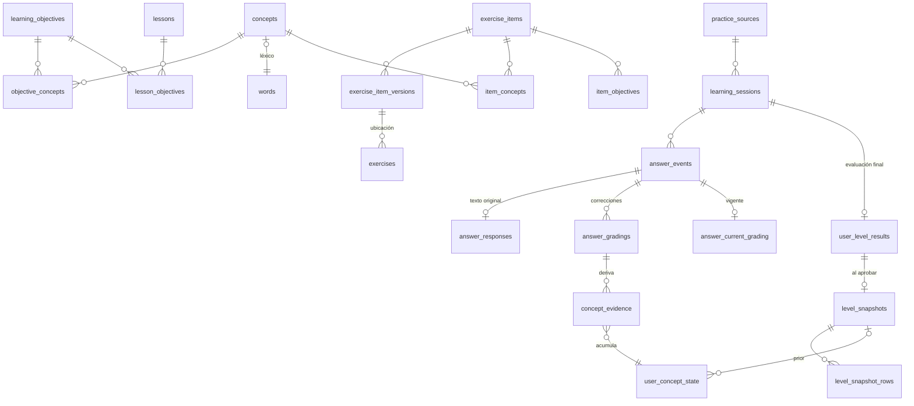
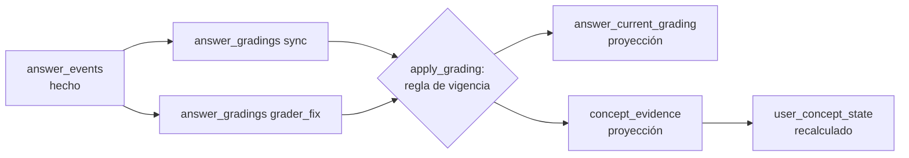
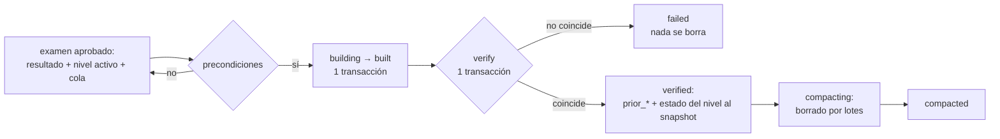
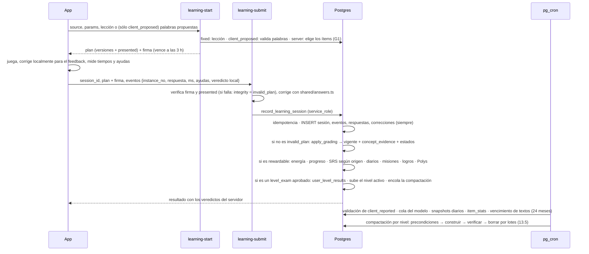

# Arquitectura de datos y evidencias del aprendizaje

> **Estado: APROBADO — DISEÑO CERRADO** (revisión 8, aprobada el 2026-11-06; ver 21). D1–D9, C1–C5, P1–P10 y G1–G2
> fueron aprobados antes. La revisión 4 agregó el ciclo de vida por nivel (K1–K8, 13.5) y la
> auditoría de recompensas contra producción (6.4). La revisión 5 agrega la verificación
> independiente del snapshot (13.6), el manifiesto de filas usadas, eliminadas y conservadas (13.7) y
> el tratamiento completo de las sesiones `invalid_plan` (6.5). La revisión 6 hace que la
> referencia no dependa de ningún agregado derivado (evolución recalculada desde los hechos, estados
> sólo como comparación), define el límite de congelamiento para cada tipo de clave y precisa
> `used_rows`; adopta además la lectura de P7 para trabajos recurrentes. La revisión 7 reemplaza los límites por id
> del congelamiento por una guarda con bloqueo y una lista completa de claves con digest (13.8, K12). La revisión 8
> trata las operaciones privilegiadas que pueden saltear la guarda, la evidencia que queda después de
> compactar y la detección de alteraciones posteriores, con sus límites frente a un superusuario
> (13.9, K13); corrige además que los contextos de borrado de K12 se podían falsificar con
> `set_config`. Los cambios están en
> K9–K11 y en las revisiones de consistencia de la sección 19. La aprobación valida el diseño, no su
> implementación ni su funcionamiento en producción (21). Todo lo que este documento llama «test» o «verificación» es una propuesta: no
> hay nada implementado, migrado ni probado.
> Fuera de alcance: la fórmula de dominio, confianza, retención y velocidad, y la interfaz. Este
> documento define **qué se guarda, dónde, quién lo escribe y con qué garantías**, para que esas
> fórmulas se puedan calcular y recalcular después.

## 0. Resumen

1. **Cuatro capas y un histórico compactado.** (1) **Hechos inmutables:** sesiones, respuestas,
   respuestas originales y correcciones. (2) **Proyecciones:** la corrección vigente de cada respuesta
   y la evidencia por concepto. (3) **Estado actual** por usuario. (4) **Agregados.** (5) **Histórico
   compactado:** resultado de la evaluación final y snapshot de cada nivel superado. Las capas 2 y 3
   se pueden reconstruir desde la capa 1 **sólo para los niveles que todavía no se compactaron**. Al
   superar la evaluación final de un nivel se genera su snapshot, se verifica y se eliminan los
   eventos de ese nivel: desde ese momento el snapshot es definitivo y ya no se puede reconstruir
   ninguna respuesta individual ni recalcular el snapshot (K1–K8, 13.5).
2. **Dos ejes que no se mezclan:** la **dimensión de PolyGo** (`vocabulary`, `grammar`,
   `comprehension`, `production`) y la **actividad del MCER** (`listening`, `reading`, `speaking`,
   `writing`, `interaction`, `mediation`). Cada fila de evidencia pertenece a una sola dimensión, así
   que cada dimensión se calcula por separado.
3. **Modo de evaluación explícito en cada ítem** (`recognition` … `free_production`): reconocer no
   cuenta como producir.
4. **Identidad del ejercicio en tres niveles:** ítem (qué evalúa), versión (qué se mostró, inmutable)
   y ubicación (lección y posición).
5. **El servidor corrige y además valida lo que se mostró.** Cada sesión nace de un **plan firmado
   por el servidor** que fija las versiones, las opciones y su orden. La Edge Function verifica la
   firma, comprueba cada respuesta contra el plan y corrige con `shared/answers.ts`.
6. **Las correcciones son hechos y la vigente es una proyección.** Una respuesta `client_reported`
   no genera evidencia hasta que el servidor la valida.
7. **Ranked queda completamente separado. Plus no aparece en el registro.**
8. **Privacidad y conservación:** las respuestas originales (el único lugar con texto del usuario)
   se eliminan al compactar su nivel o, a más tardar, a los 24 meses (D8). Los eventos, las
   correcciones y la evidencia se conservan mientras su nivel esté activo y se eliminan al compactarlo
   (K2). Las sesiones se conservan como registro de recompensas, sin respuestas. Los datos ficticios
   de los ejercicios viven en el catálogo, y no se permiten ejercicios que pidan datos personales
   reales. El borrado de cuenta alcanza también a los snapshots y a todo lo archivado.
9. **El servidor elige las preguntas de toda evaluación** (G1): en placement, exámenes de nivel y
   evaluaciones de dominio, la app no propone ítems.
10. **Sólo las sesiones verificadas y completas dan recompensas** (G2): una sesión con firma inválida
    queda guardada para auditoría, pero no da racha, progreso, energía, misiones, logros, Polys ni
    evidencia. La auditoría de producción (6.4) encontró 6 funciones que leen o escriben sesiones e
    intentos y 18 que dependen de ellas; la vista `rewardable_sessions` todavía no existe.
11. **El nivel siguiente empieza de cero** (K6): ni el progreso curricular ni el dominio se trasladan.
    El snapshot del nivel anterior sólo sirve como punto de partida (`prior_*`) para los conceptos
    compartidos y nunca se muestra como dominio vigente sin evidencia nueva.

## 1. Qué hay hoy

### Inventario (producción, 2026-11-06, sólo lectura)

| Dato                                              | Valor                                                            |
| ------------------------------------------------- | ---------------------------------------------------------------- |
| Idiomas con contenido                             | en (485 palabras), it (225), pt (215), zh (182)                  |
| Lecciones / ejercicios publicados                 | 600 / 5.410 (2.410 escritos + 3.000 de consolidación generada)   |
| Ejercicios generados que son copia de uno escrito | **948** (mismo tipo, payload y respuesta, otro id)               |
| Usuarios / sesiones / intentos                    | 2 / 6 / 47 (`exercise_attempts` ocupa 128 kB)                    |
| Extensiones disponibles sin instalar              | `pg_cron`, `pg_partman`, `pgmq`, `pg_jsonschema` (no hay `plv8`) |

### Problemas que la arquitectura resuelve

| #   | Hallazgo                                                                                                                         | Dónde                                                                                                                                                      | Consecuencia                                                                                         |
| --- | -------------------------------------------------------------------------------------------------------------------------------- | ---------------------------------------------------------------------------------------------------------------------------------------------------------- | ---------------------------------------------------------------------------------------------------- |
| 1   | El id del ejercicio es su posición (`a1-u01-l01-e03`)                                                                            | `content/path.ts`, `build-content-sql.ts`                                                                                                                  | Mover o agregar un ejercicio cambia su identidad                                                     |
| 2   | La consolidación copia ejercicios escritos con otro id                                                                           | `unitPath()`                                                                                                                                               | Un mismo ejercicio se mide como 2 a 4 distintos                                                      |
| 3   | El servidor guarda el `correct` que manda el cliente                                                                             | `parse_learning_attempts`                                                                                                                                  | Nada de lo guardado hoy sirve para medir dominio                                                     |
| 4   | El cliente elige las opciones y los distractores de los repasos, y el servidor no los conoce                                     | `buildReviewExercises` (azar en el cliente)                                                                                                                | No se puede saber qué tan difícil fue la pregunta                                                    |
| 5   | Práctica libre y «Tus errores» no guardan nada; una lección abandonada tampoco                                                   | `review.tsx` (`saves`), `submit_learning_session`                                                                                                          | Se pierde evidencia de usuarios gratuitos                                                            |
| 6   | Los repasos se guardan con `exercise_id = null` y `skill = 'vocabulary'`                                                         | `coalesce(e.skill,'vocabulary')`                                                                                                                           | La habilidad queda mal atribuida                                                                     |
| 7   | No se registran el audio repetido, el audio lento ni el pinyin                                                                   | `SpeakButton`, `SessionPlayer`                                                                                                                             | No se distingue «supo» de «supo con ayuda»                                                           |
| 8   | No hay modo de evaluación: `skill` mezcla tema (`vocabulary`) con canal (`listening`)                                            | `shared/exercises.ts`                                                                                                                                      | Un reconocimiento cuenta igual que una producción                                                    |
| 9   | El `listen_choice` actual pide reconocer la forma («elegí lo que oís»), no entender el significado                               | contenido y `review.ts`                                                                                                                                    | **Ningún tipo actual mide comprensión en sentido estricto**                                          |
| 10  | `get_learning_summary` agrupa todo el historial en cada llamada; sesiones e intentos no tienen `language_code`                   | migración 0003                                                                                                                                             | El costo crece con el historial                                                                      |
| 11  | No hay objetivos ni gramática como entidades (sólo `unit.grammar` en jsonb y 69 `tags`)                                          | `curriculum_units`, `words`                                                                                                                                | Sólo se puede medir palabras sueltas                                                                 |
| 12  | Las recompensas cuentan filas de `learning_sessions` y `exercise_attempts` sin filtrar                                           | `mission_progress` (`lessons`, `perfect`), `achievement_metrics` (`reviews_completed`, `fast_answers`), `get_friend_activity`, `friend_challenge_progress` | Si se guardaran ahí sesiones abandonadas o inválidas, darían misiones, logros y actividad social     |
| 13  | El logro `fast_answers` cuenta filas de `exercise_attempts`, y `exercise_attempts.answer` guarda el texto escrito por el usuario | `achievement_metrics`, tabla `exercise_attempts` (verificado en producción, 6.4)                                                                           | Si se compactan o vencen los intentos, el contador del logro baja; el texto no tiene vencimiento hoy |

### Qué se reutiliza

| Estructura actual                                                                                                     | Destino                                                                                                                                                                                                               |
| --------------------------------------------------------------------------------------------------------------------- | --------------------------------------------------------------------------------------------------------------------------------------------------------------------------------------------------------------------- |
| `curriculum_units`, `lessons`, `words`                                                                                | Se mantienen. `words` es la ficha de los conceptos léxicos                                                                                                                                                            |
| `exercises`                                                                                                           | Se mantiene como **ubicación**. Suma `item_id` e `item_version_id`; su id sigue siendo el de `user_lesson_progress` y los intentos viejos                                                                             |
| `exercise_words`                                                                                                      | Se mantiene mientras la use `apply_word_result`. La genera el mismo script que `item_concepts`, y un test exige que coincidan                                                                                         |
| `learning_sessions`                                                                                                   | Se amplía; su id sigue siendo la clave de idempotencia. **Es el registro de recompensas y no se compacta** (K3): no contiene respuestas                                                                               |
| `exercise_attempts`                                                                                                   | Se copia al registro nuevo (`answer_events.legacy_attempt_id`) y deja de leerse en las fases 2–3. Sus filas se eliminan con la compactación de su nivel o a los 24 meses (13.3), porque `answer` es texto del usuario |
| `user_word_progress`, `apply_word_result`, `srs_config`                                                               | Se mantienen como **planificador** de repasos (no son el estado de conocimiento)                                                                                                                                      |
| `user_lesson_progress`, `user_daily_activity`, energía                                                                | Sin cambios de estructura. Sólo las escriben sesiones que otorgan recompensas (6.2)                                                                                                                                   |
| `mission_progress`, `achievement_metrics`, `get_friend_activity`, `friend_challenge_progress`, `get_learning_summary` | Se reescriben para leer la vista `rewardable_sessions` (6.2, 6.4) **antes** de que pueda existir una sesión abandonada o inválida (fase 2)                                                                            |
| `shared/answers.ts`, `shared/exercises.ts` (`UserAnswer`)                                                             | Son el corrector y el formato de respuesta del servidor                                                                                                                                                               |
| `src/features/learning/review.ts`, `content/path.ts` (generadores)                                                    | Pasan a `shared/` para que el servidor genere las instancias con el mismo código                                                                                                                                      |
| Idempotencia por `session_id`, `security definer` + `search_path = ''`, RLS «sólo el dueño»                           | Se aplican igual a todo lo nuevo                                                                                                                                                                                      |

## 2. Principios

- **Los hechos no se modifican.** Lo que se mostró, lo que se respondió y cada corrección se
  insertan una vez. Si una corrección cambia, se inserta otra. Lo derivado se recalcula.
- **El servidor decide lo que cuenta para el dominio.** El cliente informa la respuesta, los tiempos
  y las ayudas. No decide el veredicto, el puntaje, las opciones ni los conceptos.
- **Cada dato tiene un solo dueño.** Las copias (`language_code`, `source`) sólo se permiten si son
  inmutables, y una FK compuesta garantiza que coincidan con la tabla original.
- **El idioma es un dato, no una estructura.** Ninguna tabla es específica de un idioma.
- **Lo que podés hacer depende de Plus; lo que se registra, nunca.**
- **Los datos personales tienen fecha de vencimiento y un único lugar donde borrarlos.**
- **El detalle vive mientras sirve para medir.** Cada respuesta individual se conserva mientras su
  nivel esté activo; al superarlo, se resume en un snapshot verificado y se elimina. Lo resumido es
  definitivo: no se reconstruye ni se recalcula.

## 3. Mapa de entidades



| Capa                     | Tablas                                                                                                                                                                                                               | Mutabilidad                                                                                                                                                                   | Quién escribe                                       |
| ------------------------ | -------------------------------------------------------------------------------------------------------------------------------------------------------------------------------------------------------------------- | ----------------------------------------------------------------------------------------------------------------------------------------------------------------------------- | --------------------------------------------------- |
| Catálogo                 | `learning_objectives`, `concepts`, `objective_concepts`, `lesson_objectives`, `exercise_items`, `exercise_item_versions`, `item_concepts`, `item_objectives`, `practice_sources`, `content_personas`, tablas `ref_*` | Versiones inmutables; el resto sólo cambia de `status`                                                                                                                        | Migraciones generadas desde `content/`              |
| 1 · Hechos               | `learning_sessions` (registro de recompensas, no se compacta); `answer_events`, `answer_responses`, `answer_gradings` (+ `exercise_attempts`, histórico)                                                             | **Sólo inserción** (trigger que impide `UPDATE`). Se eliminan sólo por compactación del nivel (K2), por el vencimiento de 24 meses de los textos (D8) o por borrado de cuenta | `record_learning_session`, trabajo de recorrección  |
| 2 · Proyecciones         | `answer_current_grading`, `concept_evidence`                                                                                                                                                                         | Se recalculan desde la capa 1 **sólo en niveles no compactados**; se eliminan con su nivel                                                                                    | Una sola función: `apply_grading()`                 |
| 3 · Estado               | `user_concept_state`, `user_dimension_state`, `user_objective_state`, `user_level_status`, `user_word_progress`, `user_lesson_progress`                                                                              | Se actualiza                                                                                                                                                                  | Transacción del envío, cola y compactación          |
| 4 · Agregados            | `user_skill_daily`, `user_dimension_daily`, `user_daily_activity`, `user_knowledge_snapshots`, `item_stats`                                                                                                          | Incrementales: no se recalculan después de compactar (13.5)                                                                                                                   | Transacción del envío y `pg_cron`                   |
| 5 · Histórico compactado | `user_level_results`, `level_snapshots`, `level_snapshot_rows`                                                                                                                                                       | Resultados: sólo inserción. Snapshot: inmutable desde `verified`. Se conservan mientras exista la cuenta                                                                      | Envío del examen de nivel y trabajo de compactación |
| Privacidad y operación   | `user_data_exports`, `account_deletion_log`, `knowledge_recompute_queue`, `level_compaction_queue`                                                                                                                   | —                                                                                                                                                                             | Edge Functions y `pg_cron`                          |

## 4. Catálogo pedagógico

### 4.1 Tablas de referencia (`ref_*`)

Los valores cerrados van en tablas de referencia con FK, no en `CHECK`: así se agregan valores con
un `INSERT` (las migraciones no pueden usar `DROP CONSTRAINT`) y cada valor lleva su significado.

| Tabla                   | Valores                                                                                  | Columnas con significado                                                         |
| ----------------------- | ---------------------------------------------------------------------------------------- | -------------------------------------------------------------------------------- |
| `ref_levels`            | A1, A2, B1, B2, C1, C2                                                                   | `position`                                                                       |
| `ref_polygo_dimensions` | `vocabulary`, `grammar`, `comprehension`, `production`                                   | `axis`: `knowledge` (vocabulary, grammar) \| `skill` (comprehension, production) |
| `ref_cefr_activities`   | `listening`, `reading`, `speaking`, `writing`, `interaction`, `mediation`                | `direction`: `reception` \| `production` \| `interaction` \| `mediation`         |
| `ref_assessment_modes`  | ver 4.2                                                                                  | `retrieval_rank`, `feeds_comprehension`, `feeds_production`                      |
| `ref_mode_formats`      | pares válidos (modo, formato de respuesta)                                               | —                                                                                |
| `ref_concept_kinds`     | `lexical`, `phonology`, `orthography`, `grammar`, `pragmatic`                            | `knowledge_dimension`: vocabulary, vocabulary, vocabulary, grammar, _nula_       |
| `ref_assists`           | ver 7.1                                                                                  | `optional` (lo elige el usuario)                                                 |
| `ref_response_privacy`  | `closed`, `fictional`, `open_text` (no existe un valor para datos personales reales: P4) | `retention_months` = 24                                                          |

### 4.2 Modo de evaluación

Cada ítem declara **un** modo. El modo describe qué tiene que hacer la persona con la información,
no el tema ni el canal.

| Modo                      | Qué exige                                                             | `retrieval_rank` | Formatos válidos  | Alimenta        | Ejemplo actual                                                                     |
| ------------------------- | --------------------------------------------------------------------- | ---------------- | ----------------- | --------------- | ---------------------------------------------------------------------------------- |
| `recognition`             | Identificar la forma o el significado correcto entre opciones dadas   | 1                | `select`, `pairs` | —               | `image_choice`, `translation_choice`, `match_pairs`, `listen_choice`, `fill_blank` |
| `cued_recall`             | Escribir una forma con parte de ella o una pista visible              | 2                | `typed`           | —               | `complete_word` (máscara + pista)                                                  |
| `guided_construction`     | Armar una estructura con todas las piezas dadas                       | 3                | `tiles`           | —               | `order_words`                                                                      |
| `free_recall`             | Escribir una palabra o chunk sin opciones ni pistas                   | 4                | `typed`, `speech` | —               | `translate_write` de una palabra                                                   |
| `controlled_production`   | Producir una frase con una respuesta esperada (o un conjunto cerrado) | 5                | `typed`, `speech` | `production`    | `translate_write` de una frase, `short_answer`                                     |
| `free_production`         | Producir un mensaje propio corregido con criterios (sección 8)        | 6                | `typed`, `speech` | `production`    | — (futuro)                                                                         |
| `listening_comprehension` | Entender el **significado** de un mensaje oral                        | —                | `select`, `typed` | `comprehension` | — (hoy no hay; ver hallazgo 9)                                                     |
| `reading_comprehension`   | Entender el **significado** de un texto escrito                       | —                | `select`, `typed` | `comprehension` | — (futuro)                                                                         |

**Por qué agrego `guided_construction`** a la taxonomía pedida: `order_words` no es reconocimiento
(hay que construir el orden) ni producción (no se genera ningún elemento: todas las fichas están
dadas). Clasificarlo como producción inflaría esa dimensión con evidencia más débil, y clasificarlo
como reconocimiento ocultaría que sí exige sintaxis. Es la única extensión.

**Reconocimiento contra producción real.** Sólo `controlled_production` y `free_production` con
formato `typed` o `speech` alimentan la dimensión `production`, y `ref_mode_formats` impide
combinaciones como «producción con opciones». El canal de entrada (`input_modality`: `text`,
`audio`, `image`, `audio_text`) es una columna aparte: escuchar una palabra y elegirla sigue siendo
`recognition` con entrada `audio`, no comprensión.

### 4.3 Dimensiones de PolyGo y actividades del MCER

|                 | Dimensión de PolyGo (`polygo_dimension`)                | Actividad del MCER (`cefr_activity`)                                    |
| --------------- | ------------------------------------------------------- | ----------------------------------------------------------------------- |
| Pregunta        | ¿Qué aspecto del conocimiento demuestra?                | ¿Qué actividad comunicativa ejercita?                                   |
| Dónde vive      | En cada fila de `item_concepts` y de `concept_evidence` | En `learning_objectives` (obligatoria) y en `exercise_items` (opcional) |
| Para qué se usa | Calcular dominio por dimensión                          | Agrupar objetivos y reportar alineado al MCER                           |

**Regla de derivación** (la aplica el script de contenido; un trigger la valida):

1. Cada concepto `target` del ítem da una fila con su **dimensión de conocimiento**, según
   `ref_concept_kinds.knowledge_dimension`: léxico, fonología y ortografía → `vocabulary`; gramática
   → `grammar`; pragmática → ninguna, así que sólo da filas en las dimensiones de habilidad que
   correspondan según el paso 2 (P3).
2. Si el modo alimenta `comprehension` o `production`, cada concepto `target` da **además** una fila
   en esa dimensión.
3. Los conceptos `context` y `distractor` no dan filas.

Así una respuesta puede alimentar como máximo una dimensión de conocimiento y una de habilidad. Una
dimensión nunca se deriva de otra: cada una se calcula filtrando sus propias filas. La columna
`exercises.skill` actual se conserva sin cambios para la interfaz de hoy, pero ya no se usa en
ninguna evidencia.

### 4.4 Clasificación de los tipos actuales

| Tipo                 | Modo                                                                                       | Entrada      | Formato  | Dimensiones                                                                   |
| -------------------- | ------------------------------------------------------------------------------------------ | ------------ | -------- | ----------------------------------------------------------------------------- |
| `image_choice`       | `recognition`                                                                              | `image`      | `select` | vocabulary                                                                    |
| `translation_choice` | `recognition`                                                                              | `text`       | `select` | vocabulary                                                                    |
| `listen_choice`      | `recognition`                                                                              | `audio`      | `select` | vocabulary (y grammar si la frase tiene un concepto gramatical como `target`) |
| `match_pairs`        | `recognition`                                                                              | `text`       | `pairs`  | vocabulary, **una fila por pareja**                                           |
| `fill_blank`         | `recognition`                                                                              | `text`       | `select` | la del concepto que completa el hueco                                         |
| `complete_word`      | `cued_recall`                                                                              | `text`       | `typed`  | vocabulary                                                                    |
| `order_words`        | `guided_construction`                                                                      | `text`       | `tiles`  | vocabulary / grammar                                                          |
| `translate_write`    | `free_recall` si la respuesta es una palabra del currículo; si no, `controlled_production` | `text`       | `typed`  | vocabulary (+ production si es frase)                                         |
| `short_answer`       | `controlled_production`                                                                    | `audio_text` | `typed`  | vocabulary / grammar + production                                             |

El contenido puede indicar el modo en forma explícita (`ExerciseDef.mode`). Si no lo indica, el
script lo deduce con esta tabla, y un test exige que cada ítem publicado tenga modo.

### 4.5 Objetivos y conceptos

**`learning_objectives`**: independientes por idioma, con `group_key` para equivalencias entre
idiomas (D5).

| Campo                         | Tipo                          | Notas                                                                     |
| ----------------------------- | ----------------------------- | ------------------------------------------------------------------------- |
| `id`                          | text PK                       | `en.a1.obj.introduce-yourself` (el `.` evita choques con ids de palabras) |
| `language_code`               | text FK `languages`           |                                                                           |
| `level`                       | text FK `ref_levels`          |                                                                           |
| `cefr_activity`               | text FK `ref_cefr_activities` | Obligatoria                                                               |
| `can_do_es`, `description_es` | text                          | «Podés…»                                                                  |
| `cefr_ref`                    | text null                     | Descriptor del MCER                                                       |
| `group_key`                   | text null                     | Equivalencia entre idiomas. Unique (`group_key`, `language_code`)         |
| `position`, `status`          | smallint, text                | `draft` / `active` / `retired`; nunca se borra un objetivo con evidencia  |

**`concepts`**

| Campo                          | Tipo                        | Notas                                                                                                                                                               |
| ------------------------------ | --------------------------- | ------------------------------------------------------------------------------------------------------------------------------------------------------------------- |
| `id`                           | text PK                     | Léxico = id de la palabra (`en-hello`). Otros: `en.gram.to-be-negative`, `zh.phon.tone-3`                                                                           |
| `language_code`                | text                        |                                                                                                                                                                     |
| `kind`                         | text FK `ref_concept_kinds` |                                                                                                                                                                     |
| `word_id`                      | text null, unique           | `kind = 'lexical'` ⇔ `word_id is not null` (CHECK). FK compuesta (`word_id`, `language_code`) → `words (id, language_code)`, así que la palabra es del mismo idioma |
| `parent_id`                    | text null                   | FK compuesta (`parent_id`, `language_code`) → `concepts (id, language_code)`                                                                                        |
| `title_es`, `description_es`   | text null                   | En léxicos quedan nulos: los datos están en `words`                                                                                                                 |
| `level`, `group_key`, `status` |                             |                                                                                                                                                                     |

**Relaciones**

| Tabla                | PK                                     | Campos                                                         | Restricción de idioma                                                    |
| -------------------- | -------------------------------------- | -------------------------------------------------------------- | ------------------------------------------------------------------------ |
| `objective_concepts` | (`objective_id`, `concept_id`)         | `role`: `core` \| `support`; `language_code`                   | FK compuestas a ambos lados con `language_code`                          |
| `lesson_objectives`  | (`lesson_id`, `objective_id`)          | `role`: `introduce` \| `practice` \| `consolidate` \| `assess` | Trigger: el idioma de la unidad de la lección = el del objetivo          |
| `item_concepts`      | (`item_id`, `concept_id`, `dimension`) | `role`: `target` \| `context` \| `distractor`; `language_code` | FK compuestas; un trigger valida la regla de 4.3 contra el modo del ítem |
| `item_objectives`    | (`item_id`, `objective_id`)            | `language_code`                                                | FK compuestas                                                            |

La cobertura de una unidad es una vista (unión de sus lecciones); no hay tabla `unit_objectives`.

## 5. Identidad estable de cada ejercicio

| Nivel     | Tabla                    | Identifica                          | Cambia cuando                                                                      |
| --------- | ------------------------ | ----------------------------------- | ---------------------------------------------------------------------------------- |
| Ítem      | `exercise_items`         | Qué evalúa: tipo, modo y conceptos  | Nunca. Si cambia el modo, los conceptos `target` o la privacidad, es un ítem nuevo |
| Versión   | `exercise_item_versions` | El contenido exacto que se corrigió | Cambia la redacción, las opciones, la respuesta o las variantes                    |
| Ubicación | `exercises` (existente)  | En qué lección y posición aparece   | Se reordena o se mueve: no afecta la evidencia                                     |

**`exercise_items`**

| Campo                                | Tipo                           | Notas                                                                                                                                                       |
| ------------------------------------ | ------------------------------ | ----------------------------------------------------------------------------------------------------------------------------------------------------------- |
| `id`                                 | text PK                        | Escritos: el id actual **congelado** (`a1-u01-l01-e03`); los nuevos, `en.ex.<nanoid>`. Generados: plantilla determinista, `en.gen.translate_write.en-hello` |
| `language_code`                      | text                           | Unique (`id`, `language_code`) para las FK compuestas                                                                                                       |
| `level`                              | text FK `ref_levels`           | Nivel curricular del ítem: el de la unidad de la lección; en los generados, el de la palabra. Inmutable (define el alcance de la compactación, 13.5)        |
| `origin`                             | text                           | `authored` \| `generated`                                                                                                                                   |
| `type`                               | text                           | Los de `shared/exercises.ts`                                                                                                                                |
| `assessment_mode`, `response_format` | text                           | FK compuesta → `ref_mode_formats`                                                                                                                           |
| `input_modality`                     | text                           | `text`, `audio`, `image`, `audio_text`                                                                                                                      |
| `cefr_activity`                      | text null FK                   |                                                                                                                                                             |
| `response_privacy`                   | text FK `ref_response_privacy` | Sección 13                                                                                                                                                  |
| `current_version_id`                 | bigint                         | FK compuesta (`current_version_id`, `id`) → `exercise_item_versions (id, item_id)`, diferible                                                               |
| `status`, `created_at`, `retired_at` |                                |                                                                                                                                                             |

**`exercise_item_versions`** (inmutable: un trigger rechaza cualquier `UPDATE`)

| Campo                                                                                                       | Notas                                                                                                             |
| ----------------------------------------------------------------------------------------------------------- | ----------------------------------------------------------------------------------------------------------------- |
| `id` bigint identity, `item_id`, `version`                                                                  | Unique (`item_id`, `version`) y (`id`, `item_id`)                                                                 |
| `content_hash`                                                                                              | sha256 del contenido + `grading_spec`. Unique (`item_id`, `content_hash`): recargar lo mismo no crea otra versión |
| `prompt_es`, `payload`, `answer`, `accepted_answers`, `explanation_es`, `difficulty`, `recommended_seconds` | Copia exacta de lo publicado                                                                                      |
| `grading_spec`                                                                                              | jsonb; esquema en `ref_grading_modes` (V7)                                                                        |
| `generator`, `generator_version`                                                                            | Sólo en los generados: qué función arma las opciones (sección 9)                                                  |

**Ítems generados con versión propia.** Los repasos (`review-<palabra>`) y las consolidaciones
generan su respuesta a partir de la palabra. Hoy la respuesta se calcula en el cliente en tiempo de
ejecución; con esta arquitectura, el script de contenido **materializa** cada plantilla aplicable
(tipo × palabra, ~3.300) como un ítem con su versión. Si cambia la traducción de la palabra, cambia
`content_hash` y se crea una versión nueva. Así, **la respuesta esperada siempre sale de una versión
publicada**. Lo único que se elige en cada sesión son los distractores y el orden, y eso lo fija el
plan del servidor (sección 9).

**Ubicación (`exercises`).** Suma `item_id` e `item_version_id`, con FK compuesta
(`item_version_id`, `item_id`) → versiones. `unitPath()` emite las copias con el `item_id` del
original (lo sabe por el set `used`): los 948 duplicados pasan a ser ubicaciones del mismo ítem.
`content/ids.lock.json` registra todos los ids publicados, y un test falla si alguno desaparece o
cambia de tipo o de modo. **Duplicación transitoria aceptada:** `exercises` conserva una copia del
contenido porque la app la lee de ahí; la genera el script y la verifica el checksum. En la fase 5
pasa a leerse desde la versión vigente.

## 6. Sesiones y origen de la práctica

### 6.1 `practice_sources`

| `id`                | Hoy                                       | Selección de ítems   | Afecta SRS   | Progreso          | Energía | Racha | `evidence_class` |
| ------------------- | ----------------------------------------- | -------------------- | ------------ | ----------------- | ------- | ----- | ---------------- |
| `lesson`            | lección escrita                           | `fixed` (la lección) | sí           | sí                | sí      | sí    | `learning`       |
| `consolidation`     | repasos, escucha y repaso final generados | `fixed`              | sí           | sí                | sí      | sí    | `retrieval`      |
| `srs_review`        | repaso espaciado                          | `client_proposed`    | sí           | —                 | —       | sí    | `retrieval`      |
| `smart_review`      | repaso inteligente (Plus)                 | `client_proposed`    | sí           | —                 | —       | sí    | `retrieval`      |
| `topic_review`      | repaso por tema (Plus)                    | `client_proposed`    | sí           | —                 | —       | sí    | `retrieval`      |
| `free_practice`     | práctica libre (**hoy no se guarda**)     | `client_proposed`    | **no** (D3)  | —                 | —       | sí    | `retrieval`      |
| `mistakes_practice` | tus errores (**hoy no se guarda**)        | `client_proposed`    | **no** (D3)  | —                 | —       | sí    | `retrieval`      |
| `assessment`        | evaluación de dominio (futuro)            | **`server`** (G1)    | no           | según el caso     | —       | sí    | `assessment`     |
| `level_exam`        | examen de nivel (futuro)                  | **`server`** (G1)    | no           | según el caso     | —       | sí    | `assessment`     |
| `placement`         | prueba de nivel inicial (futuro)          | **`server`** (G1)    | no           | puede desbloquear | —       | —     | `assessment`     |
| `srs_review_legacy` | repasos guardados antes de la migración   | — (desconocida)      | — (inactivo) | —                 | —       | —     | `retrieval`      |

Columnas: `selection_mode`, `affects_srs`, `affects_lesson_progress`, `consumes_energy`,
`counts_for_streak`, `evidence_class`, `reward_kind`, `plus_feature` (sólo informativa, nunca cambia
cómo se registra) y `active`. Ranked no es un origen (sección 14).

**`reward_kind`** (`lesson` \| `review` \| nulo) reemplaza a `learning_sessions.kind` en las funciones
de recompensas: `lesson` y `consolidation` → `lesson`; los cinco orígenes de repaso y práctica →
`review` (es lo que dice la tabla de 6.2: una sesión completa y verificada da misiones y logros);
`assessment`, `level_exam`, `placement` y `srs_review_legacy` → nulo, así que no cuentan como lección
ni como repaso. Cambiar la regla de un origen es un `UPDATE` de catálogo, no una migración de
funciones.

**G1: el servidor elige las preguntas de toda evaluación.** Todo origen con `evidence_class =
'assessment'` tiene `selection_mode = 'server'` (CHECK en `practice_sources`). Para esos orígenes,
`learning-start` rechaza cualquier lista de ítems o palabras que mande la app, elige los ítems con su
propia regla y semilla, y los fija en el plan firmado. `learning_sessions.selection_mode` copia el
valor del plan, con una FK compuesta (`source`, `selection_mode`) → `practice_sources (id,
selection_mode)`: no puede existir una evaluación con selección del cliente. La regla de selección
se diseña junto con las evaluaciones (fuera de alcance).

### 6.2 Estado e integridad de la sesión

`learning_sessions` tiene dos ejes independientes: `status` (si se terminó) e `integrity` (si se
pudo verificar lo que se mostró).

| `status` × `integrity`                      | Evidencia de dominio                             | SRS             | Progreso y energía | Racha, actividad diaria, misiones, logros, Polys, actividad social |
| ------------------------------------------- | ------------------------------------------------ | --------------- | ------------------ | ------------------------------------------------------------------ |
| `completed` · `server_verified`             | sí                                               | según el origen | según el origen    | sí                                                                 |
| `abandoned` · `server_verified` (D4, P2)    | sí, de las respuestas `valid`                    | **no**          | **no**             | **no**                                                             |
| `completed` · `client_reported` (app vieja) | sólo después de la validación del servidor (7.4) | sí, como hoy    | sí, como hoy       | sí, como hoy (hasta retirar la RPC, P10)                           |
| cualquiera · `invalid_plan` (P5, G2)        | **no**                                           | **no**          | **no**             | **no**                                                             |

- **G2 en la base.** Dos mecanismos, porque las recompensas leen dos clases de tablas (6.4):
  1. **Lectores de sesiones.** Toda función que cuente sesiones lee la vista:

     ```sql
     create view public.rewardable_sessions with (security_invoker = true) as
     select s.id, s.user_id, s.language_code, s.source, ps.reward_kind, s.lesson_id,
            s.completed_at, s.local_date, s.total_answers, s.first_try_total,
            s.first_try_correct, s.fast_first_try_correct
     from public.learning_sessions s
     join public.practice_sources ps on ps.id = s.source
     where s.status = 'completed' and s.integrity in ('server_verified', 'client_reported');
     ```

     **Permisos:** `security_invoker = true` es obligatorio (Postgres 17 en producción lo admite). Sin
     él, la vista se ejecuta con los permisos de su dueño y saltea el RLS de `learning_sessions`:
     cualquier usuario podría leer las sesiones de todos por PostgREST, y `achievement_metrics(otro_id)`,
     que hoy es `security invoker` y está concedida a `authenticated`, devolvería datos ajenos. Se
     revoca todo a `anon`; `authenticated` y `service_role` reciben sólo `SELECT`. Las funciones
     `security definer` que la leen (`get_friend_activity`, `friend_challenge_progress`,
     `get_public_profile`) la ven entera, igual que hoy ven la tabla, y siguen filtrando por amigos y
     visibilidad.

  2. **Tablas que sólo se escriben para sesiones recompensables:** `user_lesson_progress`,
     `user_daily_activity` (y su trigger `apply_streak_freezes`, que gasta protectores),
     `user_word_progress` (según `affects_srs`), `user_energy` (`consume_lesson_energy`) y
     `user_achievements` (`evaluate_achievements`). `record_learning_session` no ejecuta ninguna de
     esas escrituras para una sesión `abandoned` o `invalid_plan`, ni escribe `user_daily_activity`
     si el origen no tiene `counts_for_streak`.

  **Cómo se verifica.** `pg_depend` no registra las tablas que usa el cuerpo de una función
  `plpgsql` ni de una `sql` sin `begin atomic` (es el caso de todas las de 6.4), así que no sirve para
  esta prueba. Se usan tres tests: (a) uno que recorre `pg_proc.prosrc` del esquema `public` y falla
  si alguna función fuera de una lista explícita (`record_learning_session`,
  `submit_learning_session`, el trabajo de compactación y el de validación) menciona
  `learning_sessions` o `exercise_attempts`; (b) uno que hace lo mismo con las **escrituras** de las
  tablas del punto 2; (c) uno de comportamiento en PGlite que crea una sesión `abandoned` y una
  `invalid_plan` y comprueba que todas las funciones de 6.4 devuelven exactamente lo mismo que antes.
  Además, uno de permisos: como usuario A, `rewardable_sessions` y `achievement_metrics(B)` no
  devuelven nada de B.

- **Sesión con firma inválida (P5).** Se guarda con `integrity = 'invalid_plan'` sólo para
  auditoría. Qué se conserva, cómo se asigna su nivel y por qué no puede generar nada está en 6.5.
- **Sesiones abandonadas (D4, P2).** La app las envía al salir de la sesión o al pasar a segundo
  plano. Si el sistema cierra la app antes, esa sesión se pierde.
- **Ruta vieja.** `client_reported` sigue dando recompensas como hoy, porque es el comportamiento
  actual de las versiones publicadas. Ese hueco se cierra al retirar la RPC (P10).

### 6.3 Columnas nuevas en `learning_sessions`

| Campo                                                       | Notas                                                                                                                                                                                                                |
| ----------------------------------------------------------- | -------------------------------------------------------------------------------------------------------------------------------------------------------------------------------------------------------------------- |
| `source`                                                    | FK `practice_sources`. Unique (`id`, `user_id`, `source`, `language_code`, `integrity`) para que los eventos se refieran a esa combinación                                                                           |
| `language_code`                                             | FK `languages`                                                                                                                                                                                                       |
| `status`                                                    | `completed` \| `abandoned`                                                                                                                                                                                           |
| `integrity`                                                 | `server_verified` \| `client_reported` \| `invalid_plan`                                                                                                                                                             |
| `selection_mode`                                            | `fixed` \| `client_proposed` \| `server`. FK compuesta con `source` (G1)                                                                                                                                             |
| `source_params`                                             | jsonb null (`{"unit_id": "a1-u03"}`)                                                                                                                                                                                 |
| `plan_hash`                                                 | text null: hash del plan firmado (sección 9). Nulo en la ruta vieja                                                                                                                                                  |
| `fast_first_try_correct`                                    | int: primeros intentos correctos con `response_ms < 2000`. Lo calcula el envío y es inmutable. Reemplaza el conteo de `exercise_attempts` en el logro `fast_answers`, para que compactar no cambie ningún logro (K3) |
| `assessment_id`, `client`                                   | `client` = `{app_version, runtime_version, platform}`                                                                                                                                                                |
| `invalid_reason`, `claimed_plan_hash`, `claimed_plan_bytes` | Sólo en `invalid_plan` (6.5): motivo del rechazo, sha256 y tamaño del plan recibido. El plan en sí no se guarda                                                                                                      |

CHECKs: `kind` se deriva de `source` (`lesson`/`consolidation` ⇔ `lesson_id is not null`);
`integrity = 'server_verified'` ⇒ `plan_hash is not null`; `integrity = 'client_reported'` ⇒
`plan_hash is null`; `integrity = 'invalid_plan'` ⇔ `invalid_reason is not null`, y entonces
`plan_hash is null` y `first_try_total = first_try_correct = fast_first_try_correct = 0`. **Ventana de tiempo (D7):** se mantienen las 3 h actuales entre `started_at` y
la recepción. El plan firmado vence a las 3 h, y una sesión offline más vieja se rechaza como hoy.

### 6.4 Auditoría de consumidores de sesiones y recompensas (producción, 2026-11-06)

**Método.** Consultas de sólo lectura (`begin transaction read only`) al catálogo del proyecto de
producción: `pg_proc.prosrc` de todo el esquema `public`, `pg_views`, `pg_matviews`, `pg_trigger`,
`pg_policies`, `information_schema.role_table_grants`, `pg_extension`; y búsqueda en el repo
(`src/`, `server/`, `supabase/functions/`). No se modificó nada.

**Comprobado en código:**

- **La vista `rewardable_sessions` no existe** y ninguna función la menciona. No hay ninguna vista
  en `public`. Las cuatro funciones del hallazgo 12 leen las tablas directamente y **sin filtro de
  estado**: hoy es correcto sólo porque `submit_learning_session` es la única que escribe y sólo
  guarda sesiones completas. El cumplimiento de G2 es trabajo de la fase 2, no un hecho.
- `pg_cron` no está instalado (no existe el esquema `cron`): no hay trabajos programados. El único
  trigger de la cadena es `user_daily_activity_streak_freeze` (`AFTER INSERT` → `apply_streak_freezes`).
- `authenticated` tiene `SELECT` sobre `learning_sessions`, `exercise_attempts`,
  `user_daily_activity`, `user_lesson_progress` y `user_word_progress`, todas con RLS «sólo el
  dueño». `service_role` tiene todos los permisos.
- Ni el servidor de Ranked (`server/`) ni las Edge Functions (`delete-account`,
  `notify-battle-invite`) leen esas tablas. La app sólo lee `user_lesson_progress` directamente
  (`src/features/learning/api.ts`, para mostrar), protegida por RLS.

| Función (seguridad · quién la ejecuta)                                             | Ruta que lee sesiones o intentos                                                                    | Otras lecturas de la cadena                                                                                                           | Cambio en la fase 2                                                                     |
| ---------------------------------------------------------------------------------- | --------------------------------------------------------------------------------------------------- | ------------------------------------------------------------------------------------------------------------------------------------- | --------------------------------------------------------------------------------------- |
| `mission_progress` (invoker · service_role)                                        | `lessons`, `perfect`: `learning_sessions` por `kind = 'lesson'`                                     | `minutes`, `correct`: `user_daily_activity`; `ranked_*`: `battles`                                                                    | `lessons` y `perfect` → vista con `reward_kind = 'lesson'`                              |
| `achievement_metrics` (invoker · **authenticated**)                                | `reviews_completed`: `learning_sessions` por `kind = 'review'`; `fast_answers`: `exercise_attempts` | `user_lesson_progress`, `lesson_star_totals`, `user_word_progress`, `user_daily_activity`, `user_frozen_days`, `player_ratings`       | `reviews_completed` → vista; `fast_answers` → `sum(fast_first_try_correct)` de la vista |
| `get_friend_activity` (definer · authenticated)                                    | `reviews_week`, `lessons_week`: `learning_sessions`                                                 | `streak` (`current_streak` → `user_daily_activity`), `user_achievements`, `rating_history`, `battles`                                 | Las dos rutas → vista por `reward_kind`                                                 |
| `friend_challenge_progress` (definer · service_role)                               | `review_20`: `learning_sessions`                                                                    | `play_3`, `friendly_1`: `battles`                                                                                                     | `review_20` → vista                                                                     |
| `get_learning_summary` (invoker · authenticated) — **no estaba en el hallazgo 12** | `skills`: `exercise_attempts` sin filtro                                                            | racha, `user_lesson_progress`, `user_word_progress`                                                                                   | `skills` → `exercise_attempts` unido a la vista; en la fase 3 pasa a `user_skill_daily` |
| `submit_learning_session` (definer · authenticated) — único escritor actual        | Escribe sesión e intentos                                                                           | Llama a `consume_lesson_energy`, `apply_word_result`, `evaluate_achievements`; escribe `user_lesson_progress` y `user_daily_activity` | Sigue igual (sólo crea sesiones completas). En la fase 2 también escribe eventos        |

**Consumidores indirectos** (no leen sesiones, pero dan algo a partir de las funciones o tablas de
arriba). Todos quedan protegidos por los dos mecanismos de 6.2 sin cambiar su código:

| Cadena                | Funciones                                                                                                                                                                               |
| --------------------- | --------------------------------------------------------------------------------------------------------------------------------------------------------------------------------------- |
| Misiones y cofre      | `get_daily_missions` → `mission_progress`; `claim_mission_reward` → `get_daily_missions` → `poly_credit`                                                                                |
| Polys                 | `sync_polys` (authenticated) → `poly_earnings` → `mission_progress`, `user_lesson_progress` (`lesson_perfect`, `unit`), `achievement_metrics` (`best_streak_days`), `user_achievements` |
| Logros                | `evaluate_achievements` → `achievement_metrics`; `get_my_achievements` y `get_public_profile` (definer: calcula métricas de otro usuario) → `achievement_metrics`                       |
| Desafíos con amigos   | `get_friend_daily_missions`, `get_friend_weekly_challenges`, `claim_friend_challenge`, `claim_friend_daily_mission` → `friend_challenge_progress`                                       |
| Racha                 | `streak_ending`, `current_streak`, `streak_repair_offer`, `repair_streak`, `get_learning_summary`, trigger `apply_streak_freezes` → `user_daily_activity`                               |
| Progreso y desbloqueo | `is_lesson_unlocked`, `lesson_star_totals` → `user_lesson_progress`                                                                                                                     |

**Inferido, no comprobado:** que ninguna función fuera de `public` ni ningún proceso externo
(paneles, scripts manuales) lea estas tablas. Lo cubre el test (a) de 6.2 dentro de `public`; fuera de
`public` hay que revisarlo cuando se habilite `pg_cron` (fase 4).

### 6.5 Sesiones `invalid_plan`: qué se guarda y qué nunca generan (P5, G2, K11)

Una sesión es `invalid_plan` cuando `learning-submit` no puede verificar la firma del plan, o cuando
no coinciden el `user_id` del JWT, el `session_id`, el `source`, el `selection_mode` o el vencimiento
(9). Desde ese momento **todo lo que mandó el cliente es una afirmación sin verificar**, incluidos el
idioma, el origen, la lección y los ítems.

**Qué se rechaza sin guardar.** Si la petición está mal formada (JSON inválido, más de 200
respuestas, `source`, `language_code` o `lesson_id` que no existen en el catálogo, respuesta de más
de 2 KB), la Edge Function responde un error y no escribe nada en la base; queda sólo en los logs
de la Edge Function. Esto evita que un cliente use la auditoría para guardar datos arbitrarios.

**Qué se conserva para auditoría** (todo con la misma vida que el resto de su alcance, 13.3):

| Dónde                    | Qué                                                                                                                                                                                                                                                                                                                                  | Notas                                                                                                                                                                                                                                             |
| ------------------------ | ------------------------------------------------------------------------------------------------------------------------------------------------------------------------------------------------------------------------------------------------------------------------------------------------------------------------------------ | ------------------------------------------------------------------------------------------------------------------------------------------------------------------------------------------------------------------------------------------------- |
| `learning_sessions`      | `source`, `language_code`, `lesson_id` afirmados (válidos en el catálogo, pero no verificados), `started_at`, `client`, `invalid_reason` (`bad_signature` \| `expired` \| `user_mismatch` \| `session_mismatch` \| `source_mismatch` \| `selection_mismatch`), `claimed_plan_hash` (sha256 del plan recibido) y `claimed_plan_bytes` | El plan recibido **no** se guarda: no tiene valor de auditoría más allá de su hash y podría estar fabricado. `total_answers` es la cantidad de eventos recibidos; `first_try_total`, `first_try_correct` y `fast_first_try_correct` son 0 (CHECK) |
| `answer_events`          | `seq`, `response_kind`, `response_ms`, `client_offset_ms`, `assists`, `client_verdict` y `client_claim`                                                                                                                                                                                                                              | `item_id`, `item_version_id`, `placement_id`, `instance_no` y `presented` son **nulos** (CHECK). Lo que el cliente dijo que se mostró va en `client_claim` (7.1)                                                                                  |
| `answer_responses`       | La respuesta tal cual, con `response_privacy = 'open_text'`                                                                                                                                                                                                                                                                          | No hay ítem verificado del que copiar la privacidad, así que se usa la clase más restrictiva para el texto. Vence con D8                                                                                                                          |
| `answer_gradings`        | Una corrección `invalid_presented` por evento, sin `verdict`, `score`, `criteria_results` ni `concept_outcomes`                                                                                                                                                                                                                      | La respuesta no se corrige: no se sabe contra qué compararla                                                                                                                                                                                      |
| `answer_current_grading` | La vigente de cada evento (esa misma corrección)                                                                                                                                                                                                                                                                                     | Necesaria para la precondición «toda respuesta tiene corrección terminal» (13.5)                                                                                                                                                                  |

**Cómo se asigna `level_scope` sin confiar en el cliente.** `level_scope = greatest(nivel del ítem,
nivel activo)` (7.1). En un evento `invalid_plan` el ítem es nulo, así que el nivel del ítem no
participa (`greatest` ignora los nulos) y el alcance es **sólo el nivel activo** que guarda el
servidor en `user_level_status` para el idioma de la sesión, leído con `for share`. Si el usuario no
tiene fila para ese idioma, se usa A1 **sin crear la fila**: una sesión inválida no puede iniciar
el registro de un idioma. Lo único afirmado que interviene es `language_code`, que sólo decide en qué
alcance queda guardada la auditoría y en qué momento se elimina; nunca alimenta una medición.

**Por qué no pueden generar evidencia, exposición, dominio ni recompensas.** Cada garantía tiene una
defensa en la base, además de que `record_learning_session` no llama a nada de eso para estas
sesiones:

| Qué                                                                      | Defensa estructural                                                                                                                                                                                                                                                     |
| ------------------------------------------------------------------------ | ----------------------------------------------------------------------------------------------------------------------------------------------------------------------------------------------------------------------------------------------------------------------- |
| Evidencia                                                                | `concept_evidence` copia `integrity` con FK compuesta (`event_id`, `user_id`, `integrity`) → `answer_events` y tiene `CHECK (integrity <> 'invalid_plan')`: la fila no se puede insertar. Además el evento no tiene ítem, así que no hay conceptos de los que derivarla |
| Corrección distinta de inválida                                          | `answer_gradings` copia `integrity` con la misma FK y tiene `CHECK (integrity <> 'invalid_plan' or status = 'invalid_presented')`: un `grader_fix` o un `human_review` no puede convertirla en `valid`                                                                  |
| Exposición                                                               | La exposición se calcula por concepto, uniendo el evento con `item_concepts` por `item_id`. Con `item_id` nulo no hay concepto expuesto, y la consulta además filtra `integrity in ('server_verified', 'client_reported')` (7.4, paso 6)                                |
| Dominio y estados                                                        | Los estados sólo leen `concept_evidence` (11), que no puede contener estas filas                                                                                                                                                                                        |
| `item_stats`                                                             | Lee correcciones vigentes `valid`, que no existen para estos eventos                                                                                                                                                                                                    |
| Racha, progreso, energía, SRS, misiones, logros, Polys, actividad social | La vista `rewardable_sessions` las excluye por `integrity`; las tablas del punto 2 de 6.2 no se escriben (test (b)); `fast_first_try_correct = 0` (CHECK)                                                                                                               |
| Resultado de evaluación                                                  | `user_level_results` exige una sesión `level_exam` `completed` · `server_verified` (FK compuesta y CHECK, 13.5): un examen con plan inválido nunca aprueba ni reprueba un nivel                                                                                         |
| Snapshot                                                                 | La verificación independiente (13.6) comprueba que ningún agregado del snapshot use un evento `invalid_plan`; el manifiesto (13.7) los cuenta aparte como filas que se eliminan sin haberse usado                                                                       |

## 7. Hechos de respuesta

### 7.1 `answer_events` (inmutable, 16 particiones por hash de `user_id`)

Una fila por respuesta, incluidos los reintentos. **No contiene texto escrito por el usuario ni el
veredicto del servidor.**

| Grupo       | Campo                                             | Notas                                                                                                                                                                                                                                                                                      |
| ----------- | ------------------------------------------------- | ------------------------------------------------------------------------------------------------------------------------------------------------------------------------------------------------------------------------------------------------------------------------------------------ |
| Clave       | `id` bigint identity, `user_id`, `recorded_at`    | PK (`id`, `user_id`); `recorded_at` es la hora del servidor                                                                                                                                                                                                                                |
|             | `session_id`, `seq`                               | Unique (`session_id`, `seq`, `user_id`)                                                                                                                                                                                                                                                    |
| Contexto    | `user_id`, `language_code`, `source`, `integrity` | FK compuesta (`session_id`, `user_id`, `source`, `language_code`, `integrity`) → `learning_sessions`: las copias no pueden diferir                                                                                                                                                         |
| Alcance     | `level_scope`                                     | FK `ref_levels`. Nivel al que pertenece el evento para la compactación (13.5): `greatest(nivel del ítem, nivel activo del usuario en ese idioma)`, calculado por la base al insertar. Inmutable. En `invalid_plan` el ítem es nulo y vale sólo el nivel activo (6.5)                       |
| Auditoría   | `client_claim`                                    | jsonb null, sólo en `invalid_plan`: lo que el cliente dijo que se mostró (`instance_no`, `item_version_id`, `placement_id`). Validado con `pg_jsonschema` (sólo enteros y ids con patrón de catálogo, ≤ 256 B). Ningún proceso lo lee salvo la auditoría                                   |
| Histórico   | `legacy_attempt_id`                               | bigint null: id de `exercise_attempts` del que se copió (fase 2 y ruta vieja). Permite eliminar la copia vieja junto con el evento                                                                                                                                                         |
| Qué         | `item_id`, `item_version_id`, `placement_id`      | FK compuesta a versiones. Nulos sólo en el histórico irrecuperable y en `invalid_plan`. CHECK: `integrity = 'invalid_plan'` ⇒ ítem, versión, ubicación, `instance_no` y `presented` nulos; en otro caso `client_claim` nulo. Unique (`id`, `user_id`, `integrity`) para las FK de 7.3 y 10 |
|             | `instance_no`                                     | Índice de la instancia en el plan (nulo en la ruta vieja)                                                                                                                                                                                                                                  |
|             | `presented`                                       | jsonb compacto, **copiado del plan verificado**, nunca del cliente: `{"perm":[2,0,3,1]}` o `{"distractors":["en-cat","en-red","en-dog"],"perm":[…]}`. Nulo si no hay plan verificado (ruta vieja, `invalid_plan`)                                                                          |
| Repetición  | `attempt_in_session`, `is_first_try` (generado)   |                                                                                                                                                                                                                                                                                            |
| Cliente     | `client_verdict`                                  | `correct` \| `typo` \| `incorrect` (lo que vio el usuario). Sólo sirve para comparar                                                                                                                                                                                                       |
|             | `response_kind`                                   | `option` \| `tokens` \| `pairs` \| `text` (el contenido está en `answer_responses`)                                                                                                                                                                                                        |
| Tiempo      | `response_ms`, `client_offset_ms`                 | Medidos por la app y acotados                                                                                                                                                                                                                                                              |
| Ayudas (D9) | `assists` jsonb                                   | Ver abajo. Validado con `pg_jsonschema` contra `ref_assists`                                                                                                                                                                                                                               |

**Ayudas que se registran (D9).** Son las que existen hoy en la interfaz y el usuario elige usar,
además de las pedidas explícitamente:

| Clave (`ref_assists`) | Qué registra                                                        | Dónde existe hoy                                   |
| --------------------- | ------------------------------------------------------------------- | -------------------------------------------------- |
| `audio_replays`       | Reproducciones del audio del enunciado **después** de la automática | `listen_choice`, `short_answer` (`SpeakButton`)    |
| `slow_audio_plays`    | Reproducciones lentas (tortuga)                                     | `listen_choice`, `short_answer`                    |
| `prompt_audio_plays`  | Escuchar la palabra en un ejercicio de lectura                      | `translation_choice` (parlante junto a la palabra) |
| `reading_visible`     | Si el pinyin estaba visible al responder                            | chino, botón «pīn» (`SessionPlayer`)               |
| `reading_toggles`     | Cambios del pinyin durante el ejercicio                             | chino                                              |
| `hints_revealed`      | Pistas opcionales reveladas                                         | **No existe hoy**: queda reservada                 |

Lo que **no** es una ayuda, sino parte del ítem, porque se muestra siempre: la pista de
`complete_word`, la traducción de `fill_blank` y `order_words` y la reproducción automática. Eso ya
está en la versión y en el modo (`cued_recall`). Tampoco se registra lo que ocurre **después** de
responder (el audio en `FeedbackPanel` y `AnswerRecap`), porque no influye en la respuesta.

### 7.2 `answer_responses`: respuesta original (inmutable, partición mensual, se elimina al compactar o a los 24 meses)

| Campo                     | Notas                                                                           |
| ------------------------- | ------------------------------------------------------------------------------- |
| `event_id`, `recorded_at` | PK (`event_id`, `recorded_at`)                                                  |
| `user_id`                 | FK (`event_id`, `user_id`) → `answer_events`; FK → `profiles` on delete cascade |
| `level_scope`             | Copia inmutable del evento (la compactación borra por alcance sin join)         |
| `response`                | jsonb `UserAnswer` tal cual (≤ 2 KB)                                            |
| `response_privacy`        | Copia del ítem (sección 13)                                                     |

Está separada de `answer_events` porque es el único lugar con texto escrito por el usuario. Vence
sin afectar la evidencia y se borra con su propia política (sección 13). Es la única tabla de
hechos que sigue particionada por mes, porque es la única con un vencimiento por tiempo (D8). Lo derivado del texto
(`normalized_response`) también es texto del usuario, así que vive acá y no en las correcciones.

### 7.3 `answer_gradings`: correcciones (inmutables, 16 particiones por hash de `user_id`)

| Campo                                                                   | Notas                                                                                                                                                                                                                                                                     |
| ----------------------------------------------------------------------- | ------------------------------------------------------------------------------------------------------------------------------------------------------------------------------------------------------------------------------------------------------------------------- |
| `id` bigint identity, `event_id`, `user_id`, `level_scope`, `integrity` | PK (`id`, `user_id`); FK (`event_id`, `user_id`, `integrity`) → `answer_events`. Misma partición que su evento, así que se compactan juntos. `level_scope` e `integrity` son copias del evento. CHECK `integrity <> 'invalid_plan' or status = 'invalid_presented'` (6.5) |
| `graded_at`, `grader`, `grader_version`                                 | `answers.ts@<hash>`                                                                                                                                                                                                                                                       |
| `kind`                                                                  | `sync` (al enviar), `legacy_validation` (valida un `client_reported`), `async_criterion`, `grader_fix`, `human_review`                                                                                                                                                    |
| `status`                                                                | `valid` \| `invalid_presented` \| `invalid_response` \| `unverifiable` \| `pending_criteria`                                                                                                                                                                              |
| `verdict`, `score`, `match_rule`                                        | Veredicto del servidor (`correct`, `correct_minor`, `partial`, `incorrect`, `skipped`, `timeout`)                                                                                                                                                                         |
| `criteria_results`                                                      | jsonb: sólo ids, booleanos, puntajes y offsets. **Nunca texto del usuario** (`pg_jsonschema`)                                                                                                                                                                             |
| `concept_outcomes`                                                      | jsonb `[{"concept_id", "outcome", "score", "chosen_concept_id"}]`. Resultado por concepto (parejas, criterios). `chosen_concept_id`: sólo en respuestas `closed` incorrectas, el id de catálogo de la opción elegida (alimenta `confusions`, 13.7). Nunca texto           |

Unique (`event_id`, `user_id`, `kind`, `grader_version`): reintentar una recorrección no la
duplica.

### 7.4 Consistencia entre respuesta, correcciones y evidencia



1. **Vigencia determinista.** La corrección vigente de un evento es la de mayor precedencia entre las
   que tienen `status` terminal (`valid`, `invalid_*`, `unverifiable`): `human_review` >
   `grader_fix` > `async_criterion` > `sync` = `legacy_validation`. Si empatan, gana la más reciente.
   `answer_current_grading` (`event_id`, `user_id` → `grading_id`, más `level_scope`) es sólo una
   caché de esa regla.
2. **Una única función escribe las proyecciones:** `apply_grading(grading_id)`. En una transacción:
   recalcula la vigente; si cambió, marca `superseded_at` en las filas de `concept_evidence` de la
   corrección anterior, inserta las de la nueva (sólo si `status = 'valid'`) y marca como
   pendientes (`dirty`) los (`user_id`, `concept_id`, `dimension`) afectados. **Rechaza** cualquier
   corrección de un evento cuyo alcance esté congelado: después de aprobar un nivel ya no se recorrige
   nada de ese nivel. El rechazo no depende de una consulta previa de `apply_grading` sino de la
   guarda con bloqueo de 13.8, que se aplica a toda escritura.
3. **El estado se recalcula desde la evidencia activa** del concepto (`superseded_at is null`) **de
   los alcances no congelados**, más el punto de partida `prior_*` del último snapshot (11), no con
   sumas y restas incrementales. Es barato porque es la historia de un solo concepto. Los contadores
   que dependen del orden, como las rachas, quedan siempre bien.
4. **Reconstrucción:** `rebuild_concept_evidence(user, concept)` recorre los eventos del concepto
   **de los alcances no compactados**, toma la vigente de cada uno y vuelve a proyectar. Es
   idempotente. Un alcance compactado no se reconstruye: ya no tiene eventos, y su resumen es el
   snapshot, que no se recalcula (K5).
5. **`client_reported` no aporta al dominio.** La ruta vieja inserta el evento y la respuesta
   original, pero **ninguna corrección**. Sin una corrección `valid` del servidor no hay
   `concept_evidence`, y los estados de conocimiento sólo leen `concept_evidence`. El trabajo de
   validación (Edge Function, por lotes) crea una corrección `legacy_validation` cuando puede
   verificar lo mostrado:
   - ejercicios escritos de lección → se verifica (las opciones salen de la versión) → `valid`;
   - respuestas escritas → se corrigen con el texto → `valid`;
   - opciones de repasos generados en el cliente viejo → los distractores no se conocen →
     `unverifiable`, sin evidencia.

   El SRS de la ruta vieja sigue usando el veredicto del cliente, como hoy: es planificación, no
   dominio.

6. **La exposición no depende de la corrección.** `since_last_seen_s` y `last_exposed_at` salen de
   los eventos de sesiones `server_verified` o `client_reported` ordenados por tiempo, porque ver la
   palabra es un hecho aunque la respuesta no esté validada. Las sesiones `invalid_plan` no cuentan
   como exposición: no se sabe qué se mostró, y sus eventos no tienen ítem del que derivar un
   concepto (6.5).

## 8. Respuestas abiertas: criterios y resultados

`exercise_item_versions.grading_spec` (forma futura con criterios; la v1 aprobada el 2026-11-08 —modos `exact_option`, `normalized_text` y `pair_set`, sin repetir respuestas ni payload, sin `pg_jsonschema`— está en docs/EXERCISE_ITEM_VERSIONS_PENDING.md §1):

```json
{
  "mode": "normalized_set",
  "accepted": ["I am from Argentina", "I'm from Argentina"],
  "rules": {
    "contractions": true,
    "typo_max_distance": 1,
    "typo_min_length": 8,
    "tone_numbers": false
  },
  "criteria": [
    { "id": "uses_from", "kind": "must_include", "value": "from", "concept": "en.gram.be-from" },
    {
      "id": "subject_verb",
      "kind": "pattern",
      "value": "^(i am|i'm) ",
      "concept": "en.gram.to-be-present"
    },
    { "id": "natural", "kind": "rubric", "rubric_ref": "rubric.introduce.v1", "async": true }
  ]
}
```

Resultado en `answer_gradings.criteria_results`:
`[{"id":"uses_from","passed":true,"score":1,"by":"rule"},{"id":"natural","status":"pending"}]`.
Mientras haya criterios diferidos, la corrección queda en `pending_criteria` y no proyecta evidencia
de esos conceptos. Cuando llega el resultado, se inserta una corrección `async_criterion` nueva; la
anterior no se modifica. Cada criterio apunta a un concepto, así que una respuesta abierta deja
evidencia distinta para cada concepto que evalúa.

## 9. Validación de lo presentado y de las respuestas dinámicas

Lo que se mostró **nunca** sale del cliente. Sale de un plan generado por el servidor.

### Flujo

1. **`learning-start`** (Edge Function) recibe `source`, `source_params`, `lesson_id` y, sólo en los
   orígenes `client_proposed`, las palabras que propone la app (la selección de los repasos sigue en
   la app: no se cambia el alcance).
2. El servidor decide los ítems según `selection_mode` (6.1):
   - `fixed`: los de la lección publicada y desbloqueada.
   - `client_proposed`: valida la propuesta (palabras publicadas, del idioma de la sesión, ya vistas
     por el usuario en los modos de repaso, sin repetir y sin superar el máximo).
   - `server` (**G1**: placement, exámenes de nivel y evaluaciones de dominio): si llega una propuesta
     de la app, la rechaza (`selection_not_allowed`), y elige los ítems él mismo.
3. El servidor arma el plan con el **generador compartido** (`shared/`, el mismo código que hoy está
   en la app): para cada instancia, `item_version_id`, `placement_id` y `presented` (permutación de
   opciones, fichas o columna derecha de las parejas; en los generados, los ids de los distractores).
   La semilla la elige el servidor.
4. Devuelve el plan y una firma `HMAC-SHA256(secret, user_id ‖ session_id ‖ source ‖ issued_at ‖
plan canónico)`. Vence a las 3 h (D7). Es **sin estado**: no hay que guardar planes en la base.
5. La app juega el plan y envía, con cada respuesta, el `instance_no` correspondiente.
6. **`learning-submit`** verifica, antes de corregir:

| Verificación                                                                                                                                 | Si falla                                                                                                                                                 |
| -------------------------------------------------------------------------------------------------------------------------------------------- | -------------------------------------------------------------------------------------------------------------------------------------------------------- |
| La firma, el `user_id` del JWT, el `session_id`, el `source`, el `selection_mode` y el vencimiento                                           | La sesión se guarda con `integrity = 'invalid_plan'` y correcciones `invalid_presented`: sin evidencia, racha, energía, progreso ni recompensas (P5, G2) |
| Cada evento apunta a una instancia del plan, y su versión y ubicación coinciden                                                              | Ese evento → `invalid_presented`                                                                                                                         |
| El tipo de respuesta coincide con el tipo de ejercicio                                                                                       | `invalid_response`                                                                                                                                       |
| `option`: el valor es una de las opciones **del plan** (versión + distractores)                                                              | `invalid_response`                                                                                                                                       |
| `tokens`: el multiconjunto de fichas es igual al del plan                                                                                    | `invalid_response`                                                                                                                                       |
| `pairs`: los lados izquierdo y derecho son exactamente los del plan, sin repetidos                                                           | `invalid_response`                                                                                                                                       |
| Lección: un primer intento por instancia (reemplaza el chequeo actual contra `exercises`)                                                    | `incomplete_lesson` (como hoy)                                                                                                                           |
| Distractores generados: publicados, del mismo idioma, sin chocar en significado ni sonido con la respuesta (las mismas reglas que `path.ts`) | Se garantiza al generar; se vuelve a verificar al recibir                                                                                                |

**Respuestas dinámicas.** En los ítems generados, la respuesta esperada y sus variantes salen de la
versión materializada (sección 5). La palabra o la frase del cliente nunca se usan como respuesta
esperada. Como la versión es inmutable, una sesión que empezó antes de publicar contenido nuevo se
corrige con lo que realmente se mostró.

**Ruta vieja.** No tiene plan: sus eventos llevan `instance_no = null`, `presented = null` e
`integrity = 'client_reported'`, y se validan como se describe en 7.4 (paso 5). La ruta vieja no
acepta orígenes `assessment` (G1).

## 10. Evidencia por concepto: `concept_evidence`

Proyección (capa 2) de las correcciones `valid` vigentes: una fila por (evento × concepto ×
dimensión).

| Campo                                                                         | Notas                                                                                                                                                  |
| ----------------------------------------------------------------------------- | ------------------------------------------------------------------------------------------------------------------------------------------------------ |
| `user_id`, `concept_id`, `dimension`, `recorded_at`, `event_id`, `grading_id` | PK en ese orden                                                                                                                                        |
| `assessment_mode`, `source`, `level_scope`, `integrity`                       | Copias inmutables (del ítem, de la sesión y del evento). Las fórmulas y la compactación filtran sin joins. `CHECK (integrity <> 'invalid_plan')` (6.5) |
| `outcome`, `score`                                                            | De `concept_outcomes` de la corrección                                                                                                                 |
| `is_first_try`, `assisted`                                                    | `assisted` = alguna ayuda opcional con valor distinto de cero o `reading_visible`                                                                      |
| `response_ms`, `since_last_seen_s`                                            | La exposición anterior del concepto (7.4, paso 6)                                                                                                      |
| `srs_stage_before`, `was_due`                                                 | Sólo léxicos                                                                                                                                           |
| `superseded_at`                                                               | Nulo = activa. La única columna que se actualiza, y sólo desde `apply_grading`                                                                         |

- Se particiona por **hash de `user_id`** (16 particiones): todas las consultas son de un usuario.
- Referencia a eventos y correcciones **con FK física** (`event_id`, `user_id`, `integrity`) →
  `answer_events` y (`grading_id`, `user_id`) → `answer_gradings`, sin cascada. Antes no la tenía porque los hechos
  vencían antes que la evidencia; ahora ambos se eliminan juntos al compactar el nivel (K2), y la
  compactación borra la evidencia antes que los eventos. La FK a `profiles` (on delete cascade)
  también es física.
- Las filas reemplazadas (`superseded_at is not null`) y las activas se eliminan juntas con su
  alcance. Lo que se conserva de ellas está en el snapshot del nivel.
- Restricción: `dimension` tiene que existir en `item_concepts` para (ítem, concepto). Lo verifica
  `apply_grading` y lo revisa un test periódico.

## 11. Estado actual

### `user_concept_state` (PK `user_id`, `concept_id`, `dimension`)

| Exposición (de los eventos)                             | Contadores (de la evidencia activa)                                                                                                            | Modelo (asíncrono, versionado)                                        |
| ------------------------------------------------------- | ---------------------------------------------------------------------------------------------------------------------------------------------- | --------------------------------------------------------------------- |
| `first_exposed_at`, `last_exposed_at`, `exposure_count` | `evidence_count`, `first_try_count`, `first_try_correct`, `unassisted_first_try_correct`, `assisted_count`                                     | `mastery`, `confidence`, `retention_estimate`, `recall_speed` (nulos) |
|                                                         | Por modo: `best_mode_rank_correct` (mayor `retrieval_rank` acertado en el primer intento sin ayuda)                                            | `model_version`, `computed_at`                                        |
|                                                         | `last_outcome`, `last_correct_at`, `last_incorrect_at`, `current_correct_streak`, `distinct_days`, `max_retained_gap_s`, `sum_log_response_ms` | `dirty_since`                                                         |

`language_code` se copia del concepto, con FK compuesta. `user_word_progress` sigue siendo el
planificador del SRS, con una semántica distinta (un resultado por palabra y sesión): no es una
duplicación de esta tabla.

**Punto de partida de un concepto compartido (K6).** Columnas `prior_snapshot_id`, `prior_level`,
`prior_mastery`, `prior_confidence`, `prior_retention_estimate`, `prior_last_evidence_at`,
`prior_evidence_count` y `prior_model_version`, copiadas de la fila del concepto en el snapshot más
reciente que lo incluya (si el concepto no tiene fila en el snapshot nuevo, conserva su `prior`
anterior). Cuando un snapshot pasa a `verified`, en la misma transacción:

- los contadores y la exposición del concepto se recalculan **sólo** con la evidencia de alcances no
  congelados, así que justo después de aprobar valen cero;
- los campos del modelo (`mastery`, `confidence`, …) quedan nulos hasta que haya evidencia nueva. La
  interfaz devuelve `insufficient_evidence` (P9): el dominio anterior nunca se muestra como vigente;
- el modelo puede usar `prior_*` como punto de partida al calcular con la evidencia nueva (por
  ejemplo, como estimación previa que pierde peso con el tiempo transcurrido desde
  `prior_last_evidence_at`). La fórmula queda fuera de alcance, pero tiene que guardar en
  `model_version` si usó un `prior` y cuál.

### `user_level_status` (PK `user_id`, `language_code`)

`active_level` (FK `ref_levels`, empieza en A1), `updated_at`. Es el nivel más bajo que el usuario
todavía no aprobó en ese idioma. Lo cambia sólo la transacción que registra un examen de nivel
aprobado (13.5). `record_learning_session` lo lee con `for share` para calcular `level_scope`, y el
registro de un examen aprobado lo bloquea con `for update`: así ningún evento puede caer en un
alcance que se está cerrando. El nivel activo no bloquea contenido; sólo define el alcance de los
eventos.

### `user_dimension_state` (PK `user_id`, `language_code`, `level`, `dimension`)

Las cuatro dimensiones, independientes: cada fila se calcula sólo desde `user_concept_state` de su
dimensión. Tiene los mismos campos del modelo y se actualiza de forma asíncrona.

**Sin evidencia no hay valor (P9).** Mientras una dimensión no tenga evidencia activa, su fila no
existe, o existe con `evidence_count = 0` y todos los campos del modelo en nulo. No se completa con
ceros, con estimaciones de otra dimensión ni con un valor por defecto. Las consultas para la
interfaz devuelven `insufficient_evidence` en ese caso. Hoy es lo que va a pasar con
`comprehension` hasta que exista el contenido de la fase C (sección 18).

**Nivel aprobado.** Cuando el snapshot de un nivel pasa a `verified`, las filas de ese nivel en
`user_dimension_state` y las de sus objetivos en `user_objective_state` dejan de actualizarse, y el
paso destructivo de la compactación las elimina: su valor definitivo queda sólo en el snapshot (un
solo dueño por dato). El nivel siguiente no hereda filas: sus dimensiones y objetivos empiezan sin
evidencia (K6).

### `user_objective_state` (PK `user_id`, `objective_id`)

`concepts_total`, `concepts_with_evidence`, `direct_evidence_count` (desde `item_objectives`), campos
del modelo, `dirty_since`. Asíncrono. La vista por nivel y actividad del MCER se agrupa sobre esta
tabla.

## 12. Histórico y agregados

| Tabla                       | Clave                                                      | Fuente                                                                                                                                                                                                                                                                                      | Escritura                                                                                                                                                             |
| --------------------------- | ---------------------------------------------------------- | ------------------------------------------------------------------------------------------------------------------------------------------------------------------------------------------------------------------------------------------------------------------------------------------- | --------------------------------------------------------------------------------------------------------------------------------------------------------------------- |
| `user_skill_daily`          | (`user_id`, `language_code`, `activity_date`, `skill`)     | Correcciones vigentes `valid`                                                                                                                                                                                                                                                               | En la transacción. Reemplaza el escaneo de `get_learning_summary`                                                                                                     |
| `user_dimension_daily`      | (`user_id`, `language_code`, `activity_date`, `dimension`) | `concept_evidence` activa                                                                                                                                                                                                                                                                   | En la transacción                                                                                                                                                     |
| `user_daily_activity`       | existente                                                  | Sólo `rewardable_sessions` (nunca abandonadas ni `invalid_plan`, 6.2)                                                                                                                                                                                                                       | En la transacción, como hoy                                                                                                                                           |
| `user_knowledge_snapshots`  | (`user_id`, `scope`, `scope_id`, `snapshot_date`)          | Estados (`scope`: `dimension`, `objective`). Sin `concept_dimension`: la evolución por concepto sale de `concept_evidence` mientras el nivel está activo y del snapshot después. **Sólo la usa la interfaz**: el snapshot y su verificación recalculan la evolución desde los hechos (13.6) | `pg_cron` nocturno, sólo para los que cambiaron. No escribe filas de un nivel congelado (trigger, 13.7). Las filas del nivel compactado se eliminan sin usarse (13.5) |
| `item_stats`                | `item_version_id`                                          | Correcciones vigentes `valid`                                                                                                                                                                                                                                                               | `pg_cron` cada hora, incremental, con marca de agua (`last_grading_id`). No se recalcula desde cero: después de una compactación no habría de dónde                   |
| `knowledge_recompute_queue` | (`user_id`, `scope`, `scope_id`)                           | `dirty`                                                                                                                                                                                                                                                                                     | `apply_grading`; la vacía `pg_cron`                                                                                                                                   |
| `level_compaction_queue`    | (`user_id`, `language_code`, `level`)                      | Examen de nivel aprobado                                                                                                                                                                                                                                                                    | La transacción del examen; la procesa `pg_cron` (13.5)                                                                                                                |

Ninguna pantalla consulta la capa 1. Los agregados de esta sección se conservan después de
compactar y no se pueden recalcular para un nivel compactado: son históricos definitivos, igual
que el snapshot.

## 13. Datos personales, datos ficticios y borrado

### 13.1 Qué es dato personal

| Dato                                                             | Dónde                                    | ¿Personal?                                                         |
| ---------------------------------------------------------------- | ---------------------------------------- | ------------------------------------------------------------------ |
| Texto escrito por el usuario y su forma normalizada              | sólo `answer_responses`                  | Sí. Puede contener cualquier cosa                                  |
| Eventos, correcciones, evidencia, estados, agregados por usuario | capas 1 a 4                              | Sí (están ligados al usuario), pero no contienen texto libre       |
| Resultados de evaluación final y snapshots de nivel              | capa 5                                   | Sí, sin texto libre: sólo ids de conceptos, de criterios y números |
| Personas, nombres, edades y ciudades de los ejercicios           | catálogo (`content_personas`, versiones) | No: son ficticios y compartidos                                    |
| `item_stats`                                                     | agregados por versión                    | No (anónimos y sin texto)                                          |

### 13.2 Datos ficticios de los ejercicios de formularios

Las unidades de A1 piden nombre, edad, país y número. Para que un ejercicio de formulario no termine
juntando datos reales:

- **`content_personas`** (catálogo): `id`, `language_code`, `display_name`, `age`, `city`,
  `country`, `phone`, `email` (dominio reservado `example.com`), `fictional = true` (CHECK). Los
  ejercicios de formulario citan una persona («Completá la ficha de Lucía Gómez, 25 años, de
  Rosario») y la respuesta esperada sale de ella. Un test exige que ningún dato de una persona
  coincida con datos de usuarios de prueba ni con figuras públicas de una lista de exclusión.
- **`exercise_items.response_privacy`**:

| Valor       | Significado                                                       | Retención de `answer_responses`         | Uso en análisis de errores |
| ----------- | ----------------------------------------------------------------- | --------------------------------------- | -------------------------- |
| `closed`    | Opción, fichas o parejas: no puede contener texto libre           | Hasta compactar su nivel; máx. 24 meses | Sí                         |
| `fictional` | Texto libre sobre una persona ficticia del catálogo               | Hasta compactar su nivel; máx. 24 meses | Sí                         |
| `open_text` | Texto libre con respuesta esperada (traducciones, `short_answer`) | Hasta compactar su nivel; máx. 24 meses | Sí, sin exportar texto     |

- **No se permiten ejercicios que pidan datos personales reales (P4).** No existe un valor para
  eso: `response_privacy` es una FK a una tabla de referencia con sólo esos tres valores. Un ejercicio
  que se escribe y pide datos de una persona (nombre, edad, país, teléfono, dirección, correo) tiene
  que ser `fictional` y citar una persona de `content_personas`. El test de contenido falla con
  consignas en segunda persona que pidan esos datos sin una persona citada («¿Cómo te llamás?» como
  pregunta a responder libremente). La revisión pedagógica (P8) lo controla también.
- Igual el usuario puede escribir algo personal por su cuenta en cualquier campo de texto. Por eso
  `open_text` y `fictional` tienen la misma retención y nunca se exporta su texto.
- Las respuestas actuales son cerradas o tienen respuesta esperada (p. ej. «How old are you?»), así
  que se clasifican como `closed` u `open_text` en el backfill.

### 13.3 Qué se conserva, cuánto y por qué (D8, K1–K3)

Cada clase de dato tiene una sola regla de fin de vida, y la regla sale de para qué sirve el dato,
no de un plazo elegido:

| Clase                                      | Tablas                                                   | Para qué sirve                                                          | Fin de vida                                                                                                                                |
| ------------------------------------------ | -------------------------------------------------------- | ----------------------------------------------------------------------- | ------------------------------------------------------------------------------------------------------------------------------------------ |
| **Respuestas originales** (texto)          | `answer_responses`, `exercise_attempts.answer`           | Volver a corregir (`grader_fix`, `async_criterion`, `human_review`)     | Lo que ocurra primero: compactación de su nivel (K2) o 24 meses (D8). Es el único tope por tiempo, porque es el único dato con texto libre |
| **Eventos**                                | `answer_events`, `exercise_attempts` (resto de columnas) | Exposición, orden, tiempos y ayudas: medir y recalcular el nivel activo | Compactación de su nivel                                                                                                                   |
| **Correcciones**                           | `answer_gradings`, `answer_current_grading`              | Veredicto vigente y su historial                                        | Compactación de su nivel                                                                                                                   |
| **Evidencia**                              | `concept_evidence`                                       | Entrada de las fórmulas de dominio                                      | Compactación de su nivel                                                                                                                   |
| **Sesiones**                               | `learning_sessions`                                      | Registro de recompensas, misiones, logros y actividad social (6.4)      | Mientras exista la cuenta (K3). Una fila por sesión, sin respuestas                                                                        |
| **Estado, progreso y agregados**           | capas 3 y 4                                              | Lo que la app muestra hoy                                               | Mientras exista la cuenta; el estado de un nivel aprobado pasa al snapshot (11)                                                            |
| **Resultado de la evaluación y snapshots** | capa 5                                                   | Histórico definitivo de cada nivel aprobado                             | Mientras exista la cuenta (K4)                                                                                                             |
| **Copias de seguridad**                    | las del proyecto de Supabase                             | Recuperación ante desastres                                             | La retención del plan (V1); no se purgan de forma selectiva (13.4)                                                                         |

**Por qué los eventos de un nivel activo no tienen plazo.** Son el insumo para medir y recalcular el
dominio del nivel que el usuario está trabajando (es el propósito declarado); un plazo por tiempo
borraría evidencia que todavía se usa. No contienen texto libre (el texto vence a los 24 meses
aunque el nivel siga activo, y entonces ese evento ya no se puede volver a corregir, pero su
corrección vigente sigue sirviendo para el dominio). Su volumen crece con la actividad dentro de un
nivel: ~17 MB por año a 60 respuestas por día, ~4 MB para un nivel de tres meses (17).

**Vencimiento de 24 meses (D8).** `answer_responses` es la única tabla particionada por mes. Un
trabajo de `pg_cron` (`expire_learning_text`) **elimina** cada partición mensual cuando su
límite **inferior** cumple 24 meses (la retención propia de `pg_partman` queda **desactivada**:
borraría particiones sin el marcado de 13.8 ni el contexto de 13.9); ningún texto supera los 24 meses; los más nuevos de esa
partición se eliminan con ~23 meses. Para `exercise_attempts` (sin particiones; deja de recibir filas
en la fase 5) el mismo trabajo elimina por lotes las filas con `created_at` de más de 24 meses. No se
pierde nada más que el texto: el resto del intento ya está copiado en `answer_events`
(`legacy_attempt_id`) desde la fase 2, y desde la fase 3 ninguna función lee `exercise_attempts`
(6.4).

**No hay ningún archivo** de respuestas, eventos ni correcciones: todo vive en la base hasta que se
elimina. Con eso, las reglas de esta tabla valen para todas las copias, salvo las copias de
seguridad (13.4). Las eliminaciones son operaciones destructivas: se aplican y se activan según P7.

### 13.4 Archivos y borrado de cuenta

- El diseño no necesita archivos. Si alguno llegara a hacer falta (exportaciones a pedido del
  usuario, copias para análisis), cualquier archivo con datos de un usuario se escribe **sólo** bajo
  un prefijo por usuario (`learning-archive/<user_id>/…`) y se registra en `user_data_exports` (`user_id`,
  `bucket`, `prefix`, `contains_responses`, `expires_at`, `created_at`). No se permiten archivos que
  mezclen usuarios. Un archivo con respuestas originales vence en la misma fecha que la respuesta más
  vieja que contiene.
- **Borrado de cuenta** (la Edge Function `delete-account`, ampliada):
  1. Lee `user_data_exports` y elimina cada prefijo de Storage. Si falla, se reintenta y **no**
     continúa.
  2. Llama a `purge_user_learning(user_id)` (13.8), que elimina los datos de aprendizaje con el
     contexto que admite la guarda de alcances congelados, y después a `auth.admin.deleteUser` (como
     hoy). Las FK `on delete cascade` hacia `profiles`
     eliminan las filas de todas las particiones: eventos, respuestas, correcciones, evidencia,
     estados, agregados, resultados de evaluación, snapshots, colas y registros de exportación. Si
     hay una compactación en curso, el trabajo de compactación encuentra el usuario borrado y
     descarta la tarea.
  3. Escribe `account_deletion_log` (`subject_hash` = hash con sal del id, `requested_at`,
     `storage_deleted_at`, `db_deleted_at`, `verified_at`), **sin** datos personales.
  4. Un trabajo de verificación confirma que no queden filas ni objetos bajo el prefijo y completa
     `verified_at`.
- **Copias de seguridad:** las del proyecto de Supabase conservan los datos borrados —por
  vencimiento, por compactación o por borrado de cuenta— hasta que vence su retención, y no se
  pueden purgar de forma selectiva. Por eso «eliminado» en este documento significa «eliminado de la
  base»; en las copias sobrevive como máximo el plazo de V1. **`docs/PRIVACY_POLICY.md` no se
  actualiza hasta verificar el plazo real del plan contratado** (P6, verificación V1).
- **Restaurar una copia** devuelve la base a un estado consistente, porque cada paso de la
  compactación es transaccional y su estado vive en la misma base (13.5): una compactación que
  quedó a medias en el momento restaurado se retoma sola. Lo que una restauración sí puede revertir
  son borrados ya hechos (cuentas, vencimientos, compactaciones posteriores a ese momento): después
  de restaurar se vuelven a ejecutar, en este orden, los borrados de cuenta registrados en
  `account_deletion_log` desde la fecha restaurada (por `subject_hash`), el vencimiento de 24 meses y
  la cola de compactación (V10).

### 13.5 Ciclo de vida por nivel: snapshot y compactación (K1–K8)

**Alcance.** La unidad que se compacta es el **alcance** (`user_id`, `language_code`,
`level_scope`). `level_scope` de cada evento es `greatest(nivel del ítem, nivel activo)`, calculado
por la base al insertar (7.1):

| Caso                                                                                                | `level_scope` | Por qué                                                                                    |
| --------------------------------------------------------------------------------------------------- | ------------- | ------------------------------------------------------------------------------------------ |
| Lección de A1 con A1 activo                                                                         | A1            | Es el trabajo del nivel                                                                    |
| Repaso de una palabra de A1 con A2 activo                                                           | A2            | Es evidencia nueva posterior a aprobar A1: no debe perderse con la compactación de A1      |
| Lección de A2 con A1 activo (el primer tramo de cada nivel está desbloqueado, `is_lesson_unlocked`) | A2            | Es trabajo de A2; compactarlo con A1 perdería detalle de un nivel que todavía no se evaluó |
| Examen final de A1                                                                                  | A1            | Su resultado se guarda aparte (`user_level_results`) antes de compactar                    |

Como el nivel activo sólo sube, cuando se aprueba L ningún evento nuevo puede recibir `level_scope =
L`: **el alcance queda cerrado** en la misma transacción que registra el examen aprobado (bloqueo de
`user_level_status`, 11). Una sesión iniciada antes de aprobar y enviada después cae en el nivel nuevo.
Eso cierra el alcance a **eventos nuevos**; las correcciones y la evidencia de eventos ya registrados
siguen llegando hasta el congelamiento (por eso existen las precondiciones), y desde ahí la guarda
de 13.8 rechaza toda escritura en el alcance.

**Nuevas tablas (capa 5).**

`user_level_results` (sólo inserción; se conservan mientras exista la cuenta): `id`, `user_id`,
`language_code`, `level`, `session_id` (FK `learning_sessions`, origen `level_exam`), `passed`,
`score`, `dimension_results` jsonb (puntaje y cantidad de ítems por dimensión), `exam_version`,
`grader_version`, `decided_at`. Unique parcial (`user_id`, `language_code`, `level`) where `passed`.
Se guardan también los exámenes no aprobados. FK compuesta (`session_id`, `user_id`, `source`,
`language_code`, `integrity`) → `learning_sessions` con `CHECK (source = 'level_exam' and integrity =
'server_verified')`, y un trigger exige `status = 'completed'`: un examen abandonado, de la ruta vieja
o con plan inválido no produce resultado (G1, 6.5).

`level_snapshots` (cabecera, una por alcance aprobado): `id`, `user_id`, `language_code`, `level`,
`level_result_id` (FK), `status`, `snapshot_version` (versión del código que lo construyó),
`model_version` (versión de las fórmulas con que estaban calculados los estados copiados),
`verifier_version` (versión del verificador independiente, 13.6), `frozen_at` (instante del
congelamiento; es el `as_of` de todos los cálculos), `diagnostics` jsonb (avisos no bloqueantes, 13.6), `sessions_by_source_status` jsonb (sesiones del alcance por origen y estado, sin las `invalid_plan`), `first_event_at`, `last_event_at`, `created_at`,
`verified_at`, `compacted_at`, `error`. Unique (`user_id`, `language_code`, `level`). El detalle de
qué filas se usaron, se eliminan y se conservan no va en la cabecera sino en
`level_snapshot_manifest`, y lo que se borró, en `level_compaction_log` (13.7).

`level_snapshot_rows` (inmutables desde `verified`): PK (`snapshot_id`, `scope`, `scope_id`,
`dimension`), con `scope` = `dimension` (las cuatro del nivel), `objective` (los del nivel) o
`concept` (todo concepto con evidencia en el alcance, de cualquier nivel; con `concept_level`):

| Grupo                     | Campos                                                                                                                                                                                                                                                                                                                                                                       |
| ------------------------- | ---------------------------------------------------------------------------------------------------------------------------------------------------------------------------------------------------------------------------------------------------------------------------------------------------------------------------------------------------------------------------- |
| Exposición                | `exposure_count`, `first_exposed_at`, `last_exposed_at`, `distinct_days`                                                                                                                                                                                                                                                                                                     |
| Aciertos sin ayuda        | `evidence_count`, `first_try_count`, `first_try_correct`, `unassisted_first_try_correct`, `assisted_count`, `by_mode` jsonb (`{modo: [n, correctos, correctos_sin_ayuda]}`), `best_mode_rank_correct`                                                                                                                                                                        |
| Retención                 | `max_retained_gap_s`, `retention_by_gap` jsonb (aciertos y totales en primer intento después de ≥ 1, 7 y 30 días sin ver el concepto), `last_correct_at`                                                                                                                                                                                                                     |
| Errores recurrentes       | `incorrect_count`, `last_incorrect_at`, `max_incorrect_streak`, `confusions` jsonb (hasta 5 ids de concepto elegidos en lugar del correcto, con cantidad; sale de `concept_outcomes.chosen_concept_id` de las vigentes `valid`, nunca de `answer_responses`), `failed_criteria` jsonb (ids de criterio y cantidad)                                                           |
| Evolución                 | `evolution` jsonb: hasta 8 tramos con la misma cantidad de evidencia, en orden temporal (`[desde, n, correctos, correctos_sin_ayuda]`). En `dimension` y `objective`, tramos por semana ISO calculados desde `concept_evidence` y `answer_events`, más `model_trajectory` (dominio al cierre de cada semana con `model_eval`, 13.6). Nada sale de `user_knowledge_snapshots` |
| Velocidad de recuperación | `correct_ms_p50`, `correct_ms_p90`, `sum_log_response_ms` y su `n` (aciertos en primer intento sin ayuda)                                                                                                                                                                                                                                                                    |
| Modelo y confianza        | `mastery`, `confidence`, `retention_estimate`, `recall_speed`, `model_version`, `computed_at`; `evidence_sufficiency` (`sufficient` \| `insufficient`, P9). Nulos si no había evidencia suficiente                                                                                                                                                                           |

Nada de esto contiene texto del usuario: `confusions` son ids de concepto del catálogo y
`failed_criteria` son ids de criterio. Tamaño estimado: ~700 filas de ~300 B por alcance de A1
(~0,2 MB) contra ~4 MB de eventos, correcciones, respuestas y evidencia de un nivel de tres meses.

**Máquina de estados** (`level_snapshots.status`; un trigger sólo permite avanzar):
`building` → `built` → `verified` → `compacting` → `compacted`, o `building`/`built` → `failed`. La
única vuelta atrás permitida es `failed` → `building` (reconstruir después de corregir el
constructor, borrando antes las filas del intento fallido). Desde `verified` no hay vuelta atrás.



1. **Disparo.** La transacción que registra un `level_exam` aprobado inserta `user_level_results`,
   sube `user_level_status.active_level` y encola (`user_id`, `language_code`, `level`) en
   `level_compaction_queue`. Si no aprobó, sólo inserta el resultado: **el nivel activo no se
   compacta** (K1).
2. **Precondiciones** (si alguna falla, la tarea se reintenta en la próxima pasada; nunca se avanza
   con datos incompletos):
   - todo evento del alcance tiene corrección vigente terminal: no quedan `client_reported` sin
     validar ni `pending_criteria` (si un criterio diferido no puede resolverse, su trabajo tiene que
     emitir `unverifiable`; hasta entonces la compactación espera y genera una alerta);
   - la cola `knowledge_recompute_queue` no tiene entradas del usuario, y los estados del alcance
     están calculados con el `model_version` vigente;
   - la marca de agua de `item_stats` es posterior a la última corrección del alcance;
   - el usuario existe y no tiene un borrado de cuenta en curso.
3. **Congelar y construir.** Primero, la transacción de congelamiento de 13.8 (bloqueo de la guarda,
   precondiciones comprobadas otra vez con el bloqueo tomado, `frozen_at`, cabecera en `building`).
   Después, en otra transacción `repeatable read` (`building` → `built`), escribe la lista de
   claves congeladas y el manifiesto (13.7, 13.8) y calcula las filas desde los eventos, las correcciones y la evidencia, con los campos del modelo
   calculados por `model_eval` (nunca copiados de los estados ni de `user_knowledge_snapshots`). Si falla, se revierte entera.
4. **Verificar** (otra transacción, `built` → `verified` o `failed`). Ejecuta la verificación
   independiente de 13.6: vuelve a medir las fuentes y compara el manifiesto, recalcula todas las
   filas del snapshot con una implementación de referencia distinta del constructor y compara fila
   por fila y columna por columna, y comprueba las invariantes de conservación y de cadena. Si todo
   coincide, en la misma transacción: copia `prior_*` a `user_concept_state`,
   recalcula esos conceptos sin el alcance congelado y deja de actualizar las filas del nivel en
   `user_dimension_state` y `user_objective_state` (la cola las ignora; la interfaz lee el nivel
   aprobado desde el snapshot). Desde este momento ningún valor visible depende de los eventos del
   alcance, así que borrarlos no cambia nada de lo que se muestra. Si no
   coincide, `failed` con el motivo en `error`: no se borra nada y el alcance queda congelado hasta
   que se corrija el constructor y se vuelva a construir (un snapshot `failed` se reemplaza; uno
   `verified` nunca).
5. **Compactar** (`compacting` → `compacted`, destructivo, por lotes de ~5.000 filas, cada lote en su
   transacción). Orden, de hijos a padres: `answer_responses` → `concept_evidence` →
   `answer_current_grading` → `answer_gradings` → `exercise_attempts` (filas de
   `legacy_attempt_id` del alcance) → `answer_events` → filas del nivel en
   `user_knowledge_snapshots`, `user_dimension_state` y `user_objective_state` (su valor final ya
   está en el snapshot, 11). Cada lote borra **sólo claves de la lista congelada cuyo digest no
   cambió**, las marca y registra en `level_compaction_log` cuántas borró, todo en la misma
   transacción y con la cabecera bloqueada (13.8): repetir un lote es inofensivo, nunca se cuenta dos
   veces y nunca borra una fila que no estaba congelada. Cuando no quedan filas, aplica
   el cierre de 13.7 y pasa a `compacted`.
6. **Qué no se toca:** `learning_sessions` (K3), `user_level_results`, `user_lesson_progress`,
   `user_daily_activity`, `user_word_progress` (el planificador sigue agendando repasos),
   `user_skill_daily`, `user_dimension_daily`, `item_stats`, `user_achievements`, energía y Polys.
   Por eso compactar no cambia ninguna recompensa, misión, logro, racha ni actividad social: todas
   leen sesiones o tablas que se conservan (6.4).

**Por qué una compactación interrumpida no pierde información (K7).**

- Nada se borra antes de `verified`, y `verified` exige que una implementación independiente,
  ejecutada en una transacción separada de la que construyó, obtenga desde las fuentes exactamente
  las mismas filas (13.6).
- Desde el congelamiento, la guarda con bloqueo rechaza toda escritura en el alcance, incluidas las de
  transacciones que empezaron antes (13.8): lo verificado es exactamente lo que se va a borrar (lista
  de claves con digest).
- Cada lote borra sólo filas de un alcance `verified`/`compacting`, y su resumen ya está en el
  snapshot. Si el proceso se corta entre lotes, quedan filas que siguen cubiertas por el snapshot y la
  próxima pasada continúa desde `compacting`. No hay ningún estado intermedio en que una fila esté
  borrada y no resumida.
- El snapshot no se reconstruye nunca después de `verified` (trigger): una pasada que se reanuda no
  puede «resumir» un alcance ya incompleto.
- Si el cierre de 13.7 no da exacto, la tarea queda en `compacting` con alerta; no se marca
  `compacted`.

**Activación gradual (K8).** El borrado del paso 5 está detrás de un interruptor de configuración
(`learning_config.compaction_delete_enabled`, falso al empezar). Con el interruptor apagado los
pasos 1 a 4 corren igual y los snapshots quedan en `verified`: así se puede revisar con datos reales
que el constructor resume bien antes de borrar nada. Encenderlo es una operación destructiva (P7).
No hay un plazo de espera entre `verified` y el borrado: una vez verificado, conservar los eventos no
agrega capacidad de medición, sólo datos personales.

**Consecuencias aceptadas (K5).** Después de compactar no se puede: recuperar una respuesta
individual; volver a corregir una respuesta de ese nivel (`grader_fix`, `human_review`); recalcular
el snapshot con otra fórmula (un `model_version` nuevo no se aplica hacia atrás: el snapshot se lee
con su versión); ni reconstruir `item_stats`, `user_skill_daily` o `user_dimension_daily` desde cero
para ese periodo.

### 13.6 Verificación independiente del snapshot (K9)

**Objetivo.** Demostrar, antes de borrar, que cada fila de `level_snapshot_rows` es exactamente lo que
resulta de las fuentes congeladas: que no falta ninguna fila, que no sobra ninguna y que ningún valor
es distinto. Comparar ids de eventos, cantidades o un hash de las propias filas no alcanza: eso
detecta cambios en las fuentes, pero no un constructor que resume mal.

**Principio.** El verificador no relee lo que escribió el constructor para validarlo consigo mismo:
recalcula todo desde las fuentes con una **implementación de referencia distinta** y compara. Son
cinco capas, y todas tienen que pasar en la misma transacción:

**A. Las fuentes siguen siendo las congeladas.** Para cada tabla del manifiesto aplica, clave por
clave, la condición 1 del cierre de 13.8 (las únicas claves marcadas pueden ser de vencimiento) y la
condición 3 (ninguna fila nueva). Detecta cualquier cambio en las fuentes entre la construcción y la verificación.

**B. Las fuentes son coherentes entre sí** (la cadena evento → corrección vigente → evidencia), sin
mirar el snapshot:

| #   | Comprobación                                                                                                                                                                                                                                                                                                                                                                                                 | Detecta                                                                     |
| --- | ------------------------------------------------------------------------------------------------------------------------------------------------------------------------------------------------------------------------------------------------------------------------------------------------------------------------------------------------------------------------------------------------------------ | --------------------------------------------------------------------------- |
| B1  | Recalcula la vigente de cada evento del alcance con la regla de precedencia de 7.4 directamente desde `answer_gradings` (función de ventana) y la compara con `answer_current_grading`, en las dos direcciones                                                                                                                                                                                               | Vigentes faltantes, de más o que apuntan a otra corrección                  |
| B2  | Para cada evento cuya vigente recalculada es `valid`, el conjunto de filas **activas** de `concept_evidence` es exactamente el que sale de `item_concepts` (conceptos `target` × regla de dimensiones de 4.3) con `outcome` y `score` de `concept_outcomes`, y todas apuntan a esa vigente. Para los eventos con vigente no `valid`, no hay ninguna fila activa. No hay filas activas sin evento del alcance | Evidencia faltante, sobrante, de otra corrección o con valores mal copiados |
| B3  | Las copias de cada fila de evidencia (`assessment_mode`, `source`, `level_scope`, `integrity`, `is_first_try`, `response_ms`, `assisted` recalculado desde `assists`) coinciden con el ítem, la sesión y el evento                                                                                                                                                                                           | Copias desincronizadas                                                      |
| B4  | Ningún evento `invalid_plan` tiene evidencia ni correcciones distintas de `invalid_presented`; ningún evento con ítem nulo aporta exposición                                                                                                                                                                                                                                                                 | Sesiones inválidas tratadas como válidas (6.5)                              |

**C. Recálculo completo con la implementación de referencia.** `snapshot_reference_rows(user,
language, level, as_of)` es una función SQL de sólo lectura que devuelve las filas esperadas del
snapshot. Reglas de independencia:

- se escribe por separado del constructor, en otro cambio y revisada aparte, y **no comparte con él
  ninguna función auxiliar** salvo las tablas de catálogo;
- es declarativa: un `GROUP BY` por grupo de métricas directamente sobre las entradas permitidas
  (abajo), sin tablas intermedias ni acumulados del constructor;
- además de las filas, devuelve su **linaje**: los ids de evento, corrección y evidencia que
  intervienen en cada fila. Con él se comprueba `used_rows` del manifiesto (13.7);
- define la forma canónica de cada valor, que el constructor también tiene que respetar: enteros y
  `timestamptz` exactos; percentiles con `percentile_disc` (un valor real de los datos, sin
  interpolación); `sum_log_response_ms` como `numeric(18,6)` redondeado; jsonb con claves fijas y
  arreglos en orden determinista (`confusions` por cantidad descendente y luego `concept_id`;
  `evolution` con `ntile(8)` sobre (`recorded_at`, `event_id`)); semanas ISO en UTC
  (`date_trunc('week', recorded_at at time zone 'UTC')`), para que no dependan de la zona horaria
  del usuario; las cuatro filas `dimension` y una fila por objetivo del nivel existen siempre, con
  `evidence_count = 0` y modelo nulo si no hay evidencia (P9).

**Qué puede leer la referencia** (la regla de independencia es que ningún valor del snapshot salga
de un agregado que no esté verificado contra los hechos en la misma transacción):

| Entrada                                                                                     | Clase                 | Uso permitido                                                                                                                                                             |
| ------------------------------------------------------------------------------------------- | --------------------- | ------------------------------------------------------------------------------------------------------------------------------------------------------------------------- |
| `answer_events`, `answer_gradings`, `learning_sessions`                                     | Hechos (capa 1)       | Libre                                                                                                                                                                     |
| Catálogo (`exercise_items`, `item_concepts`, `item_objectives`, `ref_*`, …)                 | Catálogo versionado   | Libre                                                                                                                                                                     |
| `answer_current_grading`, `concept_evidence`                                                | Proyecciones (capa 2) | **Sólo porque B1–B3 las reconstruyen desde los hechos en la misma transacción**: si B falla, C no se ejecuta. La referencia usa la vigente recalculada en B1, no la caché |
| `level_snapshot_rows` de snapshots anteriores `verified` o `compacted`                      | Histórico verificado  | Sólo para el punto de partida (`prior_*`) de los conceptos compartidos. **No** se lee `prior_*` desde `user_concept_state`                                                |
| `user_concept_state`, `user_dimension_state`, `user_objective_state`                        | Estado (capa 3)       | **Nunca como entrada.** Sólo como objetivo de comparación en E                                                                                                            |
| `user_knowledge_snapshots`, `user_skill_daily`, `user_dimension_daily`, `item_stats`, colas | Agregados (capa 4)    | **Nunca.** Ni como entrada ni como objetivo de comparación bloqueante                                                                                                     |

**Evolución recalculada desde los hechos.** El constructor y la referencia calculan la evolución sin
usar `user_knowledge_snapshots`:

- `evolution` (cantidades) de las filas `dimension` y `objective`: por semana ISO, `n`, correctos y
  correctos sin ayuda, contados sobre la evidencia activa del alcance (`concept_evidence`, unida a
  `item_objectives` para los objetivos), y la exposición de la semana desde `answer_events`;
- `model_trajectory` (columna nueva, jsonb): para cada semana con evidencia, el valor de
  `model_eval(model_version, evidencia activa con recorded_at ≤ fin de la semana, prior, as_of = fin
de la semana)`. Es la evolución del dominio «según lo que se sabe al congelar»: si una corrección
  posterior (`grader_fix`) reemplazó una respuesta, la trayectoria usa la vigente, no la que había
  aquella semana.

Por esa última diferencia, `user_knowledge_snapshots` (lo que la interfaz mostró cada noche) **no**
coincide necesariamente con `model_trajectory`, y por eso no se compara de forma bloqueante. La
verificación sólo deja un diagnóstico (`level_snapshots.diagnostics`): las semanas en que la tabla
nocturna difiere de la trayectoria recalculada sin que haya una corrección reemplazada en esa semana.
Eso indica un error del trabajo nocturno, que se corrige aparte; no afecta la fidelidad del snapshot,
porque el snapshot no se construye desde esa tabla.

La comparación es `expected EXCEPT ALL actual` y `actual EXCEPT ALL expected`, sobre **todas** las
columnas. Las dos tienen que dar vacías. Una fila que falta aparece en la primera; una que sobra o
está duplicada, en la segunda; un valor distinto en cualquier columna hace que la fila aparezca en
las dos. Las diferencias se guardan (sólo claves y nombres de columna, sin valores personales) en
`level_snapshots.error`.

Los campos del modelo (`mastery`, `confidence`, `retention_estimate`, `recall_speed`) se recalculan
con `model_eval(model_version, evidencia, prior, as_of = frozen_at)`. Por eso la fase 6 exige que las
fórmulas, cuando se diseñen, sean **funciones puras y deterministas** de esos argumentos. Si no lo
fueran, el verificador sólo podría comparar la copia con `user_*_state`, que no es una verificación
independiente; en ese caso la fase 6 no se habilita. El constructor tampoco copia los campos del
modelo desde los estados: los calcula con `model_eval`, igual que la referencia.

**D. Invariantes de conservación** (baratas, y detectan errores aunque la referencia y el
constructor compartan una mala definición):

- por dimensión: suma de `evidence_count` de las filas `concept` de esa dimensión = filas activas de
  `concept_evidence` del alcance con esa dimensión = `evidence_count` de la fila `dimension`;
- por fila: suma de `n` en `by_mode` = suma de `n` en `evolution` = `evidence_count`;
  `unassisted_first_try_correct` ≤ `first_try_correct` ≤ `first_try_count` ≤ `evidence_count`;
  suma de cantidades de `confusions` ≤ `incorrect_count`; totales de `retention_by_gap` ≤
  `first_try_count`;
- `exposure_count` ≥ eventos distintos con evidencia del concepto (toda evidencia viene de una
  exposición);
- el conjunto de filas `concept` es exactamente el de los (concepto, dimensión) con exposición o
  evidencia en el alcance;
- para cada tabla del manifiesto, `used_rows` = cantidad de filas distintas en el linaje de la
  referencia, y `frozen_rows` = `used_rows` + suma de `excluded` (13.7). En particular, ningún evento
  `invalid_plan` ni ninguna corrección o evidencia reemplazada aparece en el linaje.

**E. Los estados que vio el usuario son coherentes con los hechos.** Con la cola vacía (precondición
de 13.5), los campos del modelo de `user_concept_state` (conceptos con fila en el snapshot),
`user_dimension_state` y `user_objective_state` (filas del nivel) tienen que ser iguales a los de la
referencia calculados con `as_of = frozen_at`, y `prior_*` de `user_concept_state` igual a la fila
del snapshot anterior. Los estados no son entrada de nada: E sólo comprueba que lo que mostró la
interfaz era lo que dicen los hechos. Si no coincide, hay un error en la cola de recálculo y no se
compacta hasta corregirlo.

Si falla cualquier comprobación de A a E, el snapshot pasa a `failed`, no se borra nada y el alcance
queda congelado hasta corregir y reconstruir.

**Qué no demuestra.** Que el corrector haya acertado (eso es D1 y las correcciones posteriores, que
después de aprobar ya no se aceptan); y, si el constructor y la referencia comparten la misma
definición equivocada de una métrica, C pasa igual: lo mitigan D, los casos de referencia calculados
a mano y las pruebas de mutación de V12. Tampoco garantiza que `model_eval` sea pedagógicamente
correcta: sólo que el snapshot y los estados aplican la misma versión a los mismos hechos.

### 13.7 Manifiesto: filas usadas, eliminadas y conservadas (K10)

**`level_snapshot_manifest`** (PK `snapshot_id`, `table_name`), escrito al congelar e inmutable desde
`built`. Cada tabla tiene **dos particiones independientes** de las mismas filas congeladas:

- `frozen_rows` (**F**): claves de la tabla en `level_snapshot_frozen_keys` (13.8): las filas del
  alcance que existían al congelar. En las tablas que se conservan, las filas a las que se refiere el
  snapshot;
- por **contribución**: `used_rows` (**U**) y `excluded` jsonb (`{motivo: cantidad}`), con
  **F = U + Σ excluded** (CHECK);
- por **destino**: `delete_rows` (**D**) y `keep_rows` (**K**), con **F = D + K** (CHECK);
- `frozen_digest`: sha256 de la lista de claves y de sus `row_digest`, en orden de clave;
- `expirable`: si D8 puede eliminar filas de esta tabla antes que la compactación.

**Semántica de `used_rows`.** U cuenta las filas que **contribuyen** a algún valor del snapshot: las
que aparecen en el linaje que devuelve la referencia (13.6). **No** cuenta las filas que sólo hay que
leer para construir o verificar: la verificación lee siempre **todo F** (por ejemplo, B1 necesita las
correcciones reemplazadas para recalcular la vigente), así que «leídas» no necesita una columna
propia. Toda fila de F que no contribuye figura en `excluded` con exactamente un motivo, elegido en
este orden de prioridad:

| Motivo            | Qué filas                                                                                                                                                             |
| ----------------- | --------------------------------------------------------------------------------------------------------------------------------------------------------------------- |
| `invalid_plan`    | Eventos, vigentes y correcciones de sesiones `invalid_plan`, y esas sesiones (6.5)                                                                                    |
| `superseded`      | Correcciones que no son la vigente y filas de `concept_evidence` con `superseded_at` no nulo                                                                          |
| `no_item`         | Eventos del histórico irrecuperable sin ítem (7.1): no hay concepto al que atribuirlos                                                                                |
| `not_valid`       | Vigentes (y sus correcciones) con estado terminal distinto de `valid` (`unverifiable`, `invalid_response`): el evento sí contribuye a la exposición, la corrección no |
| `not_read`        | Filas que el snapshot nunca lee: `answer_responses` (texto), `exercise_attempts` (copia de los eventos)                                                               |
| `comparison_only` | Estados que sólo se comparan en E: `user_concept_state`, `user_dimension_state`, `user_objective_state`                                                               |
| `ui_only`         | `user_knowledge_snapshots`: sólo diagnóstico                                                                                                                          |

| Tabla                      | Clave congelada (13.8)     | F                                                          | U                                                      | `excluded`                                | D   | K   | `expirable` |
| -------------------------- | -------------------------- | ---------------------------------------------------------- | ------------------------------------------------------ | ----------------------------------------- | --- | --- | ----------- |
| `learning_sessions`        | `id` + digest              | sesiones con algún evento del alcance (incluido el examen) | las demás (`sessions_by_source_status` de la cabecera) | `invalid_plan`                            | 0   | F   | no          |
| `user_level_results`       | `id` + digest              | el resultado aprobado                                      | F                                                      | —                                         | 0   | F   | no          |
| `answer_events`            | `id` + digest              | eventos del alcance                                        | los que aportan exposición o evidencia                 | `invalid_plan`, `no_item`                 | F   | 0   | no          |
| `answer_current_grading`   | `event_id` + digest        | vigentes del alcance                                       | las `valid`                                            | `invalid_plan`, `not_valid`               | F   | 0   | no          |
| `answer_gradings`          | `id` + digest              | correcciones del alcance, también las reemplazadas         | las vigentes `valid`                                   | `invalid_plan`, `superseded`, `not_valid` | F   | 0   | no          |
| `concept_evidence`         | clave compuesta + digest   | filas del alcance, activas y reemplazadas                  | las activas                                            | `superseded`                              | F   | 0   | no          |
| `answer_responses`         | `event_id` + digest        | respuestas del alcance presentes al congelar               | 0                                                      | `not_read`                                | F   | 0   | **sí** (D8) |
| `exercise_attempts`        | `id` + digest              | filas cuyo `legacy_attempt_id` es de un evento congelado   | 0                                                      | `not_read`                                | F   | 0   | **sí** (D8) |
| `user_knowledge_snapshots` | clave natural + digest     | filas `dimension` y `objective` del nivel                  | 0                                                      | `ui_only`                                 | F   | 0   | no          |
| `user_dimension_state`     | clave natural + digest     | filas del nivel                                            | 0                                                      | `comparison_only`                         | F   | 0   | no          |
| `user_objective_state`     | clave natural + digest     | filas de los objetivos del nivel                           | 0                                                      | `comparison_only`                         | F   | 0   | no          |
| `user_concept_state`       | clave natural (sin digest) | conceptos con fila `concept` en el snapshot                | 0                                                      | `comparison_only`                         | 0   | F   | no          |

**Ejemplo de conciliación** (alcance hipotético, sólo para mostrar que las cifras cierran): 1.000
eventos, de los cuales 20 son `invalid_plan`, 5 son históricos sin ítem y 975 tienen ítem; de estos,
940 tienen vigente `valid` y 35 `unverifiable`. Hubo 30 `grader_fix` que reemplazaron 30
correcciones `sync`, y esas 30 respuestas tenían ~63 filas de evidencia, ahora reemplazadas.

| Tabla                    | F                                             | U       | `excluded`                                         | D     | K   |
| ------------------------ | --------------------------------------------- | ------- | -------------------------------------------------- | ----- | --- |
| `answer_events`          | 1.000                                         | 975     | `invalid_plan` 20, `no_item` 5                     | 1.000 | 0   |
| `answer_current_grading` | 1.000                                         | 940     | `invalid_plan` 20, `not_valid` 40 (5 + 35)         | 1.000 | 0   |
| `answer_gradings`        | 1.030 (1.000 vigentes + 30 reemplazadas)      | 940     | `invalid_plan` 20, `superseded` 30, `not_valid` 40 | 1.030 | 0   |
| `concept_evidence`       | activas de las 940 vigentes + 63 reemplazadas | activas | `superseded` 63                                    | F     | 0   |

Los 35 eventos `unverifiable` están en U de `answer_events` (aportan exposición, 7.4 paso 6) pero no
en U de las correcciones. Los 20 `invalid_plan` no están en ningún U, y se eliminan igual (D).

**Clave congelada según el tipo de tabla.** Todas las tablas del manifiesto guardan la **lista
completa de claves congeladas** en `level_snapshot_frozen_keys` (13.8); el tipo de clave sólo cambia
cómo se representa:

| Tipo de clave                              | Tablas                                                                     | `key` en `level_snapshot_frozen_keys`                                   |
| ------------------------------------------ | -------------------------------------------------------------------------- | ----------------------------------------------------------------------- |
| Identidad (`bigint`)                       | `answer_events`, `answer_gradings`, `exercise_attempts`                    | el id                                                                   |
| Clave del evento                           | `answer_responses`, `answer_current_grading`                               | el `event_id`                                                           |
| Compuesta                                  | `concept_evidence`                                                         | (`concept_id`, `dimension`, `event_id`, `grading_id`) en jsonb canónico |
| Natural compuesta, filas que se actualizan | `user_knowledge_snapshots`, `user_dimension_state`, `user_objective_state` | la clave natural en jsonb canónico                                      |
| Tablas que se conservan                    | `learning_sessions`, `user_level_results`, `user_concept_state`            | el id o la clave natural                                                |

La revisión 6 usaba `max_id`, `max_event_id` y `max_grading_id` como límite. **No alcanzaba**, por
tres motivos: (1) una fila de `concept_evidence` insertada después de congelar puede referirse a un
evento y a una corrección viejos (por ejemplo, `rebuild_concept_evidence` reproyectando una
corrección existente) y quedar dentro de los dos límites; (2) un id de `identity` se asigna al
insertar, no al confirmar, así que una transacción iniciada antes del congelamiento puede confirmar
después una fila con id **menor** que `max_id`: el lote la habría borrado sin resumir; (3) el rechazo
de `apply_grading` a alcances congelados era una consulta sin bloqueo, que una transacción
concurrente puede pasar antes de que el congelamiento confirme. 13.8 reemplaza los límites por una
guarda con bloqueo y por la lista de claves.

Las confusiones se calculan desde las correcciones, no desde el texto: para respuestas `closed`, el
corrector guarda en `concept_outcomes` el `chosen_concept_id` (un id del catálogo). Así ningún
agregado depende de `answer_responses`, y su vencimiento no puede cambiar el resultado de la
verificación.

### 13.8 Congelamiento y borrado concurrente (K12)

**Guarda por alcance.** `level_scope_guards` (PK `user_id`, `language_code`, `level`): `frozen_at`
(nulo mientras el alcance esté abierto) y `snapshot_id`. Un trigger `guard_scope_write`
(`before insert or update or delete`, a nivel de sentencia con tablas de transición, para bloquear
una vez por sentencia) está en **todas las tablas del manifiesto que se eliminan**. El alcance de cada fila sale de su
`level_scope` o, en las tablas de estado, de (`user_id`, `language_code`, nivel). Para cada alcance
distinto que toca la sentencia, en
orden de (`user_id`, `language_code`, `level`) para evitar interbloqueos:

1. inserta la guarda si no existe (`on conflict do nothing`) y la lee con **`for share`**;
2. si `frozen_at` es nulo, deja pasar;
3. si `frozen_at` no es nulo: rechaza todo `insert` y todo `update`; rechaza todo `delete`, salvo
   que la transacción tenga uno de estos contextos: `compaction` con el `snapshot_id` de la guarda (y
   la cabecera en `compacting`), `expiry` (sólo en `answer_responses` y `exercise_attempts`) o
   `account_purge` con el `user_id` de la fila. **Revisión 8:** el contexto no es un parámetro
   `polygo.*` fijado con `set_config`, porque cualquier rol puede fijar un parámetro personalizado
   y así falsificarlo. Es una fila en `privileged_contexts` (`xid` = `pg_current_xact_id()`, `kind`,
   `snapshot_id`, `user_id`), tabla sin permisos para ningún rol de la aplicación, que sólo
   escriben las funciones `security definer` de compactación, vencimiento y borrado de cuenta y que
   la misma función borra antes de terminar; si la transacción se revierte, la fila tampoco existe.
   El trigger (también `security definer`, `search_path = ''`) busca la fila de su propia
   transacción (13.9).

`learning_sessions` y `user_level_results` no tienen `level_scope` (una sesión puede tener eventos de
varios alcances): su trigger rechaza `update` y `delete` de cualquier fila cuya clave esté en la lista
congelada de un snapshot no `compacted`, salvo con el contexto `account_purge`. Ninguna función de la
aplicación las borra (K3; test (a) de 6.2). `user_concept_state` no tiene guarda: es global al
concepto, se conserva y se actualiza a propósito al pasar a `verified` (11).

**Transacción de congelamiento** (separada, antes de construir; reemplaza «congela el alcance» del
paso 3 de 13.5):

1. toma la guarda con **`for update`**. Ese bloqueo espera a que confirmen o se reviertan **todas**
   las transacciones que ya escribieron en el alcance, porque cada una tiene su `for share` hasta el
   final;
2. con el bloqueo tomado, vuelve a comprobar las precondiciones de 13.5 (corrección terminal en todo
   evento, cola vacía, marca de agua de `item_stats`). Si alguna falla, se revierte y no congela nada:
   el alcance sigue abierto y la tarea se reintenta;
3. fija `frozen_at` y `snapshot_id`, inserta la cabecera en `building` y confirma.

**Por qué ninguna transacción concurrente puede entrar en el conjunto congelado:**

| Caso                                                                                                  | Qué pasa                                                                                                                                                                                                                                                                                                                  |
| ----------------------------------------------------------------------------------------------------- | ------------------------------------------------------------------------------------------------------------------------------------------------------------------------------------------------------------------------------------------------------------------------------------------------------------------------- |
| Escritora que escribió en el alcance antes del congelamiento y todavía no confirmó                    | Tiene la guarda en `for share`; el congelamiento espera. Si confirma, su fila ya existe cuando se construye el manifiesto; si se revierte, no existe. Nunca queda «a medias»                                                                                                                                              |
| Escritora que empezó antes pero escribe en el alcance después de que el congelamiento tomó el bloqueo | Su `for share` espera. Cuando el congelamiento confirma, Postgres vuelve a leer la guarda (en `read committed`) y ve `frozen_at`: el trigger rechaza la escritura y la transacción se revierte entera. En `repeatable read`, la lectura con bloqueo de una fila modificada da error de serialización: también se revierte |
| Escritora que empieza después del congelamiento                                                       | Ve `frozen_at` y se rechaza                                                                                                                                                                                                                                                                                               |
| `concept_evidence` con ids viejos (reproyección, `rebuild_concept_evidence`)                          | Es un `insert` en un alcance congelado: el trigger lo rechaza, sin importar los ids                                                                                                                                                                                                                                       |
| Id de `identity` asignado antes y confirmado después                                                  | La fila se inserta antes del bloqueo de su transacción sólo si esa transacción ya tenía la guarda; entonces el congelamiento la esperó y la fila está en la lista. Si no la tenía, el trigger se ejecuta antes de insertar y la rechaza                                                                                   |

**Construcción.** En una transacción `repeatable read` iniciada **después** de confirmar el
congelamiento, el constructor lee una foto única que contiene todas las filas del alcance y escribe,
por cada una, (`snapshot_id`, `table_name`, `key`, `row_digest`) en `level_snapshot_frozen_keys`,
donde `row_digest` es el sha256 de la fila completa en forma canónica (con sal por snapshot en
`answer_responses` y `exercise_attempts`, 13.9). F de cada tabla es la cantidad
de claves. Desde ese momento, «el conjunto congelado» es exactamente esa lista.

**Borrado por lotes.** Cada lote es una transacción con este orden, y aborta entero ante cualquier
anomalía:

1. bloquea la cabecera con `for update` (dos ejecuciones concurrentes de la compactación, o la
   compactación y el vencimiento, quedan en serie) y exige `status = 'compacting'`;
2. inserta su fila `compaction` en `privileged_contexts`;
3. toma hasta 5.000 claves de una tabla con `deleted_cause` nulo, en orden de clave;
4. borra de la tabla **sólo esas claves y sólo si el digest de la fila viva es igual a
   `row_digest`**, con `returning`;
5. si alguna clave tomada no tenía fila viva (borrado inesperado) o tenía otro digest
   (modificación), **revierte el lote** y deja alerta: no se borra nada de ese lote;
6. marca esas claves con `deleted_cause = 'compaction'` y `deleted_batch_no`, y escribe la fila de
   `level_compaction_log` con la cantidad.

Una fila que no está en la lista nunca puede borrarse por un lote, porque el borrado se hace por clave
de la lista; por eso tampoco puede borrarse una fila posterior al congelamiento (que además no
puede existir). Una interrupción revierte el lote completo; un reintento toma las claves que siguen
sin marca; dos ejecuciones concurrentes se serializan por la cabecera.

**Vencimiento de 24 meses durante la compactación.** Antes de eliminar una partición de
`answer_responses` o un lote de `exercise_attempts`, el trabajo de vencimiento bloquea, en orden de
id, las cabeceras de los alcances congelados que tienen claves en esas filas, inserta su contexto
`expiry` (con la lista de particiones autorizadas, 13.9), marca esas claves con `deleted_cause = 'expiry'` y escribe su fila de registro, todo en la misma
transacción que el borrado. `DROP` de partición no ejecuta triggers: por eso el marcado es explícito y
el cierre lo controla.

**Borrado de cuenta.** `delete-account` llama, antes de `auth.admin.deleteUser`, a
`purge_user_learning(user_id)` (`security definer`), que inserta su contexto `account_purge` y elimina las
filas del usuario en todas las tablas con guarda; la cascada posterior ya no encuentra filas. Que la
cascada desde `auth.users` no choque con la guarda si quedara alguna fila se comprueba en V13.

**Cierre** (condición para pasar a `compacted`). Se ejecuta en una transacción `repeatable read` que
bloquea la cabecera con `for update` y la guarda con `for share`, así que ve una foto única y ningún
lote ni vencimiento puede correr mientras tanto. Repetirlo da siempre el mismo resultado. Para cada
tabla del manifiesto:

1. **Cada clave congelada está en exactamente uno de dos estados:** marcada (`deleted_cause` no nulo)
   y sin fila viva, o sin marcar y con fila viva cuyo digest es igual a `row_digest`. Una clave sin
   marca y sin fila es un **borrado inesperado**; una clave marcada con fila viva, un **borrado
   registrado que no ocurrió**; una fila viva con otro digest, una **modificación**. Cualquiera de las
   tres hace fallar el cierre. Al comparar clave por clave, una pérdida y una fila extra no pueden
   compensarse como podían con las cantidades de la revisión 6;
2. **Cantidades:** claves marcadas = suma de `deleted_rows` del registro = D, y claves sin marcar =
   K; en las tablas con D = 0 (`learning_sessions`, `user_level_results`, `user_concept_state`) no
   puede haber ninguna marca (K3); `cause = 'expiry'` sólo en las tablas con `expirable`;
3. **Filas nuevas:** ninguna fila viva del alcance (por `level_scope` o, en las tablas de clave
   natural, por nivel) tiene una clave que no esté en la lista;
4. **Tablas que se conservan:** todas sus claves siguen vivas. `learning_sessions` y
   `user_level_results` además conservan su digest; `user_concept_state` sólo se controla por
   existencia, porque se actualiza a propósito al pasar a `verified`;
5. **Guarda:** `frozen_at` sigue fijado y apunta a este snapshot.

Si algo no da exacto, la tarea queda en `compacting` con alerta y no se borra nada más. Si todo da
exacto, en la misma transacción se escribe el comprobante de cierre y su entrada en la cadena
(13.9), la cabecera pasa a `compacted` y se eliminan sus filas de `level_snapshot_frozen_keys` (son
sólo claves y digests; las cantidades quedan en el manifiesto y en el registro, y los digests
agregados, en el comprobante). Esto reemplaza tanto las cuentas `source_counts` = `deleted_counts` de la revisión 4
como el cierre por cantidades de la revisión 6.

**Qué no cubre.** La guarda sólo actúa sobre lo que pasa por triggers. Las operaciones que la
pueden saltear (`TRUNCATE`, triggers desactivados, `DROP` o `DETACH` de particiones, cambios de
dueño o de funciones), quién puede ejecutarlas y cómo se controlan y detectan, antes y después de
`compacted`, están en 13.9.

### 13.9 Operaciones privilegiadas, evidencia posterior y límites (K13)

**Modelo de amenaza.** El objetivo no es impedir todo a cualquiera, sino que (1) ningún rol de la
aplicación pueda saltear K12; (2) el rol administrador sólo pueda hacerlo con una operación
explícita que quede registrada y que la base rechace salvo en una ventana de mantenimiento
autorizada (P7); (3) cualquier alteración posterior a `compacted`, incluida la de un rol
privilegiado, se **detecte** en un plazo acotado comparándola con algo que ese rol no controla; y (4)
lo que no se puede garantizar quede escrito. En Supabase el cliente no tiene superusuario: el
superusuario (`supabase_admin`) es del proveedor. Los roles relevantes son:

| Rol                                      | Quién lo usa                                                                                           | Poder sobre las tablas de aprendizaje                                                                                                                                                            |
| ---------------------------------------- | ------------------------------------------------------------------------------------------------------ | ------------------------------------------------------------------------------------------------------------------------------------------------------------------------------------------------ |
| `anon`, `authenticated`                  | La app                                                                                                 | Sólo lo que conceden RLS y las funciones expuestas                                                                                                                                               |
| `service_role`                           | Edge Functions                                                                                         | `BYPASSRLS` y los permisos de tabla que se le concedan; **no** es dueño: no puede desactivar triggers, cambiar funciones ni hacer DDL                                                            |
| `polygo_learning_owner` (nuevo, NOLOGIN) | Dueño de las tablas, particiones y funciones de aprendizaje; sólo se usa con `set role` en migraciones | Todo lo del dueño: `ALTER TABLE … DISABLE TRIGGER`, `DROP`/`DETACH`/`ATTACH PARTITION`, reemplazar funciones, `TRUNCATE`                                                                         |
| `postgres`                               | SQL Editor, CLI, MCP, `pg_cron`                                                                        | Administrador del proyecto: crea roles y puede hacer `set role polygo_learning_owner`. Puede fijar `session_replication_role` si Supabase se lo permite (V14). En la práctica, equivale al dueño |
| `supabase_admin`                         | Proveedor                                                                                              | Superusuario: todo, incluidos catálogos, WAL y copias                                                                                                                                            |

Separar el dueño de `postgres` no protege contra `postgres` (puede asumir el rol), pero evita que una
sentencia escrita a mano, una herramienta o una migración actúe como dueño por accidente: hace falta
un `set role` explícito, que queda en el registro.

**1. Operaciones privilegiadas: control por tipo de rol.**

| Operación                                                                          | Roles de la aplicación                                                                                                                                                                                                                                                                                                                                                                                                                                  | Dueño / `postgres`                                                                                                                                                                                                                                                                                                                                                                                                                                                                                  |
| ---------------------------------------------------------------------------------- | ------------------------------------------------------------------------------------------------------------------------------------------------------------------------------------------------------------------------------------------------------------------------------------------------------------------------------------------------------------------------------------------------------------------------------------------------------- | --------------------------------------------------------------------------------------------------------------------------------------------------------------------------------------------------------------------------------------------------------------------------------------------------------------------------------------------------------------------------------------------------------------------------------------------------------------------------------------------------- |
| `TRUNCATE`                                                                         | Se revocan `TRUNCATE`, `TRIGGER` y `REFERENCES` en todas las tablas de aprendizaje (los permisos por defecto de Supabase los conceden a `anon`, `authenticated` y `service_role`) y se ajustan los privilegios por defecto del esquema. Además, un trigger `before truncate` que rechaza siempre: `TRUNCATE` no dispara los triggers de `delete`, así que sin él la guarda no se entera                                                                 | El trigger `before truncate` rechaza; para saltearlo hay que desactivarlo (fila siguiente)                                                                                                                                                                                                                                                                                                                                                                                                          |
| Desactivar o borrar triggers (`DISABLE TRIGGER`, `DROP TRIGGER`)                   | Imposible: requiere ser dueño                                                                                                                                                                                                                                                                                                                                                                                                                           | Un trigger de eventos (`ddl_command_start`) rechaza `ALTER TABLE` que desactive o borre triggers, `DROP`/`DETACH`/`ATTACH PARTITION`, `ALTER … OWNER` y `CREATE OR REPLACE`/`DROP` de las funciones de guarda, compactación y cierre sobre objetos del esquema de aprendizaje, salvo que exista una fila vigente en `privileged_maintenance` (quién, motivo, objetos, desde, hasta: la autorización P7 escrita en la base). Todo intento, aceptado o rechazado, se registra en `privileged_ddl_log` |
| `session_replication_role = replica`                                               | No pueden fijarlo (parámetro de superusuario, salvo concesión explícita)                                                                                                                                                                                                                                                                                                                                                                                | Los triggers de guarda, de inmutabilidad y de `truncate` se crean con `ENABLE ALWAYS`: se disparan también en modo `replica`. Volver a ponerlos en modo normal es un `ALTER TABLE`, que cae en la fila anterior                                                                                                                                                                                                                                                                                     |
| `DROP` de particiones                                                              | Imposible: requiere ser dueño                                                                                                                                                                                                                                                                                                                                                                                                                           | Sólo se admite el `DROP` de particiones mensuales de `answer_responses` dentro de `expire_learning_text`: el trigger de eventos exige un contexto `expiry` de la misma transacción con esa partición en su lista. La retención de `pg_partman` está desactivada (13.3). `DROP`/`DETACH` de una partición de hash se rechaza siempre fuera de mantenimiento                                                                                                                                          |
| DML directo sobre una partición (`delete from answer_events_p3`)                   | **Hueco que corrige esta revisión:** el trigger de guarda es de sentencia con tablas de transición y está en la tabla padre; una sentencia dirigida a una partición no lo dispara, y Postgres no admite tablas de transición en particiones. Por eso ninguna partición tiene permisos para ningún rol salvo el dueño; las particiones nuevas de `pg_partman` se crean con el mismo criterio (un trigger de eventos `ddl_command_end` revoca y registra) | El dueño sí puede; queda en el registro de sentencias (abajo) y lo detecta el cierre o la auditoría                                                                                                                                                                                                                                                                                                                                                                                                 |
| Falsificar un contexto de borrado                                                  | Ya no es posible: el contexto es una fila de `privileged_contexts` (13.8), sin permisos para la aplicación                                                                                                                                                                                                                                                                                                                                              | Puede insertarla; queda en el registro de sentencias                                                                                                                                                                                                                                                                                                                                                                                                                                                |
| Abusar de una función legítima (`purge_user_learning` con `service_role` filtrado) | La función está concedida sólo a `service_role`. Cada purga deja `account_deletion_log` y una entrada `purge` en la cadena; la auditoría alerta si, pasados 30 minutos, el usuario sigue existiendo en `auth.users`                                                                                                                                                                                                                                     | —                                                                                                                                                                                                                                                                                                                                                                                                                                                                                                   |
| `security definer` con `search_path` manipulable                                   | Todas las funciones privilegiadas fijan `search_path = ''` y califican cada objeto (como las actuales, 1)                                                                                                                                                                                                                                                                                                                                               | —                                                                                                                                                                                                                                                                                                                                                                                                                                                                                                   |

**Registro de sentencias.** `pgaudit` (si el plan lo admite, V14) con las clases `ddl`, `role` y
de configuración para todos los roles, y `write` para `postgres` y el dueño en las tablas de
aprendizaje. El registro de Postgres vive fuera de la base, así que una sentencia privilegiada no
puede borrar su propio rastro desde SQL; pero su retención en Supabase es corta y depende del plan,
por eso se envía a un destino externo (drenaje de registros o exportación periódica, V14). El
trigger de eventos y `privileged_ddl_log` no reemplazan a `pgaudit`: están dentro de la base y el
mismo rol que los saltea los puede borrar.

**Herramientas.** El SQL Editor, la CLI y el MCP de Supabase actúan como `postgres`. Para el trabajo
habitual el MCP se usa en modo de sólo lectura; las operaciones destructivas siguen P7 y, si tocan
objetos protegidos, requieren además la fila de `privileged_maintenance`.

**2. Evidencia posterior a la compactación.** Después de `compacted` no quedan las filas ni la lista
de claves. Lo que se conserva es un **comprobante de cierre** y su lugar en una **cadena de hashes**
anclada fuera de la base. No demuestra de nuevo que el snapshot resumía bien las filas borradas
(eso sólo se puede demostrar mientras existen, 13.6), sino que el cierre ocurrió con estos
resultados y que nada de lo conservado cambió desde entonces.

`level_compaction_receipts` (PK `snapshot_id`; sólo inserción; se borra con la cuenta), escrito en la
transacción del cierre (13.8), con forma canónica definida campo por campo para que se pueda
recalcular fuera de SQL:

| Campo                                                  | Qué fija                                                                                                                         |
| ------------------------------------------------------ | -------------------------------------------------------------------------------------------------------------------------------- |
| `user_id`, `language_code`, `level`, `level_result_id` | El alcance y el examen que lo cerró                                                                                              |
| `header_digest`                                        | sha256 de la cabecera canónica con `status = 'compacted'`, `frozen_at`, `verified_at`, `compacted_at`, versiones y `diagnostics` |
| `rows_digest`, `rows_count`                            | sha256 de todas las filas de `level_snapshot_rows` en orden de PK, y su cantidad                                                 |
| `manifest_digest`                                      | sha256 de todas las filas de `level_snapshot_manifest` (incluye F, U, `excluded`, D, K y `frozen_digest` de cada tabla)          |
| `log_digest`                                           | sha256 de todas las filas de `level_compaction_log` del snapshot                                                                 |
| `closure`                                              | Por tabla: claves marcadas por causa (`compaction`, `expiry`), D, K y resultado de las cinco condiciones del cierre              |
| `kept_digest`                                          | sha256 de las filas conservadas de `user_level_results` (sólo inserción); de `learning_sessions`, las claves (existencia)        |
| `verifier_version`, `closure_version`, `closed_at`     | Qué código verificó y cerró                                                                                                      |
| `nonce`                                                | 16 bytes aleatorios: sin el comprobante, su hash no se puede asociar a un usuario                                                |
| `receipt_hash`, `ledger_seq`                           | sha256 del comprobante canónico y su posición en la cadena                                                                       |

`level_compaction_ledger` (append-only; **sin** `user_id` ni FK a los comprobantes, para que el
borrado de cuenta no lo rompa): `seq` consecutivo (asignado con la fila de cabeza de la cadena
bloqueada `for update`, no con una secuencia, para que no haya huecos), `kind` (`receipt` |
`purge`), `body_hash` (el `receipt_hash`, o el hash de la lista de `seq` purgados), `prev_hash` y
`entry_hash` = sha256(`prev_hash` ‖ `seq` ‖ `kind` ‖ `body_hash`). Los cierres son pocos (uno por
nivel aprobado), así que serializarlos no cuesta.

**Privacidad de los digests.** Un digest de una sola fila con texto corto (`answer_responses`) se
podría probar contra un diccionario. Por eso `row_digest` de `answer_responses` y
`exercise_attempts` se calcula con una sal aleatoria por snapshot guardada en
`level_snapshot_salts`, que el cierre borra junto con la lista de claves: después de `compacted`
ningún hash permite reconstruir ni confirmar un texto. El comprobante sólo contiene digests de
conjuntos y cantidades.

**Borrado de cuenta.** `purge_user_learning` borra (con su contexto) los comprobantes, snapshots,
manifiestos y registros del usuario y agrega una entrada `purge` con los `seq` afectados. La cadena
sigue verificable: esos `seq` quedan como hashes opacos marcados como purgados.

**3. Detección de alteraciones posteriores a `compacted`.**

- **Prevención para la aplicación:** triggers `ENABLE ALWAYS` hacen inmutables la cabecera
  `compacted`, `level_snapshot_rows`, el manifiesto, el registro, los comprobantes y la cadena
  (`update` y `delete` rechazados, salvo el contexto `account_purge`, que nunca alcanza a la cadena);
  la guarda del alcance sigue con `frozen_at` fijado para siempre, así que tampoco se puede volver a
  escribir en un alcance compactado.
- **Auditoría interna diaria** (`audit_compactions`, `pg_cron`, sólo lectura salvo su propio
  registro `compaction_audit_runs`): recorre la cadena desde el último `seq` auditado y recalcula
  `entry_hash`; recalcula los digests de todos los comprobantes nuevos y de una treintava parte
  rotativa de los viejos (todo comprobante se revisa al menos una vez por mes) contra las filas
  actuales; comprueba que ningún alcance compactado tenga filas vivas (índice por `level_scope`) y que
  su guarda siga apuntando al snapshot; compara `privileged_ddl_log` y `privileged_maintenance`
  (DDL sin autorización); y confirma cada `purge` contra `account_deletion_log` y `auth.users`.
  Detecta errores y alteraciones de la aplicación o de alguien que no sabe recalcular la cadena.
- **Anclaje y verificación externos** (lo único que detecta a un rol privilegiado que reescribe
  datos, comprobantes y cadena de forma coherente): un trabajo **fuera de Supabase**, con un rol de
  base de sólo lectura propio (`polygo_auditor`) y credenciales distintas, (a) lee la cabeza de la
  cadena (`seq`, `entry_hash`) al menos una vez por día y la escribe en un almacenamiento
  append-only que el administrador de la base no controla (V15); (b) recalcula la cadena completa con
  su propia implementación (no llama a funciones de la base, que un rol privilegiado podría
  reemplazar) y comprueba que extiende la última cabeza anclada; y (c) recalcula una muestra
  rotativa de comprobantes desde las filas. El ancla sólo contiene `seq` y hashes: ningún dato
  personal, así que no se ve afectada por los borrados de cuenta.
- **Qué se detecta y cuándo:** una alteración de filas conservadas sin tocar el comprobante, en la
  próxima auditoría interna; una reescritura coherente de filas, comprobante y cadena, en la próxima
  verificación externa, si ocurrió después del ancla que cubre ese `seq`; filas reaparecidas en un
  alcance compactado (restauración, `ATTACH`), en la auditoría interna; un DDL sobre objetos
  protegidos, en `privileged_ddl_log` y en `pgaudit`. Toda discrepancia es una alerta que se revisa a
  mano; nada se corrige automáticamente.
- **Restauración de una copia (V10):** la cadena anclada indica qué cierres posteriores al punto
  restaurado hay que volver a ejecutar; un comprobante anclado que falta después de restaurar no es
  una manipulación sino un cierre a repetir, y se documenta así en el procedimiento.

**4. Límites reales.** PostgreSQL no puede ofrecer, frente a un superusuario o frente a `postgres`
actuando como dueño:

1. **Prevención.** Puede desactivar triggers de eventos (parámetro `event_triggers` en Postgres 17,
   o borrarlos), triggers comunes, `pgaudit` y cualquier tabla de registro; modificar catálogos;
   asumir cualquier rol. Todo control dentro de la base es una barrera contra errores y contra roles
   menores, no contra él.
2. **Integridad sin ancla.** Puede reescribir datos, comprobantes y cadena de forma coherente. Sin
   el ancla externa eso es indetectable; con ella, sólo lo es lo hecho **antes** del ancla que cubre
   el cierre (ventana de hasta un día), y la verificación externa sólo puede afirmar «nada cambió
   desde el ancla», no «el cierre fue legítimo».
3. **Veracidad del comprobante.** El comprobante registra que el cierre pasó; si el código del
   verificador fue reemplazado antes de cerrar, el comprobante es coherente y falso. Lo mitigan
   `verifier_version` (versión revisada, P7), el registro de DDL y que cada cambio de código de la
   compactación requiere autorización (P7).
4. **Borrado real.** «Eliminado» no alcanza al WAL, a las copias ni a PITR (V1), que el superusuario
   del proveedor puede leer, ni impide que un rol privilegiado copie datos antes de borrarlos.
5. **El proveedor.** Contra `supabase_admin` sólo hay garantías contractuales y de certificación de
   Supabase, y la verificación externa, que detecta (no impide) cambios de datos posteriores al
   ancla.

Controles operativos que esto exige: rol dueño separado y sin login; `postgres` usado sólo con P7 y,
para objetos protegidos, con `privileged_maintenance`; contraseña de base y clave `service_role`
rotadas y fuera del repositorio; MCP en sólo lectura por defecto; `pgaudit` con destino externo;
ancla externa con credenciales distintas; revisión semanal de las alertas de auditoría; y un
procedimiento escrito para responder a una discrepancia (congelar el borrado con
`compaction_delete_enabled = false`, conservar registros, comparar contra el ancla).

## 14. Ranked completamente separado (D6)

- Ninguna tabla de aprendizaje lee datos de Ranked y ninguna tabla de Ranked lee datos de
  aprendizaje. `practice_sources` no tiene un origen `ranked`, y `record_learning_session` no acepta
  sesiones de partidas.
- Las respuestas de Ranked siguen en la memoria del servidor de partidas, y sólo `battles.questions`
  y el resultado llegan a la base. Si algún día se guardan, será en una tabla del dominio de Ranked,
  sin relación con `concept_evidence`.
- El ELO sigue sin depender de las tablas de aprendizaje.
- **Capa de recompensas.** Algunas funciones existentes leen resultados de los dos dominios para dar
  misiones, Polys, logros y actividad social (`mission_progress`, `achievement_metrics`,
  `poly_earnings`, `get_friend_activity`, `friend_challenge_progress`; 6.4). No es una lectura
  cruzada entre dominios: es una capa aparte que consume el resultado de cada uno (partidas por un
  lado, `rewardable_sessions` por el otro). Lo prohibido sigue siendo que la evidencia, el estado de
  conocimiento o la compactación usen datos de Ranked, o que el ELO use datos de aprendizaje.
- La compactación no lee ni borra nada de Ranked (`battles`, `battle_players`, `rating_history`,
  `player_ratings`).

## 15. Gratis y Plus

- Todos los orígenes generan evidencia para todos los usuarios desde la primera respuesta, incluidas
  la práctica libre, «Tus errores» y las sesiones abandonadas.
- La energía sólo bloquea **completar** una lección. Ninguna regla de evidencia la consulta.
- Ninguna tabla de las capas 1 a 4 se relaciona con `user_entitlements`. Comprar, vencer o
  reembolsar Plus no inserta, modifica ni borra evidencia. `learning-start` puede rechazar un modo
  Plus sin acceso, pero eso decide si la sesión empieza, no cómo se registra.

## 16. Flujo completo



Todo lo que ocurre en la base es una sola transacción, como hoy: si falta energía, no se guarda
nada. La idempotencia sigue dada por `session_id`. Una sesión abandonada `server_verified` pasa por
`apply_grading` pero no por el paso de recompensas. Una `invalid_plan` sólo pasa por el primero
(6.2). La compactación corre siempre fuera de la transacción del envío.

## 17. Índices, particiones y volumen

**Estimación** (10.000 usuarios activos por día, 60 respuestas por usuario por día, 1,5 conceptos y
1,4 dimensiones por respuesta):

| Tabla              | Filas / mes | Bytes / fila | Tamaño / mes (con índices) |
| ------------------ | ----------- | ------------ | -------------------------- |
| `answer_events`    | 18 M        | ~170         | ~5 GB                      |
| `answer_responses` | 18 M        | ~80          | ~2 GB                      |
| `answer_gradings`  | ~18 M       | ~120         | ~3 GB                      |
| `concept_evidence` | ~38 M       | ~70          | ~4 GB                      |

| Tabla                                          | Particiones              | Índices                                                                                                                                                                                                                                                                                                             |
| ---------------------------------------------- | ------------------------ | ------------------------------------------------------------------------------------------------------------------------------------------------------------------------------------------------------------------------------------------------------------------------------------------------------------------- |
| `answer_events`                                | 16 por hash de `user_id` | PK (`id`, `user_id`); (`session_id`, `seq`); (`user_id`, `recorded_at` desc); (`user_id`, `language_code`, `level_scope`, `id`) (compactación); (`item_version_id`, `recorded_at`); parcial (`recorded_at`) where `integrity = 'client_reported'` (cola de validación); (`legacy_attempt_id`) parcial where no nulo |
| `answer_responses`                             | mensual (`recorded_at`)  | PK; (`user_id`, `language_code`, `level_scope`) (compactación); (`event_id`, `user_id`) (FK)                                                                                                                                                                                                                        |
| `answer_gradings`                              | 16 por hash de `user_id` | PK (`id`, `user_id`); (`event_id`, `user_id`); (`user_id`, `level_scope`); unique de idempotencia; (`id`) para la marca de agua de `item_stats`                                                                                                                                                                     |
| `answer_current_grading`                       | 16 por hash de `user_id` | PK (`event_id`, `user_id`); (`user_id`, `level_scope`)                                                                                                                                                                                                                                                              |
| `concept_evidence`                             | 16 por hash de `user_id` | PK; parcial (`user_id`, `dimension`, `concept_id`, `recorded_at`) where `superseded_at is null`; (`user_id`, `level_scope`)                                                                                                                                                                                         |
| `level_snapshots`, `level_snapshot_rows`       | —                        | unique (`user_id`, `language_code`, `level`); PK de filas; parcial (`status`) where `status not in ('compacted')` (trabajo)                                                                                                                                                                                         |
| `user_level_results`                           | —                        | (`user_id`, `language_code`, `level`); unique parcial where `passed`                                                                                                                                                                                                                                                |
| `exercise_attempts` (existente)                | —                        | + (`created_at`) para el vencimiento de 24 meses                                                                                                                                                                                                                                                                    |
| `user_concept_state`                           | —                        | PK; (`user_id`, `language_code`, `dimension`); parcial (`dirty_since`)                                                                                                                                                                                                                                              |
| `user_dimension_state`, `user_objective_state` | —                        | PK; (`user_id`, `language_code`)                                                                                                                                                                                                                                                                                    |
| `learning_sessions`                            | —                        | + (`user_id`, `source`, `completed_at` desc); parcial (`user_id`, `local_date`) where la sesión es `rewardable`; unique compuesta para las FK                                                                                                                                                                       |
| `item_concepts`                                | —                        | PK + (`concept_id`, `dimension`)                                                                                                                                                                                                                                                                                    |
| `exercise_item_versions`                       | —                        | unique (`item_id`, `version`), (`id`, `item_id`), (`item_id`, `content_hash`)                                                                                                                                                                                                                                       |
| `exercises`                                    | —                        | + (`item_id`)                                                                                                                                                                                                                                                                                                       |
| `user_data_exports`                            | —                        | (`user_id`); (`expires_at`)                                                                                                                                                                                                                                                                                         |

**Por qué cambian las particiones (D2 revisada).** Las particiones mensuales de eventos y
correcciones servían para borrar por tiempo (P1 anterior). Con la compactación por nivel se borra por
(usuario, idioma, nivel), que en particiones mensuales tocaría todas las de la vida del nivel y
dejaría particiones viejas que nunca se eliminan. Con hash de `user_id`, todas las consultas
(envío, recálculo, compactación, borrado de cuenta) son de un solo usuario y caen en una sola
partición, la cantidad de particiones es fija (16) y eventos, correcciones, vigentes y evidencia de
un usuario quedan juntos. Toda partición (las 16 de hash y las mensuales) se crea sin permisos para
ningún rol distinto del dueño: se accede sólo por la tabla padre (13.9). Sólo `answer_responses` mantiene partición mensual, porque su vencimiento
de 24 meses sí es por tiempo y así se aplica con `DROP` de partición, sin `DELETE` masivo.

`pg_partman` crea por adelantado sólo las particiones mensuales de `answer_responses`. Para que
borrar la cuenta en cascada sea rápido, cada partición tiene índice por `user_id`. El volumen ya no
se estabiliza en «24 meses de todo»: cada usuario conserva el detalle de su nivel activo
(~780 B por respuesta sumando evento, respuesta, corrección y evidencia con índices, según la tabla
de arriba: ~17 MB por año a 60 respuestas por día) más ~0,2 MB de snapshot por nivel aprobado. Un
nivel trabajado durante tres meses a ese ritmo deja ~4 MB de detalle, que la aprobación reemplaza
por ~0,2 MB. El peor caso, un usuario que practica años sin aprobar, crece sin tope a ese ritmo,
salvo los textos (24 meses); es el costo aceptado de no compactar un nivel activo (K1).

## 18. Estrategia de migraciones

Las migraciones de esquema son **aditivas** (sin `DROP` ni `DELETE`, que la herramienta MCP rechaza)
e idempotentes, y se verifican en PGlite. **Operaciones destructivas (P7):** las funciones y los
trabajos de vencimiento, borrado de cuenta y purga de evidencia reemplazada necesitan `DELETE` o
`DROP` de particiones. Se aplican y se ejecutan sólo desde el SQL Editor o la CLI de Supabase, y
siempre con autorización explícita en cada caso. Para los trabajos recurrentes (vencimiento de 24
meses, compactación), la autorización se da al **activarlos** —crear la función, programar el
trabajo y encender `compaction_delete_enabled`— y vuelve a pedirse ante cualquier cambio de su
código; cada pasada programada no requiere una autorización propia (P7, propuesto en la revisión 4 y adoptado en la 6).

| Fase                                           | Esquema                                                                                                                                                                                                                                                                                                                                                                                                                                                                                                                                                                                                                                                                                                                                                                                                                                                                                                                                                                                                                                                                                                                                                                                                                                                                                                                                                                                                            | Backfill                                                                                                                                                                                                                                                                                                                                           | App / contenido                                                                                                                                                                                                                                                                                                                                                                   |
| ---------------------------------------------- | ------------------------------------------------------------------------------------------------------------------------------------------------------------------------------------------------------------------------------------------------------------------------------------------------------------------------------------------------------------------------------------------------------------------------------------------------------------------------------------------------------------------------------------------------------------------------------------------------------------------------------------------------------------------------------------------------------------------------------------------------------------------------------------------------------------------------------------------------------------------------------------------------------------------------------------------------------------------------------------------------------------------------------------------------------------------------------------------------------------------------------------------------------------------------------------------------------------------------------------------------------------------------------------------------------------------------------------------------------------------------------------------------------------------ | -------------------------------------------------------------------------------------------------------------------------------------------------------------------------------------------------------------------------------------------------------------------------------------------------------------------------------------------------- | --------------------------------------------------------------------------------------------------------------------------------------------------------------------------------------------------------------------------------------------------------------------------------------------------------------------------------------------------------------------------------- |
| **1 · Catálogo e identidad**                   | `ref_*`, `concepts`, `learning_objectives`, relaciones, `exercise_items` (con `level`), `exercise_item_versions` (con modo, formato, entrada y privacidad), `practice_sources` (con `selection_mode`, el CHECK de G1 y `reward_kind`), `content_personas`; `exercises.item_id` e `item_version_id`; unique `words (id, language_code)`                                                                                                                                                                                                                                                                                                                                                                                                                                                                                                                                                                                                                                                                                                                                                                                                                                                                                                                                                                                                                                                                             | Ítems = ids actuales; las 948 copias → su original; ítems generados materializados; conceptos léxicos = 1.107 palabras; modo y privacidad deducidos por tabla (4.4, 13.2)                                                                                                                                                                          | `id`, `mode` y `concepts` explícitos en `content/`, `ids.lock.json`, generadores en `shared/`, tests. **Objetivos y conceptos gramaticales: sólo inglés A1, en `draft`, y pasan a `active` después de la revisión pedagógica (P8)**. Sin build nueva                                                                                                                              |
| **2 · Hechos, proyecciones y recompensas**     | Columnas de `learning_sessions` (`status`, `integrity`, `selection_mode`, `fast_first_try_correct`…); `user_level_status`; `answer_events` (con `level_scope`, `legacy_attempt_id`, `client_claim` y sus CHECK), `answer_gradings` y `concept_evidence` con la copia de `integrity` y sus CHECK (6.5), `answer_current_grading` (hash de `user_id`); `learning_sessions.invalid_reason`, `claimed_plan_hash`, `claimed_plan_bytes`; `concept_outcomes.chosen_concept_id`, `answer_responses` (mensual); `user_concept_state` (con `prior_*`, nulos); triggers de inmutabilidad; `apply_grading`; vista `rewardable_sessions` **con `security_invoker` y sus permisos (6.2)**; **reescritura de `mission_progress`, `achievement_metrics` (incluido `fast_answers`), `get_friend_activity`, `friend_challenge_progress` y `get_learning_summary` (`skills`) para leerla (G2, 6.4)**                                                                                                                                                                                                                                                                                                                                                                                                                                                                                                                                 | Las 6 sesiones y los 47 intentos → sesiones `completed` · `client_reported`, eventos (`level_scope` = A1, `legacy_attempt_id`) y respuestas; `fast_first_try_correct` desde `exercise_attempts`; `user_level_status` = A1. Luego, validación: los de lección y los escritos → `legacy_validation` `valid`; las opciones de repaso → `unverifiable` | La RPC vieja también escribe eventos y respuestas (`client_reported`). Todavía no pueden existir sesiones abandonadas ni `invalid_plan`. **Criterio de salida:** pasan los tests (a)–(c) y el de permisos de 6.2, y cada función de 6.4 devuelve lo mismo antes y después de la migración para los usuarios reales                                                                |
| **3 · Plan y corrección en el servidor**       | `record_learning_session` (`service_role`, calcula `level_scope` con `user_level_status` `for share`; para `invalid_plan`, sólo con el nivel activo y sin crear filas, 6.5); `user_skill_daily`, `user_dimension_daily`; `get_learning_summary` (`skills`) pasa a `user_skill_daily`                                                                                                                                                                                                                                                                                                                                                                                                                                                                                                                                                                                                                                                                                                                                                                                                                                                                                                                                                                                                                                                                                                                               | Diarios desde la evidencia                                                                                                                                                                                                                                                                                                                         | Edge Functions `learning-start` y `learning-submit`; la app envía `instance_no`, tiempos y ayudas; guardan práctica libre, errores y abandonadas. Es JS: `eas update`. **Sólo después de cerrar la fase 2. La RPC vieja sigue activa durante toda la fase (P10)**                                                                                                                 |
| **4 · Derivados y privacidad**                 | `user_dimension_state`, `user_objective_state`, cola, `user_knowledge_snapshots`, `item_stats` (con marca de agua), `user_data_exports`, `account_deletion_log`; `pg_cron`, `pg_partman` (sólo `answer_responses`)                                                                                                                                                                                                                                                                                                                                                                                                                                                                                                                                                                                                                                                                                                                                                                                                                                                                                                                                                                                                                                                                                                                                                                                                 | Estados desde los conceptos                                                                                                                                                                                                                                                                                                                        | `delete-account` ampliada; trabajo de vencimiento de 24 meses de `answer_responses` y `exercise_attempts` (P7); `PRIVACY_POLICY.md` **recién después de V1**                                                                                                                                                                                                                      |
| **5 · Retiro**                                 | `exercise_attempts` deja de recibir filas; se revoca `submit_learning_session`; `exercises` se lee desde la versión                                                                                                                                                                                                                                                                                                                                                                                                                                                                                                                                                                                                                                                                                                                                                                                                                                                                                                                                                                                                                                                                                                                                                                                                                                                                                                | —                                                                                                                                                                                                                                                                                                                                                  | **Sólo cuando la versión mínima de la app permita retirar la RPC (P10, V5)**, con autorización. Nunca durante la fase 3                                                                                                                                                                                                                                                           |
| **6 · Evaluación final y compactación**        | `user_level_results` (con FK compuesta y CHECK hacia sesiones `level_exam` verificadas), `level_snapshots`, `level_snapshot_rows`, `level_snapshot_manifest`, `level_snapshot_frozen_keys`, `level_compaction_log`, `level_compaction_queue`, columnas `model_trajectory`, `diagnostics` y `sessions_by_source_status`; trigger que rechaza escrituras de filas de un nivel congelado en `user_knowledge_snapshots`, `user_dimension_state` y `user_objective_state`; `learning_config` (`compaction_delete_enabled` = falso); triggers de estado monótono, de snapshot inmutable y de alcance cerrado; rechazo de correcciones de alcances congelados en `apply_grading`; funciones de precondiciones, construcción, `snapshot_reference_rows` (escrita y revisada aparte del constructor, 13.6), verificación A–E, cierre del manifiesto con límites por tipo de clave (13.7), registro de borrados también en el vencimiento de 24 meses y compactación por lotes; trabajo de `pg_cron`. **Controles privilegiados (13.9):** rol `polygo_learning_owner`, `privileged_contexts`, `privileged_maintenance`, `privileged_ddl_log`, triggers `before truncate` y `ENABLE ALWAYS`, triggers de eventos, revocación de `TRUNCATE`/`TRIGGER`/`REFERENCES` y de todo permiso en particiones, `level_snapshot_salts`, `level_compaction_receipts`, `level_compaction_ledger`, `audit_compactions`, rol `polygo_auditor` | —                                                                                                                                                                                                                                                                                                                                                  | Requiere la fase 4, el examen de nivel (`level_exam`, con su regla de selección G1) y las fórmulas con `model_version`, **puras y deterministas** para que el verificador pueda recalcularlas (fuera de alcance, K9). Independiente de la fase 5. Primero corre sin borrar (K8); encender el borrado es una operación destructiva con autorización (P7), sólo después de V9 y V12 |
| **C · Comprensión (contenido, independiente)** | Ninguno: el esquema ya admite `listening_comprehension` y `reading_comprehension`                                                                                                                                                                                                                                                                                                                                                                                                                                                                                                                                                                                                                                                                                                                                                                                                                                                                                                                                                                                                                                                                                                                                                                                                                                                                                                                                  | —                                                                                                                                                                                                                                                                                                                                                  | Ítems de comprensión auditiva y lectora **en contexto** (mensaje → significado), con revisión pedagógica. Hasta entonces no se muestra dominio de comprensión (P9, sección 11)                                                                                                                                                                                                    |

**Orden obligatorio:** la reescritura de las recompensas (fase 2) se aplica antes de que el envío
pueda crear sesiones abandonadas o `invalid_plan` (fase 3). Si se invirtiera, esas sesiones darían
misiones y logros (hallazgo 12). `level_scope` y `legacy_attempt_id` existen desde la fase 2 porque
los eventos son inmutables: no se pueden agregar después a filas ya escritas. La compactación
(fase 6) va después de que ninguna función lea `exercise_attempts` (fases 2 y 3) y de que
`fast_answers` lea `fast_first_try_correct` (fase 2), para que borrar no cambie ningún logro.

## 19. Decisiones cerradas

| #   | Decisión                                                                                                                                                                                                                                                                                                                                                                                                                                                                                                                                                                                                                                                                                                                                                                              |
| --- | ------------------------------------------------------------------------------------------------------------------------------------------------------------------------------------------------------------------------------------------------------------------------------------------------------------------------------------------------------------------------------------------------------------------------------------------------------------------------------------------------------------------------------------------------------------------------------------------------------------------------------------------------------------------------------------------------------------------------------------------------------------------------------------- |
| D1  | La corrección del servidor la hace una Edge Function que reutiliza `shared/answers.ts`                                                                                                                                                                                                                                                                                                                                                                                                                                                                                                                                                                                                                                                                                                |
| D2  | Particiones desde el inicio. **Revisada (rev. 4):** `answer_events`, `answer_gradings`, `answer_current_grading` y `concept_evidence` por hash de `user_id` (16); `answer_responses` por mes (17)                                                                                                                                                                                                                                                                                                                                                                                                                                                                                                                                                                                     |
| D3  | Práctica libre y «Tus errores» guardan evidencia y no modifican el SRS (`affects_srs = false`)                                                                                                                                                                                                                                                                                                                                                                                                                                                                                                                                                                                                                                                                                        |
| D4  | Las sesiones abandonadas se guardan sin progreso, sin energía y sin racha                                                                                                                                                                                                                                                                                                                                                                                                                                                                                                                                                                                                                                                                                                             |
| D5  | Objetivos independientes por idioma, con `group_key`                                                                                                                                                                                                                                                                                                                                                                                                                                                                                                                                                                                                                                                                                                                                  |
| D6  | Ranked completamente separado: sin origen, sin tablas compartidas y sin lecturas cruzadas                                                                                                                                                                                                                                                                                                                                                                                                                                                                                                                                                                                                                                                                                             |
| D7  | Se mantiene la ventana de 3 h para sesiones offline; el plan firmado vence a las 3 h                                                                                                                                                                                                                                                                                                                                                                                                                                                                                                                                                                                                                                                                                                  |
| D8  | Respuestas originales durante un máximo total de 24 meses y eliminación definitiva después (antes, si se compacta su nivel); el borrado de cuenta incluye todo lo archivado (registro `user_data_exports`, prefijo por usuario)                                                                                                                                                                                                                                                                                                                                                                                                                                                                                                                                                       |
| D9  | Se registran audio repetido, audio lento, audio de la palabra, pinyin visible y sus cambios, y pistas opcionales (reservada: hoy no existen)                                                                                                                                                                                                                                                                                                                                                                                                                                                                                                                                                                                                                                          |
| C1  | `polygo_dimension` (4 valores) separado de `cefr_activity` (6 valores). Una dimensión por fila de evidencia; cada dimensión se calcula sola                                                                                                                                                                                                                                                                                                                                                                                                                                                                                                                                                                                                                                           |
| C2  | Modo de evaluación explícito por ítem: los 7 modos pedidos + `guided_construction`. Sólo los modos de producción con formato `typed`/`speech` alimentan `production`                                                                                                                                                                                                                                                                                                                                                                                                                                                                                                                                                                                                                  |
| C3  | Respuestas, respuestas originales y correcciones inmutables; vigencia determinista; `concept_evidence` y los estados se reconstruyen con `apply_grading` **en los niveles no compactados**; `client_reported` no aporta evidencia hasta que el servidor la valida                                                                                                                                                                                                                                                                                                                                                                                                                                                                                                                     |
| C4  | Lo presentado sale de un plan firmado por el servidor; las respuestas dinámicas salen de versiones materializadas; nada del cliente define la respuesta esperada ni las opciones                                                                                                                                                                                                                                                                                                                                                                                                                                                                                                                                                                                                      |
| C5  | El texto del usuario vive sólo en `answer_responses`; los datos de formularios son ficticios (`content_personas`); clasificación `response_privacy`; borrado de cuenta en 4 pasos con verificación                                                                                                                                                                                                                                                                                                                                                                                                                                                                                                                                                                                    |
| P1  | **Reemplazada por K2 (rev. 4):** `answer_events`, `answer_gradings`, `answer_current_grading` y `concept_evidence` se conservan mientras su nivel esté activo y se eliminan al compactarlo; ya no vencen a los 24 meses. Las respuestas originales siguen con D8. No hay archivos                                                                                                                                                                                                                                                                                                                                                                                                                                                                                                     |
| P2  | Las sesiones abandonadas no modifican el SRS. Sus respuestas `valid` aportan evidencia de dominio                                                                                                                                                                                                                                                                                                                                                                                                                                                                                                                                                                                                                                                                                     |
| P3  | Fonología y ortografía → `vocabulary`; pragmática → sólo las dimensiones de habilidad que correspondan por el modo                                                                                                                                                                                                                                                                                                                                                                                                                                                                                                                                                                                                                                                                    |
| P4  | No se permiten ejercicios que pidan datos personales reales: `response_privacy` sólo admite `closed`, `fictional` y `open_text`                                                                                                                                                                                                                                                                                                                                                                                                                                                                                                                                                                                                                                                       |
| P5  | Las sesiones con firma inválida se guardan como `invalid_plan` para auditoría, sin evidencia, exposición, racha, energía, progreso ni recompensas. Detalle y defensas estructurales en 6.5 (K11)                                                                                                                                                                                                                                                                                                                                                                                                                                                                                                                                                                                      |
| P6  | La política de privacidad se actualiza recién después de verificar el plazo real de las copias de seguridad (V1)                                                                                                                                                                                                                                                                                                                                                                                                                                                                                                                                                                                                                                                                      |
| P7  | Las operaciones destructivas (vencimiento, borrado de cuenta, compactación) se aplican y se activan mediante el SQL Editor o la CLI, siempre con autorización explícita. En los trabajos recurrentes se autoriza la activación y cada cambio de código, no cada pasada (18)                                                                                                                                                                                                                                                                                                                                                                                                                                                                                                           |
| P8  | El catálogo de objetivos y conceptos empieza por inglés A1, con revisión pedagógica antes de publicar (`draft` → `active`)                                                                                                                                                                                                                                                                                                                                                                                                                                                                                                                                                                                                                                                            |
| P9  | La comprensión lectora y auditiva en contexto se crea en una fase de contenido independiente (fase C). Sin evidencia no se muestra dominio de comprensión                                                                                                                                                                                                                                                                                                                                                                                                                                                                                                                                                                                                                             |
| P10 | La RPC vieja se retira sólo cuando la versión mínima de la app lo permita, en la fase 5. Nunca durante la fase 3                                                                                                                                                                                                                                                                                                                                                                                                                                                                                                                                                                                                                                                                      |
| G1  | Placement, exámenes de nivel y evaluaciones de dominio (`evidence_class = 'assessment'`) seleccionan sus ítems en el servidor: `selection_mode = 'server'` obligatorio, propuestas de la app rechazadas, ruta vieja no admitida                                                                                                                                                                                                                                                                                                                                                                                                                                                                                                                                                       |
| G2  | Una sesión con firma inválida no genera racha, progreso, energía, misiones, logros, Polys ni actividad social: todo lo que otorga algo lee `rewardable_sessions` (vista `security_invoker`) o tablas que sólo se escriben para esas sesiones, y cuatro tests lo verifican (6.2, 6.4)                                                                                                                                                                                                                                                                                                                                                                                                                                                                                                  |
| K1  | Mientras un nivel está activo se conserva todo su detalle. Si el usuario no aprueba la evaluación final, su nivel no se compacta                                                                                                                                                                                                                                                                                                                                                                                                                                                                                                                                                                                                                                                      |
| K2  | Al aprobar la evaluación final de un nivel se genera un snapshot por usuario, idioma y nivel; verificado el snapshot, se eliminan respuestas, eventos, correcciones, vigentes, evidencia e intentos viejos de ese alcance (`level_scope`)                                                                                                                                                                                                                                                                                                                                                                                                                                                                                                                                             |
| K3  | `learning_sessions` no se compacta: es el registro de recompensas. Ninguna recompensa, misión, logro, racha ni actividad social cambia al compactar (`fast_first_try_correct`)                                                                                                                                                                                                                                                                                                                                                                                                                                                                                                                                                                                                        |
| K4  | Se conservan, mientras exista la cuenta, el resultado de cada evaluación final (`user_level_results`, aprobada o no) y el snapshot con su `snapshot_version` y `model_version`                                                                                                                                                                                                                                                                                                                                                                                                                                                                                                                                                                                                        |
| K5  | Lo compactado es histórico y definitivo: no se recupera la respuesta individual, no se recorrige y no se recalcula el snapshot con otra fórmula                                                                                                                                                                                                                                                                                                                                                                                                                                                                                                                                                                                                                                       |
| K6  | El nivel siguiente empieza de cero en progreso curricular y en dominio. El snapshot sólo aporta un punto de partida (`prior_*`) para conceptos compartidos, que nunca se muestra como dominio vigente sin evidencia nueva                                                                                                                                                                                                                                                                                                                                                                                                                                                                                                                                                             |
| K7  | La compactación es una máquina de estados transaccional: nada se borra antes de `verified`, el alcance queda cerrado desde `building`, el borrado es por lotes idempotentes, por clave congelada y con digest, registrados en la misma transacción (`level_compaction_log`), y una interrupción se retoma sin pérdida (13.8)                                                                                                                                                                                                                                                                                                                                                                                                                                                          |
| K8  | El borrado arranca apagado (`compaction_delete_enabled`); se enciende después de revisar snapshots reales (V9). Sin plazo de espera entre verificar y borrar                                                                                                                                                                                                                                                                                                                                                                                                                                                                                                                                                                                                                          |
| K9  | `verified` exige la verificación independiente de 13.6: fuentes re-medidas (A), coherencia evento → vigente → evidencia (B), recálculo completo con una implementación de referencia que sólo lee hechos, catálogo, proyecciones verificadas en B y snapshots anteriores, y comparación `EXCEPT ALL` en las dos direcciones sobre todas las columnas (C), invariantes de conservación y de linaje (D) y coherencia de los estados mostrados (E). La evolución se recalcula desde los hechos; `user_knowledge_snapshots` sólo da diagnósticos. Las fórmulas del modelo tienen que ser puras para habilitar la fase 6                                                                                                                                                                   |
| K10 | Manifiesto por tabla con dos particiones de las filas congeladas: por contribución (F = U + Σ excluded, U = linaje de la referencia) y por destino (F = D + K). Lista completa de claves congeladas con digest por fila en todas las tablas (13.8; reemplaza los límites por id de la revisión 6). Cierre clave por clave, más cantidades; `learning_sessions`, `user_level_results` y `user_concept_state` tienen D = 0. El snapshot no lee `answer_responses` (13.7)                                                                                                                                                                                                                                                                                                                |
| K11 | Una sesión `invalid_plan` guarda sólo afirmaciones del cliente marcadas como tales (`client_claim`, `invalid_reason`, hash del plan), no tiene ítem, su `level_scope` sale sólo del nivel activo del servidor y la base impide que genere evidencia, correcciones válidas, exposición, resultados de evaluación o recompensas (6.5)                                                                                                                                                                                                                                                                                                                                                                                                                                                   |
| K12 | Guarda por alcance (`level_scope_guards`) con trigger en toda escritura: `for share` en cada escritora y `for update` en el congelamiento, que espera a las transacciones en curso y vuelve a comprobar las precondiciones con el bloqueo tomado. Después del congelamiento sólo se admite borrar con contexto de compactación, vencimiento o borrado de cuenta, registrado como fila de `privileged_contexts` de la propia transacción (revisión 8, K13). Lotes y cierre bloquean la cabecera; el cierre usa una foto única (`repeatable read`)                                                                                                                                                                                                                                      |
| K13 | Los roles de la aplicación no pueden saltear K12: sin `TRUNCATE`, `TRIGGER` ni permisos en particiones, triggers `before truncate` y `ENABLE ALWAYS`, contextos de borrado en una tabla privada y no en parámetros. El dueño es un rol separado sin login; el DDL sobre objetos protegidos exige una autorización registrada (`privileged_maintenance`) y queda en `privileged_ddl_log` y `pgaudit`. Cada cierre deja un comprobante con digests de lo conservado, encadenado en un registro append-only sin datos personales y anclado a diario fuera de Supabase; una auditoría interna diaria y una verificación externa independiente detectan alteraciones posteriores. Frente a `postgres` y al superusuario sólo se promete detección posterior al ancla, no prevención (13.9) |
| —   | Ya aprobado antes: tres niveles de identidad del ejercicio, `practice_sources` con políticas, Plus fuera del registro, migraciones aditivas por fases                                                                                                                                                                                                                                                                                                                                                                                                                                                                                                                                                                                                                                 |

### Revisión de consistencia (2026-11-06)

Contradicciones encontradas en la versión anterior y cómo se resolvieron. Las dos filas que hablan
de «24 meses» para los hechos quedaron superadas por la revisión 4 (abajo): hoy los hechos se
eliminan con la compactación de su nivel y el tope de 24 meses es sólo para el texto.

| Dónde                             | Contradicción                                                                                       | Resolución                                                                         |
| --------------------------------- | --------------------------------------------------------------------------------------------------- | ---------------------------------------------------------------------------------- |
| §9 contra P5/G2                   | Una sesión con firma inválida «contaba como actividad»                                              | `integrity = 'invalid_plan'`: no da nada (6.2)                                     |
| §12 contra D4                     | `user_daily_activity` incluía sesiones abandonadas, que según D4 no dan racha                       | Sólo se escribe para `rewardable_sessions`                                         |
| Funciones existentes contra D4/G2 | Misiones, logros y actividad de amigos cuentan todas las filas de `learning_sessions` (hallazgo 12) | Vista `rewardable_sessions` y orden obligatorio de fases (18)                      |
| §0 y §3 contra P1                 | «Las capas 2 a 4 se reconstruyen desde la capa 1» sin límite, aunque la capa 1 vence                | Se reconstruyen mientras existan los hechos; después la evidencia queda definitiva |
| §13 contra P4                     | Existía el valor `self_disclosure` con su propia retención                                          | Se eliminó el valor; los datos personales reales no se pueden pedir                |
| §13.4 contra P1                   | Se mencionaba un archivo de particiones viejas de `answer_events`                                   | No hay archivos: los hechos se eliminan a los 24 meses                             |
| §7.4 contra P5                    | La exposición contaba cualquier evento, incluidos los de planes inválidos                           | Las sesiones `invalid_plan` no cuentan como exposición                             |

### Revisión de consistencia, revisión 4 (2026-11-06): compactación y auditoría

| Dónde                                    | Contradicción                                                                                                                   | Resolución                                                                                                      |
| ---------------------------------------- | ------------------------------------------------------------------------------------------------------------------------------- | --------------------------------------------------------------------------------------------------------------- |
| §0, §3, §7.4 (paso 4), §10, C3           | Las proyecciones y la evidencia «se reconstruyen desde la capa 1» y la evidencia «se conserva mientras exista la cuenta»        | Sólo se reconstruye lo no compactado; la evidencia se elimina con su nivel y el snapshot es definitivo (K2, K5) |
| P1 contra la nueva política              | Eventos y correcciones vencían a los 24 meses aunque el nivel siguiera activo, lo que borraba evidencia en uso                  | P1 reemplazada por K1/K2; el tope de 24 meses queda sólo para el texto (D8), que es el dato personal sensible   |
| D2 contra K2                             | Las particiones mensuales servían para borrar por tiempo; la compactación borra por usuario y nivel                             | Hash de `user_id` para eventos, correcciones, vigentes y evidencia; mensual sólo para `answer_responses` (17)   |
| §6.2 (G2) contra producción              | El documento hablaba de la vista como si las funciones ya la usaran                                                             | La vista no existe; 6.4 lo deja como comprobado y la fase 2 lo implementa con criterio de salida                |
| §6.2 contra la seguridad de vistas       | Una vista sin `security_invoker` saltea el RLS: expondría todas las sesiones por PostgREST y vía `achievement_metrics(otro_id)` | `security_invoker = true`, sin permisos para `anon`, test de permisos                                           |
| Hallazgo 12 contra producción            | Faltaba `get_learning_summary`, que lee `exercise_attempts` sin filtro                                                          | Se agrega a la fase 2; pasa a `user_skill_daily` en la fase 3                                                   |
| Fase 5 contra K3                         | `fast_answers` iba a leer `answer_events`: compactar habría bajado el contador del logro                                        | `learning_sessions.fast_first_try_correct` en la fase 2; la fase 5 ya no toca el logro                          |
| §6.2 (test por nombre de tabla)          | Proponía un test que «enumera las funciones que leen» las tablas; `pg_depend` no registra el cuerpo de estas funciones          | Test por `prosrc` + test de escrituras + test de comportamiento + test de permisos (6.2)                        |
| §6.1/6.2 contra el comportamiento actual | Derivar `kind` del origen haría contar práctica libre y evaluaciones como «repaso» sin decirlo                                  | `practice_sources.reward_kind` explícito (6.1)                                                                  |
| D6 contra las funciones existentes       | `mission_progress`, `achievement_metrics`, `poly_earnings` y `get_friend_activity` leen partidas y sesiones a la vez            | Es la capa de recompensas, no una lectura cruzada entre dominios (14); la compactación no toca Ranked           |
| §12 (`user_knowledge_snapshots`)         | El alcance `concept_dimension` duplicaba la evolución que ya dan la evidencia y el snapshot                                     | Se quita ese alcance                                                                                            |
| §13.3 y `exercise_attempts`              | `exercise_attempts.answer` es texto del usuario y no tenía vencimiento                                                          | Vence a los 24 meses y se elimina con la compactación de su nivel (`legacy_attempt_id`)                         |
| P7 contra trabajos automáticos           | «Se ejecutan … con autorización explícita en cada caso» haría imposible una compactación por usuario                            | Se autoriza la activación y cada cambio de código, no cada pasada (adoptada en la revisión 6, sección 20)       |
| §17 (volumen)                            | «El tamaño se estabiliza en ~24 veces el volumen mensual»                                                                       | Ya no hay tope por tiempo para los eventos: el volumen depende del nivel activo; estimación nueva en 17         |

### Revisión de consistencia, revisión 5 (2026-11-06): verificación, manifiesto e `invalid_plan`

Contradicciones o huecos encontrados en la revisión 4 y cómo se resolvieron:

| Dónde                                    | Problema                                                                                                                                                              | Resolución                                                                                                    |
| ---------------------------------------- | --------------------------------------------------------------------------------------------------------------------------------------------------------------------- | ------------------------------------------------------------------------------------------------------------- |
| 13.5, paso 4                             | La verificación comparaba ids, cantidades y un hash de las propias filas: un constructor que resume mal pasaba igual                                                  | Verificación independiente A–D (13.6, K9)                                                                     |
| 13.5, `source_counts` = `deleted_counts` | `source_counts` incluía `learning_sessions`, que nunca se borra (K3): la igualdad no podía cumplirse                                                                  | Manifiesto con F, U, D y K por tabla; D = 0 para sesiones (13.7, K10)                                         |
| 13.5 contra D8                           | El vencimiento de 24 meses puede borrar respuestas mientras se compacta: las cuentas no cerraban, y la verificación podía fallar sin error real                       | Registro de borrados con `cause = 'expiry'` en la misma transacción; el snapshot ya no lee `answer_responses` |
| 13.5 (`confusions`) contra C5 y D8       | Las confusiones se derivaban del texto de `answer_responses`: dependían de un dato que vence y metían texto del usuario en el cálculo                                 | `concept_outcomes.chosen_concept_id` en la corrección (7.3)                                                   |
| 13.5, paso 5                             | «Borrar filas de este alcance» podía borrar una fila que entró después de congelar y no estaba resumida                                                               | `max_id` por tabla y cierre punto 5 (13.7)                                                                    |
| 7.1 contra 6.2 y C4                      | `item_id`, `item_version_id` y `presented` «copiados del plan verificado» en sesiones sin plan verificado; un id inventado por el cliente rompía la FK y la auditoría | Nulos en `invalid_plan` (CHECK); lo afirmado va en `client_claim` (7.1, 6.5)                                  |
| 7.1 (`level_scope`) contra 6.5           | El nivel del ítem salía de datos no verificados                                                                                                                       | En `invalid_plan` sólo cuenta el nivel activo del servidor, sin crear filas de estado                         |
| 6.2 y 10 contra P5                       | «No genera evidencia» dependía sólo de que `record_learning_session` no llamara a `apply_grading`                                                                     | Copias de `integrity` con FK compuesta y CHECK en `answer_gradings` y `concept_evidence` (6.5)                |
| 13.5 contra G1                           | `user_level_results` podía apuntar a cualquier sesión                                                                                                                 | FK compuesta y CHECK: sólo `level_exam` `completed` · `server_verified`                                       |
| 13.5 (filas `dimension`) contra P9       | «Una fila `dimension` por cada dimensión con evidencia» contra «las cuatro del nivel»                                                                                 | Siempre las cuatro y una por objetivo, con `evidence_count = 0` y modelo nulo si no hay evidencia             |

**Revisión contra las decisiones vigentes.** Resultado de releer el documento completo después de
estos cambios; es una revisión de texto, no una prueba:

- **K1–K8.** Siguen igual. K3 queda reforzada por el cierre (L = 0 en `learning_sessions`); K4, por la
  restricción de `user_level_results`; K7, por el registro de borrados; K8 suma la condición V12.
- **D1–D9.** D1: la verificación no vuelve a corregir respuestas, sólo comprueba la cadena. D2: las FK
  nuevas incluyen `user_id`, la clave de partición. D3, D4 y P2: los eventos de sesiones abandonadas
  son fuente usada (U) y su evidencia cuenta. D6: nada de Ranked entra en el manifiesto. D8: no se
  demora ningún vencimiento; sólo se registra. D9: `assisted` se recalcula desde `assists` (B3).
- **C1–C5.** C1 y C2: filas por dimensión y `by_mode`. C3: la vigencia se recalcula con la misma regla
  (B1) y sólo en alcances no compactados. C4: `invalid_plan` no tiene `presented`. C5:
  `client_claim` no admite texto libre (esquema) y las respuestas inválidas se guardan como
  `open_text`.
- **G1–G2.** Un examen con plan inválido no produce resultado; `invalid_plan` queda fuera de la vista
  y de toda escritura de recompensas.
- **Fases.** Las columnas y CHECK de `invalid_plan` entran en la fase 2, antes de que la fase 3 pueda
  crear esas sesiones; el orden fase 2 → fase 3 se mantiene. La fase 6 agrega manifiesto, registro,
  referencia y verificador, y modifica el trabajo de vencimiento de la fase 4 para que registre.

### Revisión de consistencia, revisión 6 (2026-11-06): independencia, límites y `used_rows`

Los límites por id y el cierre por cantidades de esta revisión quedaron superados por la revisión 7
(13.8).

| Dónde              | Problema                                                                                                                                                                 | Resolución                                                                                                                                                        |
| ------------------ | ------------------------------------------------------------------------------------------------------------------------------------------------------------------------ | ----------------------------------------------------------------------------------------------------------------------------------------------------------------- |
| 13.6 C contra K9   | La referencia leía `user_knowledge_snapshots` (un agregado derivado) para la evolución semanal: un error de esa tabla se reproducía en el constructor y en la referencia | `evolution` y `model_trajectory` se recalculan desde los hechos; la tabla sólo produce diagnósticos no bloqueantes                                                |
| 13.6 C (estados)   | No estaba definido qué podía leer la referencia de los estados; `prior_*` salía de `user_concept_state`                                                                  | Tabla de entradas permitidas: estados sólo como objetivo de comparación (E); `prior_*` desde el snapshot anterior; proyecciones sólo después de verificarlas en B |
| 13.5, paso 3       | El constructor copiaba los campos del modelo desde los estados                                                                                                           | Los calcula con `model_eval`, igual que la referencia                                                                                                             |
| 13.7 (`max_id`)    | Las tablas con clave natural compuesta y filas que se actualizan no tienen id: el límite no estaba definido y un lote podía borrar una fila escrita después de congelar  | Límite según el tipo de clave; lista de claves con digest por fila; trigger de nivel congelado; cierre con I = 0                                                  |
| 13.7 (`used_rows`) | No estaba claro si U contaba filas que contribuyen o filas leídas; las correcciones reemplazadas y los eventos `invalid_plan` no cerraban con F                          | U = linaje (filas que contribuyen); F = U + Σ `excluded` con un único motivo por fila; ejemplo de conciliación                                                    |
| 13.6 D             | La invariante «`used_rows` = eventos que no son `invalid_plan`» olvidaba los eventos históricos sin ítem                                                                 | U = linaje; `no_item` como motivo de exclusión                                                                                                                    |
| 20 (P7)            | La lectura para trabajos recurrentes figuraba como pendiente                                                                                                             | Adoptada                                                                                                                                                          |

**Revisión contra las decisiones vigentes** (revisión de texto, no una prueba): K1–K8 sin cambios de
fondo (K7: los lotes sólo borran dentro del límite; K8: V12 amplía las pruebas previas a encender el
borrado). D2: `level_snapshot_frozen_keys` no está particionada y es chica (sólo filas de estado de
un nivel). D8: el vencimiento registra sólo filas dentro del límite. C3: la vigencia y la evidencia
se reconstruyen desde los hechos en B antes de usarse. G1–G2 y 6.5 sin cambios. Fases: todo lo nuevo
pertenece a la fase 6; las fases 2 a 5 no cambian.

### Revisión de consistencia, revisión 7 (2026-11-06): congelamiento y borrado concurrente

| Punto                      | Qué tenía la revisión 6                                                   | Problema                                                                                                                                           | Resolución                                                                                                                  |
| -------------------------- | ------------------------------------------------------------------------- | -------------------------------------------------------------------------------------------------------------------------------------------------- | --------------------------------------------------------------------------------------------------------------------------- |
| `concept_evidence`         | Límite `event_id <= max_event_id and grading_id <= max_grading_id` (13.7) | Una fila insertada después de congelar con ids viejos (reproyección) quedaba dentro del límite y se borraba sin resumir                            | Lista completa de claves con digest; la guarda rechaza el `insert` (13.8)                                                   |
| Ids de `identity`          | «Los ids sólo crecen» (13.7)                                              | Un id se asigna al insertar, no al confirmar: una transacción anterior al congelamiento podía confirmar después una fila con id menor que `max_id` | El congelamiento toma la guarda `for update` y espera a toda escritora con `for share`; el borrado es por clave de la lista |
| Rechazo de `apply_grading` | Consulta sin bloqueo (7.4)                                                | Una transacción que consultó antes y confirmó después escribía en el alcance congelado                                                             | Trigger de guarda con bloqueo en toda escritura (13.8); las precondiciones se comprueban otra vez con el bloqueo tomado     |
| Congelamiento y manifiesto | En la misma transacción `read committed` que la construcción              | Filas confirmadas entre sentencias podían quedar fuera del manifiesto                                                                              | Congelamiento en su propia transacción; construcción en `repeatable read` después                                           |
| Lotes                      | Borraban «dentro del límite»                                              | Podían borrar una intrusa dentro del límite y no detectaban modificaciones antes de borrar                                                         | Borran sólo claves congeladas con digest igual; ante una falta o una diferencia el lote se revierte entero                  |
| Cierre                     | Cantidades V + L = F, L = D, V = K, I = 0, «consulta de sólo lectura»     | Una pérdida y una intrusa podían compensarse; sin foto única ni bloqueo, un lote concurrente podía falsear el resultado                            | Cierre clave por clave en `repeatable read`, con la cabecera bloqueada                                                      |
| Borrados inesperados       | Sólo se detectaban por cantidades                                         | Ningún mecanismo los impedía                                                                                                                       | La guarda rechaza borrados sin contexto; el cierre detecta los que la saltean                                               |
| Borrado de cuenta          | Cascada desde `auth.users`                                                | La guarda nueva podría bloquear la cascada                                                                                                         | `purge_user_learning` con contexto antes de `deleteUser`; V13                                                               |

**Qué ya resolvía la revisión 6 y se mantiene:** los eventos nuevos de un nivel aprobado no pueden
recibir ese `level_scope`, porque el nivel activo sube en la transacción del examen y
`record_learning_session` lo lee con `for share` (11, 13.5). Eso basta para los **eventos nuevos**,
pero no para las correcciones, la evidencia ni los estados de eventos ya registrados: por eso la
guarda. Que el registro y el borrado se confirmen juntos (13.7 de la revisión 6) también se mantiene.

No cambia ninguna decisión aprobada: D1–D9, C1–C5, G1–G2, K1–K11 y P7 quedan iguales. K7 y K10 se
precisan, y K12 es nueva. Todo pertenece a la fase 6, salvo `purge_user_learning`, que amplía el
borrado de cuenta de la fase 4 cuando se habilite la fase 6.

### Revisión de consistencia, revisión 8 (2026-11-06): operaciones privilegiadas y evidencia posterior

| Punto                            | Qué tenía la revisión 7                                                         | Problema                                                                                                                                      | Resolución                                                                                                    |
| -------------------------------- | ------------------------------------------------------------------------------- | --------------------------------------------------------------------------------------------------------------------------------------------- | ------------------------------------------------------------------------------------------------------------- |
| Contextos de borrado (13.8)      | Parámetros `polygo.*` fijados con `set_config` por funciones `security definer` | **Bloqueante:** cualquier rol puede fijar un parámetro personalizado; `service_role` podía borrar filas congeladas fingiendo una compactación | Fila en `privileged_contexts` ligada a la transacción, sin permisos para la aplicación                        |
| DML sobre particiones            | No tratado                                                                      | El trigger de sentencia de la tabla padre no se dispara con una sentencia dirigida a una partición                                            | Ninguna partición tiene permisos fuera del dueño; las nuevas se revocan al crearse                            |
| `TRUNCATE`                       | «Se revoca a los roles de la aplicación»                                        | Supabase lo concede por defecto también a tablas nuevas, y `TRUNCATE` no dispara triggers de `delete`                                         | Revocación con privilegios por defecto, trigger `before truncate`, `TRIGGER` y `REFERENCES` también revocados |
| `session_replication_role`       | Mencionado como límite                                                          | Desactiva los triggers comunes                                                                                                                | Triggers de guarda e inmutabilidad con `ENABLE ALWAYS`                                                        |
| Retención de `pg_partman` (13.3) | Alternativa al trabajo propio                                                   | Borraría particiones sin marcar las claves ni contexto: el cierre fallaría o, después de compactar, nada lo notaría                           | Desactivada; sólo `expire_learning_text` borra particiones, con contexto que el trigger de eventos comprueba  |
| Dueño de las tablas              | `postgres`, implícito                                                           | Cualquier sentencia del SQL Editor o del MCP actúa como dueño                                                                                 | `polygo_learning_owner` sin login; `set role` explícito y registrado                                          |
| Después de `compacted`           | Se borraba la lista de claves y no quedaba con qué comparar (limitación 9)      | Una alteración posterior, incluso de la aplicación, no se detectaba                                                                           | Comprobante de cierre, cadena append-only, auditoría diaria y verificación externa con ancla                  |
| Digests de filas con texto       | `row_digest` sin sal                                                            | Un digest de una respuesta corta se podía probar contra un diccionario mientras existiera                                                     | Sal por snapshot en las dos tablas con texto, borrada en el cierre                                            |

**Revisión contra las decisiones vigentes** (revisión de texto, no una prueba): D1–D9, C1–C5,
G1–G2, K1–K11 y P7 no cambian. D8: el vencimiento sigue igual, sólo cambia qué función borra las
particiones. K3/K4: el comprobante agrega digests de lo conservado, sin cambiar qué se conserva. K12
se corrige en su mecanismo de contexto; su comportamiento no cambia. P7: `privileged_maintenance` es
la forma escrita en la base de la autorización que P7 ya exige. Todo pertenece a la fase 6.

## 20. Verificaciones externas pendientes

No quedan decisiones de arquitectura abiertas: el diseño está aprobado y cerrado (21).
Antes de la fase indicada, hay que verificar fuera de este documento:

| #   | Verificación                                                                                                                                                                                                                                                                                                                                                                                                                                                                                                                                                                                                                                                                                                                                                                                                                                                                                                                                                                                                                                                                                                                                                                                                                                                                                                                                                                                                                                                                                                                                                                                                                                                                                                                                                                                                                                                                                                                                                                                                                                                                                                                                                                                                                                                                                                                                                                                                                                                                                                                                                                                                                                                                                                                                                                                                                                        | Por qué importa                                                                                                                                                                                 | Antes de                     |
| --- | --------------------------------------------------------------------------------------------------------------------------------------------------------------------------------------------------------------------------------------------------------------------------------------------------------------------------------------------------------------------------------------------------------------------------------------------------------------------------------------------------------------------------------------------------------------------------------------------------------------------------------------------------------------------------------------------------------------------------------------------------------------------------------------------------------------------------------------------------------------------------------------------------------------------------------------------------------------------------------------------------------------------------------------------------------------------------------------------------------------------------------------------------------------------------------------------------------------------------------------------------------------------------------------------------------------------------------------------------------------------------------------------------------------------------------------------------------------------------------------------------------------------------------------------------------------------------------------------------------------------------------------------------------------------------------------------------------------------------------------------------------------------------------------------------------------------------------------------------------------------------------------------------------------------------------------------------------------------------------------------------------------------------------------------------------------------------------------------------------------------------------------------------------------------------------------------------------------------------------------------------------------------------------------------------------------------------------------------------------------------------------------------------------------------------------------------------------------------------------------------------------------------------------------------------------------------------------------------------------------------------------------------------------------------------------------------------------------------------------------------------------------------------------------------------------------------------------------------------- | ----------------------------------------------------------------------------------------------------------------------------------------------------------------------------------------------- | ---------------------------- |
| V1  | Plazo real de retención de las copias de seguridad y de PITR del plan de Supabase contratado                                                                                                                                                                                                                                                                                                                                                                                                                                                                                                                                                                                                                                                                                                                                                                                                                                                                                                                                                                                                                                                                                                                                                                                                                                                                                                                                                                                                                                                                                                                                                                                                                                                                                                                                                                                                                                                                                                                                                                                                                                                                                                                                                                                                                                                                                                                                                                                                                                                                                                                                                                                                                                                                                                                                                        | Es el único lugar donde un dato borrado sobrevive; condiciona la política de privacidad (P6)                                                                                                    | Fase 4                       |
| V2  | Que `pg_cron`, `pg_partman` (5.x) y `pg_jsonschema` se puedan habilitar en el proyecto; que la retención de `pg_partman` funcione en `answer_responses` (mensual) con su FK hacia `answer_events` (hash); y que las FK entre tablas particionadas por hash se creen y validen en PGlite y en Postgres 17                                                                                                                                                                                                                                                                                                                                                                                                                                                                                                                                                                                                                                                                                                                                                                                                                                                                                                                                                                                                                                                                                                                                                                                                                                                                                                                                                                                                                                                                                                                                                                                                                                                                                                                                                                                                                                                                                                                                                                                                                                                                                                                                                                                                                                                                                                                                                                                                                                                                                                                                            | Figuran como disponibles pero no están instaladas (comprobado: no aparecen en `pg_extension`)                                                                                                   | Fase 2                       |
| V3  | Que las Edge Functions puedan importar `shared/*.ts` (fuera de `supabase/functions/`) y que ese código corra en Deno sin cambios. Consultar la documentación vigente de Supabase                                                                                                                                                                                                                                                                                                                                                                                                                                                                                                                                                                                                                                                                                                                                                                                                                                                                                                                                                                                                                                                                                                                                                                                                                                                                                                                                                                                                                                                                                                                                                                                                                                                                                                                                                                                                                                                                                                                                                                                                                                                                                                                                                                                                                                                                                                                                                                                                                                                                                                                                                                                                                                                                    | D1 depende de que el corrector sea el mismo archivo                                                                                                                                             | Fase 3                       |
| V4  | Que se pueda enviar una sesión abandonada al pasar a segundo plano con Expo SDK 58. Consultar la documentación versionada (`AppState`, tareas en segundo plano)                                                                                                                                                                                                                                                                                                                                                                                                                                                                                                                                                                                                                                                                                                                                                                                                                                                                                                                                                                                                                                                                                                                                                                                                                                                                                                                                                                                                                                                                                                                                                                                                                                                                                                                                                                                                                                                                                                                                                                                                                                                                                                                                                                                                                                                                                                                                                                                                                                                                                                                                                                                                                                                                                     | D4/P2 dependen de que el envío llegue                                                                                                                                                           | Fase 3                       |
| V5  | Mecanismo para conocer y exigir una versión mínima de la app (`runtimeVersion` de EAS Update, versión de tienda)                                                                                                                                                                                                                                                                                                                                                                                                                                                                                                                                                                                                                                                                                                                                                                                                                                                                                                                                                                                                                                                                                                                                                                                                                                                                                                                                                                                                                                                                                                                                                                                                                                                                                                                                                                                                                                                                                                                                                                                                                                                                                                                                                                                                                                                                                                                                                                                                                                                                                                                                                                                                                                                                                                                                    | Condición para retirar la RPC vieja (P10)                                                                                                                                                       | Fase 5                       |
| V6  | Revisión pedagógica de los objetivos y conceptos de inglés A1, hecha por una persona con dominio del idioma y criterio didáctico                                                                                                                                                                                                                                                                                                                                                                                                                                                                                                                                                                                                                                                                                                                                                                                                                                                                                                                                                                                                                                                                                                                                                                                                                                                                                                                                                                                                                                                                                                                                                                                                                                                                                                                                                                                                                                                                                                                                                                                                                                                                                                                                                                                                                                                                                                                                                                                                                                                                                                                                                                                                                                                                                                                    | P8: nada pasa a `active` sin ella                                                                                                                                                               | Publicar fase 1              |
| V7  | Revisión del texto de la política de privacidad (respuestas escritas, ayudas, 24 meses, copias de seguridad)                                                                                                                                                                                                                                                                                                                                                                                                                                                                                                                                                                                                                                                                                                                                                                                                                                                                                                                                                                                                                                                                                                                                                                                                                                                                                                                                                                                                                                                                                                                                                                                                                                                                                                                                                                                                                                                                                                                                                                                                                                                                                                                                                                                                                                                                                                                                                                                                                                                                                                                                                                                                                                                                                                                                        | Pasan a guardarse datos nuevos                                                                                                                                                                  | Fase 4                       |
| V8  | Gestión del secreto HMAC del plan como secreto de Edge Function, incluida su rotación sin invalidar planes vigentes (máximo 3 h)                                                                                                                                                                                                                                                                                                                                                                                                                                                                                                                                                                                                                                                                                                                                                                                                                                                                                                                                                                                                                                                                                                                                                                                                                                                                                                                                                                                                                                                                                                                                                                                                                                                                                                                                                                                                                                                                                                                                                                                                                                                                                                                                                                                                                                                                                                                                                                                                                                                                                                                                                                                                                                                                                                                    | Si el secreto se filtra, se pueden fabricar planes                                                                                                                                              | Fase 3                       |
| V9  | Prueba real del constructor de snapshots con el borrado apagado (K8): ejecutar la verificación A–D (13.6) sobre los snapshots de usuarios reales que aprueben un nivel, y forzar interrupciones entre lotes y durante el vencimiento de 24 meses en PGlite comprobando el cierre de 13.7                                                                                                                                                                                                                                                                                                                                                                                                                                                                                                                                                                                                                                                                                                                                                                                                                                                                                                                                                                                                                                                                                                                                                                                                                                                                                                                                                                                                                                                                                                                                                                                                                                                                                                                                                                                                                                                                                                                                                                                                                                                                                                                                                                                                                                                                                                                                                                                                                                                                                                                                                            | Es la única forma de comprobar con datos reales que el resumen no pierde información antes de borrar                                                                                            | Encender el borrado (fase 6) |
| V12 | Pruebas del propio verificador en PGlite: (1) casos de referencia con el snapshot esperado calculado a mano para al menos tres historiales chicos (con abandonadas, `client_reported` validadas y `unverifiable`, reemplazos por `grader_fix`, `invalid_plan` y conceptos compartidos entre niveles); (2) pruebas de mutación: borrar una fila de evidencia activa, cambiar un `score`, un `outcome` o una dimensión, activar una fila reemplazada, borrar una vigente, duplicar o quitar una fila del snapshot, alterar un elemento de `evolution` o `confusions`, insertar un evento en un alcance congelado, borrar una sesión o una respuesta sin registro; cada una tiene que hacer fallar la verificación o el cierre; (3) intentar insertar evidencia o una corrección `valid` de un evento `invalid_plan` y comprobar que la base lo rechaza; (4) independencia de los derivados: alterar una fila de `user_knowledge_snapshots` (el snapshot no cambia y aparece un diagnóstico), alterar un campo del modelo o un `prior_*` en `user_concept_state`, `user_dimension_state` o `user_objective_state` (falla E y el snapshot no cambia), hacer que `answer_current_grading` apunte a una corrección reemplazada (falla B1), mover el `recorded_at` de una evidencia a otra semana (falla A por digest y, si se recalcula el digest, C en `evolution` y `model_trajectory`), quitar la evidencia de una sola semana (falla C), cambiar el `model_version` de una fila (falla C); (5) límites de congelamiento: insertar después de congelar un evento, una corrección, una vigente, una evidencia, una respuesta y un intento viejo con id o `event_id` mayor que el límite, y una fila nueva o modificada en cada tabla de clave natural saltando el trigger; ninguna se borra y el cierre da I > 0; interrumpir un lote de cada tipo de clave y comprobar que repetirlo no cambia L; (6) conciliación del manifiesto: con un historial como el del ejemplo de 13.7, F = U + Σ excluded y F = D + K en cada tabla, y U coincide con el linaje de la referencia; (7) concurrencia, con dos sesiones de base reales: una escritora que inserta en el alcance y confirma después de que el congelamiento pidió el bloqueo (el congelamiento espera y la fila queda en la lista), una que escribe después de que el congelamiento tomó el bloqueo (se revierte), una evidencia con `event_id` y `grading_id` viejos insertada después de congelar (se rechaza), una escritora en `repeatable read` (error de serialización), dos lotes concurrentes (se serializan), un lote interrumpido después del `delete` y antes del marcado (se revierte entero), el vencimiento de una partición mientras se compacta (claves marcadas como `expiry`), un borrado sin contexto (rechazado) y uno hecho con los triggers desactivados (el cierre falla) | Demuestra que la verificación detecta filas faltantes, sobrantes y valores incorrectos, y no sólo que el constructor coincide consigo mismo. Hasta que pase, 13.6 es un diseño, no una garantía | Encender el borrado (fase 6) |
| V13 | Que la cascada de `auth.admin.deleteUser` y `purge_user_learning` funcionen con la guarda de alcances congelados en Postgres 17 y en PGlite, y que los triggers de sentencia con tablas de transición se ejecuten en las cascadas de FK                                                                                                                                                                                                                                                                                                                                                                                                                                                                                                                                                                                                                                                                                                                                                                                                                                                                                                                                                                                                                                                                                                                                                                                                                                                                                                                                                                                                                                                                                                                                                                                                                                                                                                                                                                                                                                                                                                                                                                                                                                                                                                                                                                                                                                                                                                                                                                                                                                                                                                                                                                                                             | Un borrado de cuenta no puede quedar bloqueado por una compactación en curso                                                                                                                    | Fase 6                       |
| V10 | Procedimiento de restauración de copias de Supabase: qué se restaura (base completa o PITR) y cómo volver a aplicar borrados de cuenta, vencimientos y compactaciones posteriores al punto restaurado                                                                                                                                                                                                                                                                                                                                                                                                                                                                                                                                                                                                                                                                                                                                                                                                                                                                                                                                                                                                                                                                                                                                                                                                                                                                                                                                                                                                                                                                                                                                                                                                                                                                                                                                                                                                                                                                                                                                                                                                                                                                                                                                                                                                                                                                                                                                                                                                                                                                                                                                                                                                                                               | Una restauración puede devolver datos ya eliminados (13.4)                                                                                                                                      | Fase 4                       |
| V11 | Comprobar con datos de prueba en PGlite que la vista con `security_invoker` mantiene el RLS al leerla desde funciones `security invoker` concedidas a `authenticated`, y que el linter de Supabase (`get_advisors`) no la marca                                                                                                                                                                                                                                                                                                                                                                                                                                                                                                                                                                                                                                                                                                                                                                                                                                                                                                                                                                                                                                                                                                                                                                                                                                                                                                                                                                                                                                                                                                                                                                                                                                                                                                                                                                                                                                                                                                                                                                                                                                                                                                                                                                                                                                                                                                                                                                                                                                                                                                                                                                                                                     | Es la protección de G2 contra fugas entre usuarios (6.2). Lo de esta tabla es inferido de la documentación de Postgres, no probado                                                              | Fase 2                       |
| V14 | Capacidades reales de los roles en el proyecto de Supabase y pruebas de 13.9 en PGlite y en una rama: si `postgres` puede fijar `session_replication_role` y crear triggers de eventos; qué permisos por defecto reciben tablas y particiones nuevas (también las de `pg_partman`); si `pgaudit` y el drenaje de registros están disponibles en el plan y cuánto se retienen. Pruebas: `TRUNCATE`, `delete` directo sobre una partición, `set_config` de un contexto falso, `DISABLE TRIGGER`, `DETACH`/`DROP PARTITION` y reemplazo de una función de guarda sin `privileged_maintenance`, todos rechazados; con `session_replication_role = replica` la guarda sigue actuando; `expire_learning_text` sí puede borrar su partición; alterar una fila de `level_snapshot_rows` saltando el trigger y reescribir un comprobante con su cadena: lo detecta la auditoría interna en el primer caso y sólo la verificación externa en el segundo                                                                                                                                                                                                                                                                                                                                                                                                                                                                                                                                                                                                                                                                                                                                                                                                                                                                                                                                                                                                                                                                                                                                                                                                                                                                                                                                                                                                                                                                                                                                                                                                                                                                                                                                                                                                                                                                                                       | Lo de 13.9 sobre roles de Supabase es inferido, no comprobado; si `postgres` no puede crear triggers de eventos, el control de DDL queda sólo en `pgaudit` (detección, sin rechazo)             | Encender el borrado (fase 6) |
| V15 | Destino del ancla externa y del trabajo de verificación: almacenamiento append-only con retención bloqueada y credenciales distintas de las de Supabase (por ejemplo, un bucket con bloqueo de objetos en otro proveedor), dónde corre el verificador y la forma canónica de los comprobantes implementada igual en SQL y fuera de SQL (prueba de vectores)                                                                                                                                                                                                                                                                                                                                                                                                                                                                                                                                                                                                                                                                                                                                                                                                                                                                                                                                                                                                                                                                                                                                                                                                                                                                                                                                                                                                                                                                                                                                                                                                                                                                                                                                                                                                                                                                                                                                                                                                                                                                                                                                                                                                                                                                                                                                                                                                                                                                                         | Sin ancla externa, una reescritura coherente hecha con `postgres` es indetectable                                                                                                               | Encender el borrado (fase 6) |

**P7 en trabajos recurrentes (adoptada en la revisión 6):** se autoriza la activación de cada
trabajo recurrente (crear la función, programarlo y, en la compactación, encender
`compaction_delete_enabled`) y cada cambio de su código; cada ejecución programada no requiere una
autorización propia (18).

**Limitaciones que siguen existiendo** (aceptadas o pendientes de prueba; ninguna está resuelta por
una prueba todavía):

1. Nada de este documento está implementado ni probado. 13.6 y 13.7 son un diseño hasta que pasen
   V9 y V12.
2. Si el constructor y la implementación de referencia comparten la misma definición equivocada de
   una métrica, la comparación C no lo detecta. Lo mitigan las invariantes D, los casos calculados a
   mano y la revisión separada (V12), no lo eliminan.
3. La verificación de los campos del modelo y de `model_trajectory` depende de que las fórmulas,
   todavía no diseñadas, sean puras. Si no lo son, la fase 6 no se habilita (K9). Calcular la
   trayectoria semana por semana multiplica el costo de `model_eval` por la cantidad de semanas del
   nivel; se mide en V9.
4. La verificación demuestra que el snapshot representa fielmente las fuentes congeladas, no que las
   correcciones fueran acertadas.
5. La auditoría de una sesión `invalid_plan` queda en el alcance del idioma que afirmó el cliente. Si
   el usuario nunca estudia ese idioma, sus eventos se conservan hasta borrar la cuenta (el texto
   vence igual a los 24 meses). El volumen está acotado por petición (200 respuestas, 2 KB cada una).
6. La fila de `learning_sessions` de una sesión `invalid_plan` se conserva mientras exista la cuenta
   (K3), con sus afirmaciones de origen, idioma y lección, pero sin respuestas.
7. El costo de la verificación (leer el alcance completo dos veces por usuario y nivel) no está
   medido; se mide en V9.
8. `user_knowledge_snapshots` no se verifica de forma bloqueante: una discrepancia con los hechos sólo
   produce un diagnóstico. Es correcto para la fidelidad del snapshot (que no la usa), pero significa
   que un error del trabajo nocturno se detecta como aviso y se corrige aparte.
9. La guarda depende de que **toda** escritura pase por triggers. Desde la revisión 8 ningún rol de
   la aplicación puede saltearla (13.9), pero `postgres` (que puede asumir el rol dueño) y el
   superusuario del proveedor sí. Para ellos sólo hay detección: antes del cierre, clave por clave;
   después, por comprobantes, cadena y verificación externa, y sólo para lo ocurrido después del
   ancla que cubre cada cierre (ventana de hasta un día). Una reescritura coherente anterior al ancla,
   o un verificador reemplazado antes de cerrar, no se detecta. Lo comprueban V12 (7), V14 y V15.
10. Las copias de seguridad conservan lo eliminado durante el plazo del plan (V1), y una sesión
    abandonada se pierde si el sistema cierra la app antes del envío (D4, V4).
11. Los controles de 13.9 sobre roles de Supabase (triggers de eventos, `session_replication_role`,
    `pgaudit`, permisos por defecto) son inferidos de la documentación de Postgres y no están
    comprobados en el proyecto (V14). Si alguno no está disponible, el control correspondiente pasa
    de rechazo a sólo registro.
12. Después de compactar ya no se puede demostrar que el snapshot resumía bien las filas borradas:
    sólo que la verificación de 13.6 pasó en su momento (comprobante) y que nada de lo conservado
    cambió desde el ancla.

Fuera de alcance, para la etapa siguiente: las fórmulas de dominio, confianza, retención y velocidad
(incluido cómo usan `prior_*`); la regla de selección de ítems de las evaluaciones (G1) y el diseño
del examen de nivel, del que depende la fase 6; y la interfaz.

## 21. Aprobación y cierre del diseño

**Estado: APROBADO — DISEÑO CERRADO** (revisión 8, 2026-11-06). Queda cerrada la fase de diseño de
la arquitectura de datos y de la captura de eventos. Las decisiones D1–D9, C1–C5, P1–P10, G1–G2 y
K1–K13 (19) son definitivas; un cambio posterior exige una revisión nueva de este documento, no una
decisión en la implementación.

**Comprobación final de consistencia (revisión de texto, sin pruebas).** Se revisaron K12 (13.8),
K13 (13.9), V14 y V15 entre sí y contra las decisiones vigentes. No hay bloqueos críticos. Se
corrigieron sólo desajustes de redacción, sin cambiar ningún comportamiento:

| Punto                           | Desajuste                                                                                                          | Corrección                                              |
| ------------------------------- | ------------------------------------------------------------------------------------------------------------------ | ------------------------------------------------------- |
| K12 en la tabla de decisiones   | No decía cómo se registra el contexto de borrado, que la revisión 8 cambió de `set_config` a `privileged_contexts` | Se agrega la referencia a `privileged_contexts` y a K13 |
| `row_digest` en 13.8            | Se describía sin sal; 13.9 la agrega para `answer_responses` y `exercise_attempts`                                 | Referencia cruzada a 13.9 en 13.8                       |
| K13                             | Figuraba como «Propuesta, revisión 8»                                                                              | Pasa a decisión cerrada                                 |
| Orden de la tabla de decisiones | K12 aparecía antes que K11                                                                                         | Se ordena                                               |

Quedan comprobados como coherentes: los contextos de borrado de K12 son los mismos que admite 13.9
(`compaction`, `expiry`, `account_purge`) y ninguno se puede fijar desde un rol de la aplicación;
cada hueco de la guarda listado en «Qué no cubre» (13.8) tiene su control en la tabla 1 de 13.9 y su
prueba en V14; la detección posterior a `compacted` que promete 13.9 frente a un rol privilegiado
depende sólo del ancla externa, que es exactamente lo que V15 debe resolver; y las limitaciones 9,
11 y 12 de 20 describen lo mismo que los límites reales de 13.9.

**Qué valida esta aprobación.** Valida el **diseño**: qué se guarda, dónde, quién lo escribe y con
qué garantías. **No** valida su implementación ni su funcionamiento en producción. Nada de lo
descrito existe todavía; todo «test», «verificación» o «garantía» de este documento es una
propuesta hasta que pase la verificación correspondiente de 20. En particular, **V14 y V15 deben
ejecutarse y aprobarse antes de activar los mecanismos de 13.9 y antes de encender el borrado**
(`compaction_delete_enabled`, fase 6); si V14 muestra que un control no está disponible en
Supabase, ese control pasa de rechazo a sólo registro (limitación 11) y se documenta en una
revisión nueva antes de activar.

**Dependencias para la fase de implementación** (orden de 18; cada verificación antes de su fase):

| Antes de                     | Verificaciones de 20           | Dependencias de diseño externas a este documento                                                                                                                                    |
| ---------------------------- | ------------------------------ | ----------------------------------------------------------------------------------------------------------------------------------------------------------------------------------- |
| Publicar fase 1              | V6                             | Revisión pedagógica de inglés A1 (P8)                                                                                                                                               |
| Fase 2                       | V2, V11                        | —                                                                                                                                                                                   |
| Fase 3                       | V3, V4, V8                     | Documentación vigente de Supabase y de Expo SDK 58                                                                                                                                  |
| Fase 4                       | V1, V7, V10                    | `PRIVACY_POLICY.md` recién después de V1                                                                                                                                            |
| Fase 5                       | V5                             | Mecanismo de versión mínima de la app (P10)                                                                                                                                         |
| Fase 6 (encender el borrado) | V9, V12, V13, **V14**, **V15** | Fórmulas puras del Mastery Engine (K9); regla de selección de ítems de las evaluaciones (G1) y diseño del examen de nivel; destino del ancla externa con credenciales propias (V15) |

**Limitaciones que se aceptan con la aprobación** (detalle en las limitaciones 1–12 de 20): no hay
nada implementado ni probado; frente a `postgres` y al superusuario del proveedor sólo hay
detección posterior al ancla, no prevención; una reescritura coherente anterior al ancla o un
verificador reemplazado antes del cierre no se detectan; los controles de roles de Supabase son
inferidos hasta V14; el borrado no alcanza a las copias de seguridad ni a PITR (V1); después de
compactar sólo se puede demostrar que la verificación pasó y que nada cambió desde el ancla; y el
costo de la verificación no está medido (V9).

**Fase siguiente: diseño del Mastery Engine.** La próxima fase es el diseño de las fórmulas de
**dominio, confianza, retención y velocidad de recuperación**, que se calculan sobre los hechos y la
evidencia definidos aquí (capas 1–2) y escriben en los campos del modelo de `user_concept_state` y
en los estados derivados (11). Ese diseño debe respetar, sin reabrirlas, las restricciones que este
documento ya fija: fórmulas puras y versionadas (`model_version`, K9), recalculables desde los
hechos; uso de `prior_*` sólo como punto de partida, nunca como dominio vigente sin evidencia nueva
(K6); y separación de Ranked y de Plus (D6, 15). La interfaz, la regla de selección de ítems (G1) y
el examen de nivel quedan fuera de este documento y de esa fase salvo lo que el Mastery Engine
necesite como entrada.
