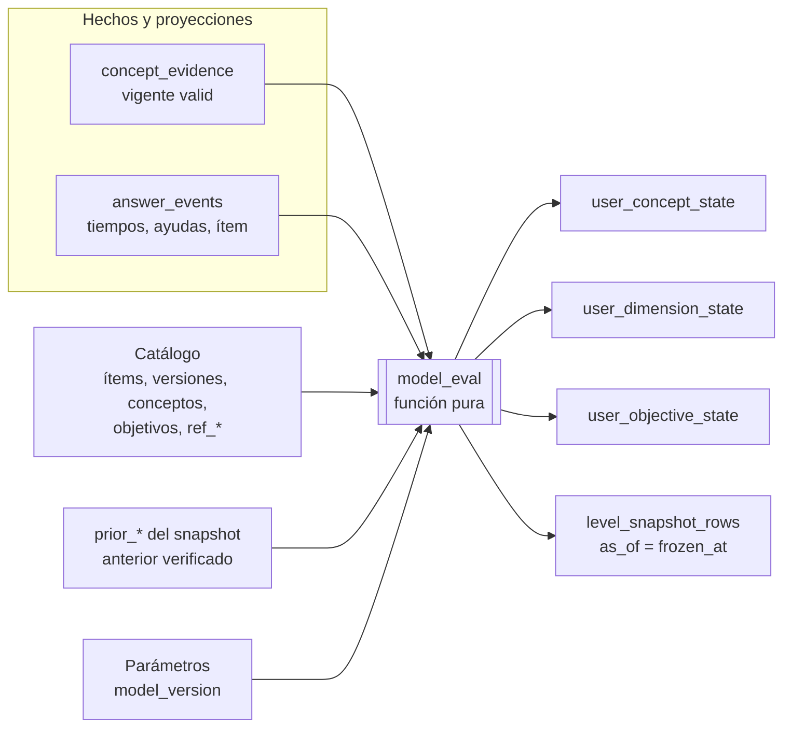

# Mastery Engine: diseño del motor de dominio

> **Estado: APROBADO — DISEÑO CERRADO** (revisión 2, aprobada el 2026-11-06, con M1–M13 tal como
> están; ver 16). Fase 4 del Learning System. La aprobación no autoriza la implementación.
> Revisión 2: la cota inferior `L` pasa a ser el percentil 5 de la Beta calculado numéricamente
> (**P5 numérico**; 4.4, 5.8, 7.6) y la velocidad se mide sólo en el escalón objetivo (4.7, 5.12).
> Además se corrige E0 (la fila 4 usa `σ = 0,8`: 0,996 días < 1 día), y 5.8.4 separa la tolerancia
> objetivo del P5 numérico, la precisión observada en JavaScript y la validación pendiente en
> PostgreSQL. Nada más cambia respecto de la 1.
> **Revisión 2.1 (2026-11-10, documental, aprobada por el usuario):** agrega el apéndice 17 con los
> historiales originales de E6, E8 y E9 y su procedencia; α y β de esos casos salen de los historiales
> (ya no de `m` y `sd`, que la rev. 2 no publicaba); aclara el historial de E8; corrige una errata de
> E9 (`L` = 0,1832 en «2 errores y 1 acierto»); y precisa el criterio 1 de 5.8.4. No cambia ninguna
> fórmula, parámetro, estado ni decisión M1–M13.
> **Revisión 2.2 (2026-11-10, aprobada por el usuario, opción A):** implementa el punto de partida K6
> de 5.7 **sólo en la implementación TypeScript de referencia** (`shared/mastery.ts`), con la que los
> dos casos E9 con prior quedan reproducidos; la función SQL canónica `mastery_eval` (M11) **no** lo
> incorpora y los snapshots no existen. Corrige la terminología de la 2.1: lo que ahí se llama «motor
> canónico» es la implementación TypeScript de referencia (sección 18). No cambia ninguna fórmula,
> parámetro, estado ni decisión M1–M13; el texto de la 2.1 se conserva como registro.
> **Revisión 2.3 (2026-11-11, decisiones K7 aprobadas por el usuario):** versión `me-1.0.1`, que es
> `me-1.0.0` más K6. Fija la selección del snapshot (`verified_at <= as_of`), el envejecimiento hasta
> `máx(t_last, frozen_at)`, la precisión del prior, el redondeo de la SQL y la interfaz SQL
> (`mastery_eval_prior`, con `mastery_eval` como envoltorio idéntico); K6 queda en la SQL canónica en
> una migración nueva **sin aplicar**, y los 35 vectores, validados en TypeScript y en SQL (sección 19).
> `me-1.0.0` no cambia. Mastery y Adaptive siguen apagados. Las revisiones 2.1 y 2.2 se conservan.
> **Revisión 2.4 (2026-11-11, corrección de alcance pedida por el usuario):** la opción A no autorizaba
> una migración. La migración `20261119120000`, su reversión y la prueba de paridad que dependía de
> ella se retiraron de la vía activa y se conservan como **evidencia experimental** en
> `tools/k6-sql-experiment/`. K6 vive sólo en TypeScript; la SQL canónica sigue sin K6, y E9 con prior
> vuelve a `validated_ts_k6_sql_pending` (sección 20). El texto de la 2.3 se conserva como registro.
> Es un diseño: no hay código, migraciones ni SQL ejecutado. Se apoya en
> `docs/LEARNING_DATA_ARCHITECTURE.md` (revisión 8, aprobada y cerrada) y no la modifica. Las dos
> agregaciones aditivas que propone (M10) están justificadas en 3.5 y no son bloqueantes.
> Fuera de alcance: Adaptive Learning, SRS, la interfaz Athlete Performance, el diseño del examen de
> nivel y la regla de selección de sus ítems (G1). Sólo se fija lo que el motor necesita de ellos.

## 0. Resumen

1. **Qué es.** Una función pura y versionada, `model_eval`, que recibe la evidencia de un usuario
   (capas 1 y 2 de la arquitectura), el catálogo, un punto de partida opcional (`prior_*`) y un
   instante `as_of`, y devuelve para cada (concepto, dimensión): **dominio**, **confianza**,
   **retención** y **velocidad de recuperación**, más un estado (`insufficient`, `in_progress`,
   `mastered`). Agregando esos resultados obtiene objetivos, dimensiones y niveles del MCER.
2. **Dominio** es la probabilidad estimada de que el usuario responda bien, **sin ayuda y en el
   primer intento**, un ítem que exige el **nivel de recuperación objetivo** de esa dimensión
   (para vocabulario y gramática, recuperar sin opciones). **Confianza** es qué tan precisa y
   actual es esa estimación. Son dos números distintos, y sin evidencia suficiente no hay ninguno.
3. **Cómo pesa cada respuesta.** Cada fila de evidencia aporta aciertos y errores ponderados por:
   repetición del mismo ejercicio, cercanía con la exposición anterior, antigüedad, azar de las
   opciones, ayudas y nivel de la escalera de recuperación. Un acierto se descuenta por cada
   explicación alternativa a «lo sabe» (azar, ayuda, memoria inmediata); un error, no.
4. **Lo que no hace.** El tiempo de respuesta **nunca** cambia el dominio. El paso del tiempo sin
   practicar **no** cambia el dominio: baja la confianza y la retención predicha. Repetir un mismo
   ejercicio no alcanza nunca para tener una estimación. Reconocer no cuenta como recordar.
5. **Garantías comprobadas con el calculador de referencia:** acertar sin ayuda nunca baja el
   dominio y errar nunca lo sube (0 violaciones en 8.000 historiales aleatorios, 6.1). Los ejemplos
   de la sección 8 salen de ese calculador, y el E0 se recalculó a mano completo.
6. **Niveles.** Un nivel se **demuestra** por dimensión con criterios verificables (cobertura,
   dominio, ningún objetivo débil, transferencia, retención demostrada, confianza). El nivel global
   es el **mínimo** de las cuatro dimensiones. El nivel **formal** sigue cambiando sólo al aprobar
   el examen de nivel, como fija la arquitectura. Con el contenido actual, **ningún usuario puede
   demostrar un nivel global**: no hay ítems de comprensión (hallazgo 9 de la arquitectura).
7. **Pendiente de aprobación:** decisiones M1–M13 (15).

## 1. Auditoría: qué existe y qué no

### 1.1 Fuentes leídas

- `docs/LEARNING_DATA_ARCHITECTURE.md` completo (rev. 8): capas, `concept_evidence`,
  `user_concept_state` (`prior_*`), `level_snapshot_rows`, verificación independiente (13.6, K9),
  K6, P9, G1, D6.
- Código: `shared/exercises.ts`, `shared/answers.ts`, `shared/srs.ts`, `content/types.ts`,
  `content/builders.ts`, `content/en/`, `src/features/learning/` (`api.ts`, `player.ts`),
  `docs/LEARNING_CURRICULUM.md`.
- Migraciones del repositorio (`supabase/migrations/`), en particular `…_curriculum.sql`
  (`srs_config`, `apply_word_result`, `submit_learning_session`, `get_learning_summary`).
- **No se ejecutó SQL** en esta fase. Los datos de producción citados son los de la auditoría de
  sólo lectura de la arquitectura (2026-11-06).

### 1.2 Diseñado contra implementado

| Elemento                                                                             | Diseño aprobado  | Repositorio / producción                                                                                                                   |
| ------------------------------------------------------------------------------------ | ---------------- | ------------------------------------------------------------------------------------------------------------------------------------------ |
| `concepts`, `learning_objectives`, `item_concepts`, `exercise_items`, `ref_*`        | Sí (fase 1)      | **No existe** ninguno                                                                                                                      |
| `answer_events`, `answer_gradings`, `concept_evidence`                               | Sí (fase 2)      | **No existe**. Hoy sólo hay `exercise_attempts` con el `correct` del cliente                                                               |
| `user_concept_state` (con `prior_*`), `user_dimension_state`, `user_objective_state` | Sí (fases 2 y 4) | **No existe**                                                                                                                              |
| `model_eval`, `model_version`                                                        | Nombrados (K9)   | **No existe ni está definido**: es el objeto de este documento                                                                             |
| `level_snapshots`, `level_snapshot_rows`, `user_level_results`                       | Sí (fase 6)      | **No existe**                                                                                                                              |
| Registro de ayudas (`assists`), plan firmado, `presented`                            | Sí (D9, 9)       | **No existe**: la app no registra audio repetido, audio lento ni pinyin                                                                    |
| «Dominada» de una palabra                                                            | —                | Existe: `user_word_progress.stage >= 3` (SRS, `shared/srs.ts`). Es planificación de repasos, no dominio, y la arquitectura la mantiene así |
| `response_ms`                                                                        | Sí               | Existe en `exercise_attempts` (lo mide la app, `player.ts`)                                                                                |

**Conclusión:** el motor no tiene hoy ninguna entrada válida. Todo lo que se diseña acá depende de
que existan las fases 1 a 4 de la arquitectura.

### 1.3 Hechos del código que condicionan el motor

| Hecho                                                                                                                                                                                                                        | Dónde                                           | Consecuencia para el motor                                                                                                          |
| ---------------------------------------------------------------------------------------------------------------------------------------------------------------------------------------------------------------------------- | ----------------------------------------------- | ----------------------------------------------------------------------------------------------------------------------------------- |
| `difficulty` existe (1–5) pero **ningún ejercicio ni palabra la asigna**: todos valen 1 por defecto                                                                                                                          | `content/types.ts`, migración `curriculum`      | No se puede usar como dificultad. La v1 usa la dificultad estructural (modo, formato, opciones) (M12)                               |
| `recommendedSeconds` es un valor fijo por tipo de ejercicio (12, 15, 20, 25 o 30 s), no calibrado                                                                                                                            | `content/builders.ts`                           | Sirve sólo como escala para la velocidad (5.12), no como dificultad                                                                 |
| Ejercicios escritos de inglés por tipo: `fill_blank` 289, `translate_write` 141, `image_choice` 113, `listen_choice` 111, `translation_choice` 99, `order_words` 58, `match_pairs` 54, `short_answer` 46, `complete_word` 26 | `content/en/` (conteo de llamadas a los atajos) | Predomina el reconocimiento. La producción controlada existe (frases de `translate_write`, `short_answer`); la producción libre, no |
| No hay ítems de comprensión en sentido estricto (`listen_choice` pide reconocer la forma)                                                                                                                                    | Hallazgo 9 de la arquitectura                   | La dimensión `comprehension` queda `no_content` (P9) hasta la fase C                                                                |
| Inglés sólo tiene A1 y A2; italiano, portugués y chino, sólo A1                                                                                                                                                              | `content/types.ts` (`Level = 'A1' \| 'A2'`)     | B1–C2 no son evaluables con el contenido actual                                                                                     |
| Producción sólo escrita: no hay formato `speech`                                                                                                                                                                             | `shared/exercises.ts` (`UserAnswer`)            | La dimensión `production` mide sólo producción escrita                                                                              |
| En lección, los errores vuelven al final con hasta 2 reintentos; la precisión se mide sobre el primer intento                                                                                                                | `LEARNING_CURRICULUM.md`                        | Los reintentos no aportan al dominio (5.4)                                                                                          |
| Producción: 2 usuarios, 6 sesiones, 47 intentos                                                                                                                                                                              | Auditoría de la arquitectura (1)                | **No hay datos para calibrar nada.** Todos los parámetros de la v1 son a priori (14)                                                |

### 1.4 Vacíos de información

Se documentan, no se completan con supuestos:

| #   | Vacío                                                                                             | Efecto                                                                                   | Cómo se resuelve                                          |
| --- | ------------------------------------------------------------------------------------------------- | ---------------------------------------------------------------------------------------- | --------------------------------------------------------- |
| V-1 | No existe el catálogo de conceptos y objetivos (sólo 69 `tags` y `unit.grammar` en jsonb)         | No se puede saber hoy cuántos conceptos tiene cada nivel ni cuántos ítems tiene cada uno | Fase 1 de la arquitectura y revisión V6 (P8)              |
| V-2 | No se sabe cuántos ítems distintos de recuperación tiene cada concepto                            | Un concepto con un solo ítem de recuperación nunca puede llegar a `mastered` (5.9)       | Auditoría de contenido después de la fase 1               |
| V-3 | No hay datos de comportamiento para calibrar umbrales, factores ni vidas medias                   | Los valores de la tabla 5.14 son a priori                                                | Protocolo de validación de la sección 9                   |
| V-4 | No hay diseño del examen de nivel                                                                 | El motor sólo puede fijar los requisitos que el examen debe cumplir (7.6)                | Fase de diseño del examen (dependencia de G1)             |
| V-5 | No hay criterios de corrección para producción libre (`grading_spec.criteria` sólo está diseñado) | B1+ en producción no es evaluable                                                        | Contenido y corrector de criterios (8 de la arquitectura) |

## 2. Alcance y principios

- **Determinista y puro.** El resultado depende sólo de los argumentos de `model_eval`. No lee
  `now()`, no usa azar, no lee estados ni agregados (capas 3 y 4).
- **Explicable.** Cada número se puede reconstruir con la tabla de evidencia y la tabla de
  parámetros. Ningún factor carece de una frase que lo justifique (5.15).
- **Sin IA generativa.** Ni para corregir ni para estimar. Las respuestas abiertas llegan ya
  corregidas por `shared/answers.ts` y por criterios deterministas o revisión humana (8 de la
  arquitectura).
- **El mismo motor para todos los idiomas.** Ninguna fórmula depende del idioma (12).
- **Ranked y Plus no son entradas** (D6, 15 de la arquitectura): el motor sólo lee
  `concept_evidence`, sus hechos de origen y el catálogo.
- **No es SRS ni Adaptive Learning.** Estima; no decide qué practicar ni cuándo. `user_word_progress`
  sigue siendo el planificador.
- **No certifica.** «Nivel demostrado» es una estimación interna de PolyGo, no una certificación
  del MCER (7.7).

## 3. Arquitectura del motor

### 3.1 Posición en las capas



### 3.2 La función

```
model_eval(model_version, user_id, language_code, scope, as_of)
  → filas de resultado por (concepto, dimensión), objetivo, dimensión y nivel
```

**Entradas permitidas** (las mismas que admite la referencia de 13.6 de la arquitectura):

| Entrada                                                                                               | Qué toma                                                                                                                                                                                                                                           |
| ----------------------------------------------------------------------------------------------------- | -------------------------------------------------------------------------------------------------------------------------------------------------------------------------------------------------------------------------------------------------- |
| `concept_evidence` activa (`superseded_at is null`) de alcances no congelados, `recorded_at <= as_of` | `concept_id`, `dimension`, `recorded_at`, `event_id`, `assessment_mode`, `outcome`, `score`, `is_first_try`, `response_ms`, `since_last_seen_s`, `source`                                                                                          |
| `answer_events` (por `event_id`)                                                                      | `item_id`, `item_version_id`, `session_id`, `presented` (cantidad de opciones), `assists` (detalle; `concept_evidence.assisted` es sólo un booleano)                                                                                               |
| Historial de primeros intentos del usuario por `item_id` (de `answer_events`)                         | Instante del intento anterior del mismo ítem (5.4) y si el ítem es nuevo para el usuario (5.10)                                                                                                                                                    |
| Catálogo                                                                                              | `exercise_items` (`type`, `assessment_mode`, `response_format`, `input_modality`), `exercise_item_versions` (`recommended_seconds`, payload), `concepts` (`level`, `kind`), `item_concepts`, `objective_concepts` (`role`), `ref_assessment_modes` |
| `level_snapshot_rows` + `level_snapshots.frozen_at` del snapshot anterior `verified`                  | Punto de partida (`prior_*`) de conceptos compartidos (K6). **No** se lee `prior_*` de `user_concept_state`                                                                                                                                        |
| Parámetros de `model_version`                                                                         | Tabla 5.14                                                                                                                                                                                                                                         |

**Prohibido como entrada:** `user_*_state`, `user_knowledge_snapshots`, `user_skill_daily`,
`user_dimension_daily`, `item_stats`, `user_word_progress`, `difficulty`, datos de Ranked o de
Plus, y el texto de `answer_responses`.

### 3.3 Reglas de determinismo

1. **Orden total** de la evidencia: (`recorded_at`, `event_id`, `concept_id`, `dimension`).
2. **Tiempo:** todos los intervalos se calculan en segundos desde los `timestamptz` y se convierten a
   días dividiendo por 86.400, sin zona horaria. Los días distintos se cuentan en UTC, igual que
   las semanas ISO de 13.6.
3. **Aritmética:** la implementación canónica es SQL con `numeric` (`power`, `ln`, `exp` sobre
   `numeric`). La grilla de retención se normaliza en dominio logarítmico (restando el máximo antes
   de exponenciar).
4. **Redondeo:** los valores publicados se redondean a 4 decimales (`round` de Postgres: mitad
   lejos de cero). **Toda comparación contra un umbral se hace con el valor redondeado.**
5. **`as_of` explícito:** nunca `now()`. La cola de recálculo pasa el instante de cálculo; el
   snapshot pasa `frozen_at`; `model_trajectory` pasa el fin de cada semana.
6. **Catálogo mutable:** las versiones de ítem son inmutables, pero el universo de conceptos de un
   nivel y los roles `core`/`support` pueden cambiar de `status`. Cada resultado agregado guarda un
   `catalog_digest` (sha256 de la lista ordenada de (`concept_id`, `dimension`, peso) usada) para
   detectar que se calculó con otro catálogo.

### 3.4 Quién lo ejecuta

| Llamador                                          | `as_of`                       | Para qué                                              |
| ------------------------------------------------- | ----------------------------- | ----------------------------------------------------- |
| Cola `knowledge_recompute_queue` (`pg_cron`)      | instante del recálculo        | Estados de conceptos marcados `dirty` y sus agregados |
| Constructor y referencia del snapshot (13.5–13.6) | `frozen_at`                   | Campos del modelo de `level_snapshot_rows`            |
| `model_trajectory` (13.6)                         | fin de cada semana ISO        | Evolución del dominio del nivel                       |
| Validación offline (9)                            | justo antes de cada respuesta | Medir la calidad predictiva                           |

`model_eval` es la **definición del modelo** y por eso la comparten el constructor y la referencia,
como ya prevé 13.6. Lo que debe ser independiente es la agregación de hechos, no la fórmula. La
corrección de la fórmula misma se prueba con vectores calculados a mano y con una segunda
implementación usada sólo en pruebas (10).

### 3.5 Salidas y dónde se guardan

| Salida                                    | Columna existente (arquitectura)                                                             |
| ----------------------------------------- | -------------------------------------------------------------------------------------------- |
| Dominio `m` (nulo si `insufficient`)      | `mastery`                                                                                    |
| Confianza `c` al `as_of` del cálculo      | `confidence`                                                                                 |
| Retención predicha al `as_of` del cálculo | `retention_estimate`                                                                         |
| Velocidad relativa                        | `recall_speed`                                                                               |
| Versión                                   | `model_version`, `computed_at`                                                               |
| Uso de un punto de partida y cuál         | `prior_snapshot_id` (no nulo ⇔ la fórmula lo usó: la regla de 5.7 lo usa siempre que existe) |
| Suficiencia                               | `evidence_sufficiency` (snapshot)                                                            |

**Lo que no tiene columna:** estado (`in_progress`/`mastered`), cota inferior, perfil por escalón,
transferencia, vida media de retención, `catalog_digest`. Dos opciones, ambas compatibles con la
arquitectura:

- **Recomendada (M10a):** columna aditiva `model_detail jsonb` en `user_concept_state`,
  `user_dimension_state`, `user_objective_state` y `level_snapshot_rows`, validada con
  `pg_jsonschema`, sin texto del usuario. Motivo: `confidence` y `retention_estimate` dependen de
  `as_of`, así que guardados envejecen; con `t_last` y la vida media en `model_detail`, la lectura
  puede recalcularlos para «ahora» sin volver a leer la evidencia, y el snapshot conserva el
  detalle que ya no se podrá recalcular después de compactar (K5).
- **Alternativa:** recalcular con `model_eval` en cada lectura (posible mientras el nivel está
  activo) y aceptar que el snapshot guarde sólo los cuatro campos del modelo.

No es un bloqueo: el motor funciona con las columnas existentes. Se pide aprobación porque agrega
una columna a tablas ya diseñadas.

## 4. Definiciones

### 4.1 Unidad de evaluación

La unidad es el par **(concepto, dimensión)**, la misma clave de `user_concept_state` y de
`concept_evidence`. Cada dimensión se calcula sólo con sus filas (C1 de la arquitectura): ninguna
dimensión se deriva de otra.

### 4.2 Escalera de recuperación

Cada fila de evidencia está en un **escalón** según su `assessment_mode`:

| Dimensión               | Escalón R (reconocer) | Escalón G (con apoyo)                | Escalón L (sin apoyo)                                      |
| ----------------------- | --------------------- | ------------------------------------ | ---------------------------------------------------------- |
| `vocabulary`, `grammar` | `recognition`         | `cued_recall`, `guided_construction` | `free_recall`, `controlled_production`, `free_production`  |
| `production`            | —                     | `controlled_production` (escalón P)  | `free_production` (escalón F)                              |
| `comprehension`         | —                     | —                                    | `listening_comprehension`, `reading_comprehension` (único) |

El **escalón objetivo** `T` es el que define el dominio:

| Dimensión               | A1–A2                     | B1–C2                                          |
| ----------------------- | ------------------------- | ---------------------------------------------- |
| `vocabulary`, `grammar` | L                         | L                                              |
| `production`            | P (producción controlada) | F (producción libre corregida con criterios)   |
| `comprehension`         | único                     | único (con requisitos de texto por nivel, 7.4) |

El nivel que se usa es el **del concepto** (`concepts.level`), no el nivel activo del usuario.

### 4.3 Dominio de un concepto

> **Dominio** `m(c, d)` = probabilidad estimada de que el usuario responda correctamente, sin
> ayudas y en el primer intento, un ítem del escalón objetivo de `d` que evalúa el concepto `c`.

Se estima con una distribución Beta(α, β) cuyos aciertos y errores son las contribuciones
ponderadas de la evidencia (5.5–5.7). `m = α / (α + β)`. El dominio **no** incluye el olvido
futuro (eso es la retención) ni la rapidez (eso es la velocidad).

### 4.4 Confianza

> **Confianza** `c(c, d)` = precisión de la estimación × actualidad de la evidencia, en [0, 1].

- **Precisión** `π = 1 − sd / sd₀`: cuánto se redujo la incertidumbre respecto de no saber nada
  (`sd₀` = desvío de Beta(1, 1) = 0,2887). Un dominio cerca de 0,5 con la misma cantidad de
  evidencia tiene menos precisión que uno cerca de 0 o de 1: es correcto, porque es más incierto.
- **Actualidad** `f = 2^(−(as_of − t_last) / H_conf)`: evidencia vieja describe peor el presente.
- Se publica además la **cota inferior** `L` = percentil 5 de Beta(α, β) calculado numéricamente (**P5 numérico**), que es la que
  deciden los umbrales (5.8). No es una garantía de que el dominio real supere `L` con 95 % de
  probabilidad: la Beta del motor se arma con evidencia ponderada, no con ensayos independientes
  (5.8.2). Es una regla de decisión prudente cuya calibración se comprueba con datos (9).

### 4.5 Estados de un concepto

| Estado         | Condición                                                                                         | Qué se publica                                                           |
| -------------- | ------------------------------------------------------------------------------------------------- | ------------------------------------------------------------------------ |
| `insufficient` | `n_eff < 2` **o** evidencia directa (escalón ≥ T) de menos de 2 ítems distintos                   | Nada de dominio ni confianza (P9). Sí el perfil por escalón como detalle |
| `in_progress`  | Suficiente y no cumple `mastered`                                                                 | `m`, `c`, `L`                                                            |
| `mastered`     | Suficiente, `m ≥ 0,80`, `L ≥ 0,60`, evidencia directa en ≥ 2 días distintos y transferencia (4.8) | `m`, `c`, `L`                                                            |

Además, un concepto suficiente con `m < 0,50` se marca como **punto débil** (`weak`), sin cambiar su
estado.

### 4.6 Retención

> **Retención** `R(c, d, as_of)` = probabilidad predicha de recuperar el concepto sin ayuda en
> `as_of`, dado el tiempo transcurrido desde la última exposición y la vida media de memoria
> estimada con las recuperaciones espaciadas observadas.

Es independiente del dominio: el dominio dice cuánto sabe cuando lo acaba de practicar; la
retención, cuánto conserva después.

### 4.7 Velocidad de recuperación

> **Velocidad** `v(c, d)` = media geométrica de `tiempo de respuesta / tiempo de referencia del
ítem` en sus aciertos sin ayuda en el primer intento **del escalón objetivo `T`** de `d` (4.2):
> la misma tarea que define el dominio. 1,0 = el tiempo de referencia; 0,5 = la mitad; 2,0 = el doble.

En vocabulario y gramática mide, por lo tanto, la rapidez para **recuperar sin opciones**: los
reconocimientos (R) y las recuperaciones con apoyo (G) nunca entran en `v`. Cada escalón tiene su
propia velocidad como detalle (`v_R`, `v_G`, …, 5.12), y ninguna se combina con otra. Nunca
modifica el dominio, la confianza ni la retención.

### 4.8 Transferencia

> **Transferencia** = desempeño en ítems que el usuario nunca había visto, después de haber
> practicado el concepto con otros ítems. Mide que lo aprendido no está atado a un ejercicio.

- **Cercana:** primer encuentro con un ítem nuevo del escalón ≥ G (en `comprehension` y
  `production`, cualquier escalón).
- **Lejana:** además, con un par (tipo de ejercicio, `input_modality`) que el usuario no había usado
  para ese concepto.

### 4.9 Dominio de un objetivo, una dimensión y un nivel

- **Dimensión en un nivel:** cuánto de los conceptos de ese nivel en esa dimensión está
  **demostrado**. Lo no evaluado cuenta como no demostrado, no como desconocido promediable (5.13).
- **Objetivo:** lo mismo sobre los conceptos del objetivo; el valor general del objetivo es el
  **mínimo** entre sus dimensiones.
- **Nivel:** no es un número. Es un vector de cuatro dimensiones, cada una con su estado y sus
  criterios cumplidos (7). Ninguna dimensión compensa a otra.

## 5. Fórmulas, versión `me-1.0.0`

### 5.1 Notación

Para un par (c, d), `E` es su evidencia activa con `recorded_at ≤ as_of`, ordenada según 3.3. Para
cada fila `e`: `t_e` (días), `s_e` (valor observado), `g_e` (azar), `a_e` (ayudas), `k(e)` (escalón),
`ρ_e`, `σ_e`, `φ_e` (pesos). `t_last` = mayor `t_e` de primeros intentos; `t_first` = el menor.

### 5.2 Filtro de entrada

- Sólo filas de `concept_evidence` activas (las únicas que existen son de correcciones `valid`
  vigentes de sesiones `server_verified` o `client_reported` validadas: 6.5 y 7.4 de la arquitectura).
- Sólo **primeros intentos** (`is_first_try`). Los reintentos de la misma sesión vienen después de
  ver la respuesta correcta: no informan dominio y tienen peso 0.
- Todos los orígenes (lección, consolidación, repasos, práctica libre, «Tus errores», evaluaciones,
  sesiones abandonadas) entran con las mismas reglas (15 de la arquitectura).

### 5.3 Valor observado `s`

`s = score` de `concept_outcomes` si no es nulo; si no, por veredicto: `correct` 1;
`correct_minor` (error de tipeo tolerado) 0,9; `partial` el `score`; `incorrect`, `skipped`,
`timeout` 0.

### 5.4 Peso de información `w = ρ · σ · φ`

**Repetición del mismo ítem** (no infla): `ρ = 1` la primera vez que el usuario responde ese ítem;
después, `ρ = mín(1, Δ_ítem / G)` con `G = 7 días`, donde `Δ_ítem` es el tiempo desde el primer
intento anterior **del mismo ítem**. Repetir un ejercicio a los pocos minutos casi no aporta; a la
semana aporta como uno nuevo, porque recordar después de una semana sí es evidencia. El peso de una
fila depende sólo de su propio hecho (no se recalcula al llegar filas nuevas), lo que garantiza la
monotonía (6.1).

**Cercanía con la exposición anterior del concepto** (`since_last_seen_s`):

| Tiempo desde la exposición anterior         | `σ` |
| ------------------------------------------- | --- |
| Nulo (primera exposición) o menos de 10 min | 0,5 |
| De 10 min a 1 día                           | 0,8 |
| 1 día o más                                 | 1,0 |

Una respuesta dada minutos después de ver el concepto mide memoria inmediata: informa la mitad,
sea acierto o error.

**Antigüedad:** `φ = 2^(−(t_last − t_e) / H)` con `H = 90 días`. Se ancla en la **última evidencia**,
no en `as_of`: por eso el paso del tiempo sin practicar no cambia el dominio (6.2).

### 5.5 Aportes a aciertos y errores

```
aciertos_e = w · (1 − g) · s · a
errores_e  = w · (1 − s · a)
```

- **Azar `g`** (sólo descuenta aciertos): `select` con `n` opciones → `1/n` (`n` sale de
  `presented` o de la versión); `pairs` con `n` parejas → `1/n`; `tiles` y `typed` → 0. Un acierto
  entre 4 opciones vale 0,75 de acierto, porque una vez de cada cuatro se acierta sin saber. Un
  error no tiene explicación alternativa y vale entero.
- **Ayudas `a`** (crédito parcial, tomadas de `answer_events.assists`; producto con piso 0,25):

| Ayuda (`ref_assists`)                       | Factor                                   | Por qué                                          |
| ------------------------------------------- | ---------------------------------------- | ------------------------------------------------ |
| `audio_replays`                             | 1 repetición gratis; × 0,85 cada una más | Escuchar dos veces es normal en comprensión oral |
| `slow_audio_plays` ≥ 1                      | × 0,7                                    | Cambia la tarea a una más fácil                  |
| `prompt_audio_plays` ≥ 1                    | × 0,8                                    | Da la pronunciación de lo que hay que reconocer  |
| `reading_visible` (pinyin)                  | × 0,6                                    | Resuelve la lectura de los caracteres            |
| `hints_revealed` (reservada: hoy no existe) | × 0,4 por pista                          | Revela parte de la respuesta                     |

Un acierto con ayuda es en parte un error: con `a = 0,4`, cuenta 0,4 de acierto y 0,6 de error.
Así, quien siempre usa pistas converge a un dominio de 0,4 por más que practique (E3). Es la única
forma en que un acierto puede bajar el dominio, y es deliberada: necesitar la pista muestra que
no lo recuperaba solo.

### 5.6 Combinación por la escalera

Para cada escalón `k`: `N_k = Σ w`, `S_k = Σ aciertos`, `F_k = Σ errores`. Con el escalón objetivo `T`:

```
directos (k ≥ T):    S_dir = Σ_{k≥T} S_k
                     F_dir = F_T + 0,5 · Σ_{k>T} F_k
                     W_dir = Σ_{k≥T} N_k
indirectos (k < T):  S_ind = mín( Σ_{k<T} τ_k · S_k ,  S_dir )      τ_R = 0,25   τ_G = 0,5
                     F_ind = Σ_{k<T} F_k
```

- **Acertar algo más fácil prueba poco** (τ); **fallar algo más fácil prueba mucho** (entero).
- **Lo indirecto nunca pesa más que lo directo:** el tope `S_dir` hace que reconocer sólo pueda
  reforzar lo que ya se demostró recuperando. Sin ningún acierto directo, el reconocimiento no aporta
  nada al dominio (pero sí aparece en el perfil por escalón).
- **Fallar algo más difícil que el objetivo prueba la mitad** (0,5): no poder producir libremente
  una frase no significa no poder producirla con guía.
- Acertar algo más difícil que el objetivo cuenta entero.

### 5.7 Punto de partida

Todo punto de partida es **evidencia ficticia ubicada en el tiempo**, y envejece con el mismo `φ`
que la evidencia real:

- **Base:** Beta(1, 1) ubicada en `t_first`: aporta `φ₀ = 2^(−(t_last − t_first)/H)` a α y a β.
- **Snapshot anterior (K6)**, si el concepto tiene fila en el último snapshot verificado:
  `n_p = N_p · prior_confidence` con `N_p = 4`, ubicado en `frozen_at` de ese snapshot:
  `α_p = prior_mastery · n_p · φ_p`, `β_p = (1 − prior_mastery) · n_p · φ_p`,
  `φ_p = 2^(−(t_last − frozen_at)/H)`. Como `prior_confidence` ya incluye la actualidad hasta
  `frozen_at`, el envejecimiento total es el de toda la distancia a la última evidencia del nivel
  anterior, sin contarla dos veces.

Un nivel anterior aporta como máximo lo que valen 4 respuestas, menos con el tiempo, y **nunca**
cuenta para la suficiencia: sin evidencia nueva el estado es `insufficient` y no se muestra nada
(K6, E9).

### 5.8 Estimación

```
α = φ₀ + α_p + S_dir + S_ind
β = φ₀ + β_p + F_dir + F_ind
m  = α / (α + β)
sd = √( m (1 − m) / (α + β + 1) )          (desvío exacto de la Beta)
L  = Q(0,05; α, β)                          (P5 numérico: solución de I_L(α, β) = 0,05)
π  = máx(0, 1 − sd / 0,2887)
f  = 2^(−(as_of − t_last) / 90)
c  = π · f
```

`I_x(α, β)` es la función Beta incompleta regularizada (la función de distribución de la Beta) y
`Q` su inversa. `L` sólo se calcula para pares suficientes (5.9): los insuficientes no publican
nada.

#### 5.8.1 Por qué no la aproximación normal

La revisión 1 usaba `L = máx(0, m − 1,645 · sd)`. Con poca evidencia y dominio alto, que es justo
donde se decide `mastered`, la Beta es muy asimétrica (cola larga hacia abajo) y la aproximación
**sobrestima** el percentil: aprueba lo que el P5 numérico no aprueba. Con dominio bajo lo
subestima (y el `máx(0, ·)` lo deja en 0), lo que no cambia decisiones pero publica un número falso.

| Beta(α, β)                  | `m`    | `L` normal | `L` P5 numérico | Error  | Consecuencia                                               |
| --------------------------- | ------ | ---------- | --------------- | ------ | ---------------------------------------------------------- |
| (1, 1) (sin evidencia)      | 0,5000 | 0,0251     | 0,0500          | −0,025 | —                                                          |
| (3, 1) (2 aciertos limpios) | 0,7500 | 0,4314     | 0,3684          | +0,063 | —                                                          |
| (5, 1) (4 aciertos limpios) | 0,8333 | **0,6016** | **0,5493**      | +0,052 | La normal da `L ≥ 0,60` con 4 aciertos; el P5 numérico, no |
| (6, 1) (5 aciertos limpios) | 0,8571 | 0,6536     | 0,6070          | +0,047 | Mínimo real para `L ≥ 0,60` sin errores                    |
| (1; 0,5) (evidencia vieja)  | 0,6667 | 0,1762     | 0,0975          | +0,079 | Peor caso de la tabla: α, β < 1                            |
| (13, 4) (examen 12/15)      | 0,7647 | **0,6002** | **0,5834**      | +0,017 | La propuesta de examen de la rev. 1 no aprobaba (7.6)      |
| (2, 8)                      | 0,2000 | 0,0016     | 0,0410          | −0,039 | —                                                          |
| (100, 25)                   | 0,8000 | 0,7414     | 0,7387          | +0,003 | Con mucha evidencia las dos coinciden                      |

El error positivo (la normal es demasiado optimista) llega a 0,06–0,08 en el rango de pocas
respuestas, y no hay un `z` que lo corrija para todos los casos, porque depende de la asimetría.
Por eso el P5 numérico reemplaza a la aproximación (M5).

#### 5.8.2 Qué garantiza `L` y qué no

- **Define** `L` como el percentil 5 de la Beta(α, β) que construye el motor, calculado
  numéricamente (**P5 numérico**). Su precisión numérica se trata en 5.8.4: hay una tolerancia
  objetivo y una precisión observada en JavaScript, pero la implementación canónica todavía no está
  validada. No es una garantía matemática.
- **Monotonía en la evidencia simultánea:** si una fila llega en `t = t_last`, un acierto sin ayuda
  nunca baja el percentil verdadero y un error nunca lo sube, porque el percentil de la Beta crece
  con α y decrece con β. El P5 numérico la hereda salvo diferencias del orden de su error numérico
  (5.8.4). Propiedad 6.10.
- **No garantiza** que el dominio real del usuario supere `L` con 95 % de probabilidad. Los
  pseudo-conteos α y β no son ensayos independientes: están ponderados por `σ`, `ρ`, `φ`, ayudas y
  azar; el descuento por azar no es una verosimilitud; los ítems de un concepto tienen
  dificultades distintas y respuestas correlacionadas; y la previa influye. Con muchos conceptos
  hay además comparaciones múltiples: aun con una Beta perfectamente calibrada, alrededor de 1 de
  cada 20 conceptos en el límite pasaría `L ≥ 0,60` sin tener 0,60. `L` es una **regla de decisión
  prudente**, no un intervalo de confianza; su calibración es una métrica de 9.
- **Puede bajar con un acierto espaciado.** Si una fila llega con `Δ > 0` después de `t_last`, toda
  la evidencia anterior envejece por `2^(−Δ/H)` antes de sumarla: `m` no cambia por eso (6.1), pero
  la Beta tiene menos masa y `L` puede bajar aunque la fila nueva sea un acierto. Beta(20, 1) y un
  acierto 180 días después: (20 × 0,25 + 1; 0,25) → `L` pasa de 0,8609 a 0,8069. Es coherente con
  4.4 (evidencia vieja describe peor el presente) y no rompe 6.1, que trata de `m`.

#### 5.8.3 Cálculo en PostgreSQL

PostgreSQL no tiene la Beta incompleta ni su inversa, y su `lgamma` (sólo en versiones recientes)
es `double precision`. Las tres piezas se escriben en SQL/PL/pgSQL sobre `numeric`, con número de
iteraciones fijo para que el resultado sea determinista (3.3):

| Pieza           | Método                                                                                                                                                                           |
| --------------- | -------------------------------------------------------------------------------------------------------------------------------------------------------------------------------- |
| `ln Γ(z)`       | Recurrencia `ln Γ(z) = ln Γ(z + 1) − ln z` hasta `z ≥ 10` y serie de Stirling con 8 términos (error de truncamiento < 2 · 10⁻¹⁸, 5.8.4)                                          |
| `I_x(α, β)`     | Fracción continua de Lentz modificada, máximo 300 iteraciones (corte en `abs(δ − 1) < 10⁻¹⁵`; sin convergencia → error); si `x > (α + 1)/(α + β + 2)` se usa `1 − I_{1−x}(β, α)` |
| `Q(0,05; α, β)` | Bisección sobre [0, 1] con **40 iteraciones fijas** (ancho final 2⁻⁴⁰ ≈ 9 · 10⁻¹³); se toma el punto medio y se redondea a 4 decimales                                           |

- **Viable:** `α, β > 0` siempre (la previa base `φ₀` es positiva), y en el rango del motor
  (α + β entre ~0,1 y unos cientos) la fracción continua converge en decenas de iteraciones. El
  costo es de unas 40 evaluaciones de `I_x` por par suficiente; se mide junto con el resto en V9
  (limitación 14.12).
- **Comprobación:** la segunda implementación en TypeScript (10) usa el mismo algoritmo y además se
  compara con formas cerradas: `Q(0,05; a, 1) = 0,05^(1/a)`, `Q(0,05; 1, b) = 1 − 0,95^(1/b)`,
  `Q(0,05; 1, 1) = 0,05`, y con las referencias independientes de 5.8.4.
- **Empates de redondeo:** SQL y TypeScript pueden discrepar en el cuarto decimal si el percentil
  verdadero queda, a la escala de sus errores numéricos, cerca de un punto medio. La prueba exige
  igualdad. Si falla por eso, se investiga cuál se aparta de las referencias de 5.8.4; la SQL sólo
  prevalece (canónica, M11) cuando cumple el criterio de aceptación de 5.8.4.

#### 5.8.4 Precisión numérica

Esta sección separa tres cosas distintas:

| Qué                     | Estado                                                                                                                           |
| ----------------------- | -------------------------------------------------------------------------------------------------------------------------------- |
| **Tolerancia objetivo** | Requisito de diseño: `abs(Q_calculado − Q_referencia) ≤ 10⁻¹⁰`. **No es una garantía matemática**                                |
| **Precisión observada** | Medida en una réplica JavaScript (`double`) contra referencias independientes: error máximo 4,7 · 10⁻¹³ en los vectores probados |
| **Validación canónica** | **Pendiente.** La función PostgreSQL en `numeric` no existe ni se midió                                                          |

**Tolerancia objetivo.** En el dominio probado, α, β ∈ [0,005; 500], la implementación debe cumplir
`abs(Q_calculado − Q_referencia) ≤ 10⁻¹⁰` **antes** de redondear, en cada vector de esta sección.
Es una tolerancia **absoluta**, no relativa. Si se cumple, el valor publicado a 4 decimales es el
redondeo correcto del percentil, salvo que éste quede a menos de 10⁻¹⁰ de un punto medio
(`…,xxxx5`). En ese caso el cuarto decimal puede salir hacia cualquiera de los dos lados
(diferencia de 0,0001).

**Por qué no es una garantía.** Dos de las tres piezas tienen cota rigurosa: el truncamiento de
Stirling y la bisección. La fracción continua, en cambio, se corta con un criterio de parada
práctico. No hay una cota demostrada de su resto para todo (α, β, x). Mientras no la haya, 10⁻¹⁰
es un objetivo comprobado sólo en los vectores, no una propiedad de todo el dominio.

**Qué tiene cota rigurosa y qué es aproximado:**

| Pieza                          | Naturaleza del error                                                                                                                                                                                                                                                      | Cota                                                                                     |
| ------------------------------ | ------------------------------------------------------------------------------------------------------------------------------------------------------------------------------------------------------------------------------------------------------------------------- | ---------------------------------------------------------------------------------------- |
| Recurrencia de `ln Γ`          | Exacta: sólo suma logaritmos                                                                                                                                                                                                                                              | Sólo el error aritmético de `ln`                                                         |
| Serie de Stirling (`z ≥ 10`)   | **Aproximada:** se corta después del término de B₁₆. Para `z` real positivo, el error es menor que el primer término omitido: `abs(B₁₈) / (18 · 17 · z¹⁷)`                                                                                                                | < 1,8 · 10⁻¹⁸ en `ln Γ` (cota rigurosa)                                                  |
| Fracción continua de Lentz     | **Aproximada:** se corta cuando el factor de corrección cumple `abs(δ − 1) < 10⁻¹⁵`. Es un criterio de parada práctico, no una cota demostrada del resto. Si llega a 300 iteraciones sin cumplirlo, la función **falla con error**: nunca devuelve un valor no convergido | ≈ 10⁻¹⁵ relativo por evaluación (observado). Máximo observado: 61 iteraciones; nunca 300 |
| Bisección                      | Exacta mientras el signo de `I_x − 0,05` se evalúe bien: el punto medio del intervalo final queda a ≤ 2⁻⁴¹ del percentil                                                                                                                                                  | ≤ 4,6 · 10⁻¹³ (cota rigurosa)                                                            |
| Propagación del error de `I_x` | Un error `ε` en `I_x` cerca del percentil mueve `Q` en ≈ `ε / densidad(Q)`. En el dominio validado la densidad en el percentil es ≥ 0,0199 (mínimo en Beta(0,1; 0,005)), salvo cuando el percentil está por debajo de 10⁻⁶ y se publica 0,0000                            | ≤ 51 · `ε`                                                                               |
| Cancelación en `ln B(α, β)`    | Con α + β grande, `ln Γ(α + β) − ln Γ(α) − ln Γ(β)` resta números de magnitud ~10³. En `double` pierde unos 3 dígitos; en `numeric`, con ≥ 30 dígitos significativos, no influye                                                                                          | `double`: ≤ 5,4 · 10⁻¹³ observado en `I_x`                                               |

En la réplica JavaScript, Stirling (cota rigurosa) y Lentz (comportamiento observado) quedaron
varios órdenes por debajo de la tolerancia objetivo. El error observado lo dominó la bisección
(cota rigurosa de 4,6 · 10⁻¹³), y el máximo observado está unas 200 veces por debajo de 10⁻¹⁰. Es
una observación sobre los vectores probados, no una cota para todo el dominio. En `numeric` se
espera un error igual o menor, pero **no se midió**.

**Sin resultados parciales.** Si la fracción continua llega a 300 iteraciones sin cumplir el
criterio de parada, la función lanza un error y el cálculo de ese par falla: no se devuelve el
último valor parcial, ni un valor redondeado, ni un sustituto. El fallo es visible y hay que
investigarlo. Ningún vector probado se acercó al tope: el máximo fue 61 iteraciones.

**Percentiles diminutos.** La precisión es absoluta: con α muy chico el percentil verdadero puede ser
10⁻¹⁹ o 10⁻¹⁰⁰. La bisección devuelve el punto medio de [0; 2⁻⁴⁰] ≈ 4,5 · 10⁻¹³, que se publica
como 0,0000, el valor correcto a 4 decimales. El motor no usa ningún valor de `L` en escala
logarítmica, así que la falta de precisión relativa no afecta a ninguna decisión.

**Precisión observada (réplica JavaScript).** Se escribió una réplica en `double` (JavaScript) del
algoritmo de 5.8.3:
Stirling con recurrencia, Lentz con corte en 10⁻¹⁵ y tope de 300, y bisección de 40 pasos. Se la
comparó con tres referencias que **no usan ni `ln Γ` ni fracción continua**:

1. **Formas cerradas:** `Q(p; a, 1) = p^(1/a)`; `Q(p; 1, b) = 1 − (1 − p)^(1/b)`;
   Beta(½, ½): `sin²(πp/2)`; Beta(½, 3/2) y Beta(3/2, ½): CDF
   `(2/π)(asin √x ± √(x(1 − x)))`, invertida por bisección de 200 pasos.
2. **Identidad binomial** para α, β enteros: `I_x(a, b) = P(Bin(a + b − 1, x) ≥ a)`, sumando la
   función de probabilidad.
3. **Cuadratura tanh-sinh** de la densidad para parámetros arbitrarios, con los cambios de variable
   `v = t^α` en [0, ½] y `w = (1 − t)^β` en [½, 1], que quitan las singularidades de los extremos.
   Contra 1 y 2 difiere en ≤ 3 · 10⁻¹⁵. Una primera versión sin el cambio de variable fallaba hasta
   en 0,1 con β ≤ 0,01 (en Beta(0,1; 0,005)). La réplica del algoritmo estaba bien: lo confirmó la
   forma cerrada de Beta(1; 0,01).

| Conjunto                                                                                                                        | Pares | Error máximo de `Q`    | Discrepancias al redondear a 4 decimales      |
| ------------------------------------------------------------------------------------------------------------------------------- | ----- | ---------------------- | --------------------------------------------- |
| Grilla α, β ∈ {0,005; 0,01; 0,05; 0,1; 0,2; 0,5; 1; 1,5; 2; 3; 5; 10; 20; 50; 100; 200; 500}                                    | 289   | 4,7 · 10⁻¹³            | 0                                             |
| — simétricos (α = β)                                                                                                            | 17    | 4,6 · 10⁻¹³            | 0                                             |
| — con α < 1 o β < 1                                                                                                             | 168   | 4,7 · 10⁻¹³            | 0                                             |
| — con α, β ≥ 100                                                                                                                | 9     | 3,9 · 10⁻¹³            | 0                                             |
| Todos los valores de `L` publicados en este documento (5.8.1, 5.8.2, 7.6, sección 8, 10; en E6, E8 y E9 con α, β reconstruidos) | 35    | 4,4 · 10⁻¹³            | 0 (y los 35 coinciden con el valor publicado) |
| `I_x` directo: 11 × 11 pares × 13 valores de `x` (de 10⁻⁶ a 0,999)                                                              | 1.573 | 5,4 · 10⁻¹³ (en `I_x`) | —                                             |
| `ln Γ` contra `ln((n − 1)!)` (n ≤ 170) y `ln Γ(n + ½)` (n < 60)                                                                 | 230   | 3,2 · 10⁻¹⁵ relativo   | —                                             |

Los valores de `L` del documento coinciden, en esta réplica, con los que produjo en la revisión 2
otro cálculo (Lanczos para `ln Γ`). Es una verificación cruzada en JavaScript, no una validación de
la implementación canónica.

**Validación pendiente y criterio de aceptación de la implementación PostgreSQL `numeric`.** La
función SQL canónica (M11) **no se acepta** si no cumple todo lo siguiente:

1. Supera los mismos vectores de esta sección: la grilla de 289 pares, los 35 valores publicados y
   los 17 casos de la tabla de abajo, con `abs(Q_SQL − Q_referencia) ≤ 10⁻¹⁰` antes de redondear e
   igualdad a 4 decimales con el valor publicado.

   **Precisión de la rev. 2.1 sobre los 35 valores publicados** (lista, α y β y fuente de cada uno en
   `shared/__tests__/fixtures/mastery-published-L.json`):

   - **33 validados contra el motor canónico:** los 25 cuyo par publica este documento (5.8.1, 5.8.2,
     7.6, E0, E1, E2 B, E3, E5 y 10) y los 8 de E6 (4), E8 (3) y E9 sin prior (1), cuyo α y β calcula
     el motor canónico (`me-1.0.0`) desde los historiales del apéndice 17 y reproduce además `m`, `c`
     y el estado publicados.
   - **2 validados sólo en el P5 numérico, pendientes de validación del motor:** E9 con prior («3
     aciertos» y «2 errores y 1 acierto»). Su α y β salen del calculador de diseño del apéndice 17,
     porque el motor canónico no implementa el punto de partida K6; la comparación con el motor queda
     pendiente hasta que se implemente. El segundo se compara con la `L` corregida, 0,1832 (errata de E9).

   **Rev. 2.2 (18):** en la lista anterior, «motor canónico» significa la implementación TypeScript de
   referencia `shared/mastery.ts`, no la función SQL `mastery_eval`, que no se comparó caso por caso
   con los 33. Desde la rev. 2.2, la implementación TypeScript de referencia también reproduce los 2
   casos E9 con prior (K6); en la SQL canónica siguen pendientes porque no implementa K6.

   La fila «Todos los valores de `L` publicados… 35» de la tabla de precisión observada describe la
   réplica JavaScript de la rev. 2 con α y β reconstruidos desde `m` y `sd`; se conserva como registro
   de lo que se midió entonces.
2. Supera las mismas pruebas de precisión: `I_x` en los 1.573 puntos y `ln Γ` en los 230 valores,
   con errores que no superen los observados en la réplica JavaScript.
3. Falla con error, sin devolver ningún valor, en un caso construido para que la fracción continua
   llegue a 300 iteraciones.
4. Coincide a 4 decimales con la segunda implementación TypeScript (10) en todos los vectores.

Hasta que lo cumpla, la precisión de 5.8.3 es un objetivo de diseño. Estas pruebas se agregan a
las de 10.

**Casos de prueba numéricos** (vectores de 10, además de los de la sección 8). Referencia a 12
cifras significativas y valor publicado:

| Tipo              | Beta(α, β)              | `Q(0,05)` de referencia | `L` publicado | Fuente de la referencia                      |
| ----------------- | ----------------------- | ----------------------- | ------------- | -------------------------------------------- |
| Simétrica         | (1, 1)                  | 0,0500000000000         | 0,0500        | Forma cerrada                                |
| Simétrica         | (2, 2)                  | 0,135350362172          | 0,1354        | Binomial                                     |
| Simétrica         | (10, 10)                | 0,320086529589          | 0,3201        | Binomial                                     |
| Simétrica         | (100, 100)              | 0,441969842058          | 0,4420        | Binomial                                     |
| Simétrica         | (½, ½)                  | 0,00615582970243        | 0,0062        | Forma cerrada                                |
| Simétrica         | (0,01; 0,01)            | ≈ 10⁻¹⁰⁰                | 0,0000        | Analítica: `I_x ≈ x^α / (α B)` cerca de 0    |
| Asimétrica        | (20, 1)                 | 0,860891659332          | 0,8609        | Forma cerrada                                |
| Asimétrica        | (13, 4)                 | 0,583427719294          | 0,5834        | Binomial                                     |
| Asimétrica        | (2, 8)                  | 0,0410231675070         | 0,0410        | Binomial                                     |
| Asimétrica        | (100, 25)               | 0,738740832823          | 0,7387        | Binomial                                     |
| Asimétrica        | (3,15848; 0,97716) (E0) | 0,391654669156          | 0,3917        | Cuadratura                                   |
| Asimétrica        | (3/2, ½)                | 0,228519813806          | 0,2285        | Forma cerrada                                |
| Parámetros chicos | (½, 3/2)                | 0,00154291930267        | 0,0015        | Forma cerrada                                |
| Parámetros chicos | (1; 0,05)               | 0,641514077591          | 0,6415        | Forma cerrada                                |
| Parámetros chicos | (0,05; 1)               | 4,33680868994 · 10⁻¹⁹   | 0,0000        | Forma cerrada                                |
| Parámetros chicos | (0,2; 0,01)             | 0,603706725956          | 0,6037        | Cuadratura                                   |
| Parámetros chicos | (0,1; 0,005)            | 0,646426953340          | 0,6464        | Cuadratura (mínima densidad en el percentil) |

El caso de E0 cae a 4,7 · 10⁻⁶ del punto medio 0,39165. Está muy por encima de la tolerancia
objetivo y del error observado, así que en la réplica el redondeo a 0,3917 no es ambiguo, pero es el
vector de la tabla más cercano a un empate. El de (0,05; 1) está muy por debajo del piso de la
bisección: la réplica devuelve ≈ 4,5 · 10⁻¹³, no el valor de referencia, y coincide a 4 decimales.

**Fuera del dominio probado** (α o β < 0,005 o > 500) la tolerancia no está comprobada. La prueba de
10 se amplía si los datos de 9 muestran valores ahí. Uno de esos casos es la previa muy envejecida
de 14.15, con β que tiende a 0.

### 5.9 Suficiencia

`n_eff = W_dir + F_ind` (peso de la evidencia directa más los errores indirectos, que también
informan). Suficiente ⇔ `n_eff ≥ 2` **y** al menos **2 ítems distintos** con evidencia directa.
Con un solo ítem, por más que se repita, no hay estimación (E2).

### 5.10 Transferencia

Sobre las filas **nuevas** (primer encuentro del usuario con el ítem, después de haber tenido
evidencia del concepto con otro ítem, escalón ≥ G), con peso `σ · φ` (sin `ρ`, que vale 1 en un
primer encuentro):

```
S_nov = Σ σφ (1 − g) s a        F_nov = Σ σφ (1 − s a)
índice = (1 + S_nov) / (2 + S_nov + F_nov)
transferencia cumplida ⇔ S_nov ≥ 0,5 y índice ≥ 0,60
```

La transferencia lejana (4.8) se calcula igual sobre las filas nuevas con un par (tipo, modalidad)
no usado antes; la usa sólo el criterio de nivel R5 (7.3).

### 5.11 Retención

**Sondeos:** primeros intentos sin ayuda (`a = 1`), del escalón ≥ G en `vocabulary` y `grammar`
(cualquiera en las otras dimensiones), con `since_last_seen_s` conocido; peso `ρ` (5.4). Para cada
vida media `h` de la grilla `{0,25; 0,5; 1; 2; 4; 8; 16; 32; 64; 128; 256; 512}` días:

```
p_i(h)      = g_i + (1 − g_i) · (1 − ε) · 2^(−Δ_i / h)          ε = 0,05 (desliz)
log L(h)    = Σ ρ_i [ s_i ln p_i(h) + (1 − s_i) ln(1 − p_i(h)) ]
P(h)        = exp(log L(h) − máx) / Σ exp(log L(·) − máx)          (previa uniforme en la grilla)
R(as_of)    = Σ_h P(h) · (1 − ε) · 2^(−Δ_ahora / h)              Δ_ahora = as_of − última exposición
```

Suficiente ⇔ al menos 2 sondeos con `Δ ≥ 1 día`; si no, `retention_estimate` es nulo. Se guarda
también la mediana de `P(h)` como **vida media estimada** (en `model_detail`, M10a).

**Retención demostrada** (para los criterios de nivel): el concepto tiene al menos un sondeo
acertado sin ayuda con `Δ ≥ 7 días`. Es un hecho, no una predicción.

### 5.12 Velocidad

**Filas que entran** en la velocidad del escalón `k`, `V_k`: primeros intentos, sin ayuda
(`a = 1`), aciertos (`s ≥ 0,9`), con `response_ms` no nulo y con `k(e) = k`. Se toman las **últimas
20** de ese escalón según el orden de 3.3.

```
r_e  = clamp(response_ms, 300, 120 000) / (1000 · recommended_seconds de la versión)
v_k  = exp( promedio de ln r_e sobre V_k )      (nula si |V_k| < 3)
v    = v_T                                       (T = escalón objetivo de 4.2 según concepts.level)
```

- **Filtro del escalón objetivo:** `recall_speed` publica sólo `v = v_T`. En `vocabulary` y
  `grammar`, `T` = L: los aciertos de reconocimiento y de recuperación con apoyo **no entran**, ni
  en la media ni en la ventana de 20. Así un reconocimiento rápido no puede tapar una recuperación
  lenta, ni desplazarla de la ventana (E4, variantes b y c).
- **Sin sustituto:** si hay menos de 3 filas del escalón objetivo, `v` es nula aunque haya muchas
  de otros escalones. No se usa otro escalón en su lugar.
- **Separación explícita:** `v_R`, `v_G`, `v_L` (o `v_P`, `v_F` en `production`) se guardan por
  separado en `model_detail` (M10a) como perfil, con su cantidad de filas. No se combinan ni se
  promedian entre sí. En `production` con objetivo P, las filas F tampoco entran en `v`; en
  `comprehension` hay un solo escalón.
- **Errores impulsivos:** los errores con `response_ms < 0,25 · referencia` se cuentan por escalón en
  `model_detail` (diagnóstico); tampoco cambian `v`.

Como `recommended_seconds` es un valor por tipo sin calibrar (1.3) y el tiempo de tipeo depende del
dispositivo, la velocidad sólo es comparable **para el mismo usuario en el tiempo**, no entre
usuarios. Dentro del escalón L se mezclan modos (`free_recall`, `controlled_production`, …) con
referencias distintas; el cociente contra la referencia del ítem es la única normalización
(limitación 14.9).

### 5.13 Agregación a objetivos, dimensiones y niveles

**Universo** `U(L, d)`: conceptos activos con `concepts.level = L` que tienen al menos un ítem
publicado con fila `target` en la dimensión `d`. **Peso** `ω = 2` si el concepto es `core` de algún
objetivo activo de L; si no, 1. Para cada concepto: `m̃ = m` si es suficiente, si no 0; `κ = c` si
es suficiente, si no 0.

| Métrica de la dimensión                                       | Fórmula                                    |
| ------------------------------------------------------------- | ------------------------------------------ |
| Dominio demostrado (`mastery`)                                | `Σ ω m̃ / Σ ω`                              |
| Cobertura                                                     | `Σ ω · [suficiente] / Σ ω`                 |
| Proporción dominada                                           | `Σ ω · [mastered] / Σ ω`                   |
| Confianza (`confidence`)                                      | `Σ ω κ / Σ ω`                              |
| Dominio de lo evaluado (sólo detalle)                         | `Σ_{suficientes} ω m / Σ_{suficientes} ω`  |
| Dominio de un objetivo O en `d`                               | Lo mismo sobre `O ∩ U(L, d)`               |
| Dominio general del objetivo (`user_objective_state.mastery`) | Mínimo entre sus dimensiones con conceptos |

**Puntos débiles** (se listan siempre, ordenados): conceptos suficientes con `m < 0,50`;
conceptos `core` insuficientes; objetivos con dominio `< 0,50` en alguna dimensión.

**Estado de la dimensión:** `no_content` si `U(L, d)` está vacío; `insufficient_evidence` si la
cobertura es menor que 0,25 (P9); si no, se publica.

**Por qué lo no evaluado cuenta 0.** Un promedio sólo de lo evaluado convierte «evalué 3 de 30
conceptos y los 3 están bien» en un 90 %. El dominio demostrado dice «demostraste el 9 % del
vocabulario de A1», que es lo que se sabe. El dominio de lo evaluado queda como detalle, nunca como
valor principal (E10 muestra la diferencia).

### 5.14 Parámetros de `me-1.0.0`

Todos son **a priori** (no hay datos para calibrar, 1.3) y se revisan con la sección 9.

| Parámetro                             | Valor                                                                |
| ------------------------------------- | -------------------------------------------------------------------- |
| Prior base                            | Beta(1, 1) en `t_first`                                              |
| `H` (antigüedad de la evidencia)      | 90 días                                                              |
| `H_conf` (actualidad de la confianza) | 90 días                                                              |
| `G` (repetición del mismo ítem)       | 7 días                                                               |
| `σ`                                   | 0,5 (< 10 min o primera) · 0,8 (< 1 día) · 1,0                       |
| `τ_R`, `τ_G`                          | 0,25 · 0,5                                                           |
| Error por encima del objetivo         | 0,5                                                                  |
| `N_p` (fuerza máxima del snapshot)    | 4                                                                    |
| Factores de ayuda                     | Tabla de 5.5, piso 0,25                                              |
| `s` de `correct_minor`                | 0,9                                                                  |
| Suficiencia                           | `n_eff ≥ 2` y ≥ 2 ítems directos                                     |
| `mastered`                            | `m ≥ 0,80`, `L ≥ 0,60`, ≥ 2 días, transferencia                      |
| Cota inferior                         | P5 numérico de la Beta; bisección de 40 iteraciones                  |
| Transferencia                         | `S_nov ≥ 0,5`, índice ≥ 0,60                                         |
| Retención                             | grilla de 12 vidas medias, `ε = 0,05`, ≥ 2 sondeos de ≥ 1 día        |
| Velocidad                             | sólo escalón `T`; últimos 20 aciertos, clamp 300 ms–120 s, ≥ 3 filas |
| Punto débil                           | `m < 0,50`                                                           |
| Agregación                            | `ω` core 2 / support 1; `insufficient_evidence` si cobertura < 0,25  |

### 5.15 Justificación de cada factor

| Factor                   | Pregunta que responde                                          | Si no existiera                                                                                        |
| ------------------------ | -------------------------------------------------------------- | ------------------------------------------------------------------------------------------------------ |
| `ρ` (repetición)         | ¿Es una observación nueva o la misma pregunta de hace un rato? | Repetir un ejercicio fácil inflaría la confianza y el dominio                                          |
| `σ` (cercanía)           | ¿Lo recordó o lo tenía fresco de hace un minuto?               | Una lección perfecta valdría como diez repasos espaciados                                              |
| `φ` (antigüedad)         | ¿Describe esto al usuario de ahora?                            | Errores de las primeras semanas pesarían para siempre                                                  |
| `g` (azar)               | ¿Pudo acertar sin saber?                                       | Elegir entre 2 opciones valdría como escribir la respuesta                                             |
| `a` (ayudas)             | ¿Lo hizo solo?                                                 | Usar siempre la pista llevaría a «dominado»                                                            |
| `τ` y el tope            | ¿Reconocer prueba que puede recordar?                          | Quien sólo reconoce aparecería como dominador del vocabulario                                          |
| 2 ítems distintos        | ¿Sabe el concepto o la respuesta de un ejercicio?              | Un ejercicio memorizado daría una estimación                                                           |
| Transferencia            | ¿Funciona con algo que nunca vio?                              | «Dominado» podría significar «memorizó todos los ejercicios de la lección»                             |
| `L` y no `m` en umbrales | ¿Es alto o sólo parece alto con poca evidencia?                | Tres aciertos limpios (`m` = 0,80) alcanzarían el umbral; con el P5 numérico hacen falta cinco (5.8.1) |
| `v` sólo en `T`          | ¿Recupera rápido, o sólo reconoce rápido?                      | Los reconocimientos rápidos esconderían una recuperación lenta (E4)                                    |

## 6. Propiedades que el diseño garantiza

| #    | Propiedad                                                                                                                                 | Por qué se cumple                                                                                                                                                                                                                                                                                                                                                                                                                                                     |
| ---- | ----------------------------------------------------------------------------------------------------------------------------------------- | --------------------------------------------------------------------------------------------------------------------------------------------------------------------------------------------------------------------------------------------------------------------------------------------------------------------------------------------------------------------------------------------------------------------------------------------------------------------- |
| 6.1  | **Monotonía:** agregar un acierto sin ayuda nunca baja `m`; agregar un error nunca lo sube                                                | Al llegar una fila en `t ≥ t_last`, todos los aportes anteriores (incluidos los puntos de partida) se multiplican por el mismo factor `2^(−Δ/H)`, que no cambia la proporción α/(α+β); el peso de una fila no depende de filas posteriores (`ρ` y `σ` salen de su propio hecho); y el tope indirecto se escala igual. Comprobado con el calculador de referencia: 0 violaciones en 8.000 historiales aleatorios con azar, ayudas y respuestas inmediatas y espaciadas |
| 6.2  | **El tiempo solo no cambia el dominio:** sin evidencia nueva, `m` y `L` son constantes; bajan `c` y `R`                                   | `φ` se ancla en `t_last`; sólo `f` y `R` usan `as_of` (E6)                                                                                                                                                                                                                                                                                                                                                                                                            |
| 6.3  | **La velocidad no cambia el dominio**                                                                                                     | `response_ms` no aparece en 5.4–5.9 (E4)                                                                                                                                                                                                                                                                                                                                                                                                                              |
| 6.4  | **Un solo ítem nunca da estimación**                                                                                                      | Regla de 2 ítems directos (E2)                                                                                                                                                                                                                                                                                                                                                                                                                                        |
| 6.5  | **Con ayuda constante `a`, `m` tiende a `a`**                                                                                             | Cada acierto aporta `a` a α y `1 − a` a β (E3)                                                                                                                                                                                                                                                                                                                                                                                                                        |
| 6.6  | **Sin aciertos directos, reconocer no aporta al dominio**                                                                                 | Tope `S_ind ≤ S_dir` (E1)                                                                                                                                                                                                                                                                                                                                                                                                                                             |
| 6.7  | **El nivel anterior nunca se muestra como vigente**                                                                                       | La suficiencia no cuenta `α_p`, `β_p` (E9)                                                                                                                                                                                                                                                                                                                                                                                                                            |
| 6.8  | **Independencia de dimensiones e idiomas**                                                                                                | Cada (c, d) lee sólo sus filas; ninguna fórmula usa el idioma                                                                                                                                                                                                                                                                                                                                                                                                         |
| 6.9  | **Ninguna dimensión compensa a otra; ningún objetivo débil queda oculto en un nivel demostrado**                                          | Nivel = mínimo; criterio R4 (7.3)                                                                                                                                                                                                                                                                                                                                                                                                                                     |
| 6.10 | **`L` es el P5 numérico y es monótona con evidencia simultánea:** un acierto sin ayuda en `t_last` nunca baja `L`; un error nunca la sube | El percentil de la Beta crece con α y decrece con β, y una fila en `t_last` sólo suma a α o a β (5.8.2). Con `Δ > 0` puede bajar, y es deliberado                                                                                                                                                                                                                                                                                                                     |
| 6.11 | **La velocidad publicada es la del escalón objetivo:** agregar filas de otro escalón nunca cambia `v`                                     | `V_T` filtra por `k(e) = T` antes de la ventana de 20 (5.12; E4b, E4c)                                                                                                                                                                                                                                                                                                                                                                                                |

## 7. Progresión MCER

### 7.1 Principios

1. **Completar lecciones no demuestra un nivel.** Ninguna fórmula lee `user_lesson_progress`,
   estrellas ni porcentaje de camino.
2. **No hay un porcentaje que desbloquee.** Un nivel se demuestra por dimensión con criterios
   independientes (R0–R7); ninguno es un promedio del nivel.
3. **El nivel formal no cambia.** `user_level_status.active_level` sigue cambiando sólo con un
   examen de nivel aprobado (13.5 de la arquitectura). El motor calcula el **nivel demostrado** por
   dimensión y la **preparación para el examen**; no reemplaza al examen.
4. **Las habilidades avanzan a ritmos distintos** y el resultado lo muestra como perfil (7.5).

### 7.2 Requisito de contenido (R0)

Un nivel sólo es **evaluable** en una dimensión si el catálogo lo permite. Si no, la dimensión queda
`no_content` para ese nivel y el nivel no se puede demostrar, por mejor que responda el usuario.

| Requisito por concepto `core` del nivel                                                   | Motivo                                          |
| ----------------------------------------------------------------------------------------- | ----------------------------------------------- |
| ≥ 3 ítems publicados distintos del escalón ≥ T                                            | Suficiencia (2 ítems) + transferencia (1 nuevo) |
| ≥ 2 pares (tipo, modalidad) distintos en escalón ≥ G                                      | Transferencia lejana (R5)                       |
| Cada objetivo `core` del nivel con ítems en las dimensiones que declara su actividad MCER | Ningún objetivo sin evaluar                     |

### 7.3 Criterios de una dimensión en un nivel

Valores a priori de `me-1.0.0`:

| #   | Criterio                                                                                              | Umbral |
| --- | ----------------------------------------------------------------------------------------------------- | ------ |
| R0  | Contenido evaluable (7.2 y 7.4)                                                                       | Sí     |
| R1  | Cobertura                                                                                             | ≥ 0,85 |
| R2  | Dominio demostrado                                                                                    | ≥ 0,75 |
| R3  | Proporción dominada                                                                                   | ≥ 0,70 |
| R4  | Ningún objetivo con dominio < 0,50 en la dimensión, y conceptos `core` débiles ≤ 10 % del peso `core` | Sí     |
| R5  | Transferencia lejana en los conceptos dominados (proporción ponderada)                                | ≥ 0,50 |
| R6  | Retención demostrada (sondeo acertado a ≥ 7 días) en los conceptos dominados                          | ≥ 0,60 |
| R7  | Confianza de la dimensión                                                                             | ≥ 0,60 |
| R8  | Sólo para **preparación**: retención predicha media de los conceptos dominados en `as_of`             | ≥ 0,60 |

**Nivel L demostrado en `d`** ⇔ R0–R7 en L, y cada nivel anterior aprobado por examen o demostrado
en `d`. **Preparado para el examen de L** ⇔ L demostrado en las cuatro dimensiones y R8 en todas.

Para cada dimensión se publica además el **progreso hacia L** = el menor de los cocientes
`valor / umbral` (cortado en 1) entre R1–R7: el cuello de botella, con el nombre del criterio.

### 7.4 Requisitos específicos por nivel

| Nivel  | Vocabulario y gramática                                                       | Comprensión                                                                                        | Producción                                                                              |
| ------ | ----------------------------------------------------------------------------- | -------------------------------------------------------------------------------------------------- | --------------------------------------------------------------------------------------- |
| A1, A2 | Objetivo L (recuperar sin opciones)                                           | Ítems de comprensión auditiva **y** lectora de mensajes breves, con preguntas sobre el significado | Objetivo P (producción controlada escrita)                                              |
| B1     | Ídem                                                                          | Ídem, con textos de varios párrafos                                                                | Objetivo F: producción libre corregida con `grading_spec.criteria` deterministas        |
| B2     | Ídem; gramática con evidencia del escalón L en ≥ 80 % de sus conceptos `core` | Discurso extenso e información implícita                                                           | F, con criterios de organización y precisión; producción oral requiere formato `speech` |
| C1, C2 | Ídem                                                                          | Textos complejos, implícitos y registro                                                            | F con `human_review` en una muestra de cada usuario; oral obligatoria                   |

**Lo que el diseño no promete.** C1 y C2 exigen contenido, correctores y revisión humana que no
existen. Producción oral y las actividades del MCER de interacción y mediación no tienen hoy ningún
ítem. El motor puede representar esos niveles; **no puede demostrarlos** hasta que existan, y aun
entonces el resultado es una estimación de PolyGo, no una certificación del MCER.

### 7.5 Nivel por dimensión, nivel global y perfil

```
nivel_d          = mayor L demostrado en d (con la regla de continuidad de 7.3)
nivel_global     = mín_d nivel_d       (sin valor si alguna dimensión no tiene nivel)
nivel_formal     = mayor L con examen aprobado (user_level_results)
```

Se publica el perfil completo, por ejemplo: «Vocabulario A2 · Gramática A1 · Comprensión no
evaluable · Producción A1 → nivel global: sin determinar». El nivel global nunca supera a la
dimensión más baja, y una dimensión `no_content` impide el nivel global (M8).

### 7.6 Requisitos para el examen de nivel (dependencia, no diseño)

El examen lo diseña otra fase (G1). Para ser coherente con este motor tiene que:

1. Informar un resultado **por dimensión** en `user_level_results.dimension_results`, sin compensar
   unas con otras.
2. Usar ítems **nuevos para el usuario** (mide transferencia) y corregir el azar con la misma regla
   de 5.5.
3. Tener suficientes ítems por dimensión para que la cota inferior sea informativa. Propuesta para
   confirmar en esa fase: aprobar una dimensión si el P5 numérico de
   `Beta(1 + Σ (1 − g) s, 1 + Σ (1 − s))` sobre las respuestas del examen en esa dimensión (sin `ρ`,
   `σ` ni `φ`: todos los ítems son nuevos y de la misma sesión) es ≥ 0,60, y que tenga **≥ 30 ítems
   escritos por dimensión**.

   La revisión 1 decía que 15 ítems con 12 aciertos aprobaban justo (`L` normal 0,6002). Con el
   P5 numérico, Beta(13, 4) da **0,5834**: no aprueba. Mínimo de aciertos con ítems escritos
   (`g = 0`) y probabilidad de aprobar según el acierto real `p` del usuario en el banco del examen,
   suponiendo respuestas independientes (binomial):

   | Ítems | Aciertos mínimos (P5 numérico) | `L` en el mínimo | P(aprobar), p = 0,60 | p = 0,80 | p = 0,90 | Con la normal (rev. 1): mínimo · P(aprobar), p = 0,60 |
   | ----- | ------------------------------ | ---------------- | -------------------- | -------- | -------- | ----------------------------------------------------- |
   | 10    | 9 (90 %)                       | 0,6356           | 0,0464               | 0,3758   | 0,7361   | 9 · 0,0464                                            |
   | 15    | 13 (87 %)                      | 0,6562           | 0,0271               | 0,3980   | 0,8159   | 12 · **0,0905**                                       |
   | 20    | 16 (80 %)                      | 0,6156           | 0,0510               | 0,6296   | 0,9568   | 16 · 0,0510                                           |
   | 30    | 23 (77 %)                      | 0,6174           | 0,0435               | 0,7608   | 0,9922   | 23 · 0,0435                                           |
   | 40    | 30 (75 %)                      | 0,6215           | 0,0352               | 0,8392   | 0,9985   | 29 · **0,0709**                                       |

   Lectura: con 15 ítems, alguien que acierta realmente el 80 % aprueba sólo 4 de cada 10 veces,
   y con la aproximación normal alguien en 60 % aprobaba el 9 %. Con 30 ítems la regla separa
   razonablemente (76 % contra 4 %). Aun en el modelo binomial ideal la tasa de aprobados en
   `p = 0,60` no queda siempre por debajo de 5 % (0,0510 con 20 ítems): `L ≥ 0,60` es un percentil
   bayesiano con previa uniforme, **no** un test con error garantizado. Con ítems de opción múltiple
   (`g = 1/4`) hacen falta más aciertos: 14 de 15, 25 de 30. El número final, la mezcla de formatos
   y el tratamiento de ítems correlacionados los fija la fase del examen (G1).

4. Sus respuestas entran como evidencia normal (`evidence_class = assessment`) y actualizan los
   conceptos con las mismas fórmulas.

Aprobar el examen sin estar «preparado» es posible (por ejemplo, alguien que ya sabe inglés): la
preparación es una recomendación, el examen es la prueba. Mientras no haya ítems de comprensión,
no puede existir un examen que cubra las cuatro dimensiones.

### 7.7 Estado actual de inglés frente a los criterios

| Dimensión   | A1 / A2 con el contenido actual                                                                                                                  |
| ----------- | ------------------------------------------------------------------------------------------------------------------------------------------------ |
| Vocabulario | Evaluable si el catálogo (fase 1) cumple R0; hay ítems de recuperación (`translate_write` escrito y generado) — sin verificar por concepto (V-2) |
| Gramática   | Probable cumplimiento parcial: muchos conceptos sólo tienen `fill_blank` (reconocimiento); a verificar en la fase 1                              |
| Comprensión | **`no_content`** (no hay ítems de comprensión)                                                                                                   |
| Producción  | Evaluable sólo como producción controlada escrita (`short_answer`, frases de `translate_write`)                                                  |
| B1–C2       | **`no_content`** en las cuatro dimensiones                                                                                                       |

Consecuencia: hoy ningún usuario puede tener nivel global demostrado ni estar preparado para un
examen. Es el resultado correcto, no un error.

## 8. Validación: casos numéricos

Los valores salen del calculador de referencia escrito para este diseño (fuera del repositorio) y
se redondean a 4 decimales. El caso E0 se recalcula a mano completo para verificar el calculador.
En todos los casos `t` está en días, la dimensión es `vocabulary` (objetivo L) salvo que se
indique, y «escrito» es un ítem `typed` (`g = 0`).

**Revisión 2:** todas las `L` son el P5 numérico (5.8). `m`, `sd`, `c` y los estados no
cambian salvo donde se indica; ningún estado cambió. Donde el caso publica α y β (E0, E1, E3, E5)
o el historial está completo (E2), `L` sale de ellos. ~~En E6, E8 y E9 α y β se reconstruyen con
`m` y el `sd` publicados (`α + β = m(1 − m)/sd² − 1`); el redondeo de esos valores deja una
incertidumbre de ±0,0002 en `L`, que se cierra al regenerar los vectores (10).~~

**Revisión 2.1:** en E6, E8 y E9, α y β salen de los **historiales originales** de esos casos,
transcritos con su procedencia en el apéndice 17. La reconstrucción anterior desde `m` y `sd` ya no
se usa: la rev. 2 no publicaba `sd` en esas tablas, y dejaba una incertidumbre de ±0,0002 en `L`
que, en E9 «2 errores y 1 acierto», cambiaba el cuarto decimal (errata corregida en E9).

### E0. Paso a paso: tres días de práctica

| #   | `t`   | Ítem | Escalón   | Resultado | `Δ` concepto | `Δ_ítem` | `ρ`          | `σ` | `φ` = 2^(−(3−t)/90) | `w`    | aciertos               | errores |
| --- | ----- | ---- | --------- | --------- | ------------ | -------- | ------------ | --- | ------------------- | ------ | ---------------------- | ------- |
| 1   | 0     | w1   | L         | acierto   | primera      | —        | 1            | 0,5 | 0,9772              | 0,4886 | 0,4886                 | 0       |
| 2   | 0,002 | w2   | L         | acierto   | 3 min        | —        | 1            | 0,5 | 0,9772              | 0,4886 | 0,4886                 | 0       |
| 3   | 0,004 | w3   | R (4 op.) | acierto   | 3 min        | —        | 1            | 0,5 | 0,9772              | 0,4886 | 0,4886 × 0,75 = 0,3664 | 0       |
| 4   | 1     | w1   | L         | acierto   | 0,996 días   | 1 día    | 1/7 = 0,1429 | 0,8 | 0,9847              | 0,1125 | 0,1125                 | 0       |
| 5   | 3     | w4   | L         | acierto   | 2 días       | —        | 1            | 1   | 1                   | 1      | 1                      | 0       |

En la fila 4, `Δ` concepto = 1 − 0,004 = 0,996 días (86.054 s), menor que 1 día (86.400 s): el
intervalo se compara sin redondear (3.3), así que `σ = 0,8`, no 1. `Δ_ítem` = 1 día exacto (desde
la fila 1), así que `ρ = 1/7`.

1. Directos (L): `S_dir = 0,4886 + 0,4886 + 0,1125 + 1 = 2,0897`; `F_dir = 0`; `W_dir = 2,0897`.
2. Indirectos (R): `τ_R · S_R = 0,25 × 0,3664 = 0,0916`, menor que `S_dir` → `S_ind = 0,0916`.
3. Prior base en `t_first = 0`: `φ₀ = 2^(−3/90) = 0,9772`.
4. `α = 0,9772 + 2,0897 + 0,0916 = 3,1585`; `β = 0,9772`.
5. `m = 3,1585 / 4,1357 = 0,7637`.
6. `sd = √(0,7637 × 0,2363 / 5,1357) = √0,03514 = 0,1874`; `L = Q(0,05; 3,1585; 0,9772) = 0,3917`
   (comprobación: `I_0,3917(3,1585; 0,9772) = 0,0500`). La aproximación normal de la revisión 1 daría
   `0,7637 − 1,645 × 0,1874 = 0,4554`.
7. `π = 1 − 0,1874 / 0,2887 = 0,3507`; `f = 1` (as_of = 3); `c = 0,3507`.
8. Suficiencia: `n_eff = 2,0897 ≥ 2` y 3 ítems directos (w1, w2, w4) → suficiente.
9. `mastered`: `m = 0,7637 < 0,80` → **`in_progress`**. Transferencia: w2 y w4 son nuevos;
   `S_nov = 0,4886 + 1 = 1,4886`, índice `2,4886 / 3,4886 = 0,7134` → cumplida, pero no alcanza.

Lectura: tres días de aciertos dan una estimación de 0,76 con confianza baja (0,35). Es lo
esperable: poca evidencia, mitad de ella inmediata.

El mismo historial cortado antes: **sólo el día 0** → `n_eff = 1,0` → `insufficient`; **días 0 y 1**
→ la repetición de w1 al día siguiente vale 1/7 × 0,8 → `n_eff = 0,4962 + 0,4962 + 0,1143 = 1,1066`
→ sigue `insufficient`.

### E1. Acierta por reconocimiento, falla al producir

Seis aciertos de reconocimiento (4 opciones: lección en el día 0, repasos en los días 1, 3 y 6) y
cuatro errores al escribir la palabra (días 3, 6, 9 y 10, en tres ítems distintos). `as_of = 10`.

| Paso      | Valor                                                                                                     |
| --------- | --------------------------------------------------------------------------------------------------------- |
| Escalón R | `N_R = 3,9620`, `S_R = 2,9715`, `F_R = 0` → perfil de reconocimiento `(1 + 2,9715)/(2 + 2,9715) = 0,7989` |
| Escalón L | `N_L = 2,6738`, `S_L = 0`, `F_L = 2,6738`                                                                 |
| Indirecto | `τ_R · S_R = 0,7429`, pero `S_dir = 0` → `S_ind = 0`                                                      |
| α, β      | `α = 0,9259`, `β = 0,9259 + 2,6738 = 3,5997`                                                              |
| Resultado | `m = 0,2046`, `L = 0,0108`, `c = 0,4055`, suficiente → `in_progress` y **punto débil**                    |

Sin los cuatro intentos escritos, el mismo usuario queda `insufficient` en vocabulario (`n_eff = 0`)
y sólo se ve el perfil «reconoce: 0,80». Si después acierta dos veces escribiendo (días 12 y 15),
sube a `m = 0,4879`: los reconocimientos empiezan a aportar recién cuando hay aciertos directos
(`S_ind = 0,7148`). **Reconocer nunca se confunde con recordar.**

### E2. Repite muchas veces el mismo ejercicio

| Historial (30 días, un acierto escrito por día) | `n_eff` | Ítems directos | `m`                     | `L`    | Estado         |
| ----------------------------------------------- | ------- | -------------- | ----------------------- | ------ | -------------- |
| A: siempre el mismo ítem                        | 4,1270  | 1              | (0,8603, no se publica) | —      | `insufficient` |
| B: 10 ítems distintos, cada uno cada 10 días    | 26,4898 | 10             | 0,9715                  | 0,9090 | `mastered`     |

En A, el primer intento vale 1 y cada repetición al día siguiente `1/7`: 30 respuestas valen
`1 + 29/7 = 5,14` antes de la antigüedad. Y aunque valieran más, un solo ítem no habilita ninguna
estimación (5.9). En B cada repetición llega con ≥ 7 días y vale entera. Repetir el mismo ejercicio
el mismo día vale casi 0 (a 10 minutos: `ρ = 0,001`).

### E3. Responde bien después de recibir pistas

Ocho aciertos escritos en 6 ítems durante 4 días (`as_of = 7`):

| Variante                                   | α       | β       | `m`    | `L`    | `c`    | Estado               |
| ------------------------------------------ | ------- | ------- | ------ | ------ | ------ | -------------------- |
| Sin pistas                                 | 6,7841  | 0,9548  | 0,8766 | 0,6506 | 0,6100 | `mastered`           |
| Con una pista en cada uno (`a = 0,4`)      | 3,2865  | 4,4524  | 0,4247 | 0,1612 | 0,4176 | `in_progress`, débil |
| 60 aciertos con pista en 60 días, 12 ítems | 19,8007 | 29,3837 | 0,4026 | 0,2909 | 0,7544 | `in_progress`, débil |

Cada acierto con pista aporta 0,4 de acierto y 0,6 de error. El último caso muestra la diferencia
entre dominio y confianza: el motor está **bastante seguro** (0,75) de que el dominio sin ayuda es
**bajo** (0,40).

### E4. Tarda mucho, pero responde bien

La misma evidencia que E3 sin pistas, con dos perfiles de tiempo (referencia: 20 s). Las 8 filas
son escritas (escalón L = `T`), así que todas entran en `v`:

| Usuario | Tiempos | `m`    | `c`    | Media de `ln r` | Velocidad `v`              |
| ------- | ------- | ------ | ------ | --------------- | -------------------------- |
| Rápido  | 5–8 s   | 0,8766 | 0,6100 | −1,1445         | `e^(−1,1445)` = **0,3184** |
| Lento   | 60–90 s | 0,8766 | 0,6100 | 1,3088          | `e^(1,3088)` = **3,7015**  |

Dominio y confianza idénticos. La velocidad muestra que el segundo tarda casi 12 veces más: es
información para otras fases (fluidez), no para el dominio.

**E4b. Recupera lento, reconoce rápido.** Ocho aciertos escritos (L, referencia 20 s) en 60, 64,
68, 72, 76, 80, 84 y 90 s, y después doce aciertos de `image_choice` (R, referencia 12 s) en 3 s
cada uno. `ln r` de L: media 1,3034; de R: `ln(3/12) = −1,3863`.

| Regla                                        | Filas usadas | `v`        | Lectura                          |
| -------------------------------------------- | ------------ | ---------- | -------------------------------- |
| Revisión 1 (últimos 20 aciertos, cualquiera) | 12 R + 8 L   | **0,7331** | «Más rápido que la referencia»   |
| Revisión 2: `v = v_T`                        | 8 L          | **3,6817** | Recupera 3,7 veces más lento     |
| Detalle: `v_R`                               | 12 R         | 0,2500     | Reconoce en un cuarto del tiempo |

**E4c. Los reconocimientos desplazan la ventana.** Igual, pero con 20 reconocimientos posteriores en
lugar de 12. Revisión 1: los últimos 20 aciertos son todos R → `v = 0,2500` y las 8 recuperaciones
lentas desaparecen del cálculo. Revisión 2: `v = 3,6817` (sin cambio respecto de E4b, propiedad
6.11), `v_R = 0,2500` en el detalle.

**Límites de la velocidad** (vectores de 10):

| Caso                                                      | Resultado                                               |
| --------------------------------------------------------- | ------------------------------------------------------- |
| 2 aciertos L + 50 aciertos R                              | `v` nula (< 3 filas de `T`); `v_R` publicada en detalle |
| Exactamente 3 aciertos L en 60, 64 y 68 s (ref. 20 s)     | `v = 3,1958`                                            |
| 25 aciertos L                                             | Sólo los últimos 20 según 3.3                           |
| Acierto L con `response_ms` nulo                          | No entra ni cuenta para el mínimo de 3                  |
| `response_ms` = 100 / 200 000 (ref. 20 s)                 | `r` = 0,0150 (300 ms) / 6,0000 (120 s) por el clamp     |
| Acierto L con ayuda, reintento, `partial` con `s` = 0,8   | No entran; `correct_minor` (`s` = 0,9) sí entra         |
| Acierto `cued_recall` (G) en vocabulario                  | No entra en `v`; sí en `v_G`                            |
| `production` A1 (`T` = P) con filas `free_production` (F) | F no entra en `v`; sí en `v_F`                          |
| `comprehension`                                           | Un solo escalón: todas sus filas válidas entran         |

### E5. Responde rápido, pero se equivoca

Cuatro errores en menos de 1,2 s y cuatro aciertos en ~2,7 s (8 respuestas escritas, 4 días):

| Resultado                                | Valor                                             |
| ---------------------------------------- | ------------------------------------------------- |
| α, β                                     | 2,7373 · 4,3713                                   |
| Dominio                                  | `m = 0,3851`, `L = 0,1241` → `in_progress`, débil |
| Velocidad (sólo los 4 aciertos, todos L) | `v = 0,1359`                                      |
| Errores impulsivos (< 5 s = 0,25 × 20 s) | 4 (diagnóstico)                                   |

Responder rápido no compensa nada: los errores cuentan enteros y la velocidad sólo se mide en los
aciertos.

### E6. Olvida algo que dominaba

Ocho aciertos escritos en 4 ítems entre los días 0 y 40, con intervalos crecientes:

| Momento                                                                                | `m`    | `L`    | `c`    | Retención                         | Estado        |
| -------------------------------------------------------------------------------------- | ------ | ------ | ------ | --------------------------------- | ------------- |
| Día 40 (última práctica)                                                               | 0,9047 | 0,6986 | 0,6555 | 0,9500 (vida media mediana 128 d) | `mastered`    |
| Día 100, sin practicar                                                                 | 0,9047 | 0,6986 | 0,4129 | **0,6493** (predicción)           | `mastered`    |
| Día 101, después de fallar el día 100 (z1, 60 días sin verlo) y el 101 (ítem nuevo z5) | 0,6402 | 0,3342 | 0,4053 | vida media mediana 64 d           | `in_progress` |
| Alternativa: acierta el día 100                                                        | 0,9210 | 0,7009 | 0,6432 | —                                 | `mastered`    |

- Entre los días 40 y 100 el dominio no cambia (6.2): baja la confianza (`f = 2^(−60/90) = 0,63`) y
  la retención predicha cae a 0,65. El modelo **anticipa** el olvido sin afirmarlo.
- Los dos errores lo confirman. Pesan más que los aciertos viejos porque éstos envejecen
  (`φ` del día 0 = 0,4594) y porque z1 vuelve después de 93 días (`ρ = 1`). El dominio baja a 0,64,
  la transferencia deja de cumplirse (índice 0,55) y el concepto sale de `mastered`.
- La vida media estimada baja de 128 a 64 días: a 30 días del último contacto, la retención
  predicha es 0,5933, contra 0,7643 si no hubiera fallado.

Grilla de retención del día 40 (probabilidad posterior de cada vida media; las menores a 4 días
valen 0): 4 d 0,0002 · 8 d 0,0080 · 16 d 0,0450 · 32 d 0,1070 · 64 d 0,1651 · 128 d 0,2050 ·
256 d 0,2285 · 512 d 0,2412. Con sólo aciertos, la grilla no descarta vidas medias largas: es la
razón por la que la predicción es optimista hasta que aparece un error (limitación 14.7).

### E7. Poca evidencia

Es E0 cortado: una lección de tres ejercicios en el día 0 da `n_eff = 1,0` → **`insufficient`**, sin
dominio ni confianza publicados, aunque los tres fueron aciertos (el cálculo interno daría 0,68).
El perfil sí muestra «tres aciertos, todos inmediatos».

### E8. Demuestra transferencia a ejercicios nuevos

Concepto gramatical (`there is/are`), objetivo L: un `order_words` (G) **sólo el día 0** (acierto, y un
reintento fallido que no es primer intento) y el mismo `translate_write` (L) en los días 0, 1, 3 y 6;
luego ítems que nunca vio. (Rev. 2.1: la redacción anterior podía leerse como si el `order_words`
también se repitiera los días 1, 3 y 6; el historial exacto está en el apéndice 17.)

| Historial                                                                   | Ítems directos | `m`    | `L`    | Transferencia (`S_nov`, índice) | Estado                   |
| --------------------------------------------------------------------------- | -------------- | ------ | ------ | ------------------------------- | ------------------------ |
| Hasta el día 6 (un solo ítem L)                                             | 1              | —      | —      | 0,7640 · 0,6382                 | `insufficient`           |
| + `short_answer` nuevo (día 8) + `translate_write` nuevo (día 10), aciertos | 3              | 0,8354 | 0,5428 | 2,7255 · 0,7884                 | `in_progress` (L < 0,60) |
| + otro `short_answer` nuevo (día 13), acierto                               | 4              | 0,8608 | 0,6028 | 3,6633 · 0,8234                 | **`mastered`**           |
| Variante: falla los dos nuevos de los días 8 y 10                           | 3              | 0,4826 | 0,1675 | 0,7408 · 0,3684                 | `in_progress`, débil     |

Con el P5 numérico la tercera fila queda a 0,0028 del umbral (antes, a 0,0528): sigue
`mastered`, pero es el caso de la sección más cercano al límite y el primero que hay que comprobar al
regenerar los vectores.

Las repeticiones de `translate_write` al día siguiente valen 0,14, 0,29 y 0,43 (`Δ_ítem / 7`). Los
ítems nuevos valen enteros: la transferencia es la evidencia más fuerte. Fallar en ítems nuevos
después de acertar siempre el conocido baja el dominio a 0,48: revela que se había memorizado el
ejercicio.

### E9. Punto de partida del nivel anterior (K6)

Snapshot de A1 con `prior_mastery = 0,9`, `prior_confidence = 0,7`, congelado el día 0. El concepto
vuelve a aparecer en A2 el día 120: `n_p = 4 × 0,7 = 2,8`, `φ_p = 2^(−120/90) = 0,3969` →
`α_p = 1,0001`, `β_p = 0,1111`.

| Evidencia nueva                      | Con prior: `m` · `L`           | Sin prior: `m` · `L` | Estado               |
| ------------------------------------ | ------------------------------ | -------------------- | -------------------- |
| Ninguna                              | —                              | —                    | `insufficient` (K6)  |
| 1 acierto                            | no se publica (interno 0,7297) | —                    | `insufficient`       |
| 3 aciertos en 3 ítems (días 120–123) | 0,8191 · 0,5285                | 0,8012 · 0,4718      | `in_progress`        |
| 2 errores y 1 acierto                | 0,4922 · **0,1832**            | —                    | `in_progress`, débil |

El nivel anterior adelanta un poco la estimación cuando la evidencia nueva coincide, y no la
sostiene cuando la contradice.

**Errata (rev. 2.1):** la rev. 2 publicaba `L` = 0,1831 en «2 errores y 1 acierto». Con el historial
original (apéndice 17), α = 2,9543811684 y β = 3,0476148231, y el P5 numérico es 0,183152…, que se
publica como **0,1832**. El 0,1831 venía de la reconstrucción desde `m` y `sd` (±0,0002). El estado no
cambia. Los dos casos «con prior» dependen del punto de partida K6, que el motor canónico todavía no
implementa: su α y β salen del calculador de diseño (apéndice 17) y sólo validan el P5 numérico.

**Rev. 2.2:** la implementación TypeScript de referencia aplica K6 (5.7) y reproduce α, β, `m`, `L`,
el estado y «débil» de las dos filas con prior, y el «interno 0,7297»; la función SQL canónica todavía no
lo implementa (sección 18).

### E10. Agregación a una dimensión sin ocultar puntos débiles

Nivel de juguete, vocabulario, 10 conceptos en dos objetivos. `ω`: `core` 2, `support` 1.

| Concepto | Objetivo | `ω` | Estado         | `m`                       | `c`                       |
| -------- | -------- | --- | -------------- | ------------------------- | ------------------------- |
| c1–c4    | O1       | 2   | `mastered`     | 0,95 · 0,92 · 0,90 · 0,88 | 0,80 · 0,75 · 0,70 · 0,65 |
| c5       | O1       | 1   | `in_progress`  | 0,70                      | 0,45                      |
| c6       | O1       | 1   | `mastered`     | 0,93                      | 0,72                      |
| c7       | O2       | 2   | `in_progress`  | 0,35                      | 0,40                      |
| c8       | O2       | 2   | `in_progress`  | 0,45                      | 0,38                      |
| c9       | O2       | 2   | `insufficient` | —                         | —                         |
| c10      | O2       | 1   | `mastered`     | 0,90                      | 0,60                      |

| Métrica                          | Cálculo                                             | Valor      | Criterio      |
| -------------------------------- | --------------------------------------------------- | ---------- | ------------- |
| Dominio demostrado               | 11,43 / 17                                          | **0,6724** | R2 ≥ 0,75 ✗   |
| Dominio de lo evaluado (detalle) | 11,43 / 15                                          | 0,7620     | (no decide)   |
| Cobertura                        | 15 / 17                                             | 0,8824     | R1 ≥ 0,85 ✓   |
| Proporción dominada              | 10 / 17                                             | 0,5882     | R3 ≥ 0,70 ✗   |
| Confianza                        | 9,13 / 17                                           | 0,5371     | R7 ≥ 0,60 ✗   |
| Objetivo O1                      | 8,93 / 10                                           | 0,8930     | —             |
| Objetivo O2                      | 2,50 / 7                                            | **0,3571** | R4 (≥ 0,50) ✗ |
| Puntos débiles                   | c7 (0,35), c8 (0,45), c9 (`core` sin evidencia), O2 | —          | —             |

El promedio de lo evaluado (0,76) habría superado el 0,75 de R2 y escondido que el objetivo O2
está en 0,36. Con el dominio demostrado y R4, la dimensión no se da por demostrada y el informe
nombra exactamente qué falta.

### E11. Nivel global con habilidades a ritmos distintos

| Dimensión   | A1           | A2                            | `nivel_d` |
| ----------- | ------------ | ----------------------------- | --------- |
| Vocabulario | demostrado   | demostrado                    | A2        |
| Gramática   | demostrado   | R2 = 0,62 (cuello de botella) | A1        |
| Comprensión | `no_content` | `no_content`                  | —         |
| Producción  | demostrado   | R6 = 0,40                     | A1        |

`nivel_global` = sin determinar (comprensión no evaluable). Si existiera contenido de comprensión y
estuviera demostrado A1, `nivel_global` sería A1 (el mínimo), aunque el vocabulario esté en A2.

### Resumen de los escenarios pedidos

| Escenario                       | Lo que hace el motor                                                 | Caso     |
| ------------------------------- | -------------------------------------------------------------------- | -------- |
| Reconoce, no produce            | Dominio 0,20 y punto débil; el reconocimiento queda en el perfil     | E1       |
| Repite el mismo ejercicio       | Sin estimación con un ítem; repetir a minutos vale ~0                | E2       |
| Acierta con pistas              | Crédito parcial: converge a 0,4 con alta confianza                   | E3       |
| Lento pero correcto             | Mismo dominio; velocidad 3,70                                        | E4       |
| Recupera lento, reconoce rápido | `v` sólo del escalón objetivo: 3,68, no 0,73 ni 0,25                 | E4b, E4c |
| Rápido con errores              | Dominio 0,39; velocidad sólo de aciertos; 4 errores impulsivos       | E5       |
| Olvida                          | Anticipa con la retención (0,65); confirma con errores (0,90 → 0,64) | E6       |
| Poca evidencia                  | `insufficient`, nada publicado                                       | E7       |
| Transferencia                   | Ítems nuevos pesan entero; requisito de `mastered`                   | E8       |

## 9. Validación del modelo con datos reales

Los parámetros de 5.14 son hipótesis. Se validan sin tocar producción, reproduciendo la historia
con la función pura:

1. **Repetición offline.** Para cada primer intento directo sin ayuda sobre un ítem **nuevo** para
   el usuario, calcular `model_eval` con `as_of` = un instante antes y guardar (`m`, `c`, resultado
   observado). Lo mismo con la retención sobre cada sondeo espaciado.
2. **Métricas:** Brier y log-loss del dominio contra el resultado; error de calibración (ECE) en 10
   franjas de `m`; Brier de la retención en sondeos; comparación contra dos referencias simples
   (precisión acumulada del concepto y último resultado).
3. **Volumen mínimo:** ≥ 5.000 predicciones sobre ítems nuevos por dimensión y ≥ 100 por franja
   para calibrar. Hasta entonces la versión queda marcada `experimental` (11).
4. **Criterio para adoptar una versión nueva:** ECE ≤ 0,05 en las franjas con datos, Brier mejor
   que la versión vigente y que las dos referencias, y todas las propiedades de 6 sin violaciones.
5. **Calibración de `L`:** entre los pares que alcanzan `L ≥ 0,60`, la tasa de acierto observada en
   sus siguientes respuestas directas sin ayuda sobre ítems nuevos debe ser ≥ 0,60 en al menos el
   90 % de los usuarios con ≥ 10 de esas respuestas. Si no, se ajustan los pesos o el percentil en
   una versión menor; nunca se vuelve a la aproximación normal.
6. **Qué se calibra primero:** `H`, `G`, los umbrales de `mastered` y la previa de la grilla de
   retención (limitación 14.7). Los criterios de nivel (R1–R8) se revisan comparando con resultados
   del examen cuando exista.

## 10. Pruebas del motor

| Tipo                   | Contenido                                                                                                                                                                                                                                                                                                                                                                                                                                                                                                                                                                                                                                                                                                                                                                                                |
| ---------------------- | -------------------------------------------------------------------------------------------------------------------------------------------------------------------------------------------------------------------------------------------------------------------------------------------------------------------------------------------------------------------------------------------------------------------------------------------------------------------------------------------------------------------------------------------------------------------------------------------------------------------------------------------------------------------------------------------------------------------------------------------------------------------------------------------------------- |
| Vectores de referencia | E0–E10 como entradas y salidas esperadas exactas a 4 decimales, versionados con `model_version`. E0 está verificado a mano                                                                                                                                                                                                                                                                                                                                                                                                                                                                                                                                                                                                                                                                               |
| Propiedades            | Las 9 de la sección 6, con historiales aleatorios con semilla fija; además: desplazar todos los tiempos por una constante no cambia nada; cambiar el idioma no cambia nada; permutar filas con el mismo `recorded_at` no cambia nada (desempate por `event_id`)                                                                                                                                                                                                                                                                                                                                                                                                                                                                                                                                          |
| Segunda implementación | Una implementación en TypeScript usada sólo en pruebas, escrita aparte de la SQL, que compara contra los mismos vectores y propiedades                                                                                                                                                                                                                                                                                                                                                                                                                                                                                                                                                                                                                                                                   |
| Mutación               | Cambiar cada parámetro de 5.14 debe romper al menos un vector                                                                                                                                                                                                                                                                                                                                                                                                                                                                                                                                                                                                                                                                                                                                            |
| Límites                | Sin evidencia; sólo reintentos; sólo evidencia indirecta; prior sin evidencia nueva; `as_of` anterior a toda la evidencia; `response_ms` nulo; ítem sin `presented` (ruta vieja validada)                                                                                                                                                                                                                                                                                                                                                                                                                                                                                                                                                                                                                |
| Cota inferior `L`      | Formas cerradas: `Q(0,05; 1, 1) = 0,0500`; `Q(0,05; 5, 1) = 0,5493` y `Q(0,05; 6, 1) = 0,6070` (con 4 aciertos limpios no hay `mastered`, con 5 sí por `L`); `Q(0,05; 1, 4) = 0,0127`. α, β < 1: `Q(0,05; 1; 0,5) = 0,0975`. β muy chico (evidencia muy vieja): `Q(0,05; 10; 0,0625) = 0,9636`. Mucha evidencia: `Q(0,05; 100, 25) = 0,7387`. Siempre `0 < L < 1` antes de redondear; `L < m` salvo con β < ~0,015 (ver 14.15): `Q(0,05; 10; 0,01) = 0,9996 > m = 0,9990`. Monotonía 6.10 con historiales aleatorios; contraejemplo deliberado con `Δ > 0`: Beta(20, 1) → (6; 0,25), `L` 0,8609 → 0,8069. Tabla de examen de 7.6. Precisión: vectores, tolerancia objetivo y criterio de aceptación de la SQL de 5.8.4; llegar al tope de 300 iteraciones de Lentz debe dar error, sin resultado parcial |
| Velocidad              | La tabla de límites de E4 y la propiedad 6.11: agregar filas R o G a cualquier historial no cambia `v` en `vocabulary` ni `grammar`                                                                                                                                                                                                                                                                                                                                                                                                                                                                                                                                                                                                                                                                      |

## 11. Versionado

- **Identificador:** `me-<mayor>.<menor>.<parche>`. Mayor: cambia el significado de un campo.
  Menor: cambia un parámetro o umbral. Parche: corrige la implementación sin cambiar ningún vector.
- **Parámetros en un solo lugar:** un JSON canónico por versión en `shared/mastery/` con su sha256,
  y su registro en un catálogo aditivo `mastery_model_versions` (`version`, `params`,
  `params_hash`, `status`: `experimental` | `active` | `retired`, `activated_at`) (M10b). La función
  SQL lee los parámetros de esa fila; un test exige que coincidan con el JSON.
- **Cambiar de versión:** se marcan `dirty` todos los estados de niveles no congelados y la cola
  los recalcula; mientras tanto la compactación no avanza (precondición de 13.5: estados con el
  `model_version` vigente). **Los snapshots nunca se recalculan** (K5): se leen con su versión.
- **Puntos de partida entre versiones:** `prior_mastery` de un snapshot hecho con otra versión se usa
  tal cual como entrada, con `prior_model_version` registrado.

## 12. Reutilización en los demás idiomas

- Ninguna fórmula, parámetro ni umbral depende del idioma. Inglés es el piloto sólo porque es el
  único con A2 y con el catálogo previsto primero (P8).
- Lo específico de cada idioma ya está en el catálogo: conceptos de fonología (tonos del chino →
  `vocabulary`, P3), la ayuda `reading_visible` (sólo existe en chino) y la cantidad de opciones.
- Calibrar por idioma, si los datos lo justifican, es una versión menor con parámetros por
  `language_code`, no un motor distinto.
- Requisito para cada idioma: su catálogo de conceptos y objetivos con revisión pedagógica (P8) y el
  cumplimiento de R0 por nivel. Italiano, portugués y chino tienen sólo A1 y tampoco tienen ítems de
  comprensión.

## 13. Dependencias

| Dependencia                                                                                   | Para qué                                        | Estado                |
| --------------------------------------------------------------------------------------------- | ----------------------------------------------- | --------------------- |
| Fases 1–4 de la arquitectura (catálogo, hechos, `concept_evidence`, estados, cola, `pg_cron`) | Toda entrada del motor                          | Sin implementar       |
| Registro de ayudas (D9) y plan con `presented` (9)                                            | Factores `a` y `g`                              | Sin implementar       |
| Catálogo de conceptos y objetivos de inglés A1 con revisión pedagógica (V6, P8)               | Universos `U(L, d)` y pesos `ω`                 | Sin hacer             |
| Auditoría de ítems por concepto contra R0 (V-2)                                               | Saber qué conceptos pueden llegar a `mastered`  | Después de la fase 1  |
| Fase C: ítems de comprensión auditiva y lectora                                               | Dimensión `comprehension`, nivel global, examen | Sin hacer             |
| Corrector de criterios (`grading_spec.criteria`) y producción libre                           | Producción en B1+                               | Sin hacer             |
| Diseño del examen de nivel y regla de selección (G1)                                          | Nivel formal; fase 6 de la arquitectura         | Sin hacer             |
| Datos reales (sección 9)                                                                      | Calibrar la v1                                  | 2 usuarios            |
| Fase 6 de la arquitectura                                                                     | Requiere este motor puro (K9) y el examen       | Bloqueada por las dos |

## 14. Limitaciones abiertas

1. **Nada calibrado.** Todos los parámetros son a priori; pueden estar mal, y sólo la sección 9
   lo dirá.
2. **Sin comprensión, no hay nivel global** ni examen de cuatro dimensiones.
3. **Producción sólo escrita y controlada.** No hay producción oral ni libre; B1+ en producción no
   es evaluable.
4. **B1–C2 sin contenido**; C1–C2 requieren además revisión humana. No hay certificación.
5. **Modelo por concepto independiente.** No usa relaciones entre conceptos (saber `to be` no
   informa `to be negative`); la confianza de una dimensión no es un intervalo estadístico formal.
   Tampoco lo es `L`: es el P5 numérico de una Beta construida con pesos a priori, sin
   cobertura garantizada (5.8.2) y con comparaciones múltiples entre conceptos.
6. **Corrección por azar sesgada abajo.** Con el descuento sólo sobre aciertos, quien responde al
   azar entre 4 opciones muestra ~0,2 en el perfil de reconocimiento, no 0. No afecta al dominio
   objetivo (por el tope indirecto) pero sí a la comprensión con opciones.
7. **Retención optimista sin errores.** Con sólo aciertos, la previa uniforme admite vidas medias de
   hasta 512 días (E6). Se corrige al calibrar la previa.
8. **Curva de aprendizaje.** Los errores de las primeras semanas pierden peso con `H = 90 días`; un
   usuario que falló mucho al principio tarda más en llegar a `mastered` que uno que empezó bien con
   el mismo desempeño actual.
9. **Velocidad no comparable entre usuarios** (teclado, dispositivo) y referencia sin calibrar.
   Dentro del escalón objetivo se mezclan modos con referencias distintas (`free_recall`,
   `controlled_production`); con menos de 3 aciertos del escalón objetivo no hay velocidad, aunque
   haya muchos reconocimientos.
10. **Evidencia de la ruta vieja sin ayudas.** Las respuestas `client_reported` validadas no
    registran ayudas (D9 todavía no existe): cuentan como sin ayuda. Su volumen es mínimo (47
    intentos).
11. **Catálogo mutable.** Cambiar roles u objetivos cambia los denominadores; `catalog_digest` lo
    detecta pero no lo impide.
12. **Costo no medido.** `model_trajectory` ejecuta `model_eval` una vez por semana del nivel (13.6
    de la arquitectura); se mide en V9. El P5 numérico agrega unas 40 evaluaciones de la Beta
    incompleta por par suficiente (5.8.3).
13. **Umbrales de `σ` fijos** (10 minutos, 1 día) sin datos que los respalden.
14. **Alineación con el MCER editorial.** El nivel de cada concepto lo asigna el contenido (P8), no
    una validación empírica.
15. **`L` degenerada sin errores durante años.** La previa base envejece con `φ₀`: si en más de
    ~18 meses (`t_last − t_first`) no hubo ningún error, β cae por debajo de ~0,015, la Beta se
    concentra en 1 y `L` supera a `m` y se redondea a ~1,0000. No cambia ninguna decisión (con
    esa historia `m ≥ 0,80` ya se cumple), pero el `L` publicado sobrestima la certeza. Corregirlo
    exige tocar la previa (M4), fuera del alcance de esta revisión; se revisa al calibrar (9).
16. **Examen.** La regla de 7.6 supone respuestas independientes y un único `p` por dimensión; con
    ítems correlacionados o de dificultad muy distinta, las tasas de aprobación de su tabla no valen
    tal cual.
17. **Precisión del P5 numérico sin validar en PostgreSQL.** La tolerancia objetivo de 10⁻¹⁰ sólo se
    comprobó en una réplica JavaScript y en los vectores de 5.8.4; la fracción continua no tiene
    cota de error demostrada. La implementación `numeric` se acepta sólo si supera el criterio de
    5.8.4.

## 15. Decisiones que requieren aprobación

| #   | Decisión                                                                                                                                                                                                                      | Alternativa descartada                                                                                                                                                    |
| --- | ----------------------------------------------------------------------------------------------------------------------------------------------------------------------------------------------------------------------------- | ------------------------------------------------------------------------------------------------------------------------------------------------------------------------- |
| M1  | Dominio = probabilidad de acierto sin ayuda en el escalón objetivo, estimada con una Beta ponderada; confianza = precisión × actualidad; tres estados con `insufficient` sin números                                          | Puntaje de 0 a 100 por acumulación (no es una probabilidad ni separa confianza)                                                                                           |
| M2  | Escalera de recuperación con transferencia asimétrica (`τ_R` 0,25, `τ_G` 0,5; errores fáciles enteros; errores por encima del objetivo 0,5) y tope `S_ind ≤ S_dir`                                                            | Un factor por modo sobre una sola Beta (reconocer infinitas veces llevaría a 1)                                                                                           |
| M3  | Factores: azar sólo sobre aciertos; ayudas como crédito parcial; `σ` por cercanía; `ρ` por tiempo desde el intento anterior del mismo ítem (`G` = 7 días); reintentos con peso 0; el tiempo de respuesta no interviene        | Corrección por azar con restas (rompe la monotonía); descuento por rango de repetición (rompe la monotonía)                                                               |
| M4  | Antigüedad `H` = 90 días anclada en la última evidencia, con puntos de partida que envejecen igual: el tiempo solo no cambia el dominio                                                                                       | Decaimiento hasta `as_of` (mezclaría retención con dominio)                                                                                                               |
| M5  | Suficiencia (`n_eff ≥ 2`, 2 ítems directos) y `mastered` (`m ≥ 0,80`, `L ≥ 0,60`, 2 días, transferencia), con `L` = P5 numérico de la Beta (5.8), calculado en SQL con bisección de iteraciones fijas                         | Umbral sólo sobre `m`; `L` por aproximación normal (optimista hasta +0,08 con poca evidencia, 5.8.1)                                                                      |
| M6  | Retención exponencial con grilla de vidas medias; velocidad como cociente contra el tiempo de referencia, **sólo en el escalón objetivo** (`v = v_T`, los demás escalones como detalle separado), sin efecto sobre el dominio | Usar el SRS (`stage`) como retención (es planificación, no medición); velocidad sobre aciertos de cualquier escalón (el reconocimiento oculta la recuperación lenta, E4b) |
| M7  | Dimensión = dominio demostrado (lo no evaluado cuenta 0), `ω` 2/1, objetivo = mínimo entre dimensiones, puntos débiles siempre listados                                                                                       | Promedio de lo evaluado                                                                                                                                                   |
| M8  | Criterios R0–R8 y umbrales; nivel global = mínimo de las cuatro dimensiones; una dimensión `no_content` impide el nivel global (hoy nadie tiene nivel global)                                                                 | Nivel global provisional sin comprensión                                                                                                                                  |
| M9  | Requisitos para el examen (7.6), con la propuesta de aprobar cada dimensión con P5 numérico ≥ 0,60 y ≥ 30 ítems escritos por dimensión (23 aciertos), a confirmar en la fase del examen                                       | 15 ítems por dimensión (con P5 numérico exige 13 de 15 y aprueba al 40 % de quien acierta el 80 %)                                                                         |
| M10 | Agregados aditivos a la arquitectura, no bloqueantes: (a) `model_detail jsonb` en los estados y en `level_snapshot_rows`; (b) catálogo `mastery_model_versions` y parámetros en `shared/mastery/`                             | (a) recalcular al leer; (b) parámetros en el código de la función                                                                                                         |
| M11 | Implementación canónica en SQL con `numeric`; TypeScript sólo en pruebas; comparaciones con valores redondeados a 4 decimales                                                                                                 | Implementación canónica en TypeScript (la arquitectura calcula en la base)                                                                                                |
| M12 | No usar `difficulty` (sin datos: vale 1 en todo) ni `item_stats` (agregado no puro) en la v1; la dificultad empírica entra en una versión posterior con parámetros congelados                                                 | Usar `item_stats` en vivo (rompe la pureza de K9)                                                                                                                         |
| M13 | La evidencia vieja validada (`client_reported` → `legacy_validation`) entra como sin ayuda                                                                                                                                    | Descontarla                                                                                                                                                               |

## 16. Estado

**Aprobado (2026-11-06): revisión 2 y M1–M13 tal como están; diseño de la Fase 4 cerrado.** Registro
de estado agregado el 2026-11-07, sin cambiar el contenido. Texto anterior a la aprobación:

**Pendiente de aprobación final** (revisión 2: cota inferior por P5 numérico y velocidad del escalón
objetivo; M5, M6 y M9 actualizadas en consecuencia; E0 corregido, `σ = 0,8` en la fila 4; el resto sin
cambios). No se implementa nada ni se empieza la fase siguiente hasta que
se aprueben M1–M13 o se pida una revisión. Una aprobación validaría el diseño de las fórmulas, no
su calibración ni su funcionamiento con datos reales (9).

**Revisión 2.1 (2026-11-10), aprobada por el usuario:** sólo documental (apéndice 17, sección 8, errata
de E9 y criterio 1 de 5.8.4). Las fórmulas, los parámetros, los estados y M1–M13 no cambian.

**Revisión 2.2 (2026-11-10), aprobada por el usuario (opción A):** K6 (5.7) en la implementación
TypeScript de referencia y corrección de terminología (sección 18). Las fórmulas, los parámetros, los
estados y M1–M13 no cambian. Mastery sigue apagado.

**Revisión 2.3 (2026-11-11), aprobada por el usuario (decisiones de K7):** `me-1.0.1` con K6 en
TypeScript y en la SQL canónica (migración sin aplicar), selección del snapshot, envejecimiento,
precisión, redondeo e interfaz (sección 19). `me-1.0.0` y M1–M13 no cambian. Mastery y Adaptive siguen
apagados.

**Revisión 2.4 (2026-11-11), corrección de alcance:** la parte SQL de la 2.3 sale de la vía de
migraciones y queda como evidencia experimental (sección 20). La fórmula y las decisiones de la sección
19 se mantienen para TypeScript.

## 17. Apéndice: historiales originales de E6, E8 y E9 (rev. 2.1)

### 17.1 Procedencia

Los historiales salen del calculador auxiliar con el que se escribieron los casos de la sección 8 en la
sesión de diseño del 2026-11-06. Estaba fuera del repositorio, en el directorio de trabajo de esa
sesión, y se transcribe aquí sin cambios. Son las **entradas** de los casos (días, ítems, escalón,
resultado, primer intento y separación); la `L` que calculaba ese archivo es la aproximación normal de
la rev. 1 y no se usa.

| Archivo    | Qué contiene                                                     | SHA-256                                                            | Fecha            |
| ---------- | ---------------------------------------------------------------- | ------------------------------------------------------------------ | ---------------- |
| `me2.js`   | E6 (todas las filas), E8 hasta el día 10 y su variante, E9       | `0ae89f317f628ac1bc27c221c5d08494e8cabd469054a776b2372b7f3b1c0c2a` | 2026-11-06 21:18 |
| `extra.js` | E8 con el `short_answer` del día 13 (`e8` + `sa2`)               | `50a98ce1c6803cbc98bc3d440fa8a90b7af2bf4f381198b9b9c1d462ac20bbc7` | 2026-11-06 21:18 |

Columnas: `t` en días; escalón L = `translate_write` / `short_answer` escrito (`typed`, `g = 0`,
`free_recall`), G = `order_words` (`tiles`, `g = 0`, `guided_construction`); `s` 1 acierto, 0 error;
«no» en primer intento = reintento (no es evidencia); Δ = días desde la exposición anterior del
concepto (`σ` de 5.4). Toda la evidencia es sin ayudas.

### 17.2 E6. Olvida algo que dominaba (vocabulario, objetivo L)

Base (días 0–40):

| `t` | Ítem | Escalón | `s` | Δ    |
| --- | ---- | ------- | --- | ---- |
| 0   | z1   | L       | 1   | —    |
| 1   | z2   | L       | 1   | 1    |
| 3   | z3   | L       | 1   | 2    |
| 7   | z1   | L       | 1   | 4    |
| 14  | z4   | L       | 1   | 7    |
| 21  | z2   | L       | 1   | 7    |
| 30  | z3   | L       | 1   | 9    |
| 40  | z4   | L       | 1   | 10   |

| Fila de E6     | Historial                                   | `as_of` | α            | β            | `L`    |
| -------------- | ------------------------------------------- | ------- | ------------ | ------------ | ------ |
| Día 40         | base                                        | 40      | 6,9787445645 | 0,7348672461 | 0,6986 |
| Día 100        | base (última exposición el día 40)          | 100     | 6,9787445645 | 0,7348672461 | 0,6986 |
| Día 101        | base + (100, z1, L, 0, Δ 60) + (101, z5, L, 0, Δ 1) | 101 | 4,3626046818 | 2,4517136221 | 0,3342 |
| Alternativa    | base + (100, z1, L, 1, Δ 60)                | 100     | 5,3963335893 | 0,4629373561 | 0,7009 |

### 17.3 E8. Demuestra transferencia (gramática, objetivo L)

Base (días 0–6): el `order_words` aparece **sólo el día 0**.

| `t`  | Ítem | Escalón | `s` | Primer intento | Δ    |
| ---- | ---- | ------- | --- | -------------- | ---- |
| 0    | ow1  | G       | 1   | sí             | —    |
| 0,01 | ow1  | G       | 0   | **no**         | 0,01 |
| 0,02 | tw1  | L       | 1   | sí             | 0,01 |
| 1    | tw1  | L       | 1   | sí             | 1    |
| 3    | tw1  | L       | 1   | sí             | 2    |
| 6    | tw1  | L       | 1   | sí             | 3    |

| Fila de E8           | Historial                                           | `as_of` | α            | β            | `L`    |
| -------------------- | --------------------------------------------------- | ------- | ------------ | ------------ | ------ |
| + días 8 y 10        | base + (8, sa1, L, 1, Δ 2) + (10, tw2, L, 1, Δ 2)   | 10      | 4,6997854112 | 0,9258747123 | 0,5428 |
| + día 13             | lo anterior + (13, sa2, L, 1, Δ 3)                  | 13      | 5,5924421641 | 0,9047277046 | 0,6028 |
| Variante: falla 8 y 10 | base + (8, sa1, L, 0, Δ 2) + (10, tw2, L, 0, Δ 2) | 10      | 2,7150706583 | 2,9105894652 | 0,1675 |

### 17.4 E9. Punto de partida del nivel anterior (vocabulario, objetivo L)

Prior K6: `prior_mastery = 0,9`, `prior_confidence = 0,7`, congelado el día 0 (`α_p`, `β_p` de 5.8).

| `t` | Ítem | Escalón | `s` (3 aciertos) | `s` (2 errores y 1 acierto) | Δ   |
| --- | ---- | ------- | ---------------- | --------------------------- | --- |
| 120 | p1   | L       | 1                | 0                           | 120 |
| 121 | p2   | L       | 1                | 0                           | 1   |
| 123 | p3   | L       | 1                | 1                           | 2   |

| Fila de E9                        | Prior | `as_of` | α            | β            | `L`        | Fuente de α y β                       |
| --------------------------------- | ----- | ------- | ------------ | ------------ | ---------- | ------------------------------------- |
| 3 aciertos, sin prior             | no    | 123     | 3,9390346898 | 0,9771599684 | 0,4718     | motor canónico                        |
| 3 aciertos, con prior             | sí    | 123     | 4,9162558898 | 1,0857401018 | 0,5285     | calculador de diseño (motor sin K6)   |
| 2 errores y 1 acierto, con prior  | sí    | 123     | 2,9543811684 | 3,0476148231 | **0,1832** | calculador de diseño (motor sin K6)   |

### 17.5 Qué se comprobó al incorporarlos

- El motor canónico (`shared/mastery.ts`, `me-1.0.0`) sobre los historiales de 17.2, 17.3 y E9 sin
  prior da los α y β de las tablas (a 10⁻⁹ del calculador de diseño) y reproduce los `m`, `L`, `c`,
  estados y valores de transferencia publicados en la sección 8.
- Los dos casos con prior se calculan con el calculador de diseño, que aplica `α_p`, `β_p` de 5.8 con
  `φ_p` al último día de evidencia; reproducen `α_p` = 1,0001 y `β_p` = 0,1111 (día 120), el «interno
  0,7297», los `m` publicados y la `L` de «3 aciertos». **No están validados contra el motor**: el
  punto de partida K6 no está implementado.
  *Rev. 2.2:* ya los reproduce la implementación TypeScript de referencia con K6 (18); la SQL canónica
  sigue sin K6. En el primer punto, «motor canónico» es esa implementación TypeScript (18.1).
- La retención (0,9500 y vida media 128 d el día 40; grilla; 0,6493 el día 100; 0,5933 y 0,7643 a 30
  días del día 101) y `φ` = 0,4594 del día 0 en E6 también se reproducen con el calculador de diseño.

## 18. Revisión 2.2: K6 en la implementación TypeScript de referencia

Aprobada por el usuario el 2026-11-10 (opción A del informe de investigación de K6). Alcance: sólo la
implementación TypeScript de referencia, sus pruebas y este documento. **Mastery sigue apagado**
(`enabled_for_adaptive` y `enabled_for_display` sin cambios); no se modificó ninguna migración ni
`mastery_eval`, no se crearon tablas ni columnas y no se tocó producción.

### 18.1 Terminología

M11 fija que la implementación canónica es la función SQL en `numeric` (`mastery_eval`, migración
`20261109130000_mastery_engine.sql`) y que TypeScript (`shared/mastery.ts`) sirve para pruebas. La
rev. 2.1 llamó «motor canónico» a `shared/mastery.ts` en 5.8.4 (criterio 1), en la tabla de 17.4 y
en 17.5. Lo correcto es: **los 33 casos fueron validados contra la implementación TypeScript de
referencia**, no directamente contra la SQL canónica. La SQL tiene la misma fórmula de α y β para esos
33 (salvo K6, ausente), y su P5 en `numeric` se valida en PostgreSQL 17 con los 35 pares, pero
`mastery_eval` no se comparó caso por caso con esos historiales. El texto de la 2.1 se conserva.

### 18.2 Fórmula y fuentes

Literal de 5.7 (rev. 2 aprobada), idéntica a la línea 55 del calculador de diseño `me2.js`
(SHA-256 `0ae89f317f628ac1bc27c221c5d08494e8cabd469054a776b2372b7f3b1c0c2a`, 17.1):

```
n_p = N_p · prior_confidence                 N_p = 4 (tabla 5.14; ME_PARAMS.Np)
φ_p = 2^(−(t_last − frozen_at) / H)          H = 90; t_last = último primer intento del concepto
α_p = prior_mastery · n_p · φ_p
β_p = (1 − prior_mastery) · n_p · φ_p
α   = φ₀ + α_p + S_dir + S_ind               (orden de 5.8)
β   = φ₀ + β_p + F_dir + F_ind
```

Después se calculan `m`, `sd`, `L` (P5), `π` y `c` como siempre, en precisión completa; el redondeo a
4 decimales sólo se aplica donde ya lo aplica el motor (umbrales de estado, suficiencia y
transferencia). El prior **no** entra en `n_eff`, ítems, días, transferencia, retención, velocidad
ni en el detalle por escalón; sin evidencia nueva el resultado es `insufficient` e idéntico al de no
tener prior.

### 18.3 Integración

- `MeInput.prior?: { mastery, confidence, frozenAtMs, snapshotId }`: conceptualmente es la fila del
  concepto en el último snapshot verificado del nivel anterior (`level_snapshot_rows` +
  `level_snapshots.frozen_at`, sección 3); **nunca** `prior_*` de `user_concept_state`.
- `MeResult.detail.prior` (`snapshotId`, `nP`, `phiP`, `alphaP`, `betaP`) sólo existe si se usó un
  prior; sin él el resultado es el mismo objeto que antes, bit a bit.
- Sin prior, `α_p = β_p = 0` y `φ₀ + 0 = φ₀` exactamente, así que los resultados no cambian.

### 18.4 Verificación

| Caso                                 | α            | β            | `m`              | `L`        | Estado               |
| ------------------------------------ | ------------ | ------------ | ---------------- | ---------- | -------------------- |
| E9, 1 acierto (día 120)              | 3,0000626627 | 1,1111180736 | 0,7297 (interno) | —          | `insufficient`       |
| E9, 3 aciertos, con prior            | 4,9162558898 | 1,0857401018 | 0,8191           | 0,5285     | `in_progress`        |
| E9, 2 errores y 1 acierto, con prior | 2,9543811684 | 3,0476148231 | 0,4922           | **0,1832** | `in_progress`, débil |

`α_p` = 1,0001 y `β_p` = 0,1111 el día 120; α y β coinciden con el apéndice 17 a menos de 10⁻⁹. Los
33 casos validados dan exactamente lo mismo que antes de K6: la línea base
`shared/__tests__/fixtures/mastery-k6-baseline.json`, grabada con el motor anterior, se compara con
igualdad estricta, y las 6.028 llamadas a `modelEval` de las pruebas de Mastery se repitieron con el
motor nuevo sin una sola diferencia (409.325 valores). En el fixture de los 35 valores, los dos casos
con prior pasan de `p5_only_engine_pending` a `validated_ts_k6_sql_pending`; nunca `validated`.

### 18.5 Pendiente para considerar K6 integrado

1. **SQL canónica:** `mastery_eval` no implementa K6; hace falta una migración nueva, no autorizada.
2. **Origen del prior:** `level_snapshots` y `level_snapshot_rows` no existen; tampoco el constructor ni
   la verificación de snapshots (13.5–13.6).
3. **Dos reglas temporales sin definir** (la implementación no inventa ninguna; quien llama no debe
   pasar esos casos): qué snapshot cuenta respecto de `as_of` (por ejemplo, uno con `frozen_at`
   posterior a `as_of`), y qué ocurre si `frozen_at > t_last` (`φ_p > 1`).
4. La confianza `c` de los casos con prior no está publicada (el motor usa `sd0` = 0,2887 y el
   calculador √(1/12)); no es un valor que validar.

_Rev. 2.3:_ los puntos 1, 3 y 4 quedan resueltos en la sección 19 (19.4, 19.1 y 19.2, 19.3); el 2 sigue
pendiente (fase 6).

## 19. Revisión 2.3: K6 en la SQL canónica y versión `me-1.0.1`

> **Nota de la rev. 2.4:** lo que esta sección describe en SQL fue un **ensayo local** que nunca se
> aprobó como migración ni se aplicó. K6 **no** está integrado en la SQL canónica (sección 20).

Aprobada por el usuario el 2026-11-11 (las ocho decisiones del informe K7, tomadas como contrato de
implementación). Alcance: `shared/mastery.ts`, una migración nueva **sin aplicar**
(`20261119120000_mastery_k6_prior.sql`), su reversión, pruebas y este documento. **Mastery y Adaptive
siguen apagados**: ningún interruptor cambió, ninguna migración se aplicó en producción y nada llama a
la función nueva. Las secciones 17 y 18 se conservan como registro.

### 19.1 Selección del snapshot (decisión 1)

**Regla temporal.** Sólo son elegibles los snapshots con `status` `verified` o `compacted` y
`verified_at <= as_of`. Nunca se usa uno verificado después de `as_of`, ni uno en `building`, `built`
o `failed`. Como `frozen_at <= verified_at`, el prior elegido siempre tiene `frozen_at <= as_of`; el
motor rechaza (error, en TypeScript y en SQL) un prior con `frozen_at > as_of`, porque sería
información del futuro.

**Selección por concepto.** Los elegibles se recorren del más reciente al más antiguo (`verified_at`,
después `frozen_at`, después `id`, descendentes; el orden de entrada no importa). Decide el primero que
tenga fila del (concepto, dimensión):

| Situación en ese snapshot                                                               | Resultado                                  |
| --------------------------------------------------------------------------------------- | ------------------------------------------ |
| No tiene fila del concepto (**concepto ausente**: no hubo evidencia en ese alcance)     | Se sigue con el anterior                   |
| Tiene fila con `evidence_sufficiency = 'insufficient'` (`mastery` y `confidence` nulos) | **Sin prior**; no se recupera uno anterior |
| Tiene fila suficiente                                                                   | Ese es el prior                            |
| Ningún elegible tiene fila                                                              | Sin prior                                  |

**La distinción se puede representar con la arquitectura aprobada**, sin campos nuevos:
`level_snapshot_rows` tiene fila `concept` sólo para los conceptos con evidencia en el alcance (13.5
de la arquitectura), y una fila insuficiente lleva `evidence_sufficiency = 'insufficient'` con los
campos del modelo nulos (grupo «Modelo y confianza» de 13.5). Coincide con la copia a
`user_concept_state` de la sección 11 de la arquitectura (si el concepto no tiene fila en el snapshot
nuevo, conserva su prior; si la tiene, se copia, con nulos incluidos). Consecuencia aceptada: si el
concepto quedó insuficiente en el nivel más reciente, el prior de un nivel anterior ya no cuenta.

Esto resuelve también la diferencia entre «el último snapshot verificado» (5.7) y «el snapshot más
reciente que lo incluya» (sección 11 de la arquitectura): vale la segunda, con la regla de la fila
insuficiente.

**Dónde está.** `meSelectPrior` en `shared/mastery.ts` es la referencia. La función SQL
`mastery_prior_for(user, concept, dim, as_of)` se escribe cuando existan las tablas de la fase 6; hasta
entonces nada selecciona snapshots en la base. Nunca se lee `prior_*` de `user_concept_state`.

### 19.2 Envejecimiento del prior (decisión 2)

Con `t_ref = máx(t_last, frozen_at)`:

```
n_p = N_p · prior_confidence                                   N_p = 4
φ_p = 2^(−(t_ref − frozen_at) / H)                             H = 90
k   = 2^(−máx(0, frozen_at − t_last) / H)
α_p = prior_mastery · n_p · φ_p
β_p = (1 − prior_mastery) · n_p · φ_p
α   = k·φ₀ + α_p + k·S_dir + k·S_ind
β   = k·φ₀ + β_p + k·F_dir + k·F_ind
```

- Si `frozen_at <= t_last`: `k = 1` y es exactamente la fórmula literal de 5.7. Los 35 vectores
  publicados están en este caso.
- Si `frozen_at > t_last` (evidencia del nivel nuevo anterior al congelamiento: una lección del nivel
  siguiente hecha con el anterior activo, o un repaso entre el examen y el congelamiento, 13.5 de la
  arquitectura): `φ_p = 1` y `φ₀`, S y F se envejecen hasta `frozen_at` con `k`, sólo dentro de α y β.
- `k` **no** toca `n_eff`, suficiencia, ítems, días, transferencia, retención, velocidad, el detalle
  por escalón, la evidencia ni `t_last`.

**Invariantes demostrados** (pruebas de 19.9): `α_p + β_p = n_p · φ_p <= 4`; `m` es igual al de la
fórmula literal (el factor común no cambia el cociente), así que la propiedad 6.1 se conserva (2.000
historiales aleatorios con prior, frozen_at en todos los tramos); `frozen_at = t_last`, `t_last − 1 ms`
y `t_last + 1 ms` dan α y β continuos (diferencia < 10⁻⁹). La literal daba un prior de hasta 4/k > 4
(5,92 en el contraejemplo de K7) y limitar `φ_p` a 1 rompía 6.1.

### 19.3 Confianza (decisión 3)

Sin cambios de definición: `c = π · f`, `π = máx(0, 1 − sd / 0,2887)`, `f = 2^(−(as_of − t_last)/90)`.
El prior entra en α y β, y por eso en `sd` y en `π`; no cambia `t_last` ni, por lo tanto, `f`.

**Precisión persistida.** `prior_mastery` y `prior_confidence` se usan con los 4 decimales con que se
guardan (`numeric(6,4)`), tal cual; el motor no los redondea ni los completa. Efecto medido frente a
usar la precisión completa (17.433 historiales aleatorios con prior, `shared/mastery.ts`): `L` cambia
como máximo 3,0·10⁻⁵ (`m` y `c`, 2,8·10⁻⁵); el cuarto decimal publicado de `L` cambia en 653 casos
(3,7 %); el estado no cambia en ninguno.

**Valores derivados del motor** (no publicados por el calculador de diseño):

| Caso de E9 con prior  | `c` (derivada del motor, `sd₀` = 0,2887) |
| --------------------- | ---------------------------------------- |
| 3 aciertos            | 0,4961                                   |
| 2 errores y 1 acierto | 0,3456                                   |

El calculador de diseño usaba `sd₀` = √(1/12) y daba 0,3455 en el segundo; vale el parámetro de la
tabla 5.14. Los reproducen TypeScript y la SQL.

### 19.4 Interfaz SQL (decisión 4)

| Función                                                        | Qué es                                                                                                                                                                                                                 |
| -------------------------------------------------------------- | ---------------------------------------------------------------------------------------------------------------------------------------------------------------------------------------------------------------------- |
| `mastery_eval_core(user, concept, dim, as_of, prior, version)` | Interna, sin permisos. El cuerpo histórico de `mastery_eval` con dos modos: `me-1.0.0` (el cuerpo histórico exacto: `round()` de Postgres, sin prior; con prior da error) y `me-1.0.1` (redondeo de 19.6 y K6 de 19.2) |
| `mastery_eval(user, concept, dim, as_of)`                      | **Misma firma, permisos y atributos.** Envoltorio que delega en el núcleo con `prior` nulo y `me-1.0.0`: devuelve el mismo jsonb, byte a byte, que la función histórica                                                |
| `mastery_eval_prior(user, concept, dim, as_of, prior)`         | `me-1.0.1` con el prior explícito (`mastery`, `confidence`, `frozen_at`, `snapshot_id`, `model_version`). Sólo `service_role`; ningún código la llama todavía                                                          |
| `mastery_round(x, d)`                                          | La regla de redondeo de 19.6, para pruebas y consultas                                                                                                                                                                 |

No hay sobrecargas: cada función tiene un nombre propio. El núcleo valida el prior (completo, en
[0, 1], `frozen_at <= as_of`) y no lee snapshots ni `user_concept_state`. `mastery_recompute_unit` y la
cola siguen llamando a `mastery_eval` (`me-1.0.0`): ningún estado se calcula ni se guarda con
`me-1.0.1`.

### 19.5 Contrato de paridad y salida (decisión 5)

La salida pública no cambia: `m`, `L`, `c`, `n_eff`, transferencia, retención, velocidad, escalones y
evidencia a 4 decimales; α, β y `sd` a 6. Con prior, el detalle agrega `prior` (`snapshot_id`,
`model_version`, `n_p`, `phi_p`, `k`, `alpha_p`, `beta_p`, a 6). La paridad compara, con las mismas
filas, el mismo prior, los mismos instantes (ms exactos) y los mismos parámetros, los valores de
`shared/mastery.ts` redondeados con la regla de 19.6 contra la salida SQL: **igualdad**, sin
tolerancia, en estado, debilidad, suficiencia, ítems, días, transferencia, retención, velocidad,
escalones, evidencia (la SQL la lista de la más nueva a la más vieja) y detalle del prior.

### 19.6 Redondeo (decisión 6)

`shared/mastery.ts` redondea con `signo(x) · Math.round(|x| · 10⁴ + 10⁻⁹) / 10⁴` (umbrales de
suficiencia, transferencia, `mastered` y debilidad). La SQL histórica usa `round()` de Postgres (mitad
lejos de cero, decimal exacto). **Difieren sólo** cuando `x` está a menos de 10⁻¹³ por debajo de una
mitad: TypeScript sube y Postgres baja. En 4.000 valores construidos cerca de la mitad, `round()`
difiere de TypeScript en 1.132 y la regla de `me-1.0.1` en ninguno; en todos los historiales de las
pruebas (9.041), la SQL histórica y TypeScript coinciden en todos los campos.

`me-1.0.1` aplica en la SQL la regla de TypeScript, escrita en línea en cada uno de los 27 redondeos
del cuerpo histórico y en los 5 del detalle del prior (`case when v_ts then <regla> else round(x, d)
end`). `me-1.0.0` conserva `round()`: su resultado no cambia ni en la frontera. `r4` de TypeScript no
se modificó (sólo se exporta como `meRound4`).

### 19.7 Versión del motor

`me-1.0.0` queda congelada como referencia aprobada (SQL: el cuerpo histórico, ahora en el modo
`me-1.0.0` del núcleo). `me-1.0.1` = `me-1.0.0` + K6 (5.7 con 19.2) + en la SQL, el redondeo de 19.6.
Sin prior, `shared/mastery.ts` da exactamente lo mismo que antes (6.028 llamadas grabadas de las
pruebas, 409.325 valores, sin una diferencia). Es un parche según la sección 11: ningún vector
publicado cambia. Catálogo: fila `me-1.0.1` con `status = 'shadow'`, `enabled_for_adaptive` y
`enabled_for_display` en `false`, y `N_p`, la regla de envejecimiento y la de redondeo en `params`.

### 19.8 Migración y reversión

`20261119120000_mastery_k6_prior.sql` (aditiva, **sin aplicar**): la fila del catálogo,
`mastery_round`, `mastery_eval_core`, `mastery_eval` como envoltorio, `mastery_eval_prior` y permisos.
No borra ni altera tablas, columnas, otras funciones ni interruptores. Efecto al aplicarla: ninguno
visible; `mastery_eval` devuelve lo mismo y su costo es el mismo (×1,04 en la medición intercalada),
y `mastery_eval_prior` existe sin llamadores (×1,03).

Reversión: `supabase/rollback/20261119120000_mastery_k6_prior.down.sql` (a mano, con autorización):
restaura el cuerpo histórico exacto de `mastery_eval` y borra lo agregado; se niega si algún estado se
guardó con `me-1.0.1`. Probada en PostgreSQL 17: `md5(prosrc)`, permisos y atributos iguales a los de
antes, y los mismos resultados.

### 19.9 Validación

| Prueba                                                     | Resultado                                                                                                                                         |
| ---------------------------------------------------------- | ------------------------------------------------------------------------------------------------------------------------------------------------- |
| Envoltorio contra la `mastery_eval` histórica, lado a lado | 9.041/9.041 jsonb idénticos byte a byte                                                                                                           |
| `me-1.0.1` SQL contra `shared/mastery.ts`                  | 9.041/9.041 casos (3.000 aleatorios con semilla fija, 6.028 grabados de Jest y 13 vectores; 1.834 con prior y evidencia), 0 diferencias           |
| Vectores (SQL)                                             | 11 historiales, E9 con prior ×2, día 120, sin evidencia nueva; 35/35 P5                                                                           |
| Mutaciones del núcleo SQL                                  | Todas detectadas: sin `α_p`, `φ_p` anclado en `as_of`, sin `k`, prior sumado a `n_eff`, exposición posterior a `as_of`, prior posterior a `as_of` |
| Mutaciones en TypeScript (rev. 2.2)                        | Sin `α_p`, `φ_p` en otro instante, prior en `n_eff`, un bit sin prior: detectadas                                                                 |
| Selección del snapshot (TS)                                | `as_of` = `verified_at`, antes y después; `building`, `built`, `failed`; ausente; insuficiente; antes y después de verificar                      |
| Jest de Mastery                                            | 95/95                                                                                                                                             |

Las pruebas: `shared/__tests__/mastery.test.ts`, `supabase/tests/pg17/mastery-k6-parity.mjs` y
`supabase/tests/pg17/mastery-precision.mjs`.

**Los 35 vectores** están ahora `validated` en `mastery-published-L.json`, cada uno con
`engine_version` y `sql_validation`: los 11 con historial, por `mastery_eval_prior` (`me-1.0.1`) y los 9
sin prior también por `mastery_eval` (`me-1.0.0`); los 24 con par publicado, por el P5 SQL. E9 con
prior (`L` 0,5285 y 0,1832) pasa de `validated_ts_k6_sql_pending` a `validated` con `engine_version =
me-1.0.1`.

### 19.10 Pendiente

1. Aplicar la migración en producción: requiere autorización expresa.
2. `mastery_prior_for` y las tablas de snapshots (fase 6 de la arquitectura).
3. Que la cola calcule con `me-1.0.1`: cambiar `mastery_recompute_unit` y activar la versión, con los
   pasos de la sección 11; no está autorizado.
4. Que la SQL lea los parámetros de `mastery_model_versions` en vez de llevarlos escritos (sección 11):
   sigue como en `me-1.0.0`.

## 20. Revisión 2.4: corrección de alcance (K6 sólo en TypeScript)

Pedida por el usuario el 2026-11-11: la opción A autorizaba K6 en la implementación TypeScript de
referencia, no una migración. La revisión 2.3 (sección 19) se conserva como registro; donde contradice
a esta sección, manda esta.

### 20.1 Qué se conserva

- K6 en `shared/mastery.ts` (`me-1.0.1`): la fórmula de 19.2, la confianza de 19.3, la selección de
  19.1 (`meSelectPrior`) y el redondeo de 19.6 (`meRound4`), con sus pruebas en
  `shared/__tests__/mastery.test.ts`.
- Los 33 vectores sin prior, `validated`, idénticos a la línea base (`mastery-k6-baseline.json`).
- E9 con prior (`L` 0,5285 y 0,1832; c derivada 0,4961 y 0,3456), validados **sólo en TypeScript**.

### 20.2 Qué se retiró de la vía activa

- `supabase/migrations/20261119120000_mastery_k6_prior.sql` y
  `supabase/rollback/20261119120000_mastery_k6_prior.down.sql`: nunca se aplicaron en ninguna base
  real.
- `supabase/tests/pg17/mastery-k6-parity.mjs`, que dependía de esa migración.
- Las entradas de esa migración en `supabase/tests/planned.test.mjs` y
  `supabase/tests/legacyReviewRetirement.test.mjs`.
- Los cambios de la 2.3 en `supabase/tests/pg17/mastery-precision.mjs` y en
  `mastery-published-L.json`, que sólo tenían sentido con la migración: los dos vuelven a su contenido
  de la 2.2, byte a byte. Por eso E9 con prior vuelve a `validated_ts_k6_sql_pending` y los 33 no
  llevan `engine_version` ni `sql_validation`; ningún valor numérico cambió.

### 20.3 Evidencia experimental

En `tools/k6-sql-experiment/`, con extensión `.txt` para que ninguna herramienta los ejecute ni los
tome como migración: la migración, la reversión, el arnés de paridad, el `mastery-precision.mjs` y el
`mastery-published-L.json` de la 2.3, y los registros de las corridas. Las copias son idénticas byte a
byte a los archivos retirados (SHA-256 en el README de esa carpeta). Los resultados de 19.8 y 19.9 son
de un **ensayo**: muestran que la fórmula se puede llevar a la SQL con paridad exacta, pero no valen
como validación canónica mientras no exista una migración autorizada.

### 20.4 Pendiente

Llevar K6 a la SQL canónica requiere autorización expresa para una migración. Si se autoriza, el punto
de partida es la evidencia de 20.3; los vectores E9 con prior sólo pasan a `validated` después de esa
validación SQL.

### 20.5 Estado real de K6

1. **Implementado en TypeScript:** `shared/mastery.ts` (`me-1.0.1`) es la implementación de referencia.
2. **Fórmula respaldada por las fuentes originales:**
   - n_p, φ_p, α_p y β_p son las de 5.7 (rev. 2);
   - los historiales de E9 son los originales del apéndice 17 (rev. 2.1);
   - α y β de E9 con prior coinciden con los del calculador de diseño;
   - el envejecimiento hasta `máx(t_last, frozen_at)` es la decisión 2 aprobada (19.2), que con
     `frozen_at <= t_last` da exactamente la regla literal de 5.7.
3. **Los 33 casos históricos sin prior siguen idénticos** a la línea base anterior a K6
   (`mastery-k6-baseline.json`).
4. **La paridad SQL/PostgreSQL 17 de 19.8 y 19.9 corresponde a una implementación experimental local**
   (`tools/k6-sql-experiment/`). No es una migración aprobada ni aplicada.
5. **La integración en la SQL canónica está pendiente de autorización.** La `mastery_eval` canónica
   (`20261109130000`) no tiene K6.
6. **La selección del snapshot y su origen real siguen pendientes de la fase 6.** `meSelectPrior`
   implementa la regla de 19.1 sobre snapshots que recibe como datos, y está probado en TypeScript.
   `level_snapshots`, `level_snapshot_rows` y `mastery_prior_for` todavía no existen.
7. **Mastery y Adaptive siguen apagados.** Ningún interruptor cambió y nada en producción usa K6.

K6 no está completamente integrado en el motor canónico. La opción A queda cerrada con este alcance.
